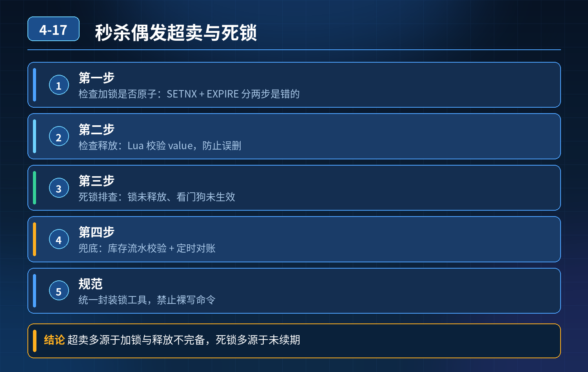

    电商秒杀，Redis 分布式锁防超卖，压测偶发超卖+高并发偶发死锁，如何定位、排查、根治

## 第 04-17 题　电商秒杀，Redis 分布式锁防超卖，压测偶发超卖+高并发偶发死锁，如何定位、排查、根治

**候选人浅层回答：** 背诵表面结论，没有深入到原理和线上场景。

## 核心拆解一句话结论

本题考察对底层原理和线上实战能力的综合理解，不能只停留在背结论。

## 一、先分两类故障：【偶发超卖】、【偶发死锁】，分开定位

核心前置认知：Redis 分布式锁只能做前置互斥削峰，本身不能杜绝超卖；主从异步复制天生存在锁丢失的理论窗口。死锁一般来自非原子操作、释放逻辑异常、锁竞争嵌套、网络异常。

## （一）排查思路：偶发超卖

按优先级排查：

1. 第一步：检查加锁是否原子 错误写法：SETNX + EXPIRE 两条命令分开执行。

加锁成功后还没设置过期，进程宕机 → 锁永久存在；同时并发下会出现加锁

- 逻辑错乱。

正确：SET lockKey uuid NX EX ttl 单条原子命令，或者 Redisson 封装。

2\. 第二步：检查释放锁逻辑，是否直接 DEL 直接 DEL，不校验持有者：线程 A锁超时释放，线程 B 拿到锁；A 执行完删锁，删掉 B 的锁，后续线程抢锁，

- 并发进入扣减逻辑，超卖。

必须Lua 脚本：先比对 value 等于当前持有者标识，匹配才删除。

3\. 第三步：排查业务耗时 \> TTL，锁提前过期 秒杀链路下游 DB 慢、网络抖动、GC 长停顿，锁到期自动释放，第一个请求还在扣库存，第二个请求拿到锁，

- 并发扣减。

长任务使用Redisson 看门狗自动续期；秒杀尽量精简链路，缩短持锁时间。

4\. 第四步：重点高频根因：Redis 主从异步复制丢锁（这是偶发超卖最常见原因） 时序：请求在 master 加锁成功 → 数据还没异步同步给 slave → master 宕机，哨兵把 slave 提拔为新 master → 新 master 没有这条锁记录 → 下一个请求成功加锁，两个请求同时扣库存，超卖。

注意：这个故障是概率性的，所以只有压测才偶尔复现，和题目现象完全吻合。 方案选择：

1\. 方案 A（主流落地）：不改锁，数据库乐观锁作为最终兜底

2\. sql

2\. update stock set count = count - 1 where sku_id = ? andcount \> 0;

3\. affected rows=1 才代表扣减成功。哪怕 Redis 锁全部失效，数据库这行 SQL拦住超卖。Redis 锁的定位只是减少 DB 压力，不是正确性保障。

4\. 方案 B：Redlock 红锁，多台独立 Redis 节点，过半节点加锁成功才算持有锁； 缺点：性能差、强依赖服务器时钟漂移、运维复杂，秒杀场景极少落地，不推荐优先使用。

6\. 第五步：锁粒度问题 如果所有商品共用一把全局锁，竞争巨大，锁超时、网络异常概率放大；按 skuId 作为 lockKey，拆分锁粒度。

## （二）排查思路：高并发下偶发死锁

死锁：锁被永久持有，后续请求永远抢不到锁。常见原因：

1. 加锁是非原子的：SETNX 成功，EXPIRE 之前宕机，key 永久存在，死锁；
2. 业务抛出异常，没有走到释放锁代码（try-finally 没写好）；
3. 可重入锁释放次数不对：Redisson hash 计数，加锁 2 次只释放 1 次，计数不为 0，key 不会删除；
4. 跨资源循环等待：线程 1 拿 skuA 锁等 skuB 锁，线程 2 拿 skuB 锁等 skuA锁，经典循环死锁；
5. 网络分区：客户端拿到锁之后，和 Redis 断开连接，客户端认为自己持有锁，Redis 端 TTL 到期释放；客户端继续执行业务，后续释放锁失败，逻辑错乱。

- 死锁解决手段：

6\. 统一原子加锁命令，杜绝 SETNX+EXPIRE 分开写；

7\. 释放锁逻辑放在try-finally；

8\. 使用 Redisson 可重入锁，框架自动维护重入计数，避免手动释放次数错误；

9\. 禁止循环获取多把资源锁；如果必须多锁，固定加锁顺序（永远先小 id、后大id），破坏循环等待条件；

10\. TTL 兜底，哪怕业务异常、网络断连，锁到时间一定会释放，不会永久卡死。

## 二、秒杀场景整套生产级三层方案（面试标准答案）

第一层：锁层（Redisson）

- 锁 key：lock:stock:{skuId}，按 sku 拆分粒度；
- 原子加锁，Lua 脚本释放、持有者校验；
- 持锁时间尽量短：拿到锁后快速扣库存，不要在锁内做复杂逻辑；
- 看门狗续期应对链路抖动、慢 SQL；
- 自旋加锁增加随机退避，减少 Redis QPS、减少 CPU 空转。

第二层：Redis 预扣库存（削峰，减少抢锁竞争）秒杀预热把库存加载到 Redis；请求先在 Redis 预扣，预扣成功才去抢分布式锁、操作 DB；Redis 预扣失败直接返回售罄，挡住绝大部分流量，大幅降低锁竞争概率。

预扣也要补偿机制：预扣成功但 DB 扣减失败，定时任务回补Redis 库存。

第三层：数据库乐观锁兜底（防超卖底线，必不可少）无论上层 Redis 锁、预扣怎么做，数据库条件更新count\>0 兜底，这是杜绝超卖的最后防线。

## 三、面试高分话术

我会分开排查两个现象：偶发超卖、偶发死锁。 先说偶发超卖，优先排查顺序： 第一，检查加锁是否原子，有没有分开 SETNX 和 EXPIRE；释放锁有没有直接 DEL、缺少 Lua 持有者校验，防止误删锁。 第二，看持锁业务耗时，是否超过锁 TTL，锁提前释放，并发进入；长链路用 Redisson 看门狗续期，同时尽量缩短锁内业务逻辑。 第三，重点排查 Redis 主从异步复制丢锁，这是压测偶发超卖最典型的根因：master 加锁成功，还没同步到从就宕机，从晋升为主，锁丢失，新请求拿到锁，并发扣库存。

Redlock 可以缓解，但性能和运维成本高，一般不用；我们主流做法是 Redis 锁只用来削峰，数据库update ... where count\>0 乐观锁兜底，这是防超卖的底线。 第四，检查锁粒度，不能所有 sku 共用一把锁，按 skuId 隔离，降低竞争。

然后是偶发死锁： 死锁常见原因：非原子加锁宕机、异常分支没有释放锁、可重入锁释放次数不对、多资源锁循环等待。 解决：使用原子 SET 命令，释放锁放在 try-finally；使用 Redisson 自带可重入锁；多资源加锁强制固定顺序，破坏循环等待；TTL 兜底，保证锁最终一定释放，不会永久卡死。

整套秒杀方案分三层：第一层 Redisson 分布式锁，按 sku 粒度加锁，Lua 释放 + 看门狗；第二层 Redis 预扣库存，提前挡住大部分无效流量，减少锁竞争；第三层数据库乐观锁兜底。Redis 锁只是优化手段，不能单独保证不超卖。

## 连环追问要点整理

1. 底层核心原理是什么？为什么这么设计？
2. 线上出现相关故障如何快速止损、定位根因？
3. 高并发场景下有哪些坑点，性能、一致性、可用性如何权衡？

## 面试回答完整话术

  - **一句话结论**：本题考察对底层原理和线上实战能力的综合理解，不能只停留在背结论。
  - **一、先分两类故障：【偶发超卖】、【偶发死锁】，分开定位**：核心前置认知：Redis 分布式锁只能做前置互斥削峰，本身不能杜绝超卖；主从异步复制天生存在锁丢失的理论窗口。死锁一般来自非原子操作、释放逻辑异常、锁竞争嵌套、网络异常。
  - **（一）排查思路：偶发超卖**：第一步：检查加锁是否原子 错误写法：SETNX + EXPIRE 两条命令分开执行。
  - **（二）排查思路：高并发下偶发死锁**：死锁：锁被永久持有，后续请求永远抢不到锁。常见原因：
  - **二、秒杀场景整套生产级三层方案（面试标准答案）**：锁 key：lock:stock:{skuId}，按 sku 拆分粒度；
  - **三、面试高分话术**：我会分开排查两个现象：偶发超卖、偶发死锁。 先说偶发超卖，优先排查顺序： 第一，检查加锁是否原子，有没有分开 SETNX 和 EXPIRE；释放锁有没有直接 DEL、缺少 Lua 持有者校验，防止误删
  - **收尾**：线上问题按「先止损保可用性 → 再定位根因 → 最后从架构规范层面根治」三段论闭环。

## 追问：本题考察核心是什么？

###  高级工程师要分清：

1. **不能只停留在背结论**：要能回答「为什么这样设计、不这样会怎样、线上踩坑怎么排查」；
2. **具备止损→定位→根治三段论**：先止血保业务，再定位根因，最后从架构与规范层面根治；
3. **给出工程取舍**：性能、一致性、可用性三者权衡，说清代价与适用场景。

  核心思想：这道题考察原理理解 + 线上实战 + 架构思维，真正的工程答案是「现象 → 根因 → 止损 → 定位 → 根治」五段式闭环。

