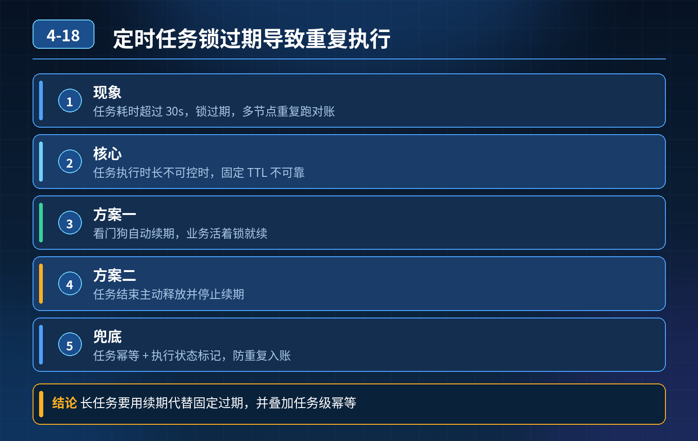

    定时任务（订单对账）Redis 锁，配置了 setnx、过期时间、释放校验，负载高任务超时、锁过期，任务重复执行导致对账错乱

## 第 04-18 题　定时任务（订单对账）Redis 锁，配置了 setnx、过期时间、释放校验，负载高任务超时、锁过期，任务重复执行导致对账错乱

**候选人浅层回答：** 背诵表面结论，没有深入到原理和线上场景。

## 核心拆解一句话结论

本题考察对底层原理和线上实战能力的综合理解，不能只停留在背结论。

## 一、事故根因

根本不是锁写错、释放没校验，而是固定 TTL 的设计假设就错了：预设了任务一定在 30s 内跑完。 负载冲高、慢 SQL、下游抖动、GC 停顿，任务耗时不可控；锁先到期释放，但是第一个节点的对账逻辑还在继续跑。于是两个节点并行跑同一批对账，产生重复数据。

这里有一个关键误区：很多人以为加长过期时间就能解决。加长TTL 只是降低概率，如果任务卡住几分钟，依然会复现；而且锁长时间卡死，节点宕机后要等很久才释放锁，任务阻塞。

## 二、三层防御方案（定时任务场景专属）

第一层：锁层 → 动态续期（看门狗），替代静态固定过期时间使用 Redisson 的可重入锁 + 看门狗：

- 拿到锁之后，后台线程每隔一段时间（默认 1/3 TTL）刷新锁过期时间；
- 只要任务线程还活着、业务在正常执行，锁就持续续期，不会因为任务耗时变长提前释放；
- 任务正常结束，主动释放锁，停止续期；
- 如果节点直接宕机，看门狗线程一起死掉，锁等待 TTL 后自动释放，避免死锁。
- 看门狗边界： 如果 JVM 长时间 STW、进程卡死、OOM，看门狗线程被冻结，续期失败，锁依旧会过期。看门狗是缓解，不是 100% 杜绝锁超时。

第二层：业务层 → 任务幂等 + 任务状态机（对账这类数据任务最重要）分布式锁只是 “抢执行权”，它有失效风险；对账、结算这类资金类任务，不能把正确性寄托在锁上面。

1. 每一次定时任务，生成唯一批次号（batchNo，例如日期 + 小时）；
2. 任务开始前先写任务执行表：batchNo, status(待执行/执行中/成功/失败), 节点ip, 开始时间；
3. 加唯一索引：batchNo 唯一；
4. 抢任务的逻辑：先尝试插入这条记录，插入成功才获得执行资格；插入失败代表已经有节点在跑 / 跑完了，直接放弃；
5. 任务执行中持续更新心跳时间；定时清理程序扫描长时间心跳不更新、状态卡在执行中的脏批次，标记失败，允许重试。

这一层的价值：就算锁失效，第二个节点尝试插入同一个 batch也会被唯一索引拦住，对账不会重复跑。 对账计算逻辑本身也要幂等：同一 batch 重复跑，不会累加金额，结果不变（先清空该批次临时数据再计算，或者使用 insert ignore）。

第三层：兜底监控 + 异常自愈

1. 锁监控：监控锁的持有时长、看门狗续期日志、同一任务锁被多次抢占告警；一旦发现同一个任务锁短时间多次被获取，立刻告警；
2. 对账结果对账校验：对账完成后做金额勾稽校验，发现总分不平、重复流水标记异常工单；
3. 重试策略：失败批次人工 / 半自动重试，重试依然基于 batchNo 幂等；
4. 备选高可靠锁选型：资金对账这种低并发、强防重复场景，可以换成 ZK 锁。

ZK 临时会话节点，会话存活锁就存在，会话消失自动释放，不需要看门狗；缺点是吞吐低，适合对账、结算，不适合秒杀。

## 三、回答面试官追问：只靠 setnx + 过期时间行不行？

不行。 setnx + 固定 TTL 适合执行时长稳定、允许极小概率重复的场景；对账、结算、资金类任务，任务耗时受外部依赖影响波动大，固定 TTL 是巨大隐患。 加长 TTL 是治标不治本：任务卡住会锁很久，故障扩散；缩短 TTL 又容易超时重复。 看门狗解决 “动态适配任务时长”；幂等 + 任务表唯一索引，是防止重复执行的最后一道防线。

补充：网上说的 Redis+ZK 双重锁一般不推荐生产落地，复杂度太高，收益很低；优先：看门狗锁 + 任务批次幂等表，性价比最高。

## 面试高分话术

这个事故的根源不是锁命令写错、释放没校验，而是采用固定过期时间，强假设任务一定会在 30 秒内完成。负载升高、慢 SQL、GC 停顿都会拉长任务耗时，锁先过期释放，业务还在跑，多个节点并行对账造成重复计算。单纯把过期时间改大，只是降低概率，不能根治，还引入锁长时间卡死的风险。

完整的保障是三层防御： 第一层，锁层面改用 Redisson 看门狗续期，锁的过期时间动态刷新，只要任务正常运行就不会提前释放；同时认识到看门狗也会受 JVM 长时间 GC、进程卡死影响，存在失效可能。 第二层，业务层是核心，对账任务引入批次号 batchNo，建立任务执行表并对 batchNo 加唯一索引。抢任务的时候先插入这条记录，插入成功才执行；就算锁失效，其他节点插入同一个批次会被唯一索引拦截。对账逻辑本身实现幂等，同一个批次多次执行不会重复累加金额。 第三层，监控兜底，监控锁抢占、对账金额勾稽校验，异常及时告警，脏批次走人工修复流程。

所以只靠 setnx + 过期时间远远不够。锁只用来减少抢任务冲突，真正保证不会重复执行的是业务幂等和状态表唯一约束。资金对账这种强一致性、并发不高的场景，也可以直接选用 ZK 分布式锁，依托会话机制天然续期。

## 连环追问要点整理

1. 底层核心原理是什么？为什么这么设计？
2. 线上出现相关故障如何快速止损、定位根因？
3. 高并发场景下有哪些坑点，性能、一致性、可用性如何权衡？

## 面试回答完整话术

  - **一句话结论**：本题考察对底层原理和线上实战能力的综合理解，不能只停留在背结论。
  - **一、事故根因**：根本不是锁写错、释放没校验，而是固定 TTL 的设计假设就错了：预设了任务一定在 30s 内跑完。 负载冲高、慢 SQL、下游抖动、GC 停顿，任务耗时不可控；锁先到期释放，但是第一个节点的对账逻辑还
  - **二、三层防御方案（定时任务场景专属）**：第一层：锁层 → 动态续期（看门狗），替代静态固定过期时间使用 Redisson 的可重入锁 + 看门狗：
  - **三、回答面试官追问：只靠 setnx + 过期时间行不行？**：不行。 setnx + 固定 TTL 适合执行时长稳定、允许极小概率重复的场景；对账、结算、资金类任务，任务耗时受外部依赖影响波动大，固定 TTL 是巨大隐患。 加长 TTL 是治标不治本：任务卡住会
  - **面试高分话术**：这个事故的根源不是锁命令写错、释放没校验，而是采用固定过期时间，强假设任务一定会在 30 秒内完成。负载升高、慢 SQL、GC 停顿都会拉长任务耗时，锁先过期释放，业务还在跑，多个节点并行对账造成重复
  - **收尾**：线上问题按「先止损保可用性 → 再定位根因 → 最后从架构规范层面根治」三段论闭环。

## 追问：本题考察核心是什么？

###  高级工程师要分清：

1. **不能只停留在背结论**：要能回答「为什么这样设计、不这样会怎样、线上踩坑怎么排查」；
2. **具备止损→定位→根治三段论**：先止血保业务，再定位根因，最后从架构与规范层面根治；
3. **给出工程取舍**：性能、一致性、可用性三者权衡，说清代价与适用场景。

  核心思想：这道题考察原理理解 + 线上实战 + 架构思维，真正的工程答案是「现象 → 根因 → 止损 → 定位 → 根治」五段式闭环。

