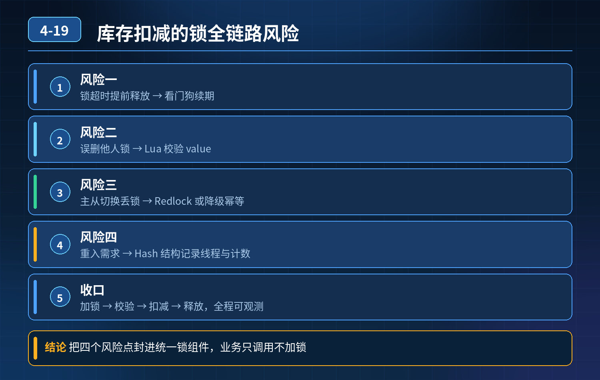

    库存扣减场景，Redis 分布式锁全链路风险点+生产级完整方案

## 第 04-19 题　库存扣减场景，Redis 分布式锁全链路风险点+生产级完整方案

**候选人浅层回答：** 背诵表面结论，没有深入到原理和线上场景。

## 核心拆解一句话结论

本题考察对底层原理和线上实战能力的综合理解，不能只停留在背结论。

## 一、逐个拆解所有风险点 + 对应解法

风险 1：业务耗时 \> 锁过期时间，锁提前释放，多线程同时进入原因：单纯设置固定 TTL，无法预判业务真实耗时；业务卡住、慢 SQL、下游

- 超时，时间到 Redis 自动释放锁。

解法：看门狗（续期机制，Redisson 自带） 拿到锁后启动后台定时线程，在锁到期前不断刷新过期时间；业务正常执行完毕，关闭续期。

注意：看门狗不是万能的，如果进程 OOM、JVM 长时间 STW 停顿，看门狗线程也会卡住，续期失败，锁依然会过期。

风险 2：锁超时释放后，旧线程执行完成，直接 del 删掉新线程的锁（锁误删）原因：直接 del lock_key，不校验持有者。时序：A 锁超时释放 → B 拿到锁

- → A 跑完业务执行 del，删掉 B 的锁。

解法：Lua 脚本原子释放锁 锁 value 存当前线程唯一标识（UUID + 线程 ID）；释放时 Lua 先判断 value 匹配，才删除，不匹配直接返回，禁止删别人的锁。

风险 3：主从异步复制、脑裂，锁丢失（高频难点）时序：A 在 master 加锁成功，锁还没异步同步到 slave；master 宕机，slave 被哨兵晋升为新 master；新 master 不存在这条锁；B 可以成功加锁。

- 解法分层：

1. 认知：普通 Redis 主从锁，本身不具备强一致性，只能做前置互斥，不能单独作为防超卖唯一保障；
2. 方案 A（主流）：Redis 锁只用来削峰限流，数据库条件更新兜底（updatestock set num=num-1 where id=? and num\>=1），就算锁失效，数据库拦住超卖；
3. 方案 B（强一致低并发）：改用 ZK 分布式锁；
4. 方案 C：Redlock，多独立节点过半加锁成功；缺点：依赖系统时钟、性能差、运维复杂，极少上生产；脑裂本质是 AP 集群的取舍，Redis 优先可用性，牺牲一致性。

风险 4：同一线程嵌套调用，重复加同一把锁（可重入问题）

- 原生 SETNX 不支持可重入，同一线程第二次加锁直接失败，业务卡死。

解法：Redisson 用 Hash 结构实现可重入锁

- key：锁名称
- field：线程唯一标识
- value：重入计数 加锁：计数 + 1；释放：计数 - 1；计数归零才删除 key。 不需要业务自己传递标记，框架内部封装。

风险 5：大量线程争抢同一把锁，自旋空转、CPU 飙升、锁饥饿自旋是不断循环尝试加锁，并发大的时候大量线程空跑；还有长时间拿不到锁

- 的饥饿线程。

优化手段：

5\. 不要死循环自旋：退避策略，重试之间增加随机休眠（指数退避），减少Redis 压力和 CPU 消耗；

6\. 公平锁：Redisson 公平锁，按照请求排队顺序分配锁，避免饥饿；性能比非公平锁略低；

7\. 锁粒度拆分：不要所有商品共用一把大锁，按 skuId 做锁 key，打散竞争；

8\. 前置限流：令牌桶、Redis 预扣库存，拦截大部分无效请求，减少抢锁线程数量；

9\. 排队模型：MQ 异步化，秒杀流量削峰，避免大量线程同时抢锁。

风险 6：JVM STW、GC 长时间停顿导致看门狗续期失败GC 停顿几十～几百 ms，看门狗线程被挂起，来不及续期，锁超时释放，并发

- 闯入。

解法：

- JVM 调优，降低长 STW 概率；
- 锁 TTL 预留足够缓冲；
- 底层依然依赖数据库兜底。

## 二、其他备选锁方案对比（数据库悲观锁 / ZK 锁）

1. Zookeeper 分布式锁（CP） 原理：临时有序节点，最小序号获得锁，监听前驱节点。 优点：

- 临时节点，会话断开自动删除，天然防死锁，不需要看门狗；
- ZK 过半写成功，主节点宕机不会丢锁，解决 Redis 脑裂丢锁痛点； 缺点：吞吐量低、重、运维复杂，网络抖动容易 session 失效释放锁； 适合：并发不高、一致性要求极高的流程（订单状态流转），不适合秒杀。

2\. 数据库悲观锁 select for update 优点：强一致，数据库原生； 缺点：行锁阻塞，并发能力差，容易长事务引发锁等待、死锁； 适合：低并发核心流程，不适合大促库存。

3\. 数据库乐观锁（version / 库存条件判断） 一般不作为分布式锁，是兜底防线，是库存防超卖的底线。

## 三、从基础 setnx → 生产级完整设计（三层核心）

1. 基础层：锁语法规范 原子加锁：SET lockKey ownerId NX EX ttl，禁止setnx+expire 分两次； Lua 脚本释放锁，校验持有者； 需要长任务自动续期 → Redisson 可重入锁、看门狗； 锁 key 按资源维度（skuId），锁粒度尽量小，减少竞争。
2. 并发优化层：控制争抢，避免自旋与饥饿 sku 维度分锁、限流、随机退避自旋、公平锁按需开启、大流量 MQ 异步。
3. 一致性兜底层（最重要） 承认 Redis 锁有极小概率失效；数据库条件更新兜底，防止超卖。 Redis 锁的定位：减轻数据库压力，不是强一致保障。

## 四、面试高分回答话术

这套 Redis 分布式锁链路，一共有多个典型失效场景，我逐个梳理： 第一，业务执行超过锁过期时间，锁提前释放。基础方案是设置 TTL，生产上用 Redisson 看门狗，在锁到期前持续续期；但看门狗也会受 JVM GC 停顿影响，不能完全依赖。 第二，锁超时之后旧线程误删别人的锁，解决方式是锁 value 存线程唯一标识，用 Lua 脚本原子判断匹配再删除，禁止直接 del。 第三，Redis 主从异步复制、脑裂问题，主节点加锁成功还没同步从节点就宕机，新主丢失锁。这个是 Redis AP 模型天生的短板，没有低成本的完美解法；我们的策略是 Redis 锁只做前置削峰，库存扣减用数据库num\>=1 条件更新兜底；强一致低并发场景换成 ZK 锁，Redlock 因为时钟依赖复杂，一般不上生产。 第四，可重入需求，原生 Redis 不支持，Redisson 用 hash 结构记录线程和重入次数，计数归零才释放锁，业务层不用自己传标记。 第五，大量线程抢同一锁，自旋空转、锁饥饿：拆分锁粒度，按 sku 隔离；自旋加随机退避；高并发用 MQ 异步削峰；需要顺序分配锁就开启公平锁。

备选方案：ZK 锁是 CP 模型，临时节点天然防死锁，不会脑裂丢锁，但是吞吐低、运维重；数据库悲观锁性能差，只适合低并发。

整体生产设计分为三层：第一层保证锁本身原子、可重入、自动续期、防误删；第二层做竞争优化，打散锁粒度、限流退避；第三层数据库兜底，接受 Redis 锁存在理论失效概率，用数据库拦住超卖。

## 连环追问要点整理

1. 底层核心原理是什么？为什么这么设计？
2. 线上出现相关故障如何快速止损、定位根因？
3. 高并发场景下有哪些坑点，性能、一致性、可用性如何权衡？

## 面试回答完整话术

  - **一句话结论**：本题考察对底层原理和线上实战能力的综合理解，不能只停留在背结论。
  - **一、逐个拆解所有风险点 + 对应解法**：风险 1：业务耗时 \> 锁过期时间，锁提前释放，多线程同时进入原因：单纯设置固定 TTL，无法预判业务真实耗时；业务卡住、慢 SQL、下游
  - **二、其他备选锁方案对比（数据库悲观锁 / ZK 锁）**：Zookeeper 分布式锁（CP） 原理：临时有序节点，最小序号获得锁，监听前驱节点。 优点：
  - **三、从基础 setnx → 生产级完整设计（三层核心）**：基础层：锁语法规范 原子加锁：SET lockKey ownerId NX EX ttl，禁止setnx+expire 分两次； Lua 脚本释放锁，校验持有者； 需要长任务自动续期 → Rediss
  - **四、面试高分回答话术**：这套 Redis 分布式锁链路，一共有多个典型失效场景，我逐个梳理： 第一，业务执行超过锁过期时间，锁提前释放。基础方案是设置 TTL，生产上用 Redisson 看门狗，在锁到期前持续续期；但看门狗
  - **收尾**：线上问题按「先止损保可用性 → 再定位根因 → 最后从架构规范层面根治」三段论闭环。

## 追问：本题考察核心是什么？

###  高级工程师要分清：

1. **不能只停留在背结论**：要能回答「为什么这样设计、不这样会怎样、线上踩坑怎么排查」；
2. **具备止损→定位→根治三段论**：先止血保业务，再定位根因，最后从架构与规范层面根治；
3. **给出工程取舍**：性能、一致性、可用性三者权衡，说清代价与适用场景。

  核心思想：这道题考察原理理解 + 线上实战 + 架构思维，真正的工程答案是「现象 → 根因 → 止损 → 定位 → 根治」五段式闭环。

