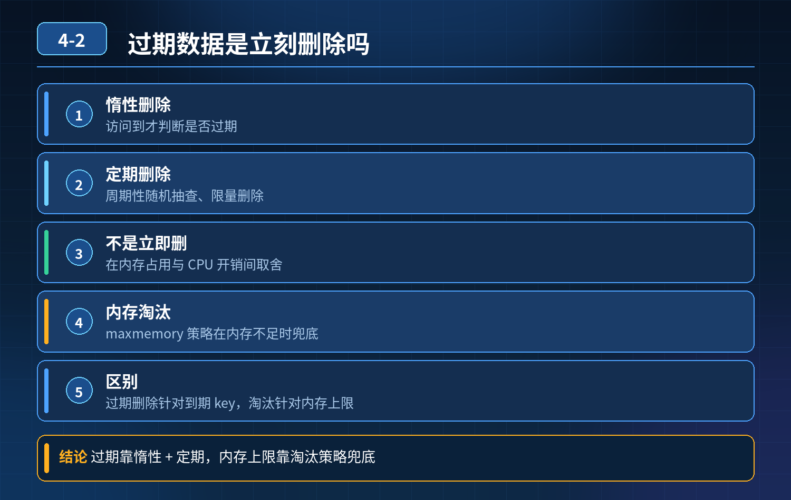

    Redis 过期的数据是立刻被删除的吗？

## 第 04-2 题　Redis 过期的数据是立刻被删除的吗？

**候选人浅层回答：** 到了过期时间马上删掉。

## 核心拆解一句话结论

本题考察对底层原理和线上实战能力的综合理解，不能只停留在背结论。

## 连环追问

1. 既然不会立刻删除，那为什么业务访问时，过期 key 就像失效了一样读不到？
2. Redis 有哪三种过期删除策略，各自优缺点是什么？
3. 过期删除和内存淘汰（maxmemory）有什么区别？

## 一、核心结论

过期的 key 不会到点就立刻从内存删除。Redis 不会单独开一个线程，轮询检查所有 key，时间一到就清理。

过期只是给 key 打上过期时间标记；过期之后，key 还留在内存占用空间，直到触发删除策略。业务读取时会校验过期时间，过期直接返回空，看起来像是删掉了。

## 二、三种过期删除策略（Redis 组合使用）

1. 惰性删除（被动删除，主力） 只有当客户端访问这个 key 的时候，Redis 才检查它是否过期。如果已经过期，立刻删除，返回 nil。 优点：几乎不消耗 CPU； 缺点：如果 key 过期后再也没人访问，会一直占内存，形成内存泄漏。
2. 定期删除（主动抽样清理，兜底） Redis 主线程每隔一段时间（默认100ms），随机抽样一批带过期的 key，检查并删除已经过期的 key。 不是遍历全库！只是抽样。

- 如果抽样里面过期 key 多，就多删一会；过期少，快速结束，防止阻塞主线程。

缺点：抽样是随机的，有概率部分过期 key 一直没被抽到，继续留在内存。

Redis 实际是：惰性删除 + 定期抽样删除，两者配合。所以过期key 可能长时间残留在内存。

3\. 主动立即删除（Redis 并没有全局启用） 就是一到过期时间马上删，需要持续扫描所有 key。海量 key 场景下会严重阻塞 Redis 主线程，所以 Redis 不采用。

## 三、关键区分：过期删除 vs maxmemory 内存淘汰（非常容易混淆）

- 过期删除：针对设置了 TTL 的 key；到时间后清理过期 key，属于 TTL 过期逻辑。就算内存空闲，到期 key 也会被慢慢清理。
- 内存淘汰（maxmemory-policy）：Redis 内存达到 maxmemory 上限时，才触发。不管 key 有没有过期，按照配置策略（LRU/LFU 等）挑选 key 释放内存。

哪怕 key 还没过期，内存满了，也可能被内存淘汰删掉；反过来，key 过期了，但内存充足，也可以一直留在内存。

## 四、线上风险与运维注意点

1. 大量冷数据带 TTL，过期后无人访问，内存不会自动释放，内存居高不下；
2. 大 key 过期，刚好被访问触发惰性删除，瞬间释放大量内存，可能引发主从复制、碎片波动；
3. 定期删除只是抽样，不能指望它把所有过期 key 一次性清干净。

<strong>追问：</strong>本题考察核心是什么？

<strong>参考答案：</strong> 初级开发以为过期时间一到就删除。高级工程师需要分清：

1. Redis 不是定时全量扫描，是惰性删除为主，定期抽样为辅；
2. 理解 “逻辑过期” 和 “物理删除” 不是同一时刻；业务读不到是读取时做过期校验，不代表内存已经释放；
3. 区分两套独立机制：TTL 过期删除 和 maxmemory 内存淘汰，两个独立逻辑，很多人混淆；
4. 能预判线上问题：大量过期冷 key 堆积，造成内存占用居高不下。

<strong>核心思想：</strong>过期时间只是逻辑失效标记；物理删除是延迟、按需进行的，有性能取舍，不能做到实时全部清理。

## 连环追问要点整理

1. 底层核心原理是什么？为什么这么设计？
2. 线上出现相关故障如何快速止损、定位根因？
3. 高并发场景下有哪些坑点，性能、一致性、可用性如何权衡？

## 面试回答完整话术

  - **一句话结论**：本题考察对底层原理和线上实战能力的综合理解，不能只停留在背结论。
  - **连环追问**：既然不会立刻删除，那为什么业务访问时，过期 key 就像失效了一样读不到？
  - **一、核心结论**：过期的 key 不会到点就立刻从内存删除。Redis 不会单独开一个线程，轮询检查所有 key，时间一到就清理。
  - **二、三种过期删除策略（Redis 组合使用）**：惰性删除（被动删除，主力） 只有当客户端访问这个 key 的时候，Redis 才检查它是否过期。如果已经过期，立刻删除，返回 nil。 优点：几乎不消耗 CPU； 缺点：如果 key 过期后再也没人访
  - **三、关键区分：过期删除 vs maxmemory 内存淘汰（非常容易混淆）**：过期删除：针对设置了 TTL 的 key；到时间后清理过期 key，属于 TTL 过期逻辑。就算内存空闲，到期 key 也会被慢慢清理。
  - **四、线上风险与运维注意点**：大量冷数据带 TTL，过期后无人访问，内存不会自动释放，内存居高不下；
  - **收尾**：线上问题按「先止损保可用性 → 再定位根因 → 最后从架构规范层面根治」三段论闭环。

## 追问：本题考察核心是什么？

###  高级工程师要分清：

1. **不能只停留在背结论**：要能回答「为什么这样设计、不这样会怎样、线上踩坑怎么排查」；
2. **具备止损→定位→根治三段论**：先止血保业务，再定位根因，最后从架构与规范层面根治；
3. **给出工程取舍**：性能、一致性、可用性三者权衡，说清代价与适用场景。

  核心思想：这道题考察原理理解 + 线上实战 + 架构思维，真正的工程答案是「现象 → 根因 → 止损 → 定位 → 根治」五段式闭环。

