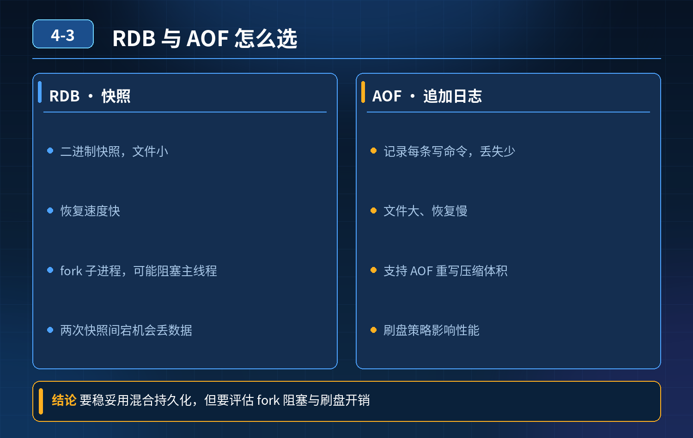

    Redis 持久化怎么选才稳妥？

## 第 04-3 题　Redis 持久化怎么选才稳妥？

**候选人浅层回答：** 直接开启 RDB+AOF 混合持久化，定时快照 + 增量日志，兼顾数据安全和性能。

## 核心拆解一句话结论

本题考察对底层原理和线上实战能力的综合理解，不能只停留在背结论。

## 连环追问

电商商品库存缓存开启混合持久化。大促整点，QPS、CPU 均未到上限，但每隔一段时间出现数百毫秒全局阻塞，所有请求集体卡顿，定位为 RDB 快照触发时 fork 子进程阻塞主线程。

1. 为什么 fork 会阻塞 Redis 主线程？
2. 如何在保障数据可靠性的前提下，规避持久化带来的性能卡顿？
3. 能不能直接关掉持久化，只依赖主从复制做备份？

## 一、根源：fork 阻塞原理

Redis 主线程调用fork()创建子进程用于 RDB 持久化。 fork 系统调用需要拷贝进程页表；Redis 内存越大，页表体量越大，fork 耗时越长。

Redis 是单线程模型，fork 操作是在主线程中执行，fork 期间主线程停止处理所有命令，产生全局停顿。子进程创建完成后，后续 RDB 文件写入使用写时复制 COW，不会阻塞主线程；阻塞点仅发生在 fork 瞬间。 大促流量高峰触发 RDB，业务请求大量堆积，就会出现周期性卡顿。 除了 RDB 的 fork，AOF 也有性能风险：

1. AOF 刷盘策略：always 每次写都 fsync，性能极差；everysec 每秒刷盘，若磁盘 IO 打满，依然会阻塞主线程；
2. AOF 重写 bgrewriteaof：同样会 fork 子进程，也存在 fork 阻塞风险；重写期间会产生大量磁盘 IO。 混合持久化（RDB+AOF）：加载时先加载 RDB 快照，再追加 AOF 增量日志，加速重启恢复；但并没有消除 fork 带来的停顿问题，这就是候选人认知的盲区。

## 二、优化方案：兼顾可靠性，规避卡顿

1. 控制 Redis 单实例内存大小 单实例内存不要过大，建议控制在 10~20GB 以内。

内存越小，页表越小，fork 耗时越短，全局停顿越轻微。超大内存场景做分片，拆分多个 Redis 实例。

2\. 调整 RDB 触发时机，避开业务高峰

- 不要依靠默认定时规则在流量峰值自动触发 RDB；
- RDB 快照改在业务低峰期（凌晨）手动 / 定时脚本触发；大促期间临时关闭自动 RDB。

3\. AOF 刷盘策略选型 线上生产一般用appendfsync everysec。 同时配置no-appendfsync-on-rewrite yes：AOF 重写时，暂停 fsync，避免磁盘 IO 叠加阻塞主线程。

4\. 利用主从架构，把持久化压力下放给从节点 主节点关闭 RDB，只开 AOFeverysec；从节点开启 RDB 做快照备份。 主节点不再执行 fork，消除主库 fork 停顿；从库负责落地快照用于故障恢复。主从复制同步数据，主库只承担业务读写。

5\. 合理配置 AOF 重写触发阈值 控制auto-aof-rewrite-percentage，避免大促期间触发 AOF 重写，重写也会 fork。

## 三、第三个问题：能不能直接关闭持久化，只靠主从？

6\. 分业务场景，不能一刀切

- 纯缓存场景（商品基础信息，允许宕机丢数据，可从
- DB 回刷重建）：可以关闭 RDB、AOF，仅依靠主从集群高可用；宕机后缓存全丢，业务从数据库重新加载。
- ❌
- 有状态、计数、库存、限流计数这类业务：不能完全关闭持久化。主从复制是异步的，如果主库宕机，还没同步到从库的数据会丢失；只靠主从无法保证宕机数据不丢。

这种场景推荐：主库开启 AOF，RDB 放到从库执行。

<strong>追问：</strong>本题考察核心是什么？

<strong>参考答案：</strong> 初级开发只记住一句话：生产环境开 RDB+AOF 混合持久化。 高级工程师需要理解：

1. 混合持久化只是加速重启加载，不能消除 fork 全局阻塞；阻塞根源是 fork 拷贝页表，不是 RDB 文件写入过程；
2. 区分 RDB、AOF 各自的性能开销点：fork 停顿、磁盘 fsync、AOF 重写；
3. 具备架构取舍：不是所有 Redis 都要全套持久化；缓存和有状态计数场景方案完全不同；
4. 学会把持久化任务卸载到从节点，保护主库线上读写，这是线上高并发 Redis的经典实践。

<strong>核心思想：</strong>持久化操作是带代价的，不是开启配置就万事大吉；高并发系统要将备份任务和线上读写流量隔离。

## 连环追问要点整理

1. 底层核心原理是什么？为什么这么设计？
2. 线上出现相关故障如何快速止损、定位根因？
3. 高并发场景下有哪些坑点，性能、一致性、可用性如何权衡？

## 面试回答完整话术

  - **一句话结论**：本题考察对底层原理和线上实战能力的综合理解，不能只停留在背结论。
  - **连环追问**：电商商品库存缓存开启混合持久化。大促整点，QPS、CPU 均未到上限，但每隔一段时间出现数百毫秒全局阻塞，所有请求集体卡顿，定位为 RDB 快照触发时 fork 子进程阻塞主线程。
  - **一、根源：fork 阻塞原理**：Redis 主线程调用fork()创建子进程用于 RDB 持久化。 fork 系统调用需要拷贝进程页表；Redis 内存越大，页表体量越大，fork 耗时越长。
  - **二、优化方案：兼顾可靠性，规避卡顿**：控制 Redis 单实例内存大小 单实例内存不要过大，建议控制在 10~20GB 以内。
  - **三、第三个问题：能不能直接关闭持久化，只靠主从？**：纯缓存场景（商品基础信息，允许宕机丢数据，可从
  - **收尾**：线上问题按「先止损保可用性 → 再定位根因 → 最后从架构规范层面根治」三段论闭环。

## 追问：本题考察核心是什么？

###  高级工程师要分清：

1. **不能只停留在背结论**：要能回答「为什么这样设计、不这样会怎样、线上踩坑怎么排查」；
2. **具备止损→定位→根治三段论**：先止血保业务，再定位根因，最后从架构与规范层面根治；
3. **给出工程取舍**：性能、一致性、可用性三者权衡，说清代价与适用场景。

  核心思想：这道题考察原理理解 + 线上实战 + 架构思维，真正的工程答案是「现象 → 根因 → 止损 → 定位 → 根治」五段式闭环。

