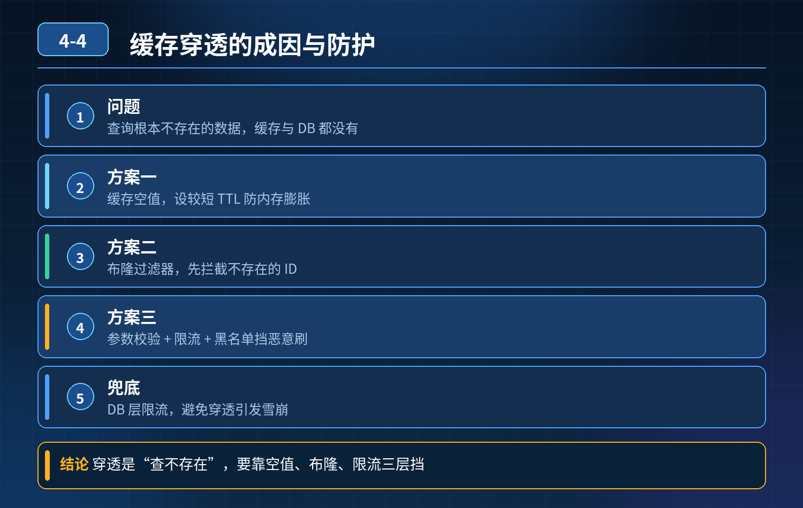

    Redis 缓存穿透

## 第 04-4 题　Redis 缓存穿透

**举例说明：**攻击者用随机负数 ID 对商品详情接口发起每秒 5 万次请求，缓存和数据库都没有这些数据，请求全部落到 DB，两分钟就把数据库 CPU 打到 100%。接入布隆过滤器后，这类请求在缓存层就被拦下。

**候选人浅层回答：** 缓存空值 + 布隆过滤器。

## 核心拆解一句话结论

本题考察对底层原理和线上实战能力的综合理解，不能只停留在背结论。

## 场景复盘

<strong>候选人回答：</strong>缓存空值 + 布隆过滤器。

## 面试官连环追问：

1. 攻击者大量随机不存在 ID 刷接口，空 key 疯狂写入 Redis，会不会把 Redis内存打满？
2. 布隆过滤器有误判、不能删除的短板，如果业务数据频繁增删，怎么处理？
3. 怎么避免穿透引发 DB 雪崩？

核心认知：空缓存、布隆只是基础手段，单独用都有明显缺陷；需要分层防御，同时解决攻击防住、Redis 不爆、数据动态变更、兜底护 DB 四个问题。

三层防护体系第一层：前置流量层（挡恶意请求，从源头减少无效查询）

1. 网关层限流、频率控制、验证码 / 风控 对接口做 IP / 用户维度的令牌桶限流；高频随机 ID 访问直接在网关拒绝，根本不进 Redis 和业务逻辑，这是对付恶意刷最划算的手段。
2. 参数合法性校验 ID 格式、取值范围、长度校验，非法格式直接拦截，比如订单 ID 是固定长度数字，带特殊字符直接丢弃。

优点：不消耗 Redis、DB 资源；专门对付攻击者批量造随机ID。

第二层：缓存与存在性判断层（两种方案按需组合，解决空 key 膨胀、布隆不能删的痛点）方案 A：缓存空值（适合少量不存在 key、低攻击场景）

- 空 key 必须设置很短的 TTL（几十秒），不能长期驻留；
- 不允许无限写入空 key；配合 Redis 内存淘汰策略；
- 缺点：遇到海量随机 ID 攻击，空 key 疯狂堆积，内存快速耗尽，不适合对抗恶意刷。

方案 B：布隆过滤器（适合海量主键集合），弥补它的短板

- 布隆：只存业务合法主键集合；请求先过布隆，布隆说不存在直接返回；
- 短板 1：不能删除 → 业务数据删除时，普通布隆没法清理；解决：改用计数布隆过滤器（Counting Bloom Filter），支持删除；或者定时全量重建布隆，Binlog 增量同步更新；
- 短板 2：存在误判（说存在实际不存在）→ 误判的请求才会走到缓存、DB，这部分流量是少量可控的；
- 注意：布隆只存有效 ID，攻击者随机 ID 绝大多数直接被拦下，不会产生大量空 key，解决空 key 膨胀问题。

选型区分： 正常业务少量 miss → 短 TTL 空缓存； 有被恶意刷风险、主键集合稳定 / 可同步 → 计数布隆优先。

第三层：数据库侧兜底防护（最后一道闸门，防止雪崩）哪怕前面两层失效，也要保护 DB：

3\. DB 查询加限流、熔断、超时；同一个接口打到 DB 的并发上限做控制；

4\. 禁止无限制穿透查询；数据库层面慢查询拦截；

5\. 监控告警：监控缓存 miss 率、DB 查询 QPS 突增，识别穿透攻击。

- 30

## 秒口述标准答案

单纯空缓存遇到海量随机攻击会堆积大量空 key 撑爆 Redis；普通布隆无法删除，数据频繁变更时容易失效。 完整方案分层：网关先做参数校验、IP 频率限流，拦截恶意流量；业务上优先用计数布隆过滤器存放合法主键，解决布隆删除问题，布隆判定不存在直接返回；少量误判的请求才走缓存，空缓存要设置极短 TTL 防止内存膨胀；最后数据库入口加限流熔断兜底，多层组合防护，避免穿透把数据库打崩。

## 高频追问

Q：计数布隆有什么代价？ A：每个位置多一个计数器，内存占用比普通布隆高几倍，适合主键总量可控的场景。 Q：为什么不直接全部用布隆，不用空缓存？

A：布隆有维护成本，数据频繁增删要同步；小流量、低攻击风险场景，短TTL 空缓存实现简单够用。 Q：布隆说不存在，就一定不存在吗？ A：是的；布隆的特性：说不存在，一定不存在；说存在，有可能误判。

## 连环追问要点整理

1. 底层核心原理是什么？为什么这么设计？
2. 线上出现相关故障如何快速止损、定位根因？
3. 高并发场景下有哪些坑点，性能、一致性、可用性如何权衡？

## 面试回答完整话术

  - **场景举例**：攻击者用随机负数 ID 对商品详情接口发起每秒 5 万次请求，缓存和数据库都没有这些数据，请求全部落到 DB，两分钟就把数据库 CPU 打到 100%。接入布隆过滤器后，这类请求在
  - **一句话结论**：本题考察对底层原理和线上实战能力的综合理解，不能只停留在背结论。
  - **面试官连环追问：**：攻击者大量随机不存在 ID 刷接口，空 key 疯狂写入 Redis，会不会把 Redis内存打满？
  - **秒口述标准答案**：单纯空缓存遇到海量随机攻击会堆积大量空 key 撑爆 Redis；普通布隆无法删除，数据频繁变更时容易失效。 完整方案分层：网关先做参数校验、IP 频率限流，拦截恶意流量；业务上优先用计数布隆过滤器存
  - **高频追问**：Q：计数布隆有什么代价？ A：每个位置多一个计数器，内存占用比普通布隆高几倍，适合主键总量可控的场景。 Q：为什么不直接全部用布隆，不用空缓存？
  - **收尾**：线上问题按「先止损保可用性 → 再定位根因 → 最后从架构规范层面根治」三段论闭环。

## 追问：本题考察核心是什么？

###  高级工程师要分清：

1. **不能只停留在背结论**：要能回答「为什么这样设计、不这样会怎样、线上踩坑怎么排查」；
2. **具备止损→定位→根治三段论**：先止血保业务，再定位根因，最后从架构与规范层面根治；
3. **给出工程取舍**：性能、一致性、可用性三者权衡，说清代价与适用场景。

  核心思想：这道题考察原理理解 + 线上实战 + 架构思维，真正的工程答案是「现象 → 根因 → 止损 → 定位 → 根治」五段式闭环。

