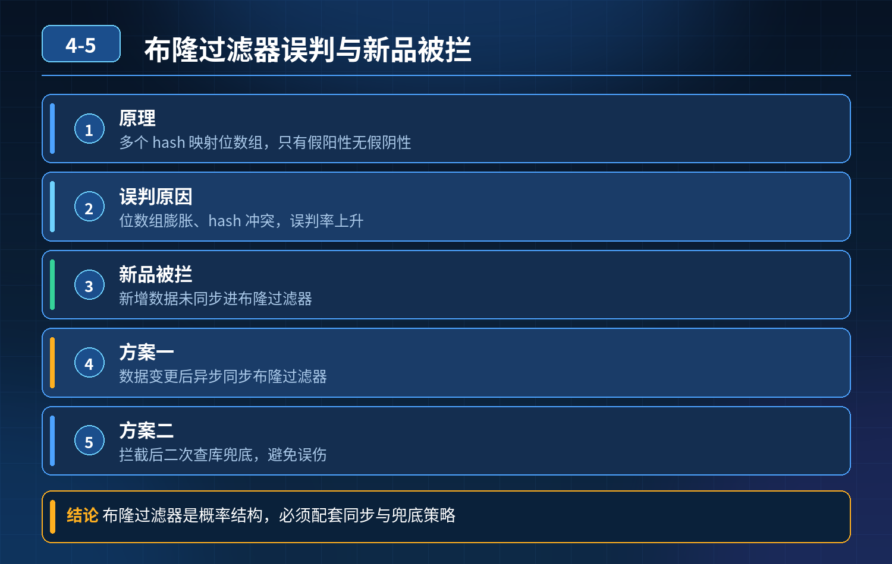

    布隆过滤器防缓存穿透，新品被误拦截、误判率持续上涨

## 第 04-5 题　布隆过滤器防缓存穿透，新品被误拦截、误判率持续上涨

**候选人浅层回答：** 背诵表面结论，没有深入到原理和线上场景。

## 核心拆解一句话结论

本题考察对底层原理和线上实战能力的综合理解，不能只停留在背结论。

## 场景复盘

商品详情页，使用布隆过滤器拦截不存在的商品 ID，防止穿透打库。 现象：新上架的商品数据库、Redis 缓存都存在，但是请求直接被布隆过滤器拦截，提示商品不存在；商品越多，误判率越来越高。

考点核心：布隆过滤器是概率型结构，只有误判（假阳性），没有漏判；不是配好就一劳永逸，考察取舍、同步策略、多层防护思维。

根源：为什么正常商品被拦住？

布隆过滤器特性：

1\. 不存在 → 一定返回不存在（无假阴性）

2\. 存在 → 有可能返回存在（假阳性，误判）事故的两个核心原因：

1\. 新增商品没有及时写入布隆过滤器 商品入库了，但布隆里没 add 这条商品id，查询时布隆判定不存在，直接拦截；这是最常见的上线事故。

2\. 预估容量不足，哈希函数配置不合理 初始化预估元素数量偏小，随着商品持续增加，填充率越来越高，哈希位大量重叠，假阳性概率持续上升。 不能无限放大容量：容量越大，内存占用越高；而且只是降低误判率，无法彻底消除误判。

面试官追问：难道把容量设无限大就可以？ 答案：不行。一是内存成本不可接受；二是布隆过滤器本身数学上就无法做到零误判。

三层防御体系（标准答案）第一层：同步管控层（事前，保证数据和布隆对齐）

1\. 商品写入和布隆写入保持原子配套 商品新增接口，入库成功之后，同步把商品ID 写入布隆过滤器； 更新、下架、删除要特殊处理：

1\. 普通布隆不支持删除！这是一大坑：如果商品下架删除，不能直接删元素，旧布隆不适合频繁删除场景。

2\. 方案：使用计数布隆过滤器（Counting Bloom Filter）支持删除；或者采用定时重建布隆的方案。

2\. 初始化时合理预估容量 + 预设可接受误判率 根据业务未来峰值商品量设置size，选择合适 hash 函数数量，控制填充率不要超过阈值（一般建议不超过 70%）。填充越满，误判爆炸。

3\. 预热机制：服务重启、过滤器重建时，先批量加载全量有效商品 ID，再对外提供流量，避免刚启动时大量正常 key 被拦截。

第二层：兜底容错层（事中，防止误杀正常流量）布隆只是前置防护，不能作为唯一拦截手段，不能直接返回不存在： 正确流程：

1. 请求进来，先过布隆过滤器；
2. 如果布隆判定不存在：不要直接拒绝，走降级兜底逻辑（短过期空值缓存方案）；
3. 去查 Redis 缓存；缓存命中，直接返回商品；
4. 缓存 miss 才查询数据库；数据库查到数据，回写 Redis，同时补写到布隆过滤器；
5. 数据库确实不存在，写入短 TTL 空缓存，挡住后续穿透。

重点：布隆是第一道筛选，不是最终裁决。初级写法直接 return不存在，就会发生题目里的误杀事故。

两种方案对比：

- 方案 A（错误）：布隆说不存在 → 直接返回无商品
- 方案 B（正确）：布隆说不存在 → 进入兜底缓存流程第三层：监控、重建、兜底补偿层（事后）

6\. 监控指标：监控布隆假阳性命中率、被过滤器拦截的请求中，实际数据库存在的比例；这个指标突增就是误判变高的信号；

7\. 定时重建机制： 当填充率、误判率超过阈值，后台低峰期异步重建一份全新布隆过滤器，双过滤器灰度切换，再废弃旧过滤器；规避持续膨胀；

8\. 兜底补偿： 被拦截但数据库真实存在的 key，自动异步回刷布隆，做自修复；

9\. 限流防护叠加：针对高频不存在 ID 限流，降低穿透攻击流量。

两种方案选型对比

1. 布隆过滤器方案：适合读远大于写、删除少的场景；优势：拦截效率极高；短板：不能删除、存在假阳性、需要同步。
2. 空值缓存方案：实现简单，无误判；缺点：如果恶意攻击者随机海量 id，会撑满 Redis 内存。 工程上一般是布隆 + 短 TTL 空缓存组合。

初级 vs 高级工程师区别初级：只知道布隆可以防穿透，逻辑写成 “布隆判定不存在直接返回”，忽略假阳性、同步问题，把布隆当成绝对正确的判断器。 高级工程师：

1. 吃透布隆概率特性：只有假阳性，没有假阴性，明白它只能做前置过滤，不能直接裁断；
2. 关注数据同步、新增、删除场景下的坑，知道普通布隆不支持删除；
3. 不会单一依赖布隆，组合空缓存形成多层防护；
4. 懂得权衡：容量、内存、误判率之间取舍，知道靠重建、灰度切换来控制误判率，而不是幻想无限扩容。

## 连环追问要点整理

1. 底层核心原理是什么？为什么这么设计？
2. 线上出现相关故障如何快速止损、定位根因？
3. 高并发场景下有哪些坑点，性能、一致性、可用性如何权衡？

## 面试回答完整话术

  - **一句话结论**：本题考察对底层原理和线上实战能力的综合理解，不能只停留在背结论。
  - **场景复盘**：商品详情页，使用布隆过滤器拦截不存在的商品 ID，防止穿透打库。 现象：新上架的商品数据库、Redis 缓存都存在，但是请求直接被布隆过滤器拦截，提示商品不存在；商品越多，误判率越来越高。
  - **收尾**：线上问题按「先止损保可用性 → 再定位根因 → 最后从架构规范层面根治」三段论闭环。

## 追问：本题考察核心是什么？

###  高级工程师要分清：

1. **不能只停留在背结论**：要能回答「为什么这样设计、不这样会怎样、线上踩坑怎么排查」；
2. **具备止损→定位→根治三段论**：先止血保业务，再定位根因，最后从架构与规范层面根治；
3. **给出工程取舍**：性能、一致性、可用性三者权衡，说清代价与适用场景。

  核心思想：这道题考察原理理解 + 线上实战 + 架构思维，真正的工程答案是「现象 → 根因 → 止损 → 定位 → 根治」五段式闭环。

