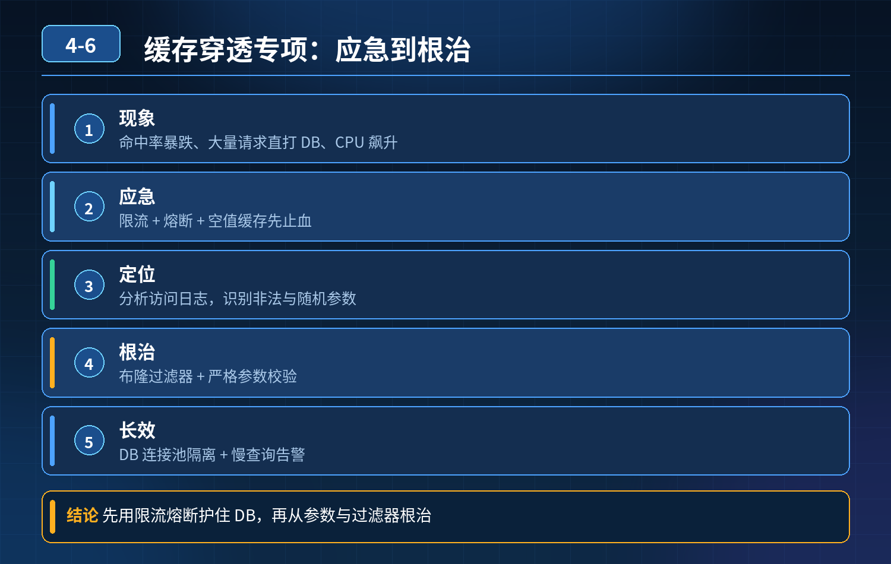

    缓存穿透专项（应急+定位+根治）

## 第 04-6 题　缓存穿透专项（应急+定位+根治）

**候选人浅层回答：** 背诵表面结论，没有深入到原理和线上场景。

## 核心拆解一句话结论

本题考察对底层原理和线上实战能力的综合理解，不能只停留在背结论。

## 场景痛点

<strong>现象：</strong>Redis 命中率暴跌、大量请求直打 DB，数据库 CPU 飙升、接口超时。

候选人只说缓存空值，但是忽略两个致命问题：

1. 海量恶意随机参数，每一个不存在的 key 都写入空缓存，大量空 key 撑爆Redis 内存；
2. 布隆过滤器有固有缺陷：存在误判、新增 / 删除商品时同步麻烦。

核心：空缓存、布隆过滤器都只是手段，要分「应急止血 → 定位根因 → 架构长效防护」整套链路，并且理解两种方案的取舍、组合。

## 三层高分逻辑

第一层：线上应急止损（故障来了优先做，先降 DB 压力）

1. 网关层紧急限流 + 拉黑恶意 IP，拦截批量随机非法参数；
2. DB 侧开启熔断，Sentinel 拦截大量穿透过来的请求，快速返回兜底，保护数据库；
3. 临时缩短空缓存 TTL，避免空 key 持续占内存；或者临时关闭空缓存，切换布隆过滤器优先拦截；
4. 扩容 Redis，调高淘汰策略（volatile-lru），防止内存打满阻塞 Redis。

第二层：快速定位根因先区分穿透来源：

- 恶意爬虫：大量随机 ID、随机参数；
- 业务 bug：前端传错参数、分页越界、删除后没清理缓存；
- 布隆过滤器不同步：新增商品还没刷进过滤器，导致误穿透；
- 缓存和 DB 不一致：DB 有数据，但是缓存被误删，看起来像穿透。 看指标：缓存命中率、Redis key 数量增长曲线、访问日志的参数分布。

第三层：架构长效防护（组合方案，而不是单一方案）组合思路：网关限流 + 布隆过滤器为主 + 短 TTL 空缓存为辅，分层搭配

5\. 网关前置：参数合法性校验、黑名单、限流，第一道拦截恶意流量；

6\. 布隆过滤器：存放全部合法业务 ID（商品 ID 等）；请求先过过滤器，直接拦截不存在 ID；

- 缺点：有极小误判率，不适合频繁删除数据场景；新增数据要异步同步到过滤器；

7\. 空缓存作为兜底补充：过滤器放行后，DB 查询为空，写入极短 TTL（几十秒）空标记；

- 重点：TTL 一定要很短，防止海量空 key 堆积占用 Redis 内存；不能单独拿空缓存扛恶意刷量；

8\. 配套监控：监控缓存命中率、空 key 数量、布隆过滤器命中情况、DB 异常QPS，低于阈值告警。

取舍一句话：恶意随机海量请求优先布隆过滤器；少量零散不存在 key，用短 TTL 空缓存兜底，二者互补，不要单独依赖其中一种。

- 30

## 秒口述标准答案

遇到缓存穿透、命中率下跌、数据库 CPU 飙升，先做应急止血：网关拉黑恶意流量、开启服务熔断保护数据库，防止故障扩大；然后看访问日志区分是恶意刷量还是业务参数 bug。长效架构上分层防护：网关做参数校验和限流，主拦截方案用布隆过滤器过滤非法 ID，再搭配超短 TTL 的空缓存做兜底；空缓存 TTL 设置很小，避免恶意请求产生大量空 key 耗尽 Redis 内存；同时监控缓存命中率及时告警，还要处理布隆过滤器和数据源同步、误判的问题。

## 高频延伸追问

Q：布隆过滤器怎么解决数据新增、删除不同步？ A：新增商品异步同步到布隆；删除场景布隆不好处理，改用 Cuckoo 过滤器（支持删除），或者业务上做逻辑删除，不物理删 ID。

Q：空缓存设置多久合适？ A：尽量短，一般 30s~2min；目的只是挡住短时间内重复穿透同一个不存在 key，而不是长期占位。

Q：布隆过滤器误判怎么办？ A：误判就是不存在的数据被当成存在，请求放行到 DB；这时候靠空缓存兜底，查到为空写入短 TTL 标记，避免持续穿透。

## 连环追问要点整理

1. 底层核心原理是什么？为什么这么设计？
2. 线上出现相关故障如何快速止损、定位根因？
3. 高并发场景下有哪些坑点，性能、一致性、可用性如何权衡？

## 面试回答完整话术

  - **一句话结论**：本题考察对底层原理和线上实战能力的综合理解，不能只停留在背结论。
  - **场景痛点**：海量恶意随机参数，每一个不存在的 key 都写入空缓存，大量空 key 撑爆Redis 内存；
  - **三层高分逻辑**：第一层：线上应急止损（故障来了优先做，先降 DB 压力）
  - **秒口述标准答案**：遇到缓存穿透、命中率下跌、数据库 CPU 飙升，先做应急止血：网关拉黑恶意流量、开启服务熔断保护数据库，防止故障扩大；然后看访问日志区分是恶意刷量还是业务参数 bug。长效架构上分层防护：网关做参数校
  - **高频延伸追问**：Q：布隆过滤器怎么解决数据新增、删除不同步？ A：新增商品异步同步到布隆；删除场景布隆不好处理，改用 Cuckoo 过滤器（支持删除），或者业务上做逻辑删除，不物理删 ID。
  - **收尾**：线上问题按「先止损保可用性 → 再定位根因 → 最后从架构规范层面根治」三段论闭环。

## 追问：本题考察核心是什么？

###  高级工程师要分清：

1. **不能只停留在背结论**：要能回答「为什么这样设计、不这样会怎样、线上踩坑怎么排查」；
2. **具备止损→定位→根治三段论**：先止血保业务，再定位根因，最后从架构与规范层面根治；
3. **给出工程取舍**：性能、一致性、可用性三者权衡，说清代价与适用场景。

  核心思想：这道题考察原理理解 + 线上实战 + 架构思维，真正的工程答案是「现象 → 根因 → 止损 → 定位 → 根治」五段式闭环。

