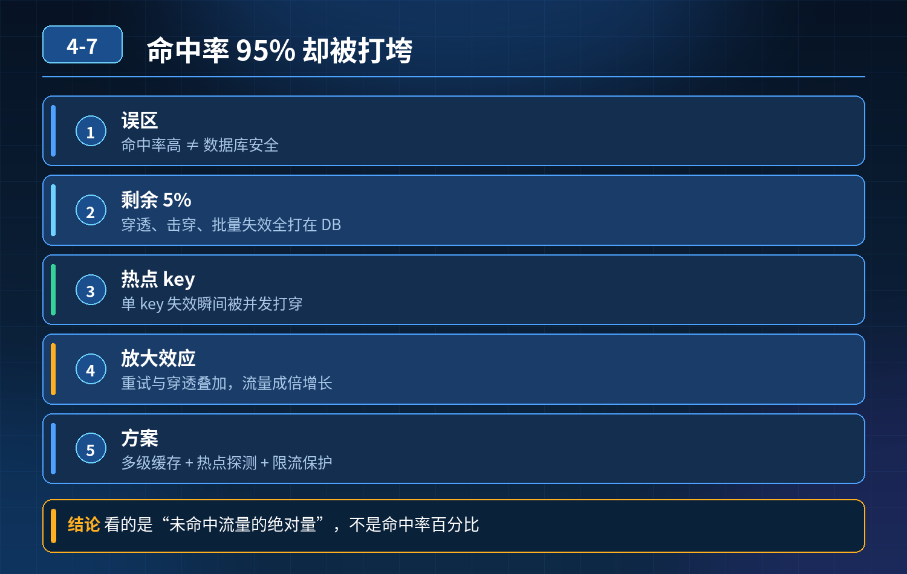

    项目加 Redis 缓存减轻 DB 压力，Redis 高可用正常、缓存命中率95% 以上、热点数据预热完成，为什么数据库还是被大量请求打垮？

## 第 04-7 题　项目加 Redis 缓存减轻 DB 压力，Redis 高可用正常、缓存命中率95% 以上、热点数据预热完成，为什么数据库还是被大量请求打垮？

**举例说明：**商品详情接口 QPS 20 万、命中率 95%，意味着仍有 1 万 QPS 会落到数据库。如果这一万请求刚好集中在热门 key 失效的瞬间，且没有排队与兜底，数据库照样被打穿。

**候选人浅层回答：** Redis 宕机，请求全部穿透到 DB；或者过期时间太短，频繁失效访问 DB。

## 核心拆解一句话结论

本题考察对底层原理和线上实战能力的综合理解，不能只停留在背结论。

## 连环追问

Redis 集群稳定、没宕机，过期时间设置很长，热点数据提前预热，命中率95%+，DB 还是被打垮。请分析原因并给出解决方案。

## 一、三个核心场景（缓存穿透、缓存击穿，还有容易忽略的业务流量结构问

题）

1. 缓存穿透：查询不存在的数据大量请求查询数据库里根本不存在的 key（比如非法 ID、爬虫恶意参数）。

缓存查不到，直接穿透到数据库查询；数据库返回空，空结果没有写入缓存。

哪怕 95% 正常热点数据命中缓存，剩下 5% 全是这类不存在 key 的高并发请求，全部打到 DB，直接耗尽数据库连接。

典型场景：爬虫、恶意攻击传入随机不存在商品 ID。

解决方案

- 空值缓存：DB 查询为空，在 Redis 缓存空值，设置较短过期时间；
- 布隆过滤器：把所有有效业务主键提前放入布隆过滤器，请求先过布隆，不存在直接拦截，不去查 Redis 和 DB。

2\. 缓存击穿：热点 key 失效，瞬间大量并发打到 DB某个超级热点 key（爆款商品）过期一瞬间，海量并发请求同时缓存 miss，同时请求数据库。

虽然整体命中率 95%，但单点热点 key 过期瞬间，一瞬间并发全部击穿，短时间打爆 DB，和全局命中率不冲突。 即使调长过期时间，依然有风险：比如主动删除缓存、缓存被 LRU 淘汰。

解决方案

- 热点 key 永不过期，后台异步主动更新缓存，不依赖 TTL 过期；
- 互斥锁（Redisson 分布式锁）：缓存 miss 时，只放行一个线程去 DB 加载数据，其余线程等待重试；
- 逻辑过期方案：缓存一直保留，后台线程异步刷新数据，不会出现缓存清空瞬间大量穿透。

3\. 容易漏掉的：流量结构问题，5% 的请求是超高并发全局命中率 95%，代表 100 次请求里 95 次命中。但如果请求分布极度不均匀： 95 次命中是低 QPS 的普通商品；剩下 5% 是爆款，这 5% 的请求占总 QPS 的 80%。 一旦这部分热点发生击穿 / 穿透，数据库瞬间压力拉满。

命中率是比例，不是流量权重，这是很多人理解的误区。

额外补充其他可能性：

- 接口没有限流：大量请求同时进来，即使少量穿透请求，并发量巨大，耗尽数据库连接池；
- 慢查询：打到 DB 的请求是慢 SQL，连接长时间不释放，连接池耗尽；
- 批量查询场景：单次接口循环大量查 DB，缓存只缓存单条，批量场景没有做优化。

## 二、三者简单区分

- 穿透：查不存在的数据，Redis、DB 都没有；
- 击穿：热点 key 存在，但缓存失效，大量并发同时打到 DB；
- 雪崩：大量 key 同时过期，大面积同时穿透（本题场景不是雪崩）。

<strong>追问：</strong>本题考察核心是什么？

<strong>参考答案：</strong> 初级开发只会想到 Redis 宕机、过期时间，只会看全局命中率这个表面指标。高级工程师要明白：

1. 全局缓存命中率是一个加权指标，不能代表热点单点的情况，少量比例的请求，可能承载绝大多数流量；
2. 分清穿透、击穿的底层差异，知道两种场景是独立风险，就算 Redis 正常、命中率很高依然会发生；
3. 防御思路分层：前置拦截（布隆）、热点保护、空值缓存、接口限流、连接池保护，不是只靠调大过期时间；
4. 不能只盯着缓存本身，数据库连接池、SQL 性能、流量限流同样是保护数据库的防线。

<strong>核心思想：</strong>缓存架构防护，不能只盯着正常命中场景，重点防御高并发下少数异常 miss 请求，这才是压垮数据库的元凶。

## 连环追问要点整理

1. 底层核心原理是什么？为什么这么设计？
2. 线上出现相关故障如何快速止损、定位根因？
3. 高并发场景下有哪些坑点，性能、一致性、可用性如何权衡？

## 面试回答完整话术

  - **场景举例**：商品详情接口 QPS 20 万、命中率 95%，意味着仍有 1 万 QPS 会落到数据库。如果这一万请求刚好集中在热门 key 失效的瞬间，且没有排队与兜底，数据库照样被打穿。
  - **一句话结论**：本题考察对底层原理和线上实战能力的综合理解，不能只停留在背结论。
  - **连环追问**：Redis 集群稳定、没宕机，过期时间设置很长，热点数据提前预热，命中率95%+，DB 还是被打垮。请分析原因并给出解决方案。
  - **一、三个核心场景（缓存穿透、缓存击穿，还有容易忽略的业务流量结构问**：缓存穿透：查询不存在的数据大量请求查询数据库里根本不存在的 key（比如非法 ID、爬虫恶意参数）。
  - **二、三者简单区分**：穿透：查不存在的数据，Redis、DB 都没有；
  - **收尾**：线上问题按「先止损保可用性 → 再定位根因 → 最后从架构规范层面根治」三段论闭环。

## 追问：本题考察核心是什么？

###  高级工程师要分清：

1. **不能只停留在背结论**：要能回答「为什么这样设计、不这样会怎样、线上踩坑怎么排查」；
2. **具备止损→定位→根治三段论**：先止血保业务，再定位根因，最后从架构与规范层面根治；
3. **给出工程取舍**：性能、一致性、可用性三者权衡，说清代价与适用场景。

  核心思想：这道题考察原理理解 + 线上实战 + 架构思维，真正的工程答案是「现象 → 根因 → 止损 → 定位 → 根治」五段式闭环。

