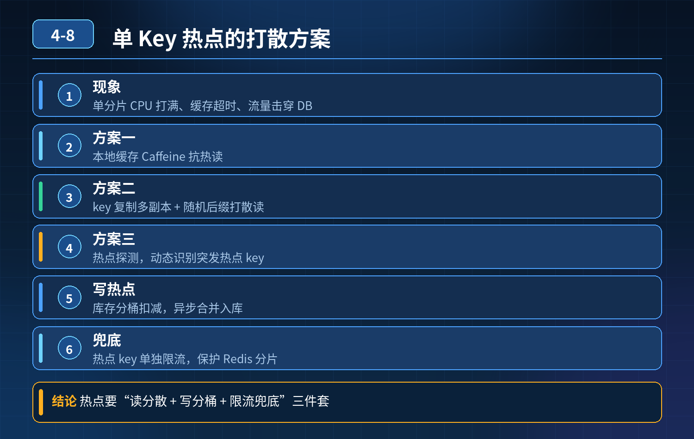

    秒杀爆款商品，单 Key 每秒十几万请求集中打在同一个 Redis 分片，节点 CPU 打满，缓存超时，流量击穿数据库

## 第 04-8 题　秒杀爆款商品，单 Key 每秒十几万请求集中打在同一个 Redis 分片，节点 CPU 打满，缓存超时，流量击穿数据库

**候选人浅层回答：** 本地 Caffeine 缓存、分布式锁防击穿、扩容 Redis 节点；多复制几份相同 key 分散流量 + 限流。

## 核心拆解一句话结论

本题考察对底层原理和线上实战能力的综合理解，不能只停留在背结论。

## 连环追问

1. 本地缓存和 Redis 存在数据不一致，更新时怎么处理？如何让所有应用实例本地缓存失效？
2. 热搜突发热点，没有提前报备，如何实时自动发现热点 key？
3. 即使加本地缓存，回源请求依然压垮单个 Redis 分片，怎么打散读流量？
4. 写热点场景：库存扣减，大量请求抢同一个 key 的分布式锁，锁冲突严重、吞吐低，如何优化？
5. value 过大，单次读取带宽与序列化开销高，不改动业务如何优化？
6. 老项目无法大规模改造架构，突发热点来袭，应急止血手段？

## 一、先区分两类热点：读热点（商品详情查询）、写热点（库存扣减），方案

完全不一样

1. 读热点治理（商品详情这类海量查询）方案① 本地 Caffeine 多级缓存（应用内存缓存）请求路径：本地缓存 → Redis → DB

- 本地缓存 TTL 短（比如几十秒），接受短暂不一致；
- 失效方案：发布更新时，广播失效消息（MQ/Redis PubSub），所有服务实例收到消息后，主动删除本地缓存，实现准实时失效；不需要等待本地 TTL 过期。

缺点：广播有延迟，适合允许短暂不一致场景；强敏感业务（价格）缩短 TTL，缩小不一致窗口。

方案② 热点 key 副本分片（key 复制打散流量）同一个商品，生成多个分片副本 key：goods:1001_0、goods:1001_1、goods:1001_2。客户端请求做随机路由，把流量分摊到多个 Redis 分片。

- 读请求随机选副本；更新时批量更新全部副本 key；
- 优点：天然把单分片压力拆分；适合大促提前预热的已知热点；
- 局限：更新成本变高，副本越多维护成本越高，突发热点自动生成副本比较复杂。

方案③ 代理层热点自动发现与缓存（大厂常用，不用改业务代码）在 Redis 前置代理层（如 Redis Cluster Proxy、自定义中间件）做热点探测：

- 实时统计 key 的 QPS，超过阈值自动判定为热点；
- 代理内部做本地缓存，热点请求直接在代理层返回，不再转发到后端 Redis 分
- 片； 优势：业务代码完全不用改动，自动识别突发、无报备的热搜热点，自动兜底，是老项目非常友好的方案。

大 Value 优化

- 压缩 value：序列化使用 Protobuf/FlatBuffer 替代 JSON，减少序列化 CPU + 带宽；
- 大对象拆字段：只返回前端需要字段，不返回完整大对象；
- 分片存储：大对象拆成多个小 key。

2\. 写热点（库存扣减，大量请求抢同一个 key，锁竞争严重）核心思路：库存分片（库存分桶） 把一个商品总库存拆成 N 个独立库存桶，例如总库存 1000 拆成 10 个桶，每桶 100：stock:1001_0 ~ stock:1001_9。

下单时随机挑选一个库存桶，扣减对应桶的库存，分布式锁只锁单个桶 key。

效果：原本所有请求争抢 1 个 key，现在并发分摊到多个 Rediskey，锁冲突大幅下降，吞吐量显著提升。

业务逻辑：下单随机选桶；扣减失败（桶无库存），换其他桶重试；最后数据库保存总库存，数据库作为最终一致性兜底，防止超卖。

## 二、热点自动探测（突发热点，没有提前报备）

监控维度：Redis Proxy / 客户端埋点，统计每个 key 的 QPS、耗时、访问次数。 触发阈值：单 key 短时间 QPS 超过阈值，标记为热点； 动作：自动在代理层缓存、自动生成副本分流、触发告警通知运维。 指标告警：分片 CPU、命令耗时、单 key 访问量。

## 三、应急止血方案（老项目，来不及改架构，突发热点瞬间来袭）

1. 接口限流：入口层对接口 QPS 做限流，削峰；
2. 熔断保护：Redis 响应超时比例达到阈值，直接返回降级缓存旧值，禁止继续回源；
3. 临时扩容 Redis 分片，手动复制热点 key 多副本；
4. 临时缩短回源并发，用信号量控制同一分片并发请求数，防止打爆 CPU；
5. 紧急关闭非核心接口，保护核心秒杀链路。

## 四、配套兜底

1. 预热：大促已知热点提前预热到本地缓存 + Redis，避免活动开始瞬间大量miss；
2. 监控大盘：热点 key 看板、分片 CPU、命中率、慢命令，提前预警；
3. 降级预案 + 故障演练：模拟突发热点压测，验证降级逻辑。

<strong>追问：</strong>本题考察核心是什么？

<strong>参考答案：</strong> 初级开发只会简单本地缓存、加锁、扩容，只解决表面，分不清读热点、写热点差异，对突发热点没有自动识别方案，库存写热点没有分桶思路，忽略本地缓存一致性问题。 高级工程师要掌握：

1. 读写热点分开治理：读热点核心是流量打散；写热点（库存）不能简单复制key，要用库存分桶降低锁竞争；
2. 两种热点分流思路：业务层多副本，或者代理层无感自动热点缓存（老项目首选，不用改业务）；
3. 多级缓存（应用本地缓存）要配套广播失效方案，解决多实例本地缓存一致性问题；
4. 完整闭环：事前预热、实时探测突发热点、大 value 优化、限流熔断应急止血，数据库兜底；
5. 选型权衡：已知热点用业务侧多副本；未知突发流量优先代理层无感热点缓存。

<strong>核心思想：</strong>热点 key 的本质是流量全部落在单一分片 / 单一锁资源上，治理的核心目标就是打散流量、拆分竞争资源；而不是单纯扩容 Redis 节点。

## 连环追问要点整理

1. 底层核心原理是什么？为什么这么设计？
2. 线上出现相关故障如何快速止损、定位根因？
3. 高并发场景下有哪些坑点，性能、一致性、可用性如何权衡？

## 面试回答完整话术

  - **一句话结论**：本题考察对底层原理和线上实战能力的综合理解，不能只停留在背结论。
  - **连环追问**：本地缓存和 Redis 存在数据不一致，更新时怎么处理？如何让所有应用实例本地缓存失效？
  - **一、先区分两类热点：读热点（商品详情查询）、写热点（库存扣减），方案**：读热点治理（商品详情这类海量查询）方案① 本地 Caffeine 多级缓存（应用内存缓存）请求路径：本地缓存 → Redis → DB
  - **二、热点自动探测（突发热点，没有提前报备）**：监控维度：Redis Proxy / 客户端埋点，统计每个 key 的 QPS、耗时、访问次数。 触发阈值：单 key 短时间 QPS 超过阈值，标记为热点； 动作：自动在代理层缓存、自动生成副本分流
  - **三、应急止血方案（老项目，来不及改架构，突发热点瞬间来袭）**：接口限流：入口层对接口 QPS 做限流，削峰；
  - **四、配套兜底**：预热：大促已知热点提前预热到本地缓存 + Redis，避免活动开始瞬间大量miss；
  - **收尾**：线上问题按「先止损保可用性 → 再定位根因 → 最后从架构规范层面根治」三段论闭环。

## 追问：本题考察核心是什么？

###  高级工程师要分清：

1. **不能只停留在背结论**：要能回答「为什么这样设计、不这样会怎样、线上踩坑怎么排查」；
2. **具备止损→定位→根治三段论**：先止血保业务，再定位根因，最后从架构与规范层面根治；
3. **给出工程取舍**：性能、一致性、可用性三者权衡，说清代价与适用场景。

  核心思想：这道题考察原理理解 + 线上实战 + 架构思维，真正的工程答案是「现象 → 根因 → 止损 → 定位 → 根治」五段式闭环。

