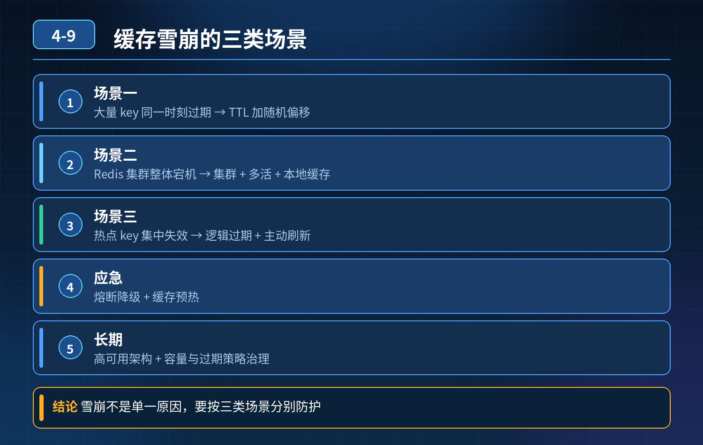

    缓存雪崩，需要考虑三类场景：大量 key 同时过期、Redis 集群整体宕机、热点 key 集中失效。从长期预防到线上应急

## 第 04-9 题　缓存雪崩，需要考虑三类场景：大量 key 同时过期、Redis 集群整体宕机、热点 key 集中失效。从长期预防到线上应急

**候选人浅层回答：** 给 key 增加随机过期时间，搭建 Redis 集群保证高可用；集群挂了就把过期时间拉长，再加熔断。

## 核心拆解一句话结论

本题考察对底层原理和线上实战能力的综合理解，不能只停留在背结论。

## 连环追问

1. 随机过期只能解决「批量 key 同一时刻过期」，如果 Redis 整个集群宕机，这套方案还能保护数据库吗？
2. 热点 key 集中失效和普通缓存雪崩有什么区别，单独怎么防护？
3. 雪崩发生时，应急止损和事后恢复怎么做？

## 一、先分清三类雪崩场景

1. 场景 1：大量 key 同时 TTL 过期 大量缓存 key 在同一时间失效，大量请求穿透打到数据库，连接池瞬间耗尽。

普通预防：过期时间增加随机偏移量（± 几分钟），打散过期时间；核心业务热点 key 不依赖 TTL 过期，采用逻辑过期，后台异步刷新，永不过期。

1. 场景 2：Redis 集群整体宕机（分片故障、主从切换失败、集群不可用）Redis 完全不可访问，所有请求全部穿透数据库，随机过期完全无效，这是更危险的雪崩。
2. 场景 3：超级热点 key 集中失效 少数几个超高流量热点 key 失效，瞬间海量并发压到 DB。这个很多人会和普通雪崩混淆，本质属于缓存击穿，但大量热点同时失效会演变成雪崩。

## 二、长期预防体系（事前）

4\. 打散过期 + 热点 key 逻辑过期 普通 key：基础过期时间叠加随机偏移，避免同一时刻集体过期； 爆款热点 key：物理 key 永不过期，使用逻辑过期，后台单独线程异步更新缓存；业务读取不删除 key，不存在过期瞬间击穿。

3\. 多级缓存兜底（应对 Redis 集群宕机） 本地Caffeine 缓存(应用内存) →Redis 集群 → MySQL 数据库 请求优先读本地缓存；Redis 挂掉时，本地缓存继续承载流量，大幅减少直达数据库请求。本地缓存设置短 TTL，数据弱一致，做降级兜底，不做强业务。

5\. 流量保护：限流 + 熔断 + 信号量控制

- 接口层限流：对核心接口做令牌桶限流，限制总 QPS；
- 数据库保护：使用信号量控制同时访问数据库的并发请求数量，防止数据库连接池被打爆；
- 熔断组件（Sentinel/Hystrix）：当 Redis 异常或者 DB 慢请求比例超过阈值，触发熔断，直接返回降级结果，拒绝继续访问 DB。

1. Redis 高可用架构：主从 + 哨兵模式适合中小规模单分片场景；生产大规模一般直接使用 Redis Cluster（自带分片、主从复制、Gossip 故障转移，不需要再叠哨兵）。分片隔离，一个分片（主+从）故障不影响其他分片；避免大 key，防止主从同步阻塞、内存溢出导致节点宕机。
2. 监控与预警 监控指标：Redis 内存、QPS、命中率、慢命令、集群节点状态、DB 连接数、慢查询； 热点 key 探测：实时识别超大流量 key，提前预警； 告警：命中异常、节点下线、命中率暴跌、数据库连接水位告警。 大促前做缓存预热，提前加载热点数据。

## 三、应急处置（雪崩发生时，核心是快速止损）

1\. 第一步快速降级：开启熔断，阻断大量请求继续访问数据库；优先返回降级数

2\. 据（缓存旧值 / 默认结果），保住数据库不宕机。

2\. 若只是批量过期：利用分布式锁，控制单条 key 只允许一个请求去数据库加载，其余请求等待，削峰。

3\. 若 Redis 集群宕机：依赖本地缓存承接流量；停止非核心业务，释放数据库连接，优先保障核心链路。

4\. 紧急限流：临时调低接口 QPS 上限，隔离非核心流量。

## 四、故障恢复（事后）

1. 修复 Redis 集群，节点恢复后，逐步恢复缓存预热，不要一次性全量回写，避免瞬间压力。
2. 逐步关闭熔断、恢复流量，灰度放量，观察数据库负载。
3. 事后复盘：定位根因，补充故障演练，完善监控阈值。

## 连环追问要点整理

1. 底层核心原理是什么？为什么这么设计？
2. 线上出现相关故障如何快速止损、定位根因？
3. 高并发场景下有哪些坑点，性能、一致性、可用性如何权衡？

## 面试回答完整话术

  - **一句话结论**：本题考察对底层原理和线上实战能力的综合理解，不能只停留在背结论。
  - **连环追问**：随机过期只能解决「批量 key 同一时刻过期」，如果 Redis 整个集群宕机，这套方案还能保护数据库吗？
  - **一、先分清三类雪崩场景**：场景 1：大量 key 同时 TTL 过期 大量缓存 key 在同一时间失效，大量请求穿透打到数据库，连接池瞬间耗尽。
  - **二、长期预防体系（事前）**：4\. 打散过期 + 热点 key 逻辑过期 普通 key：基础过期时间叠加随机偏移，避免同一时刻集体过期； 爆款热点 key：物理 key 永不过期，使用逻辑过期，后台单独线程异步更新缓存；业务读取
  - **三、应急处置（雪崩发生时，核心是快速止损）**：1\. 第一步快速降级：开启熔断，阻断大量请求继续访问数据库；优先返回降级数
  - **四、故障恢复（事后）**：修复 Redis 集群，节点恢复后，逐步恢复缓存预热，不要一次性全量回写，避免瞬间压力。
  - **收尾**：线上问题按「先止损保可用性 → 再定位根因 → 最后从架构规范层面根治」三段论闭环。

## 追问：本题考察核心是什么？

###  高级工程师要分清：

1. **不能只停留在背结论**：要能回答「为什么这样设计、不这样会怎样、线上踩坑怎么排查」；
2. **具备止损→定位→根治三段论**：先止血保业务，再定位根因，最后从架构与规范层面根治；
3. **给出工程取舍**：性能、一致性、可用性三者权衡，说清代价与适用场景。

  核心思想：这道题考察原理理解 + 线上实战 + 架构思维，真正的工程答案是「现象 → 根因 → 止损 → 定位 → 根治」五段式闭环。

