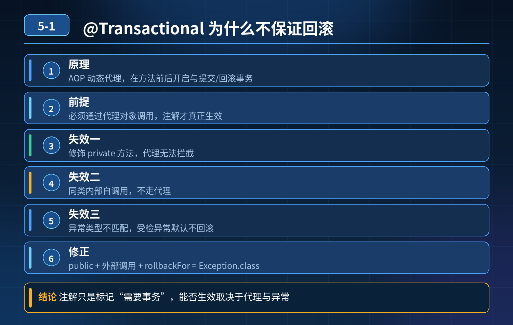

    @Transactional 是什么？加了该注解就一定可以回滚事务吗？

## 第 05-1 题　@Transactional 是什么？加了该注解就一定可以回滚事务吗？

**举例说明：**Service 中 A() 方法内部直接调用本类的 B()，B() 上标了 @Transactional 并在执行中抛异常。由于 A 调用 B 走的是 this 引用而不是 Spring 代理对象，事务根本没有开启，异常也不会触发回滚。

**候选人浅层回答：** 背诵表面结论，没有深入到原理和线上场景。

## 核心拆解一句话结论

方法访问权限问题：被注解修饰的方法是private 私有方法，动态代理无法访问私有方法，事务注解失效。

## 参考答案：

2. 同类内部调用：同一个类中，一个方法直接调用本类带@Transactional 的方法，不走 Spring 代理对象，事务不会生效。
3. 异常类型不匹配：抛出的是受检（检查型）异常，没有手动配置回滚规则，Spring 默认只对运行时异常、错误进行回滚。

<strong>现象：</strong>线上经常出现明明添加了@Transactional，业务出错，但是数据库数据依旧被持久化保存，没有回滚。

## 面试加分总结

想要真正掌握 Spring 事务，不能只知道简单使用注解，要理解底层 AOP 代理的工作原理，清楚事务注解生效的前提条件，识别各类事务失效场景，面试讲清楚这些层次，代表真正理解 Spring 事务原理。

## 连环追问要点整理

1. 底层核心原理是什么？为什么这么设计？
2. 线上出现相关故障如何快速止损、定位根因？
3. 高并发场景下有哪些坑点，性能、一致性、可用性如何权衡？

## 面试回答完整话术

  - **场景举例**：Service 中 A() 方法内部直接调用本类的 B()，B() 上标了 @Transactional 并在执行中抛异常。由于 A 调用 B 走的是 this 引用而不是 Spr
  - **一句话结论**：方法访问权限问题：被注解修饰的方法是private 私有方法，动态代理无法访问私有方法，事务注解失效。
  - **参考答案：**：方法访问权限问题：被注解修饰的方法是private 私有方法，动态代理无法访问私有方法，事务注解失效。
  - **面试加分总结**：想要真正掌握 Spring 事务，不能只知道简单使用注解，要理解底层 AOP 代理的工作原理，清楚事务注解生效的前提条件，识别各类事务失效场景，面试讲清楚这些层次，代表真正理解 Spring 事务原理
  - **收尾**：线上问题按「先止损保可用性 → 再定位根因 → 最后从架构规范层面根治」三段论闭环。

## 追问：本题考察核心是什么？

###  高级工程师要分清：

1. **不能只停留在背结论**：要能回答「为什么这样设计、不这样会怎样、线上踩坑怎么排查」；
2. **具备止损→定位→根治三段论**：先止血保业务，再定位根因，最后从架构与规范层面根治；
3. **给出工程取舍**：性能、一致性、可用性三者权衡，说清代价与适用场景。

  核心思想：这道题考察原理理解 + 线上实战 + 架构思维，真正的工程答案是「现象 → 根因 → 止损 → 定位 → 根治」五段式闭环。

