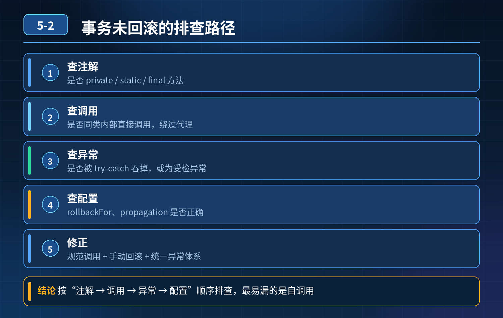

    方法上加 @Transactional，抛出异常但是数据没有回滚。如何排查？

## 第 05-2 题　方法上加 @Transactional，抛出异常但是数据没有回滚。如何排查？

**候选人浅层回答：** 注解写在 public 方法、抛出 RuntimeException 才回滚；大多是 try-catch 吞掉异常。

## 核心拆解一句话结论

本题考察对底层原理和线上实战能力的综合理解，不能只停留在背结论。

## 连环追问

1. 同一个类内，无事务方法直接调用本类带 @Transactional 的方法，事务失效底层原因？
2. 代码捕获异常，不想向上抛出，如何手动触发事务回滚？
3. 配置rollbackFor = Exception.class，抛出 Error，事务是否回滚？
4. 事务方法中新开子线程执行 DB 写操作，子线程操作是否属于当前事务？
5. 编程式事务适用场景、优势是什么？
6. 嵌套方法使用默认传播行为 REQUIRED，想做到内外事务独立回滚，会出现什么业务问题？
7. 多数据源场景，@Transactional 默认绑定哪个数据源？跨数据源如何保证一致性？

## 一、底层原理前置：Spring 声明式事务是 AOP 动态代理实现

Spring 在启动时生成代理对象，事务增强逻辑写在代理对象的方法里；只有通过外部代理对象调用带注解方法，AOP 拦截器才会执行开启 / 提交 / 回滚事务逻辑。

## 二、高频事务失效场景 + 排查顺序

1. 方法访问权限不是 public @Transactional 只对 public 生效，private/protected/default 直接忽略注解，事务不生效。
2. 本类内方法自调用（最常踩坑） A 类.method1()（无事务）直接调用本类method2()（加 @Transactional）。调用的是原始对象的 method2，不是代理对象，AOP 切面无法拦截，事务完全失效。

解决方案：注入自身代理对象（@Lazy @Autowired A a），用a.method2()调用；或者拆到不同类。

1. 异常被 try-catch 捕获且没有抛出 / 手动回滚 切面捕获方法抛出的异常才触发回滚；如果 try-catch 吃掉异常，方法正常返回，Spring 认为执行成功，提交事务。

手动回滚方式：TransactionAspectSupport.currentTransactionStatus().setRollbackOnly();

1. 异常类型不匹配 默认回滚 RuntimeException 及其子类和 Error；加上 rollbackFor = Exception.class 后，受检异常（Checked Exception，如 IOException、自定义受检业务异常）也会触发回滚。注意：Error 在默认规则下本就会回滚，与是否加 rollbackFor 无关；rollbackFor 是在默认规则上"追加"回滚范围，不是替换。

Error 属于 Throwable 的直接子类，和 Exception 同级。

1. 传播行为配置错误 默认传播行为REQUIRED：有事务就加入当前事务，没有就新建。 嵌套场景如果内外方法都 REQUIRED：内层异常回滚会标记整个事务回滚，外层无法单独提交；外层回滚内层一起回滚，无法做到内外事务互相独立。

想要独立事务需要使用REQUIRES_NEW，每次新建独立事务。

2\. 多线程场景 Spring 事务绑定在当前线程的 ThreadLocal。子线程是全新ThreadLocal，无法继承父线程的事务连接；子线程数据库操作是独立新事务，不属于外层主事务。

3\. 多数据源问题 @Transactional 默认使用主数据源（默认的 DataSourceBean），不会自动感知多个数据源。如果操作其他数据源，不会被该事务管理。

跨普通多数据源本地事务无法保证原子性；强一致用分布式事务方案（Seata等），最终一致可考虑可靠消息。

4\. 其他：数据库引擎不支持事务（MyISAM）、事务超时、只读事务写数据。

## 三、两种事务选型对比：声明式注解 vs 编程式事务

1. 声明式 @Transactional（AOP） 优点：代码侵入低，简洁； 缺点：很多隐式陷阱（自调用、线程、异常类型），切面机制带来的边界问题，只能作用于方法级别。
2. 编程式事务：TransactionTemplate 手动控制事务边界，代码显式开启、提交、

- 回滚。

适用场景：

- 事务逻辑碎片化，部分代码段需要事务，不是整个方法；
- 动态判断是否开启事务；
- 规避 AOP 代理带来的各种坑； 缺点：代码侵入性高，代码量大。

## 四、规范层面如何避免事务反复踩坑

1. 编码规范

- 事务方法放到独立 Service，避免同类自调用；
- 统一配置全局 rollbackFor = Exception.class，业务代码不要吞异常，必要时使用setRollbackOnly()；
- 禁止在事务方法中开启子线程写 DB；
- 明确事务传播行为，不要无脑使用默认 REQUIRED；需要独立子事务显式指定REQUIRES_NEW。

2\. 代码检查与测试

- 静态代码扫描规则：检测本类自调用事务方法；
- 单元测试覆盖异常回滚场景，验证事务回滚逻辑；

3\. 数据库层面

- 强制使用 InnoDB，禁止 MyISAM；
- 控制事务粒度，事务尽量短小，减少锁持有时间。

<strong>追问：</strong>本题考察核心是什么？

<strong>参考答案：</strong> 初级开发只记住简单规则：public、抛运行时异常、不要 catch。

不知道底层 AOP 代理原理，看不懂同类自调用失效的根本原因；分不清 Error和 Exception；不清楚 ThreadLocal 线程绑定，不理解事务传播行为带来的嵌套风险，多数据源场景没有概念。 高级工程师需要：

1. 理解声明式事务底层是 AOP+ThreadLocal 绑定数据库连接，所有失效场景根源都来自代理机制与连接绑定；
2. 可以按顺序排查事务失效，知道多种异常处理方案；
3. 掌握事务传播行为差异，清楚 REQUIRED 嵌套带来的业务风险；
4. 区分声明式、编程式事务各自适用场景；
5. 多数据源场景清楚本地事务局限，知道跨库一致性的取舍方案；
6. 建立编码规范，从开发阶段提前规避事务陷阱。

<strong>核心思想：</strong>Spring 注解事务不是银弹，是 AOP 代理带来的能力，它有明确边界；所有事务坑，本质都是越界使用 AOP 代理能力或者错误理解异常 / 线程 / 传播行为。

## 连环追问要点整理

1. 底层核心原理是什么？为什么这么设计？
2. 线上出现相关故障如何快速止损、定位根因？
3. 高并发场景下有哪些坑点，性能、一致性、可用性如何权衡？

## 面试回答完整话术

  - **一句话结论**：本题考察对底层原理和线上实战能力的综合理解，不能只停留在背结论。
  - **连环追问**：同一个类内，无事务方法直接调用本类带 @Transactional 的方法，事务失效底层原因？
  - **一、底层原理前置：Spring 声明式事务是 AOP 动态代理实现**：Spring 在启动时生成代理对象，事务增强逻辑写在代理对象的方法里；只有通过外部代理对象调用带注解方法，AOP 拦截器才会执行开启 / 提交 / 回滚事务逻辑。
  - **二、高频事务失效场景 + 排查顺序**：方法访问权限不是 public @Transactional 只对 public 生效，private/protected/default 直接忽略注解，事务不生效。
  - **三、两种事务选型对比：声明式注解 vs 编程式事务**：声明式 @Transactional（AOP） 优点：代码侵入低，简洁； 缺点：很多隐式陷阱（自调用、线程、异常类型），切面机制带来的边界问题，只能作用于方法级别。
  - **四、规范层面如何避免事务反复踩坑**：事务方法放到独立 Service，避免同类自调用；
  - **收尾**：线上问题按「先止损保可用性 → 再定位根因 → 最后从架构规范层面根治」三段论闭环。

## 追问：本题考察核心是什么？

###  高级工程师要分清：

1. **不能只停留在背结论**：要能回答「为什么这样设计、不这样会怎样、线上踩坑怎么排查」；
2. **具备止损→定位→根治三段论**：先止血保业务，再定位根因，最后从架构与规范层面根治；
3. **给出工程取舍**：性能、一致性、可用性三者权衡，说清代价与适用场景。

  核心思想：这道题考察原理理解 + 线上实战 + 架构思维，真正的工程答案是「现象 → 根因 → 止损 → 定位 → 根治」五段式闭环。

