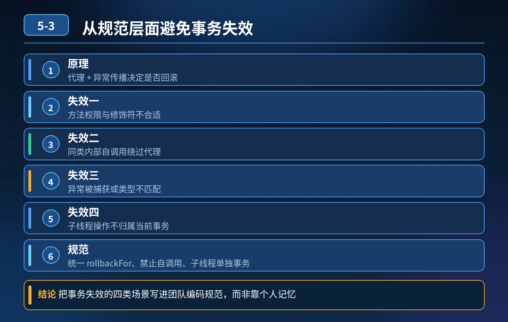

<div class="essay-image ">
    方法上加@Transactional，抛出异常数据却没有回滚，怎么排查根因？如何从规范层面避免事务失效？
</div>

## 第 05-3 题　方法上加@Transactional，抛出异常数据却没有回滚，怎么排查根因？如何从规范层面避免事务失效？

**候选人浅层回答：** 注解要加在 public 方法，抛出 RuntimeException 才会回滚；大部分情况是 try-catch 吃掉异常。

## 核心拆解一句话结论

底层原理Spring 声明式事务依靠AOP 动态代理实现。

## 连环追问

1. 同类内无事务方法调用本类带@Transactional 的方法，事务失效底层原因？
2. 捕获异常、不想向上抛出，如何手动触发事务回滚？
3. 配置rollbackFor = Exception.class，抛出Error，事务是否回滚？
4. 事务方法开启子线程执行 DB 写操作，子线程操作是否归属当前事务？
5. 编程式事务适用场景与优势是什么？
6. 嵌套事务使用默认REQUIRED，业务期望内外事务独立回滚，会出现什么问题？
7. 多数据源环境，@Transactional 默认绑定哪个数据源？跨数据源数据一致性如何保障？

## 参考答案：

如果调用的是原始对象方法，切面完全不会执行。事务连接保存在ThreadLocal，绑定当前执行线程。

## 一、事务失效排查思路（按优先级排查）

1. 方法访问权限非 public @Transactional 仅对 public 方法生效，private/protected/ 包访问权限会直接忽略注解。
2. 同类自调用（高频坑） 同一个类中，methodA()（无事务）直接调用本类methodB()（加事务）。 调用的是原始对象的 methodB，不是 Spring 代理对象，AOP 无法拦截，事务失效。

解决方案：注入自身代理@Lazy @Autowired XxxService self;，用self.methodB()调用；或者拆分到不同 Service 类。

1. 异常被 try-catch 捕获，没有抛出也没有标记回滚 AOP 切面捕获方法向外抛出
2. 的异常才触发回滚；如果 try-catch 吞掉异常，方法正常返回，Spring 判定业务正常，直接提交事务。

手动回滚代码：

```
TransactionAspectSupport.currentTransactionStat
us().setRollbackOnly();
```

1. 异常类型不匹配 Spring 默认只对RuntimeException、Error 触发回滚。

rollbackFor = Exception.class 会把受检异常也纳入回滚范围；Error 在 Spring 默认回滚规则下本来就会回滚（默认对 RuntimeException 和 Error 回滚），rollbackFor 只是在默认规则之上追加，不会"关闭"对 Error 的回滚。

2\. 传播行为使用错误 默认传播行为REQUIRED：存在事务就加入当前事务，无事务新建。 嵌套场景内外方法都用REQUIRED：内层抛出异常会标记整个全局事务为回滚状态，外层无法单独提交；外层回滚，内层跟着一起回滚，无法做到内外事务互相独立。 需要独立事务时使用REQUIRES_NEW，每次创建全新独立事务。

3\. 多线程场景 数据库连接绑定在当前线程ThreadLocal；子线程是全新线程，无法继承父线程事务连接。子线程的 DB 操作是独立新事务，不属于外层主事务。

禁止在事务方法内新开线程写库。

4\. 多数据源场景 @Transactional 默认绑定容器中默认的 DataSource Bean，不会自动切换数据源。如果操作另外一个数据源，不会被这个事务托管。

本地事务无法跨多库保证原子性；强一致性采用分布式事务框架（Seata）；可接受最终一致采用可靠消息 + 补偿。

1. 其他原因 数据库引擎不支持事务（MyISAM）、事务超时、readOnly 事务内执
2. 行写操作。

## 二、声明式事务 vs 编程式事务（TransactionTemplate）

声明式 @Transactional 优点：代码简洁，侵入低。 缺点：AOP 代理带来大量隐式边界坑；只能作用在完整方法上，无法精细化控制代码片段。

编程式事务 TransactionTemplate 优点：手动显式控制事务边界，规避 AOP代理陷阱；可以动态判断是否开启事务，只对部分代码块加事务。 适用场景：事务逻辑零散、动态决定是否开启事务、需要精细控制事务边界的场景。 缺点：代码侵入性更高，代码量大。

## 三、编码规范，预防事务失效反复出现

1. 编码约束

- 事务方法独立放在 Service 层，禁止同类自调用；
- 项目统一设置rollbackFor = Exception.class；捕获异常如需回滚，使用setRollbackOnly()；
- 禁止事务方法内部新开子线程执行数据库写操作；
- 按需选择传播行为，不要无脑使用默认 REQUIRED；需要独立子事务显式指定REQUIRES_NEW；
- 事务尽量短小，减少行锁持有时间。

2\. 静态检查与测试

- 静态代码扫描，识别同类内调用事务方法的风险代码；
- 单元测试覆盖异常场景，验证回滚逻辑。

3\. 数据库规范

- 强制使用 InnoDB 引擎，禁用 MyISAM。

<strong>追问：</strong>本题考察核心是什么？

<strong>参考答案：</strong> 初级开发只会死记简单规则，只知道 public、抛运行时异常，不理解底层 AOP 代理原理，看不懂同类自调用失效根源；分不清 Error 和 Exception，不了解 ThreadLocal 线程绑定机制；不清楚传播行为嵌套风险，多数据源场景没有概念。 高级工程师需要：

1. 理解声明式事务底层是 AOP 代理 + ThreadLocal 绑定连接；绝大多数事务失效，本质是绕过 AOP 切面，或者违背事务线程绑定规则；
2. 具备完整的故障排查链路，掌握异常捕获场景下手动回滚方案；
3. 掌握事务传播行为差异，理解 REQUIRED 嵌套带来的业务风险；
4. 能根据业务场景选型：声明式注解还是编程式事务；
5. 清楚单数据源本地事务边界，理解跨数据源一致性的取舍方案；
6. 建立开发规范，从编码阶段提前拦截事务相关 bug。

<strong>核心思想：</strong>@Transactional 不是数据库原生事务，是 SpringAOP 提供的增强能力，存在明确边界；所有踩坑，都是超出了 AOP 和事务底层机制的适用范围。

## 连环追问要点整理

1. 底层核心原理是什么？为什么这么设计？
2. 线上出现相关故障如何快速止损、定位根因？
3. 高并发场景下有哪些坑点，性能、一致性、可用性如何权衡？

## 代码示例

```java
TransactionAspectSupport.currentTransactionStat
us().setRollbackOnly();
```

## 面试回答完整话术

  - **一句话结论**：底层原理Spring 声明式事务依靠AOP 动态代理实现。
  - **连环追问**：同类内无事务方法调用本类带@Transactional 的方法，事务失效底层原因？
  - **参考答案：**：底层原理Spring 声明式事务依靠AOP 动态代理实现。事务的开启、提交、回滚逻辑写在代理对象中；只有外部调用代理对象的带注解方法，AOP 拦截器才会生效。
  - **一、事务失效排查思路（按优先级排查）**：方法访问权限非 public @Transactional 仅对 public 方法生效，private/protected/ 包访问权限会直接忽略注解。
  - **二、声明式事务 vs 编程式事务（TransactionTemplate）**：声明式 @Transactional 优点：代码简洁，侵入低。 缺点：AOP 代理带来大量隐式边界坑；只能作用在完整方法上，无法精细化控制代码片段。
  - **三、编码规范，预防事务失效反复出现**：事务方法独立放在 Service 层，禁止同类自调用；
  - **收尾**：线上问题按「先止损保可用性 → 再定位根因 → 最后从架构规范层面根治」三段论闭环。

## 追问：本题考察核心是什么？

###  高级工程师要分清：

1. **不能只停留在背结论**：要能回答「为什么这样设计、不这样会怎样、线上踩坑怎么排查」；
2. **具备止损→定位→根治三段论**：先止血保业务，再定位根因，最后从架构与规范层面根治；
3. **给出工程取舍**：性能、一致性、可用性三者权衡，说清代价与适用场景。

  核心思想：这道题考察原理理解 + 线上实战 + 架构思维，真正的工程答案是「现象 → 根因 → 止损 → 定位 → 根治」五段式闭环。

<div class="img-wrap-left"></div>
