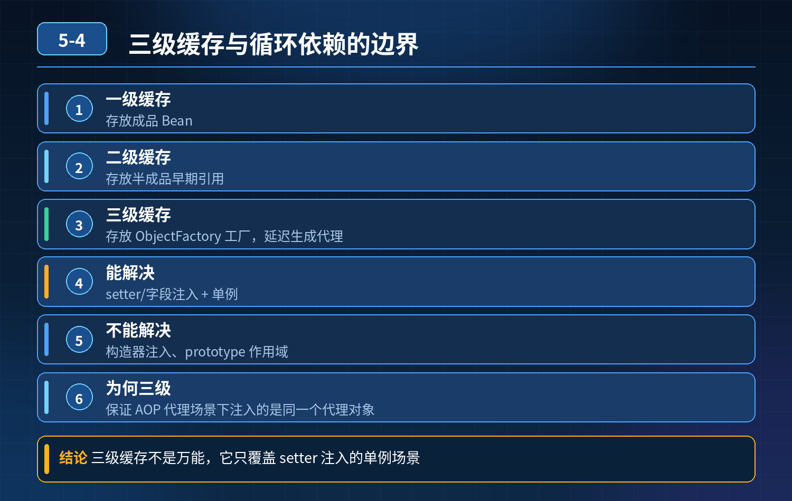

    Spring 利用三级缓存解决单例 Bean 循环依赖，这套机制能覆盖所有循环依赖场景吗？

## 第 05-4 题　Spring 利用三级缓存解决单例 Bean 循环依赖，这套机制能覆盖所有循环依赖场景吗？

**举例说明：**A 依赖 B、B 依赖 A。字段注入时 Spring 能通过三级缓存把 A 的早期引用提前暴露给 B，循环依赖得以解开；但若 A 用构造器注入 B、B 又注入 A，实例化 A 时就必须先拿到完整的 B，三级缓存无从插手，直接抛 BeanCurrentlyInCreationException。

**候选人浅层回答：** 可以。一级存成品 Bean，二级存半成品，三级存ObjectFactory，互相引用从缓存取就能解决循环注入。

## 核心拆解一句话结论

本题考察对底层原理和线上实战能力的综合理解，不能只停留在背结论。

## 连环追问

1. 构造器注入的循环依赖，为什么三级缓存解决不了？
2. prototype 原型作用域 Bean，循环依赖为什么直接报错？
3. 为什么设计三级缓存？只做早期对象暴露，二级缓存不够吗？
4. 如果 Bean 不需要 AOP 代理，是不是二级缓存就够用？
5. 循环依赖双方都需要 AOP 代理，互相注入的是代理对象还是原始对象？代理何时生成？
6. SpringBoot2.6 + 默认禁止循环依赖，背后原因？
7. 线上出现循环依赖报错，有哪些解决方案？

## 核心结论

三级缓存只能解决【单例 + set 注入 / 字段注入】的循环依赖，不能覆盖全部场景。循环依赖不是 Spring 设计的正向特性，只是为兼容不规范代码做的兼容方案。

三级缓存定义回顾

1\. 一级缓存 singletonObjects：存放完全实例化、属性填充完成、初始化完毕的成品单例 Bean

2\. 二级缓存 earlySingletonObjects：存放早期半成品 Bean（已经实例化，但属性还没填充、未初始化），已经完成代理对象生成

3\. 三级缓存 singletonFactories：存放ObjectFactory 工厂对象，不是 Bean 实例，作用是在需要的时候才去生成早期 Bean / 代理

1\. 构造器注入循环依赖，三级缓存无法解决Bean 创建第一步就是调用构造方法实例化对象。 A 依赖 B，B 依赖 A，全部构造器注入： 创建 A，执行 A 构造器，需要 B；开始创建 B，执行 B 构造器，又需要 A。 A 连实例对象都还没有生成，不存在半成品对象放入缓存，三级缓存没有任何东西可以暴露，直接抛出异常。

三级缓存生效前提：Bean 先实例化（new 出来空对象），再填充属性；构造注入卡在实例化这一步。

2\. prototype 原型 Bean 循环依赖直接报错prototype 每次获取都新建实例，不会放入三级缓存，三级缓存只管理 singleton 单例 Bean。 A 创建需要 B，B 创建又需要 A，无限递归创建，栈溢出报错。

3\. 为什么需要三级缓存？只靠二级缓存行不行？

- 如果 Bean 不需要 AOP 代理：只需要二级缓存就足够。实例化之后把半成品放入二级缓存，供别人引用。
- 如果 Bean 需要 AOP 代理：代理对象不能提前无条件全部创建。 设计思路：不提前生成代理，把生成代理的逻辑封装进 ObjectFactory 放入三级缓存。只有别的 Bean 需要引用这个半成品 Bean 的时候，才调用 ObjectFactory 生成代理，存入二级缓存。

如果只用二级缓存：实例化 Bean 之后就要立刻判断是否需要AOP、直接生成代理。但 Bean 生命周期还没走完，很多 AOP 增强相关的元信息还不完整；而且大量 Bean 即使不存在循环依赖，也会提前创建代理，造成不必要性能损耗。 三级缓存是懒加载生成早期代理对象，只有循环依赖场景才触发代理创建，普通 Bean 不提前执行代理。

4\. 循环依赖双方都需要 AOP 代理，注入的是代理对象还是原始对象？代理什么时候生成？

互相注入的是代理对象，不是原始对象。 触发时机：当其他 Bean 需要引用这个半成品 Bean 的时候，调用三级缓存里ObjectFactory.getObject()，执行 AOP 代理创建，生成代理放入二级缓存。后续其他 Bean 再次获取直接从二级缓存拿代理。

5\. SpringBoot2.6 之后默认禁止循环依赖的原因

1\. 循环依赖本身是代码设计缺陷，对象职责耦合严重，可读性差，维护风险高；

2\. 三级缓存的循环依赖机制是复杂的兼容 hack，底层生命周期复杂，容易出现难以复现的诡异问题；

3\. Spring 团队鼓励开发从根源消除循环依赖，而不是依赖框架的兼容能力；可手动开启：spring.main.allow-circular-references=true，仅作为临时兼容手段，不推荐长期使用。

4\. 线上循环依赖报错的解决方案（优先级从高到低）

1\. 重构代码（首选）：抽离公共能力到第三方 Service，解除双向依赖，从根源消灭循环；

2\. 调整注入方式：把构造器注入改成@Autowired 字段注入 /setter 注入（临时方案，治标不治本）；

3\. 使用@Lazy 懒加载：在其中一个依赖上加@Lazy，注入代理占位对象，推迟实例化时机；

4\. 临时开启allow-circular-references，仅应急，后续必须重构。

<strong>追问：</strong>本题考察核心是什么？

<strong>参考答案：</strong> 初级开发只会背诵三级缓存的字面定义，只记住 “三级缓存解决循环依赖”，不清楚生效的前置条件，分不清构造注入、原型 Bean 为什么不行；也不懂三级缓存里 ObjectFactory 是为了懒生成 AOP 代理，误以为二级缓存和三级缓存只是冗余设计。 高级工程师要理解：

1. 三级缓存生效的前置约束：仅限单例、setter / 字段注入；构造注入、原型Bean 完全不支持；
2. 三级缓存核心目的是懒创建早期 AOP 代理，无 AOP 场景二级缓存就足够；
3. 循环依赖本质是业务代码耦合问题，Spring 只是提供兼容 hack，不是推荐写法；
4. 能给出线上问题的多种修复方案，优先推荐重构而不是靠框架配置硬扛。

<strong>核心思想：</strong>三级缓存的本质是提前暴露实例化完成但未填充属性的半成品 Bean，并且按需懒加载生成 AOP 代理；它有严格适用边界，不能当成万能方案。

## 连环追问要点整理

1. 底层核心原理是什么？为什么这么设计？
2. 线上出现相关故障如何快速止损、定位根因？
3. 高并发场景下有哪些坑点，性能、一致性、可用性如何权衡？

## 面试回答完整话术

  - **场景举例**：A 依赖 B、B 依赖 A。字段注入时 Spring 能通过三级缓存把 A 的早期引用提前暴露给 B，循环依赖得以解开；但若 A 用构造器注入 B、B 又注入 A，实例化 A 时就
  - **一句话结论**：本题考察对底层原理和线上实战能力的综合理解，不能只停留在背结论。
  - **连环追问**：构造器注入的循环依赖，为什么三级缓存解决不了？
  - **核心结论**：三级缓存只能解决【单例 + set 注入 / 字段注入】的循环依赖，不能覆盖全部场景。循环依赖不是 Spring 设计的正向特性，只是为兼容不规范代码做的兼容方案。
  - **收尾**：线上问题按「先止损保可用性 → 再定位根因 → 最后从架构规范层面根治」三段论闭环。

## 追问：本题考察核心是什么？

###  高级工程师要分清：

1. **不能只停留在背结论**：要能回答「为什么这样设计、不这样会怎样、线上踩坑怎么排查」；
2. **具备止损→定位→根治三段论**：先止血保业务，再定位根因，最后从架构与规范层面根治；
3. **给出工程取舍**：性能、一致性、可用性三者权衡，说清代价与适用场景。

  核心思想：这道题考察原理理解 + 线上实战 + 架构思维，真正的工程答案是「现象 → 根因 → 止损 → 定位 → 根治」五段式闭环。

