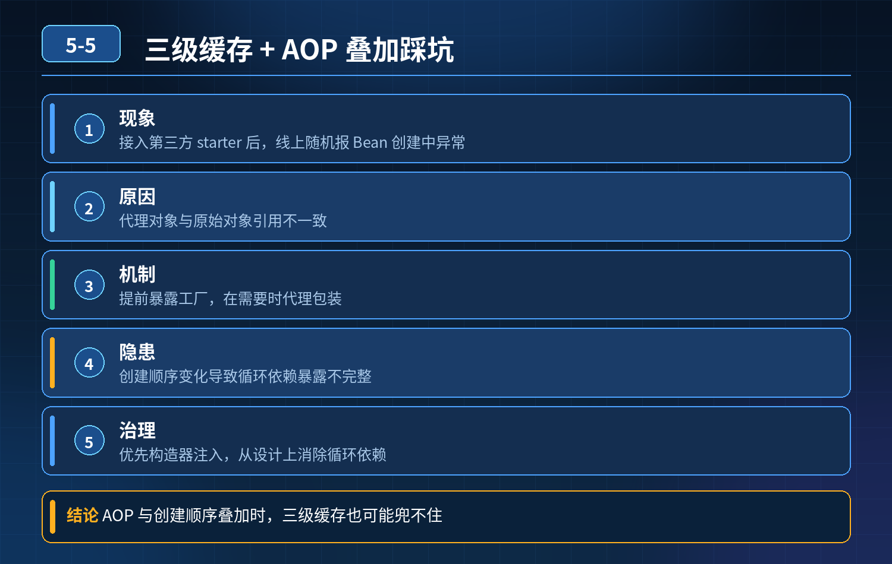

<div class="essay-image ">
    Spring 三级缓存、循环依赖+AOP/事务叠加踩坑
</div>

## 第 05-5 题　Spring 三级缓存、循环依赖+AOP/事务叠加踩坑

**候选人浅层回答：** 背诵表面结论，没有深入到原理和线上场景。

## 核心拆解一句话结论

本题考察对底层原理和线上实战能力的综合理解，不能只停留在背结论。

## 场景复盘

<strong>现象：</strong>接入第三方 starter 后，本地正常、线上随机报BeanCurrentlyInCreationException；同时循环依赖 + AOP / 事务叠加，代理对象注入错误，@Transactional 失效。 候选人只背 “三级缓存解决循环依赖”，答不出底层边界、代理提前暴露、构造注入为什么不行。

核心认知：Spring 的三级缓存只能解决【setter / 字段注入 +单例 + 非构造注入】的循环依赖；AOP 代理、Bean 创建顺序、第三方 starter 引入的 Bean 定义顺序不确定性，是线上随机报错的主要元凶。

先理清三级缓存分别存什么

```
// 一级缓存：完整好的单例Bean（实例化+填充属性+初始化完成）
```

singletonObjects// 二级缓存：早期半成品Bean（实例化完成、属性还没填充，普通原始对象，\*\*不是代理\*\*）earlySingletonObjects// 三级缓存：ObjectFactory，Bean 的代理工厂，用于拿到早期代理对象singletonFactories流程要点：

1. Bean 先实例化（new）；
2. 往三级缓存放入ObjectFactory；这一步就是提前暴露工厂；
3. 填充属性 populateBean（注入依赖）；
4. initializeBean：执行初始化、AOP 生成代理；如果依赖在填充阶段回头找这个正在创建的 Bean： 调用 ObjectFactory#getObject → 执行 AOP 代理逻辑，提前生成代理对象，放入二级缓存，供依赖方注入。

重点：二级缓存放的是早期代理对象，保证注入进去的是代理，而不是原始裸对象，事务 AOP 才生效。

面试官连环问题拆解

1. 为什么构造器注入循环依赖，三级缓存解决不了？

构造注入在实例化阶段就需要依赖对象，还没走到 “实例完成、放入三级缓存提前暴露” 这一步； A 要 new 的时候就需要 B，B new 的时候又需要 A，两个都卡在实例化，连放三级缓存的机会都没有，直接报错。

结论：Spring 原生不支持构造注入循环依赖。

2\. 线上随机启动失败、本地必现很难，根源是什么？

Bean 的加载顺序受包扫描、starter、@Conditional、注解解析顺序影响，不确定：

- 本地环境 Bean 加载顺序固定；
- 线上不同实例，类加载、Bean 注册顺序微小差异； 当循环依赖双方，加上AOP 切面、后置处理器（AnnotationAwareAspectJAutoProxyCreator）执行时机错开，就会随机触发：
- 提前暴露的时候没能成功生成代理；
- 或者拿到二级缓存里原始对象而不是代理； 于是：要么抛BeanCurrentlyInCreation，要么注入裸对象 → 事务注解失效。

3\. 循环依赖叠加 AOP 事务，什么时候代理会失效？

核心坑：只有走三级缓存 ObjectFactory#getObject 这条路径，才会提前执行AOP 生成代理。 如果后置处理器执行时机不对，提前暴露的时候没有触发代理创建，二级缓存里存的是原始对象，依赖拿到原始对象，事务切面不生效。 经典踩坑：自定义 Advisor、自定义 BeanPostProcessor、第三方 starter 引入额外 AOP 后置处理器，打乱默认顺序。

4\. @Lazy 能解决什么，不能解决什么？

@Lazy 是懒加载：注入的时候不直接注入 Bean，注入一个代理，等第一次使用

- ❌才去容器拿目标 Bean； 适合绕开一部分循环依赖； 它不是修复三级缓存底层逻辑，复杂 AOP 叠加场景依然不稳，属于治标手段，不适合作为长期方案。

三层防御方案（高阶工程解法）第一层：根治（优先）业务上消灭循环依赖，这是架构首选。 循环依赖本身代表模块职责耦合，拆接口、抽中间服务 / 上下文、事件解耦，从根源消除。

第二层：规避与规范（必须落地）

5\. 禁止构造注入形成循环依赖，循环依赖只允许 setter/field 注入；

6\. 切面、事务后置处理器顺序管控：@Order 控制 Advisor 优先级，避免自定义AOP 干扰默认事务代理创建时机；

7\. 对第三方 starter 隔离：用配置类控制 Bean 加载时机，避免 starter 偷偷引入Bean 打乱依赖图；

8\. 启动阶段增加 Bean 依赖图检测（单元测试 / 启动自检），提前发现循环依赖，不要等到线上随机炸。

第三层：应急兜底（发布故障时）

1. 回滚 starter 版本；
2. 临时用@Lazy、@DependsOn 强制 Bean 顺序，止血；
3. 启动日志重点监控：BeanCurrentlyInCreation、BeanPostProcessor 执行日志、AOP 代理创建日志，定位是哪两个 Bean 形成环、哪个后置处理器干扰代理。

- 30

## 秒口述标准答案

三级缓存中一级是完整单例 Bean，二级是早期半成品代理对象，三级是ObjectFactory 代理工厂；提前暴露工厂是为了在属性填充阶段，让依赖拿到代理对象，保证事务 AOP 生效。它只支持 setter 和字段注入的循环依赖，构造注入在实例化阶段就互相等待，无法解决。 线上随机报错是因为 Bean 加载顺序受 starter、后置处理器影响，环境不同顺序不稳定，叠加 AOP 时，提前暴露环节不一定能生成代理，会出现注入原生对象、事务失效或者启动异常。

@Lazy 只是临时绕过，根治还是要拆解耦合；工程上要做依赖自检、管控 AOP后置处理器顺序，避免第三方组件打乱 Bean 生命周期。

## 高频追问

Q：为什么不把代理直接放到二级缓存，还要搞三级 ObjectFactory？ A：不是所有 Bean 都需要 AOP 代理；用工厂懒生成代理，不需要代理的 Bean 就不会执行代理逻辑，节省开销。 Q：@DependsOn 的作用？ A：强制指定 Bean 创建先后顺序，可以规避一部分顺序不确定性带来的随机异常，但不能解决循环依赖本身。

## 连环追问要点整理

1. 底层核心原理是什么？为什么这么设计？
2. 线上出现相关故障如何快速止损、定位根因？
3. 高并发场景下有哪些坑点，性能、一致性、可用性如何权衡？

## 代码示例

```java
// 一级缓存：完整好的单例Bean（实例化+填充属性+初始化完成）
```

## 面试回答完整话术

  - **一句话结论**：本题考察对底层原理和线上实战能力的综合理解，不能只停留在背结论。
  - **场景复盘**：核心认知：Spring 的三级缓存只能解决【setter / 字段注入 +单例 + 非构造注入】的循环依赖；AOP 代理、Bean 创建顺序、第三方 starter 引入的 Bean 定义顺序不确定性
  - **秒口述标准答案**：三级缓存中一级是完整单例 Bean，二级是早期半成品代理对象，三级是ObjectFactory 代理工厂；提前暴露工厂是为了在属性填充阶段，让依赖拿到代理对象，保证事务 AOP 生效。它只支持 set
  - **高频追问**：Q：为什么不把代理直接放到二级缓存，还要搞三级 ObjectFactory？ A：不是所有 Bean 都需要 AOP 代理；用工厂懒生成代理，不需要代理的 Bean 就不会执行代理逻辑，节省开销。 Q
  - **收尾**：线上问题按「先止损保可用性 → 再定位根因 → 最后从架构规范层面根治」三段论闭环。

## 追问：本题考察核心是什么？

###  高级工程师要分清：

1. **不能只停留在背结论**：要能回答「为什么这样设计、不这样会怎样、线上踩坑怎么排查」；
2. **具备止损→定位→根治三段论**：先止血保业务，再定位根因，最后从架构与规范层面根治；
3. **给出工程取舍**：性能、一致性、可用性三者权衡，说清代价与适用场景。

  核心思想：这道题考察原理理解 + 线上实战 + 架构思维，真正的工程答案是「现象 → 根因 → 止损 → 定位 → 根治」五段式闭环。

<div class="img-wrap-left"></div>
