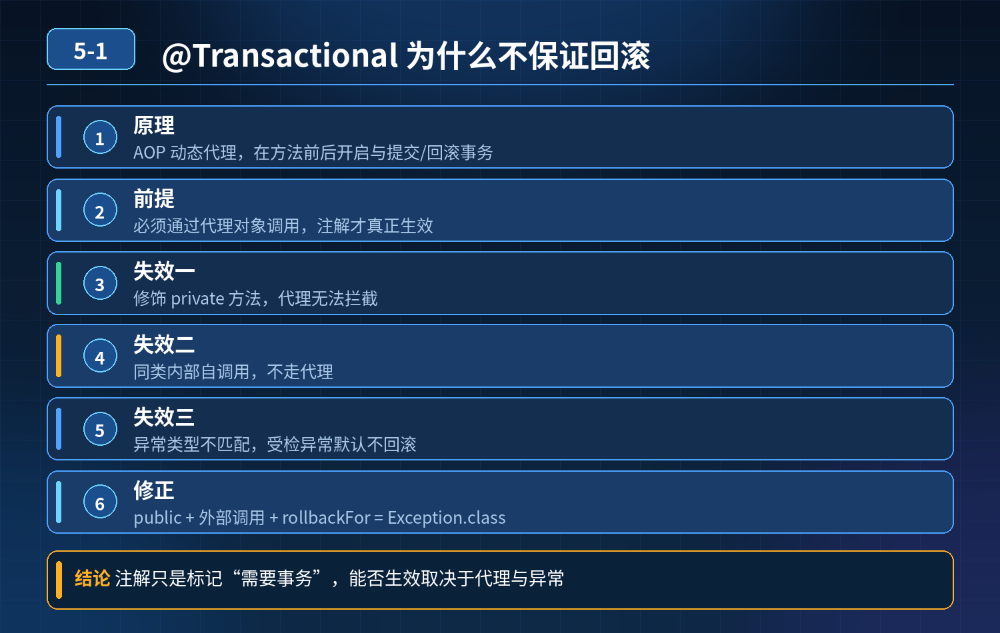
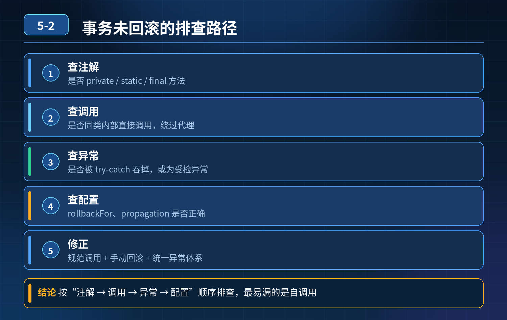
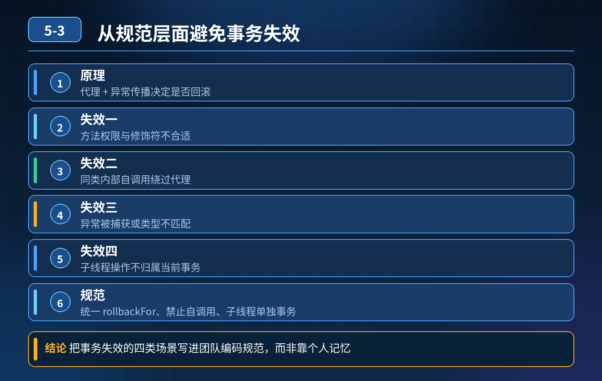
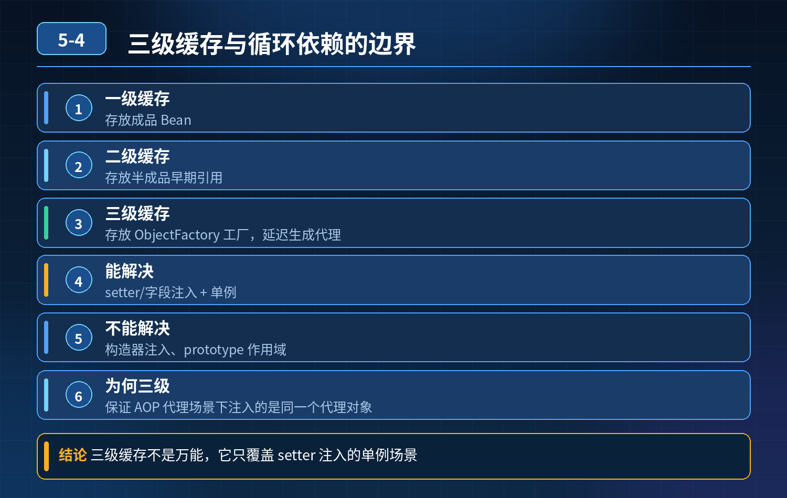
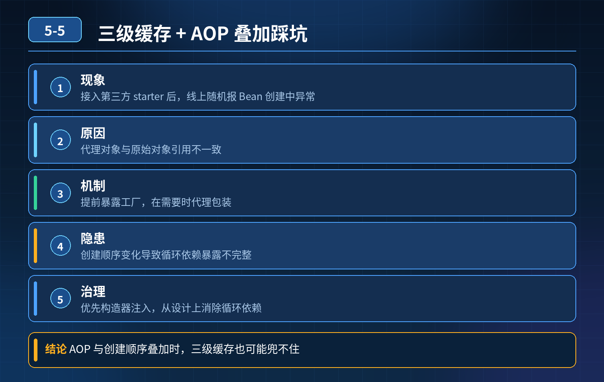

<div class="essay-chapter-header essay-image5">
    <!-- 5. Spring生态（Spring、SpringBoot、@Transactional、循环依赖、AOP） -->
</div>

## 第 1 题　@Transactional 是什么？加了该注解就一定可以回滚事务吗？

<strong>举例说明：</strong>Service 中 A() 方法内部直接调用本类的 B()，B() 上标了 @Transactional 并在执行中抛异常。由于 A 调用 B 走的是 this 引用而不是 Spring 代理对象，事务根本没有开启，异常也不会触发回滚。

<strong>参考答案：</strong> @Transactional 是 Spring 声明式事务的核心注解。底层依靠AOP 动态代理机制，在方法执行前后自动完成事务的开启、提交、回滚。

它的生效依赖 Spring 生成的代理对象，只有通过代理对象去调用目标方法，注解逻辑才会真正执行。Spring 会为对应类生成代理对象，调用时代理先开启事务；方法正常执行完毕就提交事务；方法抛出符合规则的异常才会执行事务回滚。

并不是加上注解就一定会回滚。 注解仅仅是标记该方法需要事务，无法保证代理一定能拦截到方法调用，也无法保证抛出的异常满足回滚条件，很多场景下即便写了@Transactional，异常发生也不会回滚数据。

### 问题 2：哪些场景下，加了 @Transactional，抛异常却不会回滚？

### 参考答案：

1. 方法访问权限问题：被注解修饰的方法是private 私有方法，动态代理无法访问私有方法，事务注解失效。
2. 同类内部调用：同一个类中，一个方法直接调用本类带@Transactional 的方法，不走 Spring 代理对象，事务不会生效。
3. 异常类型不匹配：抛出的是受检（检查型）异常，没有手动配置回滚规则，Spring 默认只对运行时异常、错误进行回滚。

<strong>现象：</strong>线上经常出现明明添加了@Transactional，业务出错，但是数据库数据依旧被持久化保存，没有回滚。

### 问题 3：把事务方法改成 public，使用外部类调用该事务方法，事务就一定没问题了吗？

<strong>参考答案：</strong> 还不够。解决访问权限、内部调用只是排除了部分失效场景，依旧还有其他因素会造成事务不回滚，比如异常捕获吃掉、回滚规则配置、多线程等其他问题，依旧需要注意。

### 面试加分总结

想要真正掌握 Spring 事务，不能只知道简单使用注解，要理解底层 AOP 代理的工作原理，清楚事务注解生效的前提条件，识别各类事务失效场景，面试讲清楚这些层次，代表真正理解 Spring 事务原理。

<!--  -->
<div class="img-wrap-left"></div>

## 第 2 题　方法上加 @Transactional，抛出异常但是数据没有回滚。如何排查？

从原理、失效场景、编码规范完整回答。

<strong>候选人浅层回答：</strong>注解写在 public 方法、抛出 RuntimeException 才回滚；大多是 try-catch 吞掉异常。

### 连环追问

1. 同一个类内，无事务方法直接调用本类带 @Transactional 的方法，事务失效底层原因？
2. 代码捕获异常，不想向上抛出，如何手动触发事务回滚？
3. 配置rollbackFor = Exception.class，抛出 Error，事务是否回滚？
4. 事务方法中新开子线程执行 DB 写操作，子线程操作是否属于当前事务？
5. 编程式事务适用场景、优势是什么？
6. 嵌套方法使用默认传播行为 REQUIRED，想做到内外事务独立回滚，会出现什么业务问题？
7. 多数据源场景，@Transactional 默认绑定哪个数据源？跨数据源如何保证一致性？

### 参考答案：

### 一、底层原理前置：Spring 声明式事务是 AOP 动态代理实现

Spring 在启动时生成代理对象，事务增强逻辑写在代理对象的方法里；只有通过外部代理对象调用带注解方法，AOP 拦截器才会执行开启 / 提交 / 回滚事务逻辑。

### 二、高频事务失效场景 + 排查顺序

1. 方法访问权限不是 public @Transactional 只对 public 生效，private/protected/default 直接忽略注解，事务不生效。
2. 本类内方法自调用（最常踩坑） A 类.method1()（无事务）直接调用本类method2()（加 @Transactional）。调用的是原始对象的 method2，不是代理对象，AOP 切面无法拦截，事务完全失效。

解决方案：注入自身代理对象（@Lazy @Autowired A a），用a.method2()调用；或者拆到不同类。

1. 异常被 try-catch 捕获且没有抛出 / 手动回滚 切面捕获方法抛出的异常才触发回滚；如果 try-catch 吃掉异常，方法正常返回，Spring 认为执行成功，提交事务。

手动回滚方式：TransactionAspectSupport.currentTransactionStatus().setRollbackOnly();

1. 异常类型不匹配 默认回滚 RuntimeException 及其子类和 Error；加上 rollbackFor = Exception.class 后，受检异常（Checked Exception，如 IOException、自定义受检业务异常）也会触发回滚。注意：Error 在默认规则下本就会回滚，与是否加 rollbackFor 无关；rollbackFor 是在默认规则上"追加"回滚范围，不是替换。

Error 属于 Throwable 的直接子类，和 Exception 同级。

1. 传播行为配置错误 默认传播行为REQUIRED：有事务就加入当前事务，没有就新建。 嵌套场景如果内外方法都 REQUIRED：内层异常回滚会标记整个事务回滚，外层无法单独提交；外层回滚内层一起回滚，无法做到内外事务互相独立。

想要独立事务需要使用REQUIRES_NEW，每次新建独立事务。

2. 多线程场景 Spring 事务绑定在当前线程的 ThreadLocal。子线程是全新ThreadLocal，无法继承父线程的事务连接；子线程数据库操作是独立新事务，不属于外层主事务。

3. 多数据源问题 @Transactional 默认使用主数据源（默认的 DataSourceBean），不会自动感知多个数据源。如果操作其他数据源，不会被该事务管理。

跨普通多数据源本地事务无法保证原子性；强一致用分布式事务方案（Seata等），最终一致可考虑可靠消息。

4. 其他：数据库引擎不支持事务（MyISAM）、事务超时、只读事务写数据。

### 三、两种事务选型对比：声明式注解 vs 编程式事务

1. 声明式 @Transactional（AOP） 优点：代码侵入低，简洁； 缺点：很多隐式陷阱（自调用、线程、异常类型），切面机制带来的边界问题，只能作用于方法级别。
2. 编程式事务：TransactionTemplate 手动控制事务边界，代码显式开启、提交、

- 回滚。

适用场景：

- 事务逻辑碎片化，部分代码段需要事务，不是整个方法；
- 动态判断是否开启事务；
- 规避 AOP 代理带来的各种坑； 缺点：代码侵入性高，代码量大。

### 四、规范层面如何避免事务反复踩坑

1. 编码规范

- 事务方法放到独立 Service，避免同类自调用；
- 统一配置全局 rollbackFor = Exception.class，业务代码不要吞异常，必要时使用setRollbackOnly()；
- 禁止在事务方法中开启子线程写 DB；
- 明确事务传播行为，不要无脑使用默认 REQUIRED；需要独立子事务显式指定REQUIRES_NEW。

2. 代码检查与测试

- 静态代码扫描规则：检测本类自调用事务方法；
- 单元测试覆盖异常回滚场景，验证事务回滚逻辑；

3. 数据库层面

- 强制使用 InnoDB，禁止 MyISAM；
- 控制事务粒度，事务尽量短小，减少锁持有时间。

<strong>追问：</strong>本题考察核心是什么？

<strong>参考答案：</strong> 初级开发只记住简单规则：public、抛运行时异常、不要 catch。

不知道底层 AOP 代理原理，看不懂同类自调用失效的根本原因；分不清 Error和 Exception；不清楚 ThreadLocal 线程绑定，不理解事务传播行为带来的嵌套风险，多数据源场景没有概念。 高级工程师需要：

1. 理解声明式事务底层是 AOP+ThreadLocal 绑定数据库连接，所有失效场景根源都来自代理机制与连接绑定；
2. 可以按顺序排查事务失效，知道多种异常处理方案；
3. 掌握事务传播行为差异，清楚 REQUIRED 嵌套带来的业务风险；
4. 区分声明式、编程式事务各自适用场景；
5. 多数据源场景清楚本地事务局限，知道跨库一致性的取舍方案；
6. 建立编码规范，从开发阶段提前规避事务陷阱。

<strong>核心思想：</strong>Spring 注解事务不是银弹，是 AOP 代理带来的能力，它有明确边界；所有事务坑，本质都是越界使用 AOP 代理能力或者错误理解异常 / 线程 / 传播行为。

<!--  -->
<div class="img-wrap-left"></div>

## 第 3 题　方法上加@Transactional，抛出异常数据却没有回滚，怎么排查根因？如何从规范层面避免事务失效？

<strong>候选人浅层回答：</strong>注解要加在 public 方法，抛出 RuntimeException 才会回滚；大部分情况是 try-catch 吃掉异常。

### 连环追问

1. 同类内无事务方法调用本类带@Transactional 的方法，事务失效底层原因？
2. 捕获异常、不想向上抛出，如何手动触发事务回滚？
3. 配置rollbackFor = Exception.class，抛出Error，事务是否回滚？
4. 事务方法开启子线程执行 DB 写操作，子线程操作是否归属当前事务？
5. 编程式事务适用场景与优势是什么？
6. 嵌套事务使用默认REQUIRED，业务期望内外事务独立回滚，会出现什么问题？
7. 多数据源环境，@Transactional 默认绑定哪个数据源？跨数据源数据一致性如何保障？

### 参考答案：

底层原理Spring 声明式事务依靠AOP 动态代理实现。事务的开启、提交、回滚逻辑写在代理对象中；只有外部调用代理对象的带注解方法，AOP 拦截器才会生效。

如果调用的是原始对象方法，切面完全不会执行。事务连接保存在ThreadLocal，绑定当前执行线程。

### 一、事务失效排查思路（按优先级排查）

1. 方法访问权限非 public @Transactional 仅对 public 方法生效，private/protected/ 包访问权限会直接忽略注解。
2. 同类自调用（高频坑） 同一个类中，methodA()（无事务）直接调用本类methodB()（加事务）。 调用的是原始对象的 methodB，不是 Spring 代理对象，AOP 无法拦截，事务失效。

解决方案：注入自身代理@Lazy @Autowired XxxService self;，用self.methodB()调用；或者拆分到不同 Service 类。

1. 异常被 try-catch 捕获，没有抛出也没有标记回滚 AOP 切面捕获方法向外抛出
2. 的异常才触发回滚；如果 try-catch 吞掉异常，方法正常返回，Spring 判定业务正常，直接提交事务。

手动回滚代码：

```
TransactionAspectSupport.currentTransactionStat
us().setRollbackOnly();
```

1. 异常类型不匹配 Spring 默认只对RuntimeException、Error 触发回滚。

rollbackFor = Exception.class 会把受检异常也纳入回滚范围；Error 在 Spring 默认回滚规则下本来就会回滚（默认对 RuntimeException 和 Error 回滚），rollbackFor 只是在默认规则之上追加，不会"关闭"对 Error 的回滚。

2. 传播行为使用错误 默认传播行为REQUIRED：存在事务就加入当前事务，无事务新建。 嵌套场景内外方法都用REQUIRED：内层抛出异常会标记整个全局事务为回滚状态，外层无法单独提交；外层回滚，内层跟着一起回滚，无法做到内外事务互相独立。 需要独立事务时使用REQUIRES_NEW，每次创建全新独立事务。

3. 多线程场景 数据库连接绑定在当前线程ThreadLocal；子线程是全新线程，无法继承父线程事务连接。子线程的 DB 操作是独立新事务，不属于外层主事务。

禁止在事务方法内新开线程写库。

4. 多数据源场景 @Transactional 默认绑定容器中默认的 DataSource Bean，不会自动切换数据源。如果操作另外一个数据源，不会被这个事务托管。

本地事务无法跨多库保证原子性；强一致性采用分布式事务框架（Seata）；可接受最终一致采用可靠消息 + 补偿。

1. 其他原因 数据库引擎不支持事务（MyISAM）、事务超时、readOnly 事务内执
2. 行写操作。

### 二、声明式事务 vs 编程式事务（TransactionTemplate）

声明式 @Transactional 优点：代码简洁，侵入低。 缺点：AOP 代理带来大量隐式边界坑；只能作用在完整方法上，无法精细化控制代码片段。

编程式事务 TransactionTemplate 优点：手动显式控制事务边界，规避 AOP代理陷阱；可以动态判断是否开启事务，只对部分代码块加事务。 适用场景：事务逻辑零散、动态决定是否开启事务、需要精细控制事务边界的场景。 缺点：代码侵入性更高，代码量大。

### 三、编码规范，预防事务失效反复出现

1. 编码约束

- 事务方法独立放在 Service 层，禁止同类自调用；
- 项目统一设置rollbackFor = Exception.class；捕获异常如需回滚，使用setRollbackOnly()；
- 禁止事务方法内部新开子线程执行数据库写操作；
- 按需选择传播行为，不要无脑使用默认 REQUIRED；需要独立子事务显式指定REQUIRES_NEW；
- 事务尽量短小，减少行锁持有时间。

2. 静态检查与测试

- 静态代码扫描，识别同类内调用事务方法的风险代码；
- 单元测试覆盖异常场景，验证回滚逻辑。

3. 数据库规范

- 强制使用 InnoDB 引擎，禁用 MyISAM。

<strong>追问：</strong>本题考察核心是什么？

<strong>参考答案：</strong> 初级开发只会死记简单规则，只知道 public、抛运行时异常，不理解底层 AOP 代理原理，看不懂同类自调用失效根源；分不清 Error 和 Exception，不了解 ThreadLocal 线程绑定机制；不清楚传播行为嵌套风险，多数据源场景没有概念。 高级工程师需要：

1. 理解声明式事务底层是 AOP 代理 + ThreadLocal 绑定连接；绝大多数事务失效，本质是绕过 AOP 切面，或者违背事务线程绑定规则；
2. 具备完整的故障排查链路，掌握异常捕获场景下手动回滚方案；
3. 掌握事务传播行为差异，理解 REQUIRED 嵌套带来的业务风险；
4. 能根据业务场景选型：声明式注解还是编程式事务；
5. 清楚单数据源本地事务边界，理解跨数据源一致性的取舍方案；
6. 建立开发规范，从编码阶段提前拦截事务相关 bug。

<strong>核心思想：</strong>@Transactional 不是数据库原生事务，是 SpringAOP 提供的增强能力，存在明确边界；所有踩坑，都是超出了 AOP 和事务底层机制的适用范围。

<!--  -->
<div class="img-wrap-left"></div>

## 第 4 题　Spring 利用三级缓存解决单例 Bean 循环依赖，这套机制能覆盖所有循环依赖场景吗？

<strong>举例说明：</strong>A 依赖 B、B 依赖 A。字段注入时 Spring 能通过三级缓存把 A 的早期引用提前暴露给 B，循环依赖得以解开；但若 A 用构造器注入 B、B 又注入 A，实例化 A 时就必须先拿到完整的 B，三级缓存无从插手，直接抛 BeanCurrentlyInCreationException。

<strong>候选人浅层回答：</strong>可以。一级存成品 Bean，二级存半成品，三级存ObjectFactory，互相引用从缓存取就能解决循环注入。

### 连环追问

1. 构造器注入的循环依赖，为什么三级缓存解决不了？
2. prototype 原型作用域 Bean，循环依赖为什么直接报错？
3. 为什么设计三级缓存？只做早期对象暴露，二级缓存不够吗？
4. 如果 Bean 不需要 AOP 代理，是不是二级缓存就够用？
5. 循环依赖双方都需要 AOP 代理，互相注入的是代理对象还是原始对象？代理何时生成？
6. SpringBoot2.6 + 默认禁止循环依赖，背后原因？
7. 线上出现循环依赖报错，有哪些解决方案？

### 参考答案：

### 核心结论

三级缓存只能解决【单例 + set 注入 / 字段注入】的循环依赖，不能覆盖全部场景。循环依赖不是 Spring 设计的正向特性，只是为兼容不规范代码做的兼容方案。

三级缓存定义回顾

1. 一级缓存 singletonObjects：存放完全实例化、属性填充完成、初始化完毕的成品单例 Bean

2. 二级缓存 earlySingletonObjects：存放早期半成品 Bean（已经实例化，但属性还没填充、未初始化），已经完成代理对象生成

3. 三级缓存 singletonFactories：存放ObjectFactory 工厂对象，不是 Bean 实例，作用是在需要的时候才去生成早期 Bean / 代理

1. 构造器注入循环依赖，三级缓存无法解决Bean 创建第一步就是调用构造方法实例化对象。 A 依赖 B，B 依赖 A，全部构造器注入： 创建 A，执行 A 构造器，需要 B；开始创建 B，执行 B 构造器，又需要 A。 A 连实例对象都还没有生成，不存在半成品对象放入缓存，三级缓存没有任何东西可以暴露，直接抛出异常。

三级缓存生效前提：Bean 先实例化（new 出来空对象），再填充属性；构造注入卡在实例化这一步。

2. prototype 原型 Bean 循环依赖直接报错prototype 每次获取都新建实例，不会放入三级缓存，三级缓存只管理 singleton 单例 Bean。 A 创建需要 B，B 创建又需要 A，无限递归创建，栈溢出报错。

3. 为什么需要三级缓存？只靠二级缓存行不行？

- 如果 Bean 不需要 AOP 代理：只需要二级缓存就足够。实例化之后把半成品放入二级缓存，供别人引用。
- 如果 Bean 需要 AOP 代理：代理对象不能提前无条件全部创建。 设计思路：不提前生成代理，把生成代理的逻辑封装进 ObjectFactory 放入三级缓存。只有别的 Bean 需要引用这个半成品 Bean 的时候，才调用 ObjectFactory 生成代理，存入二级缓存。

如果只用二级缓存：实例化 Bean 之后就要立刻判断是否需要AOP、直接生成代理。但 Bean 生命周期还没走完，很多 AOP 增强相关的元信息还不完整；而且大量 Bean 即使不存在循环依赖，也会提前创建代理，造成不必要性能损耗。 三级缓存是懒加载生成早期代理对象，只有循环依赖场景才触发代理创建，普通 Bean 不提前执行代理。

4. 循环依赖双方都需要 AOP 代理，注入的是代理对象还是原始对象？代理什么时候生成？

互相注入的是代理对象，不是原始对象。 触发时机：当其他 Bean 需要引用这个半成品 Bean 的时候，调用三级缓存里ObjectFactory.getObject()，执行 AOP 代理创建，生成代理放入二级缓存。后续其他 Bean 再次获取直接从二级缓存拿代理。

5. SpringBoot2.6 之后默认禁止循环依赖的原因

1. 循环依赖本身是代码设计缺陷，对象职责耦合严重，可读性差，维护风险高；

2. 三级缓存的循环依赖机制是复杂的兼容 hack，底层生命周期复杂，容易出现难以复现的诡异问题；

3. Spring 团队鼓励开发从根源消除循环依赖，而不是依赖框架的兼容能力；可手动开启：spring.main.allow-circular-references=true，仅作为临时兼容手段，不推荐长期使用。

4. 线上循环依赖报错的解决方案（优先级从高到低）

1. 重构代码（首选）：抽离公共能力到第三方 Service，解除双向依赖，从根源消灭循环；

2. 调整注入方式：把构造器注入改成@Autowired 字段注入 /setter 注入（临时方案，治标不治本）；

3. 使用@Lazy 懒加载：在其中一个依赖上加@Lazy，注入代理占位对象，推迟实例化时机；

4. 临时开启allow-circular-references，仅应急，后续必须重构。

<strong>追问：</strong>本题考察核心是什么？

<strong>参考答案：</strong> 初级开发只会背诵三级缓存的字面定义，只记住 “三级缓存解决循环依赖”，不清楚生效的前置条件，分不清构造注入、原型 Bean 为什么不行；也不懂三级缓存里 ObjectFactory 是为了懒生成 AOP 代理，误以为二级缓存和三级缓存只是冗余设计。 高级工程师要理解：

1. 三级缓存生效的前置约束：仅限单例、setter / 字段注入；构造注入、原型Bean 完全不支持；
2. 三级缓存核心目的是懒创建早期 AOP 代理，无 AOP 场景二级缓存就足够；
3. 循环依赖本质是业务代码耦合问题，Spring 只是提供兼容 hack，不是推荐写法；
4. 能给出线上问题的多种修复方案，优先推荐重构而不是靠框架配置硬扛。

<strong>核心思想：</strong>三级缓存的本质是提前暴露实例化完成但未填充属性的半成品 Bean，并且按需懒加载生成 AOP 代理；它有严格适用边界，不能当成万能方案。

<!--  -->
<div class="img-wrap-left"></div>

## 第 5 题　Spring 三级缓存、循环依赖+AOP/事务叠加踩坑

### 场景复盘

<strong>现象：</strong>接入第三方 starter 后，本地正常、线上随机报BeanCurrentlyInCreationException；同时循环依赖 + AOP / 事务叠加，代理对象注入错误，@Transactional 失效。 候选人只背 “三级缓存解决循环依赖”，答不出底层边界、代理提前暴露、构造注入为什么不行。

核心认知：Spring 的三级缓存只能解决【setter / 字段注入 +单例 + 非构造注入】的循环依赖；AOP 代理、Bean 创建顺序、第三方 starter 引入的 Bean 定义顺序不确定性，是线上随机报错的主要元凶。

先理清三级缓存分别存什么

```
// 一级缓存：完整好的单例Bean（实例化+填充属性+初始化完成）
```

singletonObjects// 二级缓存：早期半成品Bean（实例化完成、属性还没填充，普通原始对象，**不是代理**）earlySingletonObjects// 三级缓存：ObjectFactory，Bean 的代理工厂，用于拿到早期代理对象singletonFactories流程要点：

1. Bean 先实例化（new）；
2. 往三级缓存放入ObjectFactory；这一步就是提前暴露工厂；
3. 填充属性 populateBean（注入依赖）；
4. initializeBean：执行初始化、AOP 生成代理；如果依赖在填充阶段回头找这个正在创建的 Bean： 调用 ObjectFactory#getObject → 执行 AOP 代理逻辑，提前生成代理对象，放入二级缓存，供依赖方注入。

重点：二级缓存放的是早期代理对象，保证注入进去的是代理，而不是原始裸对象，事务 AOP 才生效。

面试官连环问题拆解

1. 为什么构造器注入循环依赖，三级缓存解决不了？

构造注入在实例化阶段就需要依赖对象，还没走到 “实例完成、放入三级缓存提前暴露” 这一步； A 要 new 的时候就需要 B，B new 的时候又需要 A，两个都卡在实例化，连放三级缓存的机会都没有，直接报错。

结论：Spring 原生不支持构造注入循环依赖。

2. 线上随机启动失败、本地必现很难，根源是什么？

Bean 的加载顺序受包扫描、starter、@Conditional、注解解析顺序影响，不确定：

- 本地环境 Bean 加载顺序固定；
- 线上不同实例，类加载、Bean 注册顺序微小差异； 当循环依赖双方，加上AOP 切面、后置处理器（AnnotationAwareAspectJAutoProxyCreator）执行时机错开，就会随机触发：
- 提前暴露的时候没能成功生成代理；
- 或者拿到二级缓存里原始对象而不是代理； 于是：要么抛BeanCurrentlyInCreation，要么注入裸对象 → 事务注解失效。

3. 循环依赖叠加 AOP 事务，什么时候代理会失效？

核心坑：只有走三级缓存 ObjectFactory#getObject 这条路径，才会提前执行AOP 生成代理。 如果后置处理器执行时机不对，提前暴露的时候没有触发代理创建，二级缓存里存的是原始对象，依赖拿到原始对象，事务切面不生效。 经典踩坑：自定义 Advisor、自定义 BeanPostProcessor、第三方 starter 引入额外 AOP 后置处理器，打乱默认顺序。

4. @Lazy 能解决什么，不能解决什么？

@Lazy 是懒加载：注入的时候不直接注入 Bean，注入一个代理，等第一次使用

- ❌才去容器拿目标 Bean； 适合绕开一部分循环依赖； 它不是修复三级缓存底层逻辑，复杂 AOP 叠加场景依然不稳，属于治标手段，不适合作为长期方案。

三层防御方案（高阶工程解法）第一层：根治（优先）业务上消灭循环依赖，这是架构首选。 循环依赖本身代表模块职责耦合，拆接口、抽中间服务 / 上下文、事件解耦，从根源消除。

第二层：规避与规范（必须落地）

5. 禁止构造注入形成循环依赖，循环依赖只允许 setter/field 注入；

6. 切面、事务后置处理器顺序管控：@Order 控制 Advisor 优先级，避免自定义AOP 干扰默认事务代理创建时机；

7. 对第三方 starter 隔离：用配置类控制 Bean 加载时机，避免 starter 偷偷引入Bean 打乱依赖图；

8. 启动阶段增加 Bean 依赖图检测（单元测试 / 启动自检），提前发现循环依赖，不要等到线上随机炸。

第三层：应急兜底（发布故障时）

1. 回滚 starter 版本；
2. 临时用@Lazy、@DependsOn 强制 Bean 顺序，止血；
3. 启动日志重点监控：BeanCurrentlyInCreation、BeanPostProcessor 执行日志、AOP 代理创建日志，定位是哪两个 Bean 形成环、哪个后置处理器干扰代理。

- 30

### 秒口述标准答案

三级缓存中一级是完整单例 Bean，二级是早期半成品代理对象，三级是ObjectFactory 代理工厂；提前暴露工厂是为了在属性填充阶段，让依赖拿到代理对象，保证事务 AOP 生效。它只支持 setter 和字段注入的循环依赖，构造注入在实例化阶段就互相等待，无法解决。 线上随机报错是因为 Bean 加载顺序受 starter、后置处理器影响，环境不同顺序不稳定，叠加 AOP 时，提前暴露环节不一定能生成代理，会出现注入原生对象、事务失效或者启动异常。

@Lazy 只是临时绕过，根治还是要拆解耦合；工程上要做依赖自检、管控 AOP后置处理器顺序，避免第三方组件打乱 Bean 生命周期。

### 高频追问

Q：为什么不把代理直接放到二级缓存，还要搞三级 ObjectFactory？ A：不是所有 Bean 都需要 AOP 代理；用工厂懒生成代理，不需要代理的 Bean 就不会执行代理逻辑，节省开销。 Q：@DependsOn 的作用？ A：强制指定 Bean 创建先后顺序，可以规避一部分顺序不确定性带来的随机异常，但不能解决循环依赖本身。

<!--  -->
<div class="img-wrap-left"></div>

