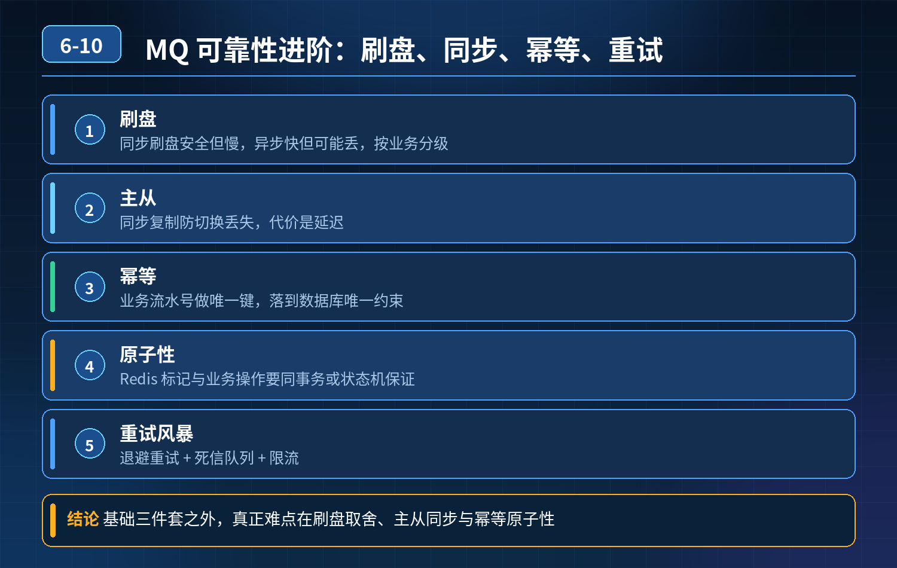

<div class="essay-image ">
    MQ 可靠性：confirm、持久化、手动 ACK 只是基础，如何解决刷盘、主从同步、幂等原子性、重试风暴问题
</div>

## 第 06-10 题　MQ 可靠性：confirm、持久化、手动 ACK 只是基础，如何解决刷盘、主从同步、幂等原子性、重试风暴问题

**候选人浅层回答：** 背诵表面结论，没有深入到原理和线上场景。

## 核心拆解一句话结论

三层核心本质（面试官想听的三层）第一层：投递可靠性层（事前）区分刷盘和副本两个能力。

## 候选人浅层回答

生产者 confirm、Broker 持久化、消费者手动 ACK；核心消息同步刷盘，非核心异步；Redis 存 msgId 做幂等。

## 连环追问汇总

1. 异步刷盘场景：Broker 收到消息、落盘前宕机，消息丢失；同步刷盘性能差，如何取舍平衡？
2. 主从集群：主收到消息，还没同步给从就宕机，从晋升为主，消息丢失，同步刷盘也救不了，怎么解决？
3. 业务执行一半宕机，未 ACK，消息重试，出现半执行 + 重复消费；Redis 判断msgId 和业务操作不是原子，中间宕机怎么办？
4. 异常消息无限重试阻塞队列如何处理？
5. 消息链路如何监控？

## 参考答案

核心认知：confirm + 持久化 + 手动 ACK 只是入门三件套，很多人混淆了「刷盘持久化」和「副本复制」两个概念。刷盘解决断电后数据留存；副本同步复制才是主从切换场景防丢的核心；幂等最大坑就是 Redis 缓存方案无法和业务事务原子绑定，存在失效风险。整套体系三层：投递可靠性层、消费原子幂等层、异常与监控治理层。
1. 刷盘策略取舍（同步刷盘 vs 异步刷盘）同步刷盘：消息写入磁盘成功才返回给 Broker，宕机不丢，但是 IO 阻塞，吞吐低，只适合资金、订单等极小流量核心链路。 异步刷盘（主流）：消息先放
- 👉page cache，后台线程批量刷盘，性能高，但窗口内宕机丢消息。
异步刷盘的风险弥补手段，不是硬改同步刷盘： 依靠主从副本同步确认：消息同步复制到从节点之后，才给生产者返回 confirm 成功。 哪怕主节点还没刷盘就宕机，从节点已经持有这条消息；切换主从之后消息不丢失。
一句话：高并发绝大多数场景，选择【异步刷盘 + 副本同步确认】，兼顾性能和可靠性；同步刷盘是小众兜底选项，不能当成通用方案。
2. 主从切换丢消息问题（高频坑）
<strong>问题根源：</strong>主收到消息，还没同步到从，就宕机。此时从节点没有这条消息，晋升为主之后消息直接消失，哪怕开启同步刷盘也没用，刷盘只保证本机磁盘，
- 解决不了跨节点复制。
解决方案： 调整投递确认语义：等副本同步完成，再返回 ack 给生产者。 RocketMQ 叫同步复制模式；Kafka 是 acks=all。
- acks=all：消息必须写入 ISR 内所有副本，才认为发送成功；
- 代价：网络延迟上升，吞吐下降，只给核心业务 Topic 单独开启；
- 非核心日志 Topic 可以 acks=1，追求性能，接受极小概率丢消息。
重点：刷盘是单机持久化；副本复制才是集群容灾。二者不能互相替代。
3. 幂等方案：Redis 存 msgId 的致命缺陷Redis 判断 + 业务落库：两个独立操作，不是原子事务。 风险时序：
1\. 消费拿到消息，Redis 插入 msgId 标记已处理
2\. Redis 成功，执行业务 DB 时服务宕机
3\. 消息没有真正处理成功，但 Redis 已经打标，这条消息永久丢失。
- 通用落地方案：数据库幂等表（和业务同一个事务） 幂等流水表，唯一索引：消息唯一 ID / 业务单号。 执行逻辑放在同一个数据库事务里面：
```
begin;-- 插入幂等记录，唯一冲突直接报错insert into idempotent
(biz_no, msg_id) values(?, ?);-- 执行业务逻辑，扣款、改订单状
```
态等update order set status = 'paid' ... ;commit;
- 事务成功：幂等记录 + 业务同时落库；重复投递时插入幂等记录冲突，直接跳过业务；
- 事务失败：全部回滚，幂等记录不会写入，下次重试可以正常执行业务；Redis 幂等只能做轻量旁路预警，不能作为资金、订单链路的主幂等方案。 补充：状态机也是很好的方案，订单单向流转，不允许回退，从业务语义上拦截重复动作。
4. 无限重试阻塞队列问题无限重试是典型故障：坏消息（数据非法、下游永久异常）反复重试，占满消费线程，队列堆积，正常消息被卡住。 方案：
1\. 设置最大重试次数 + 指数退避，不要立刻重试；
2\. 超过重试上限，转入死信 Topic，停止重试；
3\. 死信 Topic 独立消费组、独立告警，死信不参与正常业务队列；
4\. 提供后台，支持人工查看、修改数据、手动补发； 禁止死信自动删除，死信本身是故障证据和业务数据。
5. 链路监控治理不能只看堆积数量，全链路埋点监控指标：
- 生产 TPS、消费 TPS、堆积增量（比堆积总量更重要，增量 \> 0 代表还在恶化）
- 单条消息消费耗时、超时消息数、死信数量、重试次数分布
- confirm 失败率、ACK 提交失败率 告警分层：普通堆积预警、死信告警、消费停滞紧急告警； 全链路追踪：每条消息携带 traceId、msgId，日志串联生产者、Broker、消费者，快速定位是发送失败、丢副本还是消费卡死。

第二层：消费幂等原子层（事中）拒绝 Redis 非原子幂等。优先数据库幂等表，和业务同事务；或者业务状态机约束流转。解决 “业务执行一半宕机，重试重复” 这个痛点。

第三层：异常治理与监控层（兜底）重试上限、死信隔离，防止坏消息拖垮整个队列；配套链路埋点监控，不是出问题才翻日志手动排查，提前感知异常。

考察区分初级：背三段式，以为持久化 + ACK 就万事大吉，分不清刷盘和副本，随便用 Redis 做幂等。 高级：

1. 能分清刷盘（单机）和副本复制（集群容灾），理解主从切换丢失的根本原因；
2. 看透 Redis 幂等原子性漏洞，给出数据库事务内幂等的标准方案；
3. 懂得分级策略，不同 Topic 配置不同 acks、刷盘策略，平衡性能和可靠性；
4. 配套死信隔离、链路监控，形成闭环治理，而不是只关心正常流程。

面试原题：RabbitMQ 订单消息重复投递，反复扣款发券造成资损

## 一、重复消费的根本原因（不是代码 bug）

RabbitMQ 只能保证至少一次投递（At-Least-Once），重复是必然现象：

1. 网络抖动：业务执行成功，但 ACK 回执丢在网络里；Broker 收不到 ACK，消息超时后自动重新投递。
2. 服务重启宕机：消费到一半程序崩溃，还没提交 ACK；Broker 判定消费失败，消息重回队列重试。
3. 生产者重试：发送成功但没收到 confirm 确认，生产者重试发消息，造成同一条消息两次入队。

关键点：代码单次执行没问题，只要出现重试投递，就会重复执行业务；单纯丢弃消息又会导致业务丢失，所以不能简单粗暴丢消息。

## 二、面试官核心追问

1. 只靠 Redis 做 msgId 去重，会出现什么致命问题？
2. 如何做到业务层面绝对幂等，杜绝重复扣款？
3. 不能随便丢弃重试消息，如何平衡重试与重复风险？
4. 完整链路需要搭建哪三层防御？

标准答案：三层防御体系（面试官真正想听的内容）第一层：源头控重（减少重复投递次数，事前减少重试）

1. 生产者全局唯一消息 ID 每条订单消息绑定唯一业务单号（orderId）+ 全局msgId，不要用随机 ID；发送开启 confirm 确认，只有收到 Broker 回执才算发送成功，避免无限制重试。
2. 消费者严格后置手动 ACK（核心规范） 必须等业务事务完全执行成功、数据落库之后，再调用 basicAck 提交确认。 严禁先 ACK 再执行业务，否则会丢消息； 严禁业务执行一半就 ACK，避免半事务 + 消息重试带来脏数据。
3. 合理设置 prefetch 预取数量、消费超时，避免消息无故超时重投。

第二层：消费端原子幂等（核心防线，杜绝重复执行业务）坑点：Redis 去重方案失效Redis 先写入标记、再执行业务，两个操作不是原子事务。 时序风险：Redis 写入成功，业务执行时服务宕机 → 消息被标记已处理，业务却没完成，消息永久丢失。Redis 只能做旁路优化，不能作为资金订单主幂等方案。

生产级通用落地方案（二选一，保证原子性）方案 1：数据库幂等表（资金订单首选）新建幂等记录表，唯一索引：业务单号 orderId /msgId，和业务操作放在同一个数据库事务中：

```
BEGIN;-- 插入幂等记录，唯一键冲突直接报错，自动拦截重复消息INSERT
INTO idempotent_record (order_id, msg_id) VALUES
(?, ?);-- 执行业务：扣款、发放优惠券UPDATE order SET
status='PAID', balance=balance-? WHERE id=?;COMMIT;
```

- 事务整体成功：幂等记录 + 业务数据同时落库；再来重复消息，插入唯一索引直接失败，跳过业务逻辑。
- 事务整体失败：全部回滚，幂等记录不会留存，下次重试可以正常消费。

方案 2：业务状态机（业务语义兜底）订单状态单向流转：待支付→支付成功→发券完成，状态不可逆。 收到重复消息时，先查询订单状态；如果已经是 “支付成功”，直接跳过扣款和发券逻辑，不执行任何变更操作，从业务语义上杜绝重复动作。

第三层：异常重试管控 + 死信兜底（防止坏消息无限重试）

4\. 限制最大重试次数，搭配指数退避策略，不要立刻反复重试；

5\. 超过重试上限，消息转入独立死信队列，停止重试，避免坏消息占满线程、阻塞正常队列；

6\. 死信独立告警，保留 7 天以上，提供人工补发入口；

7\. 兜底补偿：定时任务每日对账，核对订单、资金、优惠券数据，发现不一致自动告警，人工修复。

## 连环追问要点整理

1. 底层核心原理是什么？为什么这么设计？
2. 线上出现相关故障如何快速止损、定位根因？
3. 高并发场景下有哪些坑点，性能、一致性、可用性如何权衡？

## 代码示例

```java
begin;-- 插入幂等记录，唯一冲突直接报错insert into idempotent
(biz_no, msg_id) values(?, ?);-- 执行业务逻辑，扣款、改订单状
```

## 面试回答完整话术

  - **一句话结论**：三层核心本质（面试官想听的三层）第一层：投递可靠性层（事前）区分刷盘和副本两个能力。
  - **候选人浅层回答**：生产者 confirm、Broker 持久化、消费者手动 ACK；核心消息同步刷盘，非核心异步；Redis 存 msgId 做幂等。
  - **连环追问汇总**：异步刷盘场景：Broker 收到消息、落盘前宕机，消息丢失；同步刷盘性能差，如何取舍平衡？
  - **参考答案**：核心认知：confirm + 持久化 + 手动 ACK 只是入门三件套，很多人混淆了「刷盘持久化」和「副本复制」两个概念。刷盘解决断电后数据留存；副本同步复制才是主从切换场景防丢的核心；幂等最大坑就是
  - **候选人浅层回答**：只需要做消息幂等，重复消息直接拦截丢弃就行。
  - **一、重复消费的根本原因（不是代码 bug）**：RabbitMQ 只能保证至少一次投递（At-Least-Once），重复是必然现象：
  - **收尾**：线上问题按「先止损保可用性 → 再定位根因 → 最后从架构规范层面根治」三段论闭环。

## 追问：本题考察核心是什么？

###  高级工程师要分清：

1. **不能只停留在背结论**：要能回答「为什么这样设计、不这样会怎样、线上踩坑怎么排查」；
2. **具备止损→定位→根治三段论**：先止血保业务，再定位根因，最后从架构与规范层面根治；
3. **给出工程取舍**：性能、一致性、可用性三者权衡，说清代价与适用场景。

  核心思想：这道题考察原理理解 + 线上实战 + 架构思维，真正的工程答案是「现象 → 根因 → 止损 → 定位 → 根治」五段式闭环。

<div class="img-wrap-left"></div>
