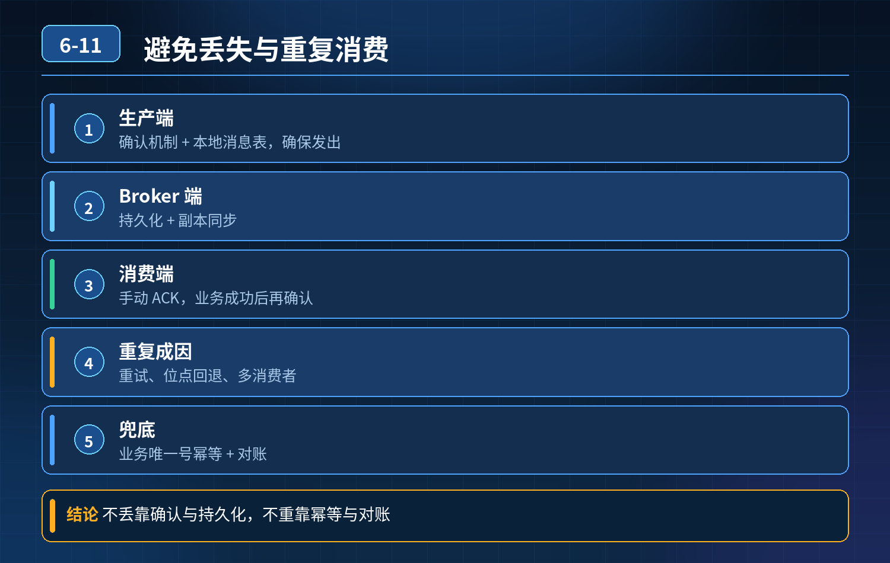

    消息队列如何避免消息丢失和重复消费

## 第 06-11 题　消息队列如何避免消息丢失和重复消费

**候选人浅层回答：** 背诵表面结论，没有深入到原理和线上场景。

## 核心拆解一句话结论

核心认知：MQ 本身无法绝对保证不重复投递，只能保证至少一次投递（At-Least-Once）。

## 候选人浅层回答

开启持久化、手动 ACK、做幂等就够了。

## 连环追问

1. 消息会在三个阶段丢失：生产者、Broker、消费者，分别怎么防护？
2. 为什么会出现重复消费？只靠幂等够不够？
3. 为什么不能先 ACK 再执行业务？
4. 完整的三层防御体系是什么？

## 一、消息丢失的三段防护

1. 生产者端（防止发出去但是 Broker 没收到）

- 开启发送确认机制（RocketMQ 的 sendCallback、ACK 回调）；同步发送等待返回结果。
- 失败重试 + 重试次数限制，避免无限重试打爆 Broker；重试使用指数退避。
- 消息发送失败落地本地日志 / 本地消息表，做补发兜底，不要盲目重试。

坑：异步发送不处理回调，以为发成功了，实际丢消息。

2\. Broker 服务端（Broker 宕机、掉盘丢消息）

- 开启消息持久化，同步刷盘（对性能损耗大，一般业务用异步刷盘）；
- 集群多副本机制（主从同步），主节点宕机，从节点接管；坑：只开持久化，没有副本，单盘故障照样丢消息。持久化不等于高可用。

3\. 消费者端（最容易踩坑）必须消费成功、业务处理完成之后，再提交 ACK 位点。

- ❌ 错误：拿到消息就
- ACK。一旦执行业务中途服务宕机、OOM，消息已经标记消费成功 → 消息丢失。
- 正确顺序：拉取消息 → 执行业务逻辑 → 业务落库成功 → 提交
- ACK。

## 二、重复消费的来源

网络抖动、ACK 提交超时：消费者业务跑完了，但是 ACK 回传给 Broker 的时候丢包；Broker 收不到 ACK，超时后会重新投递这条消息，造成重复消费。

所以：At-Least-Once 是标准语义，重复是必然要接受的风险，无法彻底杜绝，只能兜底。 兜底方案：业务幂等。

幂等实现常见方案：

1. 消息唯一 ID（msgId）作为唯一键存入业务表或者幂等表，处理前先判断是否已经处理过；
2. 业务唯一标识：订单号、支付流水号；
3. 状态机：只有状态符合预期才允许流转，重复过来的请求直接忽略。

## 三、面试官说的三层防御体系

第一层：链路规范层（前置预防）

1. 生产者：回调确认、有限重试、指数退避；
2. Broker：持久化 + 多副本集群；
3. 消费者：后置 ACK，禁止提前确认；
4. 消息埋点：msgId、投递时间、消费状态，便于追溯排查。

第二层：运行控制层（故障隔离，防止重试风暴）

1. 异常消息进入死信队列，不要无限重试；
2. 重试间隔指数退避，避免短时间大量重试占满线程、引发积压；
3. 堆积监控，提前发现链路异常。

第三层：补偿对账层（最后兜底防线）定时对账任务，比对上下游数据。例如：订单表和支付流水、库存数据核对。

发现数据不一致、消息丢失导致状态卡住，自动补发补偿，或者告警人工介入。

幂等 + 对账补偿，就算前面两层全部失效，也能保证最终一致性。

补充区分一句话

- 持久化 + 副本 + 后置 ACK，是减少丢失；
- 幂等，是承接重复投递；
- 定时对账，是兜底。

## 连环追问要点整理

1. 底层核心原理是什么？为什么这么设计？
2. 线上出现相关故障如何快速止损、定位根因？
3. 高并发场景下有哪些坑点，性能、一致性、可用性如何权衡？

## 面试回答完整话术

  - **一句话结论**：核心认知：MQ 本身无法绝对保证不重复投递，只能保证至少一次投递（At-Least-Once）。
  - **候选人浅层回答**：开启持久化、手动 ACK、做幂等就够了。
  - **连环追问**：消息会在三个阶段丢失：生产者、Broker、消费者，分别怎么防护？
  - **参考答案**：核心认知：MQ 本身无法绝对保证不重复投递，只能保证至少一次投递（At-Least-Once）。丢失防护分生产、Broker、消费三段；重复消费的兜底手段是幂等。整套是三层防御。
  - **一、消息丢失的三段防护**：生产者端（防止发出去但是 Broker 没收到）
  - **二、重复消费的来源**：网络抖动、ACK 提交超时：消费者业务跑完了，但是 ACK 回传给 Broker 的时候丢包；Broker 收不到 ACK，超时后会重新投递这条消息，造成重复消费。
  - **收尾**：线上问题按「先止损保可用性 → 再定位根因 → 最后从架构规范层面根治」三段论闭环。

## 追问：本题考察核心是什么？

###  高级工程师要分清：

1. **不能只停留在背结论**：要能回答「为什么这样设计、不这样会怎样、线上踩坑怎么排查」；
2. **具备止损→定位→根治三段论**：先止血保业务，再定位根因，最后从架构与规范层面根治；
3. **给出工程取舍**：性能、一致性、可用性三者权衡，说清代价与适用场景。

  核心思想：这道题考察原理理解 + 线上实战 + 架构思维，真正的工程答案是「现象 → 根因 → 止损 → 定位 → 根治」五段式闭环。

