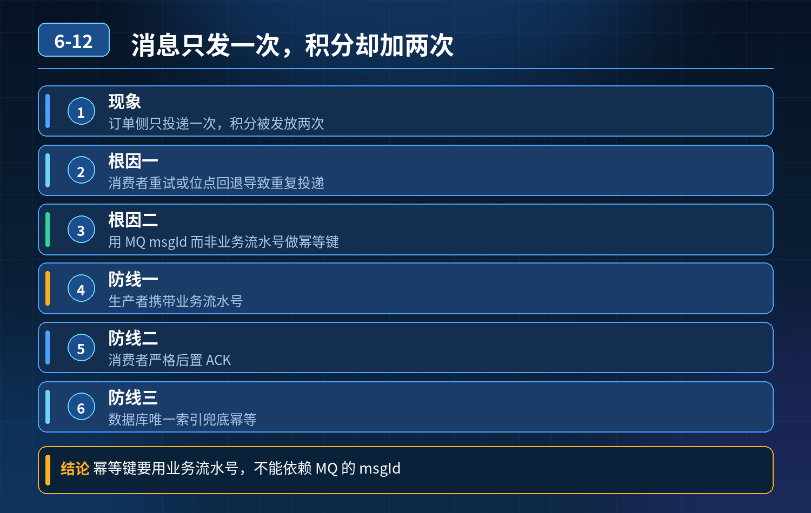

<div class="essay-image ">
    支付发积分场景，消息只发送一次，积分服务却执行两次
</div>

## 第 06-12 题　支付发积分场景，消息只发送一次，积分服务却执行两次

**举例说明：**支付成功后发送一条 MQ 消息，积分服务先执行业务再提交 ACK。业务执行到一半服务重启，消息未 ACK 被重新投递，积分于是加了两遍。改用支付单号作为幂等键并加唯一索引后，第二次插入直接冲突返回。

**候选人浅层回答：** 背诵表面结论，没有深入到原理和线上场景。

## 核心拆解一句话结论

本题考察对底层原理和线上实战能力的综合理解，不能只停留在背结论。

## 场景复盘

业务：支付成功，订单服务发送 MQ 消息，积分服务消费给用户加积分。 现象：订单侧日志证明只投递一次消息，但是积分被发放两次，产生脏数据。

<strong>考察核心：</strong>不只是知道要做幂等，而是理解重复投递成因、全局 ID 的坑、三层幂等防线落地。

先回答根源：为什么只发一次消息，却消费两次？

MQ 的语义是 At-Least-Once（至少投递一次），根源基本都是： 积分服务已经成功执行发放积分、数据库落库，但是 ACK 回传给 MQ Broker 的报文丢包、超时。 Broker 没有收到 ACK，超时后判定消费失败，重新投递这条消息。 订单生产者只发了一次，但是消费侧发生了重复投递。

重点：问题不在生产者，不是生产者多发消息，是消费侧 ACK 链路异常带来的重试投递。

面试官追问：难道给每条消息加个全局 ID 就完事了？ 答案：只存一个全局ID 远远不够，最大坑是原子性问题。 很多人用 Redis 存 msgId：Redis 标记成功之后，执行业务；一旦 Redis 写入成功、业务落库前服务宕机，这条消息直接被永久跳过，积分丢失。Redis 和 DB 业务操作不是原子事务，存在失效风险。

三层幂等防线（面试官想要的标准答案）第一层：前置预防层（源头减少重复投递）

1. 生产者携带唯一业务标识，优先使用业务流水号（支付单号），而不是单纯MQ 的 msgId；业务流水更具备业务语义，对账更方便。
2. 生产者开启确认机制，收到 Broker 确认才算投递成功，避免生产者重试多发。
3. 消费者严格后置 ACK：业务事务提交落库成功之后，再提交 ACK。 不要提前ACK；只要业务没成功，不提交 ACK，Broker 会重试；代价就是要承接重复投递，必须幂等兜底。

第二层：原子幂等核心层（核心防线，数据库方案）资金、积分这类场景首选：幂等表 + 业务操作放在同一个数据库事务内。

```
BEGIN;-- biz_no 使用支付单号/消息唯一ID，唯一索引INSERT INTO
idempotent (biz_no, msg_id, user_id) VALUES (?, ?, ?);--
```

执行业务：增加积分UPDATE user_point SET point = point + ?

WHERE user_id = ?;COMMIT;逻辑：

- 事务一起成功：幂等记录 + 积分同时入库；再来重复消息，唯一索引冲突，直接跳过积分逻辑。
- 事务回滚：幂等记录不会写入，下次重试可以正常发放积分，不会丢。

这就是和 Redis 方案最大区别：数据库事务保证原子性，不会出现标记成功、业务失败的情况。

备选方案：业务状态机。 比如积分流水表，一条支付单号只能生成一条积分发放记录；状态单向流转，已经是 “已发放” 状态就拒绝重复执行。适合业务链路清晰的场景。

第三层：对账补偿兜底层（最后防线）幂等是单条消息的防护，但依然存在极端异常：数据库宕机、主从切换、底层 bug。 定时对账任务： 核对支付流水记录 和 积分发放记录。 找到：有支付成功记录、但是没有对应积分发放记录 → 补发； 找到：同一条支付单号有多条积分发放记录 → 告警、人工修正扣回多余积分。 这一层用来兜底前面两层没能挡住的脏数据。

补充配套治理策略

4\. 合理设置重试次数、指数退避，不要高频重试压垮积分服务；超过上限转入死信队列，告警人工核查；

5\. 死信消息同样携带 biz_no，支持人工核对后补发；

6\. 全链路埋点，记录 msgId、支付单号、消费时间，方便追溯重复消费记录。

初级 vs 高级工程师差异初级：想到加全局 ID，用 Redis 存 ID 去重，不知道原子性漏洞，只做了表层拦截。 高级工程师：

1. 清楚重复投递是 ACK 丢包导致，不是生产者多发；理解 At-Least-Once；
2. 分得清 Redis 旁路去重和数据库事务幂等的适用场景，知道 Redis 不能用于资金、积分类强一致性场景；
3. 搭建三层闭环：源头控重、数据库原子幂等、定时对账兜底；
4. 明白幂等不是简单加一个 ID 字段，是整套一致性保障体系。

## 连环追问要点整理

1. 底层核心原理是什么？为什么这么设计？
2. 线上出现相关故障如何快速止损、定位根因？
3. 高并发场景下有哪些坑点，性能、一致性、可用性如何权衡？

## 代码示例

```java
BEGIN;-- biz_no 使用支付单号/消息唯一ID，唯一索引INSERT INTO
idempotent (biz_no, msg_id, user_id) VALUES (?, ?, ?);--
```

## 面试回答完整话术

  - **场景举例**：支付成功后发送一条 MQ 消息，积分服务先执行业务再提交 ACK。业务执行到一半服务重启，消息未 ACK 被重新投递，积分于是加了两遍。改用支付单号作为幂等键并加唯一索引后，第二次
  - **一句话结论**：本题考察对底层原理和线上实战能力的综合理解，不能只停留在背结论。
  - **场景复盘**：业务：支付成功，订单服务发送 MQ 消息，积分服务消费给用户加积分。 现象：订单侧日志证明只投递一次消息，但是积分被发放两次，产生脏数据。
  - **收尾**：线上问题按「先止损保可用性 → 再定位根因 → 最后从架构规范层面根治」三段论闭环。

## 追问：本题考察核心是什么？

###  高级工程师要分清：

1. **不能只停留在背结论**：要能回答「为什么这样设计、不这样会怎样、线上踩坑怎么排查」；
2. **具备止损→定位→根治三段论**：先止血保业务，再定位根因，最后从架构与规范层面根治；
3. **给出工程取舍**：性能、一致性、可用性三者权衡，说清代价与适用场景。

  核心思想：这道题考察原理理解 + 线上实战 + 架构思维，真正的工程答案是「现象 → 根因 → 止损 → 定位 → 根治」五段式闭环。

<div class="img-wrap-left"></div>
