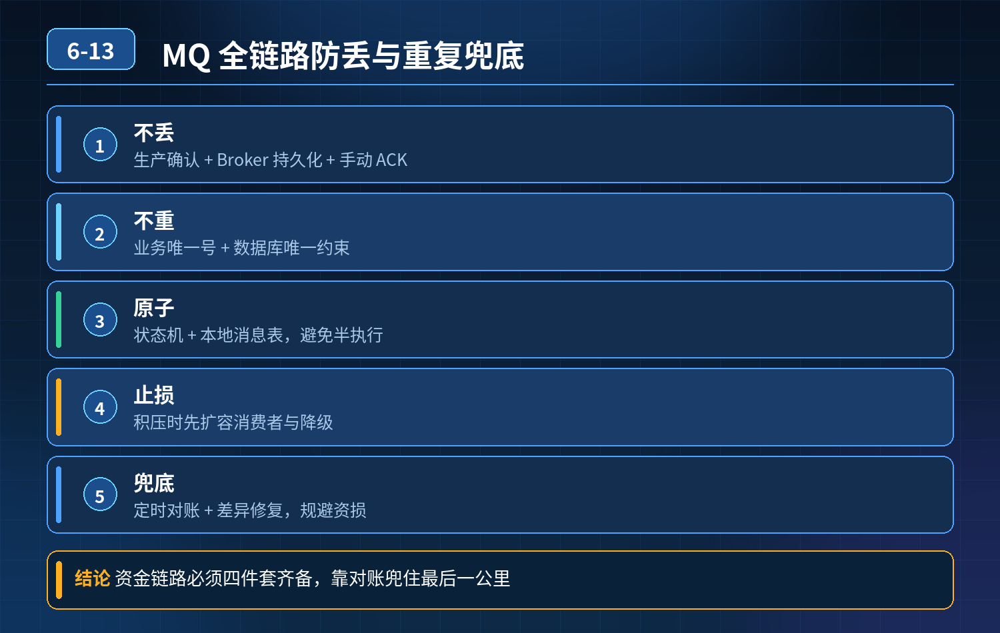

    MQ 全链路如何保障消息不丢失、重复消费兜底，规避资损

## 第 06-13 题　MQ 全链路如何保障消息不丢失、重复消费兜底，规避资损

**候选人浅层回答：** 背诵表面结论，没有深入到原理和线上场景。

## 核心拆解一句话结论

核心认知：MQ 默认语义是至少一次投递 At-Least-Once，做不到严格不重复；

## 候选人浅层回答

开启持久化、ACK 确认，依靠幂等和日志对账保底。

## 连环追问汇总

1. Broker 消息还没刷盘就宕机，消息丢失怎么处理？
2. 消费重试引发重复扣款，兜底方案？
3. 百万积压快速止损思路？
4. 能不能还原一次真实资损故障时间线？
5. 单机收发和分布式可靠性保障差别在哪？

## 一、三段防丢失方案

1）生产者端：保证消息可靠投递到 Broker只发出去不代表成功。

- 使用同步发送或者带回调的异步发送，等待 Broker 返回成功回执；
- 发送失败要有有限次数重试、指数退避，防止风暴；
- 兜底：本地消息表。发送前落库标记「待投递」，收到成功回执改为「已投递」；定时任务扫描长期待投递的消息补发，避免回调丢失导致消息 “幽灵丢失”。

2）Broker 端：刷盘前宕机的风险解决异步刷盘性能高，但消息在 PageCache 还没落盘，主节点宕机就丢消息。

- 方案 1（高可靠低吞吐）：同步刷盘，消息落盘成功才返回 ACK；适合支付、资金类核心链路；
- 方案 2（主流折中）：多副本集群。消息同步复制到从副本，等副本同步成功再返回发送成功。哪怕主节点还没刷盘就宕机，从节点拥有完整消息，切换后消息不丢；重点：单节点哪怕开持久化，宕机依然丢消息；副本复制才是 Broker 层可靠性核心，刷盘只是持久化手段。

3）消费端：防止处理中宕机丢失顺序绝对不能颠倒：执行业务、业务事务提交成功之后，再提交消费 ACK / 位点。 先 ACK 再执行业务，宕机直接丢消息，是最常见的线上事故。

## 二、重复消费、重复扣款的兜底（资损防线）

重复根源：业务处理成功，ACK 回包网络丢包、超时，Broker 没有收到确认，消息重新投递。 只靠 MQ 配置解决不了，必须业务层幂等。 主流幂等方案：

1. 幂等表：以消息唯一 ID、业务流水号（支付单号、订单号）做唯一索引，处理前先判断，存在直接跳过；
2. 状态机约束：订单 / 支付只能按固定流转方向，已经是「已扣款」状态，收到扣款消息直接拒绝；
3. 数据库唯一约束兜底，防止并发重复插入脏数据。

- 重试策略配套约束： 设置最大重试次数，超过阈值转入死信队列，禁止无限重试；死信单独告警人工复核，避免疯狂重试打爆下游、重复扣款。

## 三、百万积压快速止损（配套故障能力）

1. 先看指标区分：生产流量暴涨 / 下游消费慢 / Broker IO 阻塞；
2. 优先限流生产者，止住堆积增量，防止磁盘打满集群不可用；
3. 消费逻辑降级，剥离非核心埋点统计；
4. 坏消息路由死信，避免重试死循环占满线程；
5. 资源隔离，防止故障 Topic 挤占核心业务资源；不盲目扩容消费，避免并发压垮下游 DB，引发更大资损。

## 连环追问要点整理

1. 底层核心原理是什么？为什么这么设计？
2. 线上出现相关故障如何快速止损、定位根因？
3. 高并发场景下有哪些坑点，性能、一致性、可用性如何权衡？

## 面试回答完整话术

  - **一句话结论**：核心认知：MQ 默认语义是至少一次投递 At-Least-Once，做不到严格不重复；
  - **候选人浅层回答**：开启持久化、ACK 确认，依靠幂等和日志对账保底。
  - **连环追问汇总**：Broker 消息还没刷盘就宕机，消息丢失怎么处理？
  - **参考答案**：核心认知：MQ 默认语义是至少一次投递 At-Least-Once，做不到严格不重复；持久化、ACK 只是基础配置，不等于可靠。可靠性要拆成生产者、Broker、消费者三段闭环，同时区分 “防丢失” 
  - **一、三段防丢失方案**：1）生产者端：保证消息可靠投递到 Broker只发出去不代表成功。
  - **二、重复消费、重复扣款的兜底（资损防线）**：重复根源：业务处理成功，ACK 回包网络丢包、超时，Broker 没有收到确认，消息重新投递。 只靠 MQ 配置解决不了，必须业务层幂等。 主流幂等方案：
  - **收尾**：线上问题按「先止损保可用性 → 再定位根因 → 最后从架构规范层面根治」三段论闭环。

## 追问：本题考察核心是什么？

###  高级工程师要分清：

1. **不能只停留在背结论**：要能回答「为什么这样设计、不这样会怎样、线上踩坑怎么排查」；
2. **具备止损→定位→根治三段论**：先止血保业务，再定位根因，最后从架构与规范层面根治；
3. **给出工程取舍**：性能、一致性、可用性三者权衡，说清代价与适用场景。

  核心思想：这道题考察原理理解 + 线上实战 + 架构思维，真正的工程答案是「现象 → 根因 → 止损 → 定位 → 根治」五段式闭环。

