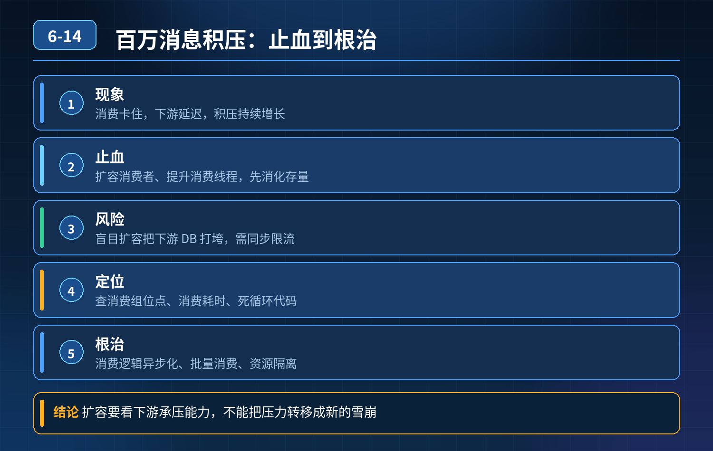

    MQ 百万消息积压，消费卡住、下游延迟，第一时间如何止血、定位、根治

## 第 06-14 题　MQ 百万消息积压，消费卡住、下游延迟，第一时间如何止血、定位、根治

**候选人浅层回答：** 背诵表面结论，没有深入到原理和线上场景。

## 核心拆解一句话结论

核心认知：消息积压本质是生产速率 \> 消费处理速率。

## 候选人浅层回答

重启消费实例、增加消费者、调大消费线程，清理过期消息。

## 连环追问汇总

1. 重启只是临时缓解，流量上来再次积压怎么办？盲目扩容消费者把下游 DB 打垮，如何评估和规避？
2. 业务代码死循环，线程占住不提交 ACK / 位点，怎么定位消费组和代码位置？
3. 多业务共用消费集群，非核心 Topic 抢占资源拖累核心链路，怎么做隔离？
4. 消息体异常，消费报错无限重试，占满消费线程池，怎么定位？
5. 有没有不重启、不加实例的在线止血方案？
6. Broker 磁盘打满，生产受阻，生产者侧兜底手段是什么？

## 一、优先在线止血（不重启、不急着加机器，防止雪崩下游）

1. 限流生产者，削峰控流入 针对积压 Topic，临时调低生产者发送速率、开启发送限流；避免消息持续灌入，磁盘持续上涨直到 Broker 写保护停止写入，影响全集群。

注意：不能直接停生产者，如果业务不允许丢数据，优先限流而不是关停。

1. 消费侧流量拆分、隔离 把该 Topic 的消息分流到临时备用消费组单独消费，和其他正常 Topic 消费线程池物理隔离，避免故障 Topic 抢占资源拖垮别的业务。
2. 降级消费内的非核心逻辑 消费逻辑里的埋点、统计、同步日志等次要逻辑临时开关关闭，只保留核心业务处理，提升单条消费速度。
3. 暂停非核心 Topic 消费 多业务共享集群时，先停报表、日志这类低优先级Topic 的消费，释放线程资源给核心链路。

- ❌ 禁忌：上来就成倍扩容消费者。消费速度瓶颈在下游 DB / 第三方接口，大量并发消费会直接打爆下游，形成二次灾难。

## 二、快速区分积压根因

1）消费阻塞、单条处理慢（下游瓶颈）特征：每条消息处理耗时高，无报错，消费线程正常流转，只是吞吐上不去； 排查：看消费埋点耗时、下游 DB 慢 SQL、第三方接口超时； 对策：下游缓存、异步化、批量合并，或者单独扩容下游服务，而不是 MQ 消费者。

2）异常消息死循环重试（高频坑）特征：少量坏消息反复消费、抛异常、不进死信，持续占用线程；看起来线程都在工作，但消息消费不掉； 定位：拉取消费失败日志，找到报错 msgId、消息体； 对策：把这条异常消息路由到死信队列 DLQ，停止重试。死信队列是这类故障的核心兜底。

3）消费代码死循环 / 阻塞（线程卡死）特征：消费线程卡在某段逻辑，不抛出异常、不退出、不提交位点，线程卡死，不再拉新消息； 定位：打消费服务线程栈（jstack），看消费线程卡在哪个方法，直接定位代码行； 对策：摘流后修复，或者临时跳过该条消息。

4）分区 / 队列分配不均衡分区数少、消费者实例数超过分区数，多余实例空闲，消费能力没跑满； 对策：调整分区数，分区数是消费并发上限。

5）多 Topic 资源争抢共享集群下，某个 Topic 消费慢、长时间占线程，挤压核心业务消费资源； 对策：业务线拆分集群，核心 Topic 独立 Broker 集群 / 独立消费线程池。

## 三、Broker 磁盘打满的兜底方案

Broker 磁盘水位达到高阈值后会拒绝写入，阻断所有生产。

1. 优先扩容磁盘，扩容分区；
2. 临时调整消息保留时长（谨慎！会丢老消息，业务允许才操作）；
3. 已经积压的历史消息优先消费释放磁盘；
4. 事前配置磁盘告警，分水位：预警水位、限流水位、拒绝写入水位。

## 连环追问要点整理

1. 底层核心原理是什么？为什么这么设计？
2. 线上出现相关故障如何快速止损、定位根因？
3. 高并发场景下有哪些坑点，性能、一致性、可用性如何权衡？

## 面试回答完整话术

  - **一句话结论**：核心认知：消息积压本质是生产速率 \> 消费处理速率。
  - **候选人浅层回答**：重启消费实例、增加消费者、调大消费线程，清理过期消息。
  - **连环追问汇总**：重启只是临时缓解，流量上来再次积压怎么办？盲目扩容消费者把下游 DB 打垮，如何评估和规避？
  - **参考答案**：核心认知：消息积压本质是生产速率 \> 消费处理速率。盲目扩消费、加大线程是双刃剑，下游数据库、接口的吞吐上限才是真正瓶颈；处理顺序：先止血控流入 → 区分积压类型定位 → 分流隔离 → 根因修复 +
  - **一、优先在线止血（不重启、不急着加机器，防止雪崩下游）**：限流生产者，削峰控流入 针对积压 Topic，临时调低生产者发送速率、开启发送限流；避免消息持续灌入，磁盘持续上涨直到 Broker 写保护停止写入，影响全集群。
  - **二、快速区分积压根因**：1）消费阻塞、单条处理慢（下游瓶颈）特征：每条消息处理耗时高，无报错，消费线程正常流转，只是吞吐上不去； 排查：看消费埋点耗时、下游 DB 慢 SQL、第三方接口超时； 对策：下游缓存、异步化、批量合
  - **收尾**：线上问题按「先止损保可用性 → 再定位根因 → 最后从架构规范层面根治」三段论闭环。

## 追问：本题考察核心是什么？

###  高级工程师要分清：

1. **不能只停留在背结论**：要能回答「为什么这样设计、不这样会怎样、线上踩坑怎么排查」；
2. **具备止损→定位→根治三段论**：先止血保业务，再定位根因，最后从架构与规范层面根治；
3. **给出工程取舍**：性能、一致性、可用性三者权衡，说清代价与适用场景。

  核心思想：这道题考察原理理解 + 线上实战 + 架构思维，真正的工程答案是「现象 → 根因 → 止损 → 定位 → 根治」五段式闭环。

