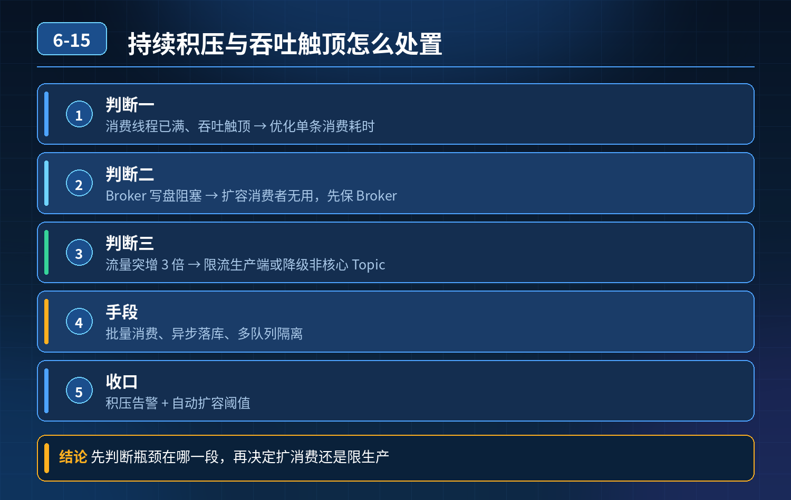

    MQ 持续积压、延迟走高，线程打满消费吞吐触顶、Broker 写盘阻塞等场景如何处置

## 第 06-15 题　MQ 持续积压、延迟走高，线程打满消费吞吐触顶、Broker 写盘阻塞等场景如何处置

**候选人浅层回答：** 背诵表面结论，没有深入到原理和线上场景。

## 核心拆解一句话结论

核心认知：积压公式：堆积速率 = 生产 TPS - 消费 TPS。

## 候选人浅层回答

直接扩容消费实例、调大消费线程，靠提升消费速度消化积压。

## 连环追问汇总

1. 消费线程已经拉满、消费吞吐到上限，消息还在持续堆积怎么办？
2. 如果积压根因是 Broker 写盘卡住，扩容消费者有用吗？紧急止损手段是什么？
3. 流量突增 3 倍，优先扩消费还是限制生产？
4. 依靠哪些指标区分：消费处理变慢 VS 生产流量暴涨？
5. 非核心日志类消息积压，是否需要扩容？消息优先级怎么分级处置？
6. 核心认知：是不是所有积压都必须清到 0？

## 参考答案

第一步：指标判定，先分清两种基础场景（最关键）监控核心指标：生产 TPS、消费 TPS、单条消费耗时、分区拉取延迟、Broker 磁盘 IO、刷盘耗时、堆积增量

- 场景 A：生产 TPS 暴涨，消费 TPS 稳定不变 → 上游流量突增
- 场景 B：生产 TPS 平稳，消费 TPS 持续下跌、单条耗时飙升 → 消费侧瓶颈（下游 DB、RPC、坏消息重试、代码阻塞）第二步：分根因应急止血方案场景 1：消费端已经打满，消费 TPS 触顶（下游是瓶颈）此时再加消费者、加线程只会并发打爆下游数据库 / 第三方接口，造成二次故障。 止血手段：

1. 生产者限流、削峰：优先限制发送速率，把堆积增量压到 0，不让积压继续上涨，防止磁盘打满 Broker 停写，牵连整个集群。
2. 消费逻辑降级：关闭消费内埋点、统计、次要同步逻辑，只保留核心业务。
3. 消息分流隔离：把积压 Topic 拆分出备用消费组，和核心业务消费池隔离，避免抢占资源。
4. 批量优化：单条消费改成批量消费，提升单位吞吐。

场景 2：Broker 写盘卡住（磁盘 IO 瓶颈、刷盘阻塞）

- 扩容消费者完全没用，消费端再快，Broker 收消息、落盘跟不上。 紧急止损：

5\. 临时降低刷盘策略（同步刷盘改异步刷盘，业务允许丢数据才可以）；

6\. 隔离该 Broker 上的其他核心 Topic，把核心业务迁移到健康 Broker；

7\. 限制该 Broker 的生产者发送流量，保护磁盘 IO；

8\. 紧急扩容磁盘、换高速 SSD；Broker 数据迁移是慢操作，故障期不作为急救手段。

场景 3：非核心消息积压（日志、埋点、离线统计）不需要紧急扩容。 策略：容忍积压，错峰消化。

- 不抢占核心链路资源；
- 降低它的消费优先级，核心业务资源优先保障；
- 等到夜间低峰流量时段，再慢慢消费清理；
- 甚至配置丢弃老旧消息（业务可接受），避免占用磁盘。

场景 4：核心业务消息积压（订单、支付）核心链路不允许长时间延迟，必须优先保障：限流上游、扩容下游依赖、单独隔离资源，尽快拉平堆积。

第三步：取舍：什么时候优先限生产，什么时候优先扩消费？

9\. 生产突增，下游处理能力短时间无法扩容 → 优先限流生产者，控制堆积增量，止损第一；

10\. 生产流量稳定，单纯消费侧变慢（下游可扩容） → 优先优化消费、扩容消费；误区：上来无脑扩消费，等于把上游洪峰全部灌到下游依赖，极易击穿 DB、第三方接口。

三层治理体系（面试官想听的三层深度）第一层：事前分级与监控消息预先分级：核心实时消息、普通业务消息、日志埋点离线消息。 监控看板：生产 TPS、消费 TPS、堆积增量、单条消费耗时、Broker 磁盘 IO、刷盘延迟；设置分级告警，低优先级消息告警阈值放宽。

第二层：故障期止血策略

1. 流量控制：生产者限流开关；
2. 资源隔离：不同优先级 Topic 独立消费线程池、独立 Broker 集群；
3. 坏消息兜底：异常消息自动转入死信，避免重试死循环吃光线程。

第三层：常态化优化，从根源减少积压

1. 热点数据前置缓存，降低下游压力；
2. 长耗时逻辑从消费链路剥离，异步二次投递；
3. 按峰值流量预留资源水位，大促前压测演练；
4. 接受合理积压：离线类消息不追求实时清零，避免过度扩容。

## 连环追问要点整理

1. 底层核心原理是什么？为什么这么设计？
2. 线上出现相关故障如何快速止损、定位根因？
3. 高并发场景下有哪些坑点，性能、一致性、可用性如何权衡？

## 面试回答完整话术

  - **一句话结论**：核心认知：积压公式：堆积速率 = 生产 TPS - 消费 TPS。
  - **候选人浅层回答**：直接扩容消费实例、调大消费线程，靠提升消费速度消化积压。
  - **连环追问汇总**：消费线程已经拉满、消费吞吐到上限，消息还在持续堆积怎么办？
  - **参考答案**：核心认知：积压公式：堆积速率 = 生产 TPS - 消费 TPS。扩容消费者只是提升消费 TPS 的手段，不是万能方案；故障第一步不是动手扩容，而是先看指标、定位根因，分级止损。高级工程师懂得：非实时
  - **收尾**：线上问题按「先止损保可用性 → 再定位根因 → 最后从架构规范层面根治」三段论闭环。

## 追问：本题考察核心是什么？

###  高级工程师要分清：

1. **不能只停留在背结论**：要能回答「为什么这样设计、不这样会怎样、线上踩坑怎么排查」；
2. **具备止损→定位→根治三段论**：先止血保业务，再定位根因，最后从架构与规范层面根治；
3. **给出工程取舍**：性能、一致性、可用性三者权衡，说清代价与适用场景。

  核心思想：这道题考察原理理解 + 线上实战 + 架构思维，真正的工程答案是「现象 → 根因 → 止损 → 定位 → 根治」五段式闭环。

