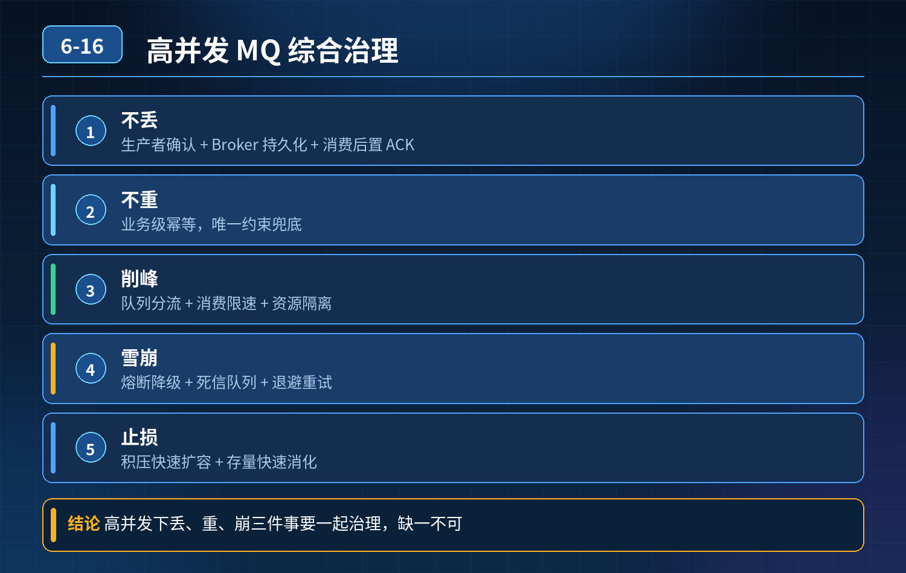

    高并发 MQ 场景，消息丢失、重复消费、服务雪崩整套治理方案

## 第 06-16 题　高并发 MQ 场景，消息丢失、重复消费、服务雪崩整套治理方案

**候选人浅层回答：** 背诵表面结论，没有深入到原理和线上场景。

## 核心拆解一句话结论

核心认知：高并发大流量下，ACK、注解幂等只是基础；

## 候选人浅层回答

开启 ACK、加幂等注解；出问题靠日志排查、手动补发。

## 连环追问汇总

1. 生产、Broker、消费全链路如何防消息丢失？
2. 如何做到业务级绝对幂等？
3. 百万消息积压，如何做到 10 分钟内快速止损？
4. 死信队列怎么设计，避免死信本身丢失？
5. Broker 主从切换过程，如何保证消息不丢、不重复？

## 一、全链路防丢失（生产者 / Broker / 消费者）

1. 生产者端 同步发送 / 带回调异步发送，必须等待 Broker 确认回执；发送前写入本地消息表，状态标记【待投递】；收到成功回执才更新为【投递成功】。

定时任务扫描长期未成功的消息有限次补发，补发失败告警。禁止无回调异步发消息。

2\. Broker 端（重点：主从切换场景） 依靠副本复制机制，而不是单纯刷盘。 消息先同步复制到从副本，副本同步成功后，才给生产者返回发送成功。

- 主节点宕机、触发主从切换：已同步到副本的消息不会丢；
- 未同步到副本的消息，生产者会发送失败，由本地消息表重试；坑：只开持久化、没有副本，主从切换极易丢消息；同步刷盘性能差，高并发场景一般采用「异步刷盘 + 副本同步确认」的折中方案。

3\. 消费者端 严格顺序：业务事务提交落库成功 → 再提交 ACK / 位点。 禁止先ACK 再执行业务；一旦业务执行一半宕机，消息直接丢失。

## 二、业务级绝对幂等（解决重复消费）

单纯注解幂等很容易在并发、分库分表场景失效，业务级幂等方案：

1. 幂等表方案（最稳妥） 以全局唯一业务流水号 / 消息唯一 ID 作为唯一索引。

消费第一步先插入幂等记录，插入成功才执行业务；唯一键冲突直接跳过。把幂等判断放到数据库唯一约束层面，数据库是最终屏障，并发也不会击穿。

2\. 状态机约束 业务状态单向流转。例如支付订单：【待支付→支付成功】，已经是支付成功状态的订单，再次收到扣款消息直接拒绝，不执行任何扣款逻辑。

3\. 补充：幂等逻辑要和业务在同一个事务内，防止幂等记录写入成功、业务逻辑失败，造成消息永久跳过。

注意：没有银弹，幂等解决的是重复投递带来的脏数据；不能防止 MQ 本身故障。

## 三、百万积压，10 分钟快速止损流程（标准化急救步骤）

1. 第一步（1~2 分钟）：看指标，区分根因：生产 TPS 暴涨 / 下游消费慢 /Broker 磁盘 IO 瓶颈；
2. 第二步：限流生产者，止住堆积增量，防止磁盘打满，Broker 拒绝写入、影响全集群；
3. 第三步：隔离故障 Topic，独立消费线程池，避免抢占核心业务资源；
4. 第四步：坏消息路由死信，终止无限重试风暴（很多积压是坏消息死循环导致）；
5. 第五步：消费逻辑降级，剥离埋点、统计、次要同步逻辑，只保留核心业务；
6. 谨慎扩容消费者：只有下游 DB / 接口还有富余容量才扩容，否则直接打爆下游，引发雪崩；核心思路：先控增量，再消化存量，而不是上来疯狂扩容。

## 连环追问要点整理

1. 底层核心原理是什么？为什么这么设计？
2. 线上出现相关故障如何快速止损、定位根因？
3. 高并发场景下有哪些坑点，性能、一致性、可用性如何权衡？

## 面试回答完整话术

  - **一句话结论**：核心认知：高并发大流量下，ACK、注解幂等只是基础；
  - **候选人浅层回答**：开启 ACK、加幂等注解；出问题靠日志排查、手动补发。
  - **连环追问汇总**：生产、Broker、消费全链路如何防消息丢失？
  - **参考答案**：核心认知：高并发大流量下，ACK、注解幂等只是基础；单机测试和生产高吞吐集群最大差别在于：网络抖动、主从切换、IO 毛刺、下游过载都是常态。整套体系分为三层：链路可靠性层、风险隔离熔断层、兜底对账补偿
  - **一、全链路防丢失（生产者 / Broker / 消费者）**：生产者端 同步发送 / 带回调异步发送，必须等待 Broker 确认回执；发送前写入本地消息表，状态标记【待投递】；收到成功回执才更新为【投递成功】。
  - **二、业务级绝对幂等（解决重复消费）**：单纯注解幂等很容易在并发、分库分表场景失效，业务级幂等方案：
  - **收尾**：线上问题按「先止损保可用性 → 再定位根因 → 最后从架构规范层面根治」三段论闭环。

## 追问：本题考察核心是什么？

###  高级工程师要分清：

1. **不能只停留在背结论**：要能回答「为什么这样设计、不这样会怎样、线上踩坑怎么排查」；
2. **具备止损→定位→根治三段论**：先止血保业务，再定位根因，最后从架构与规范层面根治；
3. **给出工程取舍**：性能、一致性、可用性三者权衡，说清代价与适用场景。

  核心思想：这道题考察原理理解 + 线上实战 + 架构思维，真正的工程答案是「现象 → 根因 → 止损 → 定位 → 根治」五段式闭环。

