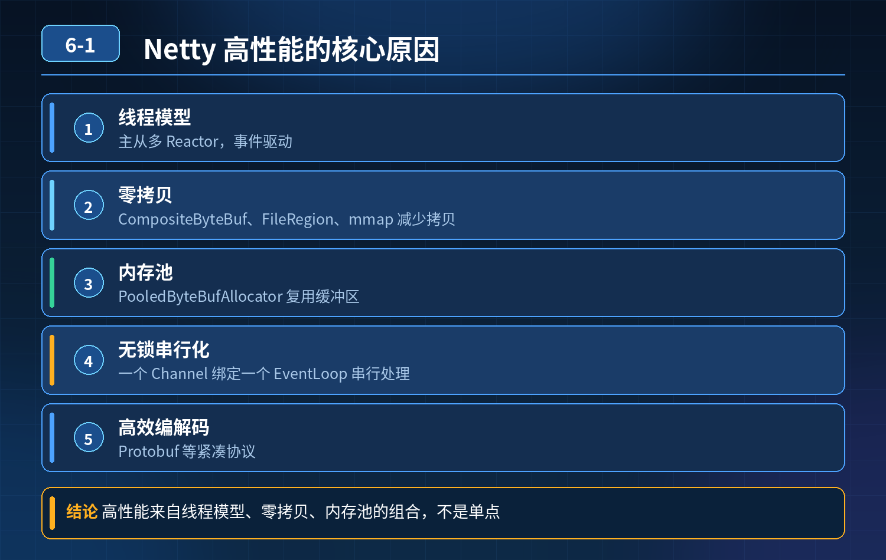

    Netty 高性能核心原理

## 第 06-1 题　Netty 高性能核心原理

**候选人浅层回答：** 主要是零拷贝，减少内核态用户态数据拷贝，降低 CPU 内存开销；加上 Reactor 事件驱动模型，单线程可以处理海量连接，所以性能高。

## 核心拆解一句话结论

本题考察对底层原理和线上实战能力的综合理解，不能只停留在背结论。

## 连环追问

1. 零拷贝是不是完全不发生任何拷贝？为什么业务处理的时候不能一直使用零拷贝？
2. 单 Reactor、主从 Reactor 本质区别，各自适合什么业务场景？
3. 为什么有的人用 Netty 写出来程序，性能反而不如 JDK 原生 NIO？
4. 除了零拷贝、Reactor 模型之外，Netty 还有哪些底层优化，支撑高性能？

## 一、零拷贝概念澄清

零拷贝≠完全没有任何拷贝，只是减少用户态与内核态之间的数据拷贝次数。

传统读写：磁盘 → 内核缓冲区 → 用户进程缓冲区 → socket 内核缓冲区→ 网卡，发生多次 CPU 拷贝。 Netty 的零拷贝（FileChannel.transferTo）：磁盘直接拷贝到 socket 内核缓冲区，绕过用户进程缓冲区，消除 CPU 参与的用户态 \<‑\> 内核态拷贝；但是硬件 DMA 拷贝依然存在。

业务处理不能无脑使用零拷贝：零拷贝适合文件直接转发，数据不需要业务修改；如果业务需要解析报文、修改报文内容，数据必须读到用户内存，零拷贝就用不了。

## 二、Reactor 反应器模型：单 Reactor VS 主从 Reactor

1\. 单 Reactor 单线程：一个线程同时做连接接受、事件分发、业务处理。

1\. 缺点：业务耗时操作会阻塞整个线程，无法支撑高并发；适合小并发简单Demo。

2\. 单 Reactor 多线程：Reactor 线程负责接受连接、IO 事件；业务交给线程池。

1\. 缺点：Reactor 单线程处理所有 accept，高并发大量连接接入时，成为接入瓶颈。

2\. 主从 Reactor（Netty 默认模式）

1\. 主 Reactor（Boss 线程组）：只负责接收 TCP 连接，把注册好的SocketChannel 分发到从 Reactor；不处理业务 IO 读写。

2\. 从 Reactor（Worker 线程组）：处理已建立连接的 IO 读写、编解码，执行业务 Handler。

本质：把「建立连接」和「IO 读写」职责拆分。Boss 线程专门处理连接建立，Worker 线程处理海量连接 IO 事件。 适用场景：RPC、网关，大量长连接高并发场景，这也是 Netty 生产环境默认使用的模型。

坑点：Worker 线程（NIO 线程）禁止执行耗时业务、同步阻塞IO；如果在 ChannelHandler 里面写数据库、RPC 同步调用，会把 Worker 线程堵死，整个服务性能暴跌，这就是很多人 Netty 写出来性能不如原生 NIO 的最主要原因。耗时业务必须丢到业务自定义线程池。

## 三、Netty 其他关键底层高性能优化（除 Reactor、零拷贝之外）

1. 内存池化（PooledByteBuf，默认开启） JDK 原生 NIO ByteBuffer 每次使用直接堆外内存，频繁分配释放会产生内存碎片。Netty 池化堆外内存，复用 ByteBuf 对象，减少对象创建销毁、减少内存碎片。
2. 高效的 ByteBuf 设计 多种缓冲区实现：堆缓冲区、直接缓冲区、复合缓冲区CompositeByteBuf，不用拷贝就可以组合多个缓冲区。
3. 编解码处理器（Handler）流水线 ChannelPipeline 责任链模式，业务逻辑分层隔离；同时支持拆包粘包处理器，解决 TCP 底层无边界问题。
4. IO 多路复用，基于 JDK NIO selector 一个线程可以监听成千上万条 Socket 连接，不需要一连接一线程，线程资源开销小。
5. 避免 JDK NIO 的 epoll 空轮询 bug Netty 做了修复，防止 Selector 无限空轮询 CPU100%。
6. 对象池 Recycler 复用普通 POJO 对象，减少 GC 压力。

<strong>追问：</strong>本题考察核心是什么？

<strong>参考答案：</strong> 不能简单把 Netty 高性能只归结为 “零拷贝 + Reactor”。

1. 要搞懂零拷贝真实含义，知道它的适用边界，不是万能；
2. 理解主从 Reactor 职责分工；最重要的坑：Worker IO 线程不能做阻塞耗时操作，很多线上 Netty 故障都是这个错误；
3. 知道内存池、ByteBuf、Recycler 等其他优化点；
4. 区分 Demo 代码和生产代码，很多人照着 Demo 写 Netty，忽略线程模型约束，线上性能直接拉胯。

高级工程师认知：Netty 高性能是一整套组合优化，不是某一个黑科技；用错线程模型，再好框架也会性能崩坏。

## 连环追问要点整理

1. 底层核心原理是什么？为什么这么设计？
2. 线上出现相关故障如何快速止损、定位根因？
3. 高并发场景下有哪些坑点，性能、一致性、可用性如何权衡？

## 面试回答完整话术

  - **一句话结论**：本题考察对底层原理和线上实战能力的综合理解，不能只停留在背结论。
  - **连环追问**：零拷贝是不是完全不发生任何拷贝？为什么业务处理的时候不能一直使用零拷贝？
  - **一、零拷贝概念澄清**：零拷贝≠完全没有任何拷贝，只是减少用户态与内核态之间的数据拷贝次数。
  - **二、Reactor 反应器模型：单 Reactor VS 主从 Reactor**：1\. 单 Reactor 单线程：一个线程同时做连接接受、事件分发、业务处理。
  - **三、Netty 其他关键底层高性能优化（除 Reactor、零拷贝之外）**：内存池化（PooledByteBuf，默认开启） JDK 原生 NIO ByteBuffer 每次使用直接堆外内存，频繁分配释放会产生内存碎片。Netty 池化堆外内存，复用 ByteBuf 对象，减
  - **收尾**：线上问题按「先止损保可用性 → 再定位根因 → 最后从架构规范层面根治」三段论闭环。

## 追问：本题考察核心是什么？

###  高级工程师要分清：

1. **不能只停留在背结论**：要能回答「为什么这样设计、不这样会怎样、线上踩坑怎么排查」；
2. **具备止损→定位→根治三段论**：先止血保业务，再定位根因，最后从架构与规范层面根治；
3. **给出工程取舍**：性能、一致性、可用性三者权衡，说清代价与适用场景。

  核心思想：这道题考察原理理解 + 线上实战 + 架构思维，真正的工程答案是「现象 → 根因 → 止损 → 定位 → 根治」五段式闭环。

