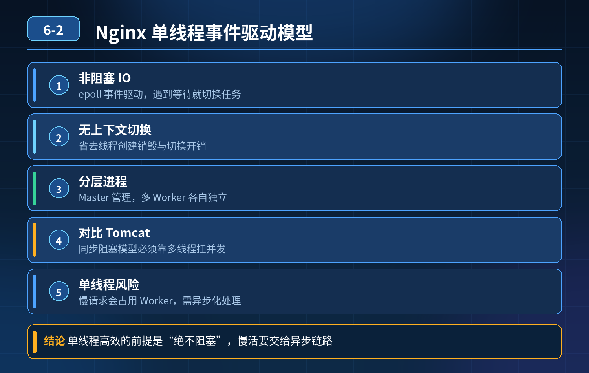

    Nginx Worker 单线程事件驱动模型

## 第 06-2 题　Nginx Worker 单线程事件驱动模型

**候选人浅层回答：** Nginx 是异步非阻塞，不需要为每个请求创建独立线程，省去线程创建销毁、上下文切换开销，并发能力强。

## 核心拆解一句话结论

本题考察对底层原理和线上实战能力的综合理解，不能只停留在背结论。

## 连环追问

1. 既然单线程异步非阻塞这么高效，为什么 Tomcat 仍然采用多线程模型？
2. Worker 单线程，如果遇到慢请求，会不会卡住这个进程下所有连接？
3. 既然单线程性能高，Nginx 为什么要启动多个 Worker 进程，不用一个进程跑满所有 CPU？
4. 单线程模型，多核机器只用一个核心，浪费其余 CPU，这个代价值得吗？为什么不是所有后端服务都做成单线程？
5. Nginx 的 Worker 单线程 和 Redis 的单线程模型，本质异同是什么？

## 一、核心原理：异步非阻塞 + IO 多路复用（epoll）

Worker 内部是单线程事件循环。线程不会阻塞等待连接；epoll 监听大量socket，只在 IO 事件就绪（可读 / 可写）的时候才处理。

重点：单线程并不是同时在处理成千上万个请求，而是不停轮询就绪事件，快速切换处理就绪 IO。连接多不等于同一时刻在运算，大部分连接都是空闲等待网络数据，CPU 只处理就绪事件。 省去大量线程的栈内存、上下文切换、锁竞争开销，所以连接承载能力极强。

## 二、连环问题解答

1. 为什么 Tomcat 用多线程，不用 Nginx 这种单线程？

两者职责完全不一样：

- Nginx：反向代理 / 静态资源网关。业务逻辑极轻，主要是网络 IO、文件读取，几乎没有耗时计算、DB 查询；非常适合异步非阻塞事件循环。
- Tomcat：Java 应用容器，执行复杂业务代码、数据库调用、复杂计算，大量阻塞业务逻辑。 如果 Tomcat 用单线程事件循环，只要一个 DB 慢查询，整个事件循环卡住，所有请求阻塞。

结论：单线程事件模型适合逻辑轻、以 IO 等待为主；一旦业务有大量阻塞操作，就必须多线程。

2\. Worker 单线程遇到慢请求，会不会卡住所有连接？

会！这是单线程事件循环最大的坑。 Worker 单线程同一时刻只能执行一件事。

如果在事件循环里执行阻塞操作（大文件同步读取、同步调用后端接口、sleep），事件循环停滞，这个 Worker 上所有连接全部卡住。 Nginx 的解决方案：

- 所有阻塞操作交给独立线程池（如文件 IO 线程池），Worker 主线程只做事件分发，不阻塞等待；
- 反向代理转发后端请求是异步非阻塞，不会卡住事件循环。

关键点：Nginx 本身把所有阻塞操作剥离出事件循环，才保证单线程稳定。

3\. Nginx 为什么启动多个 Worker 进程，不只用一个进程？

1\. 利用多核 CPU：1 Worker 进程只能跑在单个 CPU 核心。多核机器启动worker_processes auto;，每个 Worker 绑定一个 CPU 核心，多核并行，最大化利用算力。

2\. 进程隔离：一个 Worker 崩溃，不会导致整个 Nginx 挂掉，master 进程会拉起新 Worker。

3\. 进程间无共享内存锁竞争：Worker 之间基本独立，减少锁开销。

Master 进程负责管理、接收信号、监控 worker；Worker 负责业务 IO 事件处理。

4\. 为什么不是所有后端服务都做成单线程？

- 单线程事件模型有明确适用边界： 适合：逻辑简单、计算少、大量 IO 等
- ❌待、连接数巨大（网关、代理、缓存） 不适合：业务复杂、大量 CPU 计算、大量阻塞 DB / 远程调用。 单线程模型下，CPU 密集型任务会直接占满事件循环，所有请求阻塞；这种场景多线程更合适，可以把计算分散到多个核心。

5\. Nginx Worker 单线程 VS Redis 单线程 异同相同点：核心都是单线程事件循环、IO 多路复用，避免大量线程上下文切换，减少锁开销。 差异点

1\. Redis 单线程：所有命令执行都在主线程，内存操作，几乎没有网络代理转发；RDB/AOF 持久化等阻塞操作会放到子进程。

2\. Nginx Worker 单线程：侧重网络转发、代理；文件 IO 会交给内置线程池；Worker 是多进程模型，多核通过多进程利用。

Redis 单进程单主线程；Nginx 是 Master + 多 Worker 进程，每个 Worker 内部单事件循环。

<strong>追问：</strong>本题考察核心是什么？

<strong>参考答案：</strong> 初级开发只记住一句话：异步非阻塞性能高。 高级工程师要理解模型取舍：

1. 单线程高性能的前提：业务不能阻塞事件循环；一旦有阻塞操作，必须丢到线程池；
2. 分清 Nginx（网关轻 IO）和 Tomcat（执行业务阻塞代码）场景差异；
3. 知道多 Worker 进程的目的是利用多核，不是多线程；
4. 理解单线程不是万能架构，是场景取舍，不是越简单性能一定越好；
5. 能区分 Nginx 与 Redis 单线程模型细节差异。

<strong>核心思想：</strong>模型没有好坏，看业务负载；单线程适合 IO 密集轻逻辑，遇到阻塞、CPU 密集场景就不再适用。

## 连环追问要点整理

1. 底层核心原理是什么？为什么这么设计？
2. 线上出现相关故障如何快速止损、定位根因？
3. 高并发场景下有哪些坑点，性能、一致性、可用性如何权衡？

## 面试回答完整话术

  - **一句话结论**：本题考察对底层原理和线上实战能力的综合理解，不能只停留在背结论。
  - **连环追问**：既然单线程异步非阻塞这么高效，为什么 Tomcat 仍然采用多线程模型？
  - **一、核心原理：异步非阻塞 + IO 多路复用（epoll）**：Worker 内部是单线程事件循环。线程不会阻塞等待连接；epoll 监听大量socket，只在 IO 事件就绪（可读 / 可写）的时候才处理。
  - **二、连环问题解答**：为什么 Tomcat 用多线程，不用 Nginx 这种单线程？
  - **收尾**：线上问题按「先止损保可用性 → 再定位根因 → 最后从架构规范层面根治」三段论闭环。

## 追问：本题考察核心是什么？

###  高级工程师要分清：

1. **不能只停留在背结论**：要能回答「为什么这样设计、不这样会怎样、线上踩坑怎么排查」；
2. **具备止损→定位→根治三段论**：先止血保业务，再定位根因，最后从架构与规范层面根治；
3. **给出工程取舍**：性能、一致性、可用性三者权衡，说清代价与适用场景。

  核心思想：这道题考察原理理解 + 线上实战 + 架构思维，真正的工程答案是「现象 → 根因 → 止损 → 定位 → 根治」五段式闭环。

