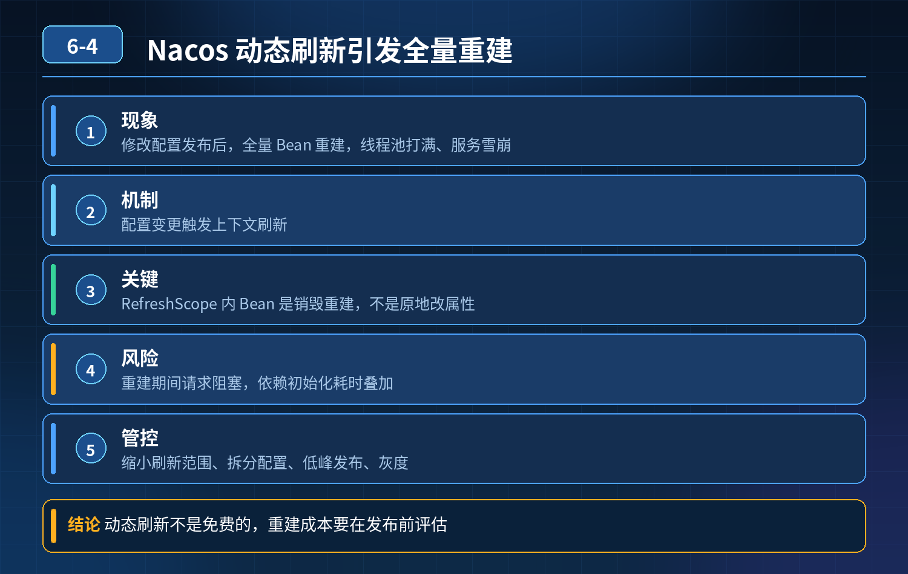

    Nacos 动态配置刷新事故，修改配置触发全量 Bean 重建，线程池打满、服务雪崩；如何管控动态配置刷新风险

## 第 06-4 题　Nacos 动态配置刷新事故，修改配置触发全量 Bean 重建，线程池打满、服务雪崩；如何管控动态配置刷新风险

**候选人浅层回答：** 背诵表面结论，没有深入到原理和线上场景。

## 核心拆解一句话结论

本题考察对底层原理和线上实战能力的综合理解，不能只停留在背结论。

## 一、事故根本原因

Spring Cloud 中@RefreshScope 的底层机制：

1. 配置变更触发 ContextRefresher 刷新上下文；
2. RefreshScope 里面的 Bean，不是原地修改属性，而是销毁旧 Bean、重新创建新 Bean；
3. 如果把大量核心业务 Bean、包含线程池、连接池、重量级资源的 Bean 都放到@RefreshScope 里，配置一变就会批量重建；
4. 重建过程同步阻塞，新来的请求拿不到可用 Bean，大量请求排队阻塞，快速耗尽 Tomcat / 业务线程池；
5. 就算回滚配置，已经卡在重建、排队的请求不会自动恢复，很多时候只能重启。

误区：很多人以为@RefreshScope 只是简单给对象属性赋值，实际上是销毁重建 Bean，有很重的副作用。

## 二、三层防御体系（核心回答）

第一层：区分配置类型，隔离刷新范围（最关键，事前设计）先对配置做分类，不同配置走不同方案，不要一把全部丢进@RefreshScope：

1. 轻量无状态参数（开关、阈值、限流数值、活动上限）：适合动态刷新； 做法：不要把整个业务 Bean 加@RefreshScope，单独抽一个很小的配置类，只持有这些基础数值，Bean 非常轻，重建成本极低。
2. 重量级资源 Bean（数据库连接池、线程池、HttpClient、Redis 连接、MQ 消费者）：禁止使用 @RefreshScope 刷新。 这类资源销毁重建代价极大，极易引发连接丢失、请求中断、线程风暴；这类参数修改，走版本发布重启。
3. 区分全局配置、业务配置；避免一个配置变更，触发大批量无关 Bean 刷新。

最佳实践：优先使用@ConfigurationProperties + 监听回调，自己监听配置变更、原地更新变量，不依赖 RefreshScope 的 Bean 重建。只是单纯修改成员变量，不销毁 Bean，没有重建开销。

第二层：配置发布的管控与灰度能力（发布阶段防护）哪怕是轻量动态配置，发布也不能直接全量推送：

1. 灰度发布：Nacos 自带灰度，先推给少量实例，观察指标（错误率、RT、线程池），没问题再全量；
2. 配置校验：服务本地写校验逻辑，配置拉取后先校验合法性（库存上限不能负数、限流值不能 0、阈值范围），非法配置直接拒绝加载，保留旧值；
3. 变更审计、审批流程：核心业务开关、大促阈值，双人审批，留变更记录；
4. 限流：配置变更推送本身做限流，防止瞬间大批量实例同时刷新，同一时刻大量实例重建 Bean，集群共振。

第三层：熔断、降级、快速恢复兜底（故障发生后的保护）

1. 配置刷新逻辑单独异步化，不和业务请求共用业务线程池；刷新失败保留旧配置，不回滚到空 / 默认值；
2. 监控埋点：配置变更事件、刷新耗时、刷新失败次数、线程池队列堆积，一旦告警自动拦截后续推送；
3. 紧急预案：配置变更支持一键暂停推送；区分 “软刷新” 和需要重启的高危配置；
4. 隔离：刷新阻塞时，原有正常流量要有降级兜底，防止连锁传到下游。

## 三、两种动态更新方案对比（面试加分点）

1. @RefreshScope：简单，但是 Bean 销毁重建，风险高；适合少量轻量配置，谨慎使用；
2. 自定义 Listener（NacosListener / ApplicationListener）：监听配置变更事件，原地修改内存变量，无 Bean 重建，开销极小，生产核心开关优先选这个。

## 四、面试高分连贯话术

这次事故根源是对@RefreshScope 底层理解错了，它不是原地修改对象字段，而是销毁并重新创建被修饰的 Bean。如果我们把包含业务逻辑、重量级资源的 Bean 都加上这个注解，配置一改就批量重建 Bean，重建过程阻塞请求，大量请求堆积打满线程池；回滚配置也很难快速解除已经阻塞的请求，只能重启。

但不是所有配置都不能热更新，我们要做分层设计，三层防护：第一层是配置分类隔离，这是根基。轻量的数值类配置，比如活动阈值、限流开关，我们优先自己写配置监听器，收到变更后原地更新内存变量，不销毁 Bean；尽量少用 @RefreshScope。连接池、线程池这类重量级资源 Bean，绝对不能动态刷新，参数改动走发版重启。 第二层是发布管控，配置变更不能直接全量推送，要走灰度，先少量实例验证，同时内置参数合法性校验，非法配置拒绝加载、保留旧值；核心配置加上审批流程。 第三层是监控和兜底，对配置刷新事件埋点监控，刷新逻辑异步，不和业务线程抢占资源；刷新失败保留旧配置，避免配置失效引发故障。

一句话总结：动态配置的核心风险，不在于 “能不能实时改”，而在于刷新会不会触发重量级资源重建、会不会同步阻塞业务链路。

## 连环追问要点整理

1. 底层核心原理是什么？为什么这么设计？
2. 线上出现相关故障如何快速止损、定位根因？
3. 高并发场景下有哪些坑点，性能、一致性、可用性如何权衡？

## 面试回答完整话术

  - **一句话结论**：本题考察对底层原理和线上实战能力的综合理解，不能只停留在背结论。
  - **一、事故根本原因**：Spring Cloud 中@RefreshScope 的底层机制：
  - **二、三层防御体系（核心回答）**：第一层：区分配置类型，隔离刷新范围（最关键，事前设计）先对配置做分类，不同配置走不同方案，不要一把全部丢进@RefreshScope：
  - **三、两种动态更新方案对比（面试加分点）**：@RefreshScope：简单，但是 Bean 销毁重建，风险高；适合少量轻量配置，谨慎使用；
  - **四、面试高分连贯话术**：这次事故根源是对@RefreshScope 底层理解错了，它不是原地修改对象字段，而是销毁并重新创建被修饰的 Bean。如果我们把包含业务逻辑、重量级资源的 Bean 都加上这个注解，配置一改就批量重
  - **收尾**：线上问题按「先止损保可用性 → 再定位根因 → 最后从架构规范层面根治」三段论闭环。

## 追问：本题考察核心是什么？

###  高级工程师要分清：

1. **不能只停留在背结论**：要能回答「为什么这样设计、不这样会怎样、线上踩坑怎么排查」；
2. **具备止损→定位→根治三段论**：先止血保业务，再定位根因，最后从架构与规范层面根治；
3. **给出工程取舍**：性能、一致性、可用性三者权衡，说清代价与适用场景。

  核心思想：这道题考察原理理解 + 线上实战 + 架构思维，真正的工程答案是「现象 → 根因 → 止损 → 定位 → 根治」五段式闭环。

