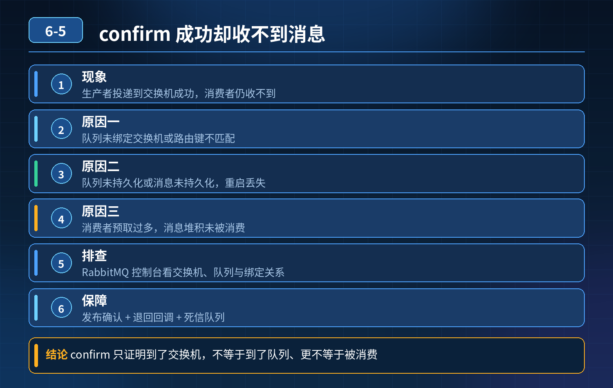

    RabbitMQ 生产者 confirm 成功、交换机路由成功，但消费者收不到消息

## 第 06-5 题　RabbitMQ 生产者 confirm 成功、交换机路由成功，但消费者收不到消息

**举例说明：**生产者日志显示消息投递交换机成功，但队列绑定的路由键是 order.pay，实际发送的是 order.paid，消息被交换机直接丢弃；另一种情况是声明队列时没有持久化，Broker 重启后消息全部丢失。

**候选人浅层回答：** 消费者没启动、连接 MQ 失败；或者生产者消息实际发送失败。

## 核心拆解一句话结论

本题考察对底层原理和线上实战能力的综合理解，不能只停留在背结论。

## 连环追问

消费者正常启动，连接 MQ 正常，交换机队列绑定关系也配置好了。

1. 生产者开启 confirm，日志显示消息投递到交换机成功，交换机路由成功，为什么消费者还是收不到消息？
2. 给出一套线上排查思路，一步步定位。

## 一、先理清流转链路

生产者 → Exchange (交换机) → 路由匹配 → Queue (队列) → Consumer消费者confirm 返回成功、交换机路由成功，只代表消息成功到达交换机，并且路由规则匹配成功，不等于消息成功进入目标队列，这就是核心误区。

## 二、常见根因（路由成功，但消息无法被消费）

1\. 队列存在，但队列里面没有消费者监听 队列创建成功，但是没有任何consumer 订阅这个队列。消息会堆积在队列里，但是不会推送；区分：队列存在 ≠ 有消费者在线监听。后台管理页面看队列的 Consumers 数量。

1\. 消息过期 TTL，直接被丢弃 消息设置了 TTL 过期时间，消息进队列之后，还没等到消费者消费就过期，被 RabbitMQ 直接删掉。

- 如果设置死信队列，消息会转入 DLQ；没有配置死信，消息直接消失。

2\. 队列设置了最大长度，消息溢出被丢弃 队列配置 x-max-length，队列满了，新消息会被丢弃（默认 drop-head 策略）。消息路由成功，但是无法入队。

3\. 消息被死信队列接收，主队列看不到消息 消费失败多次、TTL 超时、队列满，消息进入死信队列。去主队列查不到消息，误以为消息丢失。

4\. 消费者手动 ACK 场景：消息被消费了，但是业务异常没 ack，消息重回队列，或者被持续抢占 多个消费者，消息被另一个实例拿到，卡在未 ack 状态；当前实例看不到这条消息。

管理页面看 Unacked（未确认消息）。

1. 消息属性与队列绑定参数不匹配、消息优先级限制 队列设置最大优先级，消息携带更高优先级，被丢弃；或者消息的 headers 参数不匹配 headers 类型交换机。
2. 消费者限流 prefetch，消息被预取挂在消费者本地缓冲区 prefetch=100，MQ提前推 100 条给消费者缓存，还没处理完；后台页面看 Ready 为 0，Unacked 增加。消息已经给到消费者本地缓冲区，不会再推送给别的消费者。
3. 权限问题 生产者有交换机写权限，但是队列的读权限没给当前消费者账号；路由成功，但是消费者无法读取队列消息。
4. 消息被镜像 / 仲裁队列节点同步异常，节点故障消息不可见 集群场景，消息写入主节点，副本同步异常，节点故障导致消息无法被读取。

## 三、标准线上排查步骤（工程化排查思路）

1\. 打开 RabbitMQ 管理后台，找到目标 Exchange，看 Publish 的消息计数是否上

2\. 涨；确认消息确实投递成功。

2\. 查看目标 Queue：Ready 就绪消息数量、Unacked 未确认数量、Consumers 消费者数量。

- Consumers=0：消息堆积在队列，没有消费者监听；
- Ready=0，Unacked\>0：消息已经推给消费者，卡在消费未 ack；

3\. 检查消息 TTL、队列最大长度、死信队列配置；

4\. 查看死信队列，判断消息是否被转移到 DLQ；

5\. 检查 prefetch 预取值，确认是否大量消息被预取到消费端本地缓存；

6\. 检查账号权限，确认消费者账号具备队列读权限；

7\. 集群环境：检查节点状态，是否节点宕机、副本同步异常。

<strong>追问：</strong>本题考察核心是什么？

<strong>参考答案：</strong> 初级开发只会简单理解：发成功 → 消费者一定收到。 高级工程师要掌握完整消息链路：

1. 分清 confirm 成功只是投递到 Exchange 成功；路由成功 ≠ 消息成功进入队列、≠消费者能拿到消息；
2. 看懂管理后台三个核心指标：Ready、Unacked、Consumers；
3. 知道 TTL、队列长度、死信、prefetch 预取这些隐形机制会吞掉消息；
4. 具备从 MQ 后台指标定位故障的排查思路，而不是盲目改代码。

<strong>核心思想：</strong>消息在交换机之后还有很多关卡，队列、消息生命周期、消费者预取、权限都会阻断消费。

## 连环追问要点整理

1. 底层核心原理是什么？为什么这么设计？
2. 线上出现相关故障如何快速止损、定位根因？
3. 高并发场景下有哪些坑点，性能、一致性、可用性如何权衡？

## 面试回答完整话术

  - **场景举例**：生产者日志显示消息投递交换机成功，但队列绑定的路由键是 order.pay，实际发送的是 order.paid，消息被交换机直接丢弃；另一种情况是声明队列时没有持久化，Broker
  - **一句话结论**：本题考察对底层原理和线上实战能力的综合理解，不能只停留在背结论。
  - **连环追问**：消费者正常启动，连接 MQ 正常，交换机队列绑定关系也配置好了。
  - **一、先理清流转链路**：生产者 → Exchange (交换机) → 路由匹配 → Queue (队列) → Consumer消费者confirm 返回成功、交换机路由成功，只代表消息成功到达交换机，并且路由规则匹配成功，不
  - **二、常见根因（路由成功，但消息无法被消费）**：1\. 队列存在，但队列里面没有消费者监听 队列创建成功，但是没有任何consumer 订阅这个队列。消息会堆积在队列里，但是不会推送；区分：队列存在 ≠ 有消费者在线监听。后台管理页面看队列的 Co
  - **三、标准线上排查步骤（工程化排查思路）**：1\. 打开 RabbitMQ 管理后台，找到目标 Exchange，看 Publish 的消息计数是否上
  - **收尾**：线上问题按「先止损保可用性 → 再定位根因 → 最后从架构规范层面根治」三段论闭环。

## 追问：本题考察核心是什么？

###  高级工程师要分清：

1. **不能只停留在背结论**：要能回答「为什么这样设计、不这样会怎样、线上踩坑怎么排查」；
2. **具备止损→定位→根治三段论**：先止血保业务，再定位根因，最后从架构与规范层面根治；
3. **给出工程取舍**：性能、一致性、可用性三者权衡，说清代价与适用场景。

  核心思想：这道题考察原理理解 + 线上实战 + 架构思维，真正的工程答案是「现象 → 根因 → 止损 → 定位 → 根治」五段式闭环。

