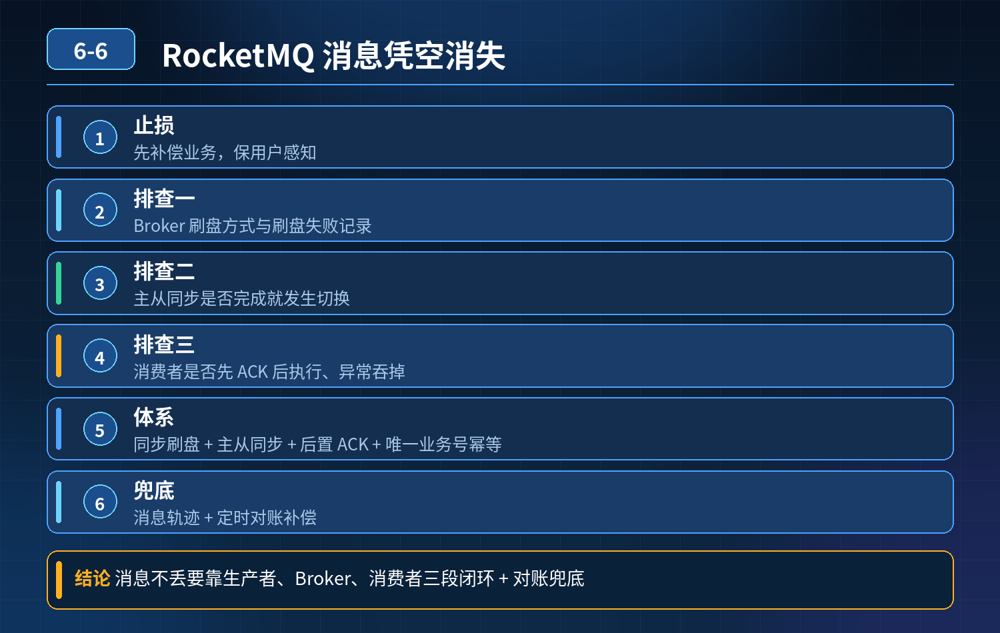

    RocketMQ 异步通知，上千条消息凭空消失，用户收不到短信邮件；如何排查根因，如何搭建全链路消息防丢失体系

## 第 06-6 题　RocketMQ 异步通知，上千条消息凭空消失，用户收不到短信邮件；如何排查根因，如何搭建全链路消息防丢失体系

**候选人浅层回答：** 背诵表面结论，没有深入到原理和线上场景。

## 核心拆解一句话结论

本题考察对底层原理和线上实战能力的综合理解，不能只停留在背结论。

## 候选人浅层回答

开启持久化、生产者确认、消费者手动 ACK 就能保证消息不丢。

## 连环追问

1. 开启持久化就一定不会丢？Broker 刷盘失败怎么办？
2. 主从同步失败，消息丢失怎么处理？
3. 消费者先 ACK，但是后续业务逻辑执行异常，消息等于丢了，怎么解决？
4. 批量消费场景，如果一条消息异常，会不会导致整批消息丢失？

## 参考答案

<strong>核心结论：</strong>只靠持久化 + sendConfirm + 手动 ACK 三个配置远远不够。消息丢失分布在生产、Broker 存储、投递消费、业务执行四个环节，需要四层防护体系。

## 一、先排查：消息凭空消失的常见根因（RocketMQ 高频丢消息场景）

1. 生产者侧

- 同步发送没有捕获异常、超时，发送失败当成发送成功；
- 单向发送（SEND_ONE_WAY），没有确认，网络抖动直接丢；
- 事务消息逻辑错误：半消息提交失败、回查逻辑异常，消息没有提交。

2\. Broker 存储侧

- 刷盘策略为异步刷盘，Broker 进程崩溃，内存中还没落盘的消息丢失；
- 主从同步延迟 / 同步失败，主节点宕机，从节点没有同步到这条消息，切换后消息丢失；
- 磁盘满、磁盘 IO 故障、文件损坏，CommitLog 文件异常；
- 消息超过保留时长被自动清理。

3\. 消费投递侧

- 消费成功后提前 ACK：ACK 提交了，但后面发短信 / 邮件的业务逻辑异常、下游第三方接口失败，消息不会再重试，业务层面等价丢失；
- 批量消费：批量拉取多条，只要代码处理不当，一条异常直接跳过、没有进入重试；
- 重试次数耗尽，消息直接被丢弃（没有配置死信队列）；
- 消费组订阅关系错乱、tag 过滤错误，消息被过滤掉，看起来像消失。

4\. 业务兜底缺失 没有对账机制，丢了消息很久都发现不了。

## 二、四层全链路可靠性防护体系

第一层：生产者端防丢

1. 优先使用同步发送 SYNC，不要默认单向发送；捕获发送异常、超时异常，发送失败走本地重试，重试次数、超时严格限制，防止风暴；
2. 重要场景使用RocketMQ 事务消息，保证【业务 DB 落库】和【发消息】原子性；
3. 本地消息表兜底：先落本地记录，标记待发送，发送成功更新状态；定时任务扫描未成功的记录重试；
4. 发送日志埋点：每条消息保存 msgId、业务唯一 ID（订单号），方便追溯。

第二层：Broker 服务端存储防丢

1. 高可靠场景改用同步刷盘 + 同步主从（SYNC_MASTER）；异步刷盘性能高，但宕机会丢内存消息，不能用于强可靠链路；
2. 监控主从同步延迟、刷盘耗时、磁盘水位；磁盘告警，避免磁盘写满无法写入；
3. 设置合理消息保留时间，不要过早清理；
4. Broker 集群多副本，避免单点故障。

第三层：消费者消费侧防丢（最容易踩坑）核心原则：业务处理成功之后，再执行 ACK，顺序不能反

1. 必须手动 ACK；先执行业务，成功之后再 ACK；业务异常不 ACK，Broker 自动重试；
2. 配置合理重试次数、重试间隔，避免无限重试压垮 Broker；超过最大重试次数转入死信队列 DLQ，而不是直接丢弃；
3. 批量消费重点：不要整批成功 ACK。逐条捕获异常，单条失败单独处理，失败消息进入重试 / 死信，不能一条翻车带走一批；
4. 消费幂等：消息会重试，短信、邮件接口必须做幂等，防止重复发送骚扰用户；用订单号做唯一防重键。

第四层：业务对账兜底（最后一道防线）MQ 的所有机制都有极限，对账是兜底，做到最终一致性： 定时对账任务，对比业务库订单表 和 MQ 消息流水 / 死信表：

- 订单支付成功，但是没有对应通知消息记录 → 补发通知；
- 对账发现死信消息，人工介入排查原因，修复后补发； 这一层是用来捕获前面所有机制漏掉的丢失场景。

## 连环追问要点整理

1. 底层核心原理是什么？为什么这么设计？
2. 线上出现相关故障如何快速止损、定位根因？
3. 高并发场景下有哪些坑点，性能、一致性、可用性如何权衡？

## 面试回答完整话术

  - **一句话结论**：本题考察对底层原理和线上实战能力的综合理解，不能只停留在背结论。
  - **候选人浅层回答**：开启持久化、生产者确认、消费者手动 ACK 就能保证消息不丢。
  - **连环追问**：开启持久化就一定不会丢？Broker 刷盘失败怎么办？
  - **一、先排查：消息凭空消失的常见根因（RocketMQ 高频丢消息场景）**：同步发送没有捕获异常、超时，发送失败当成发送成功；
  - **二、四层全链路可靠性防护体系**：优先使用同步发送 SYNC，不要默认单向发送；捕获发送异常、超时异常，发送失败走本地重试，重试次数、超时严格限制，防止风暴；
  - **三、关键避坑要点汇总**：同步刷盘 + 同步主从会牺牲吞吐量，需要权衡性能和可靠性，不是所有业务都无脑上；
  - **收尾**：线上问题按「先止损保可用性 → 再定位根因 → 最后从架构规范层面根治」三段论闭环。

## 追问：本题考察核心是什么？

###  高级工程师要分清：

1. **不能只停留在背结论**：要能回答「为什么这样设计、不这样会怎样、线上踩坑怎么排查」；
2. **具备止损→定位→根治三段论**：先止血保业务，再定位根因，最后从架构与规范层面根治；
3. **给出工程取舍**：性能、一致性、可用性三者权衡，说清代价与适用场景。

  核心思想：这道题考察原理理解 + 线上实战 + 架构思维，真正的工程答案是「现象 → 根因 → 止损 → 定位 → 根治」五段式闭环。

