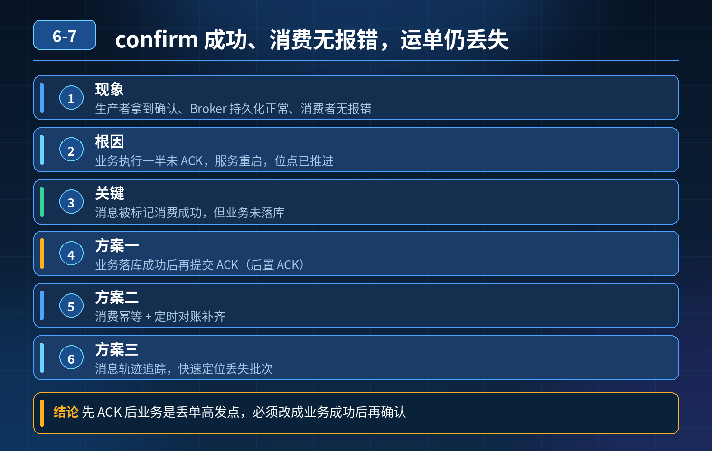

    订单物流 MQ 场景，生产者收到 confirm、消费者无报错，但运单丢失

## 第 06-7 题　订单物流 MQ 场景，生产者收到 confirm、消费者无报错，但运单丢失

**候选人浅层回答：** 背诵表面结论，没有深入到原理和线上场景。

## 核心拆解一句话结论

本题考察对底层原理和线上实战能力的综合理解，不能只停留在背结论。

## 场景复盘

业务：下单成功发送 MQ 消息，消费端调用物流接口创建运单。 现象：

1. 生产者日志：消息发送成功、拿到 Broker 确认；
2. Broker 持久化正常；
3. 消费者无报错日志；
4. 对账发现部分订单没有物流单号，MQ 里也查不到这条消息； 根因：业务执行一半，还没完成、还没 ACK，服务被重启，但是消息被 Broker 标记为消费完成，消息丢了。

误区：很多人以为只要是手动 ACK 就稳了，实际上代码顺序、消费框架底层行为、超时机制才是隐形坑。

核心追问

1. 问题本质是什么？
2. 能不能靠拉长 ACK 等待超时来解决？为什么不行？
3. 整套链路三层防御怎么设计，同时规避丢失和重复？

## 一、先拆解这个事故的本质

不是没有开手动 ACK，而是业务逻辑、外部接口调用、ACK 提交之间的边界没有控制好。 时序还原：

1. MQ 投递消息给消费者；
2. 消费者收到消息，开始执行业务：发起 HTTP 调用物流接口；
3. 外部接口还没返回、运单还没落库，服务被运维重启；
4. 框架 / Broker 侧触发超时，自动 ACK 了这条消息；
5. Broker 删除消息；业务实际没有执行成功 → 消息丢失。

重点：拉长超时时间只是治标，不能根治。 拉长超时的坏处：

- 一旦消费线程卡死，大量消息长时间挂在消费端，消息堆积；
- 故障窗口只是变大，重启、OOM、杀进程依然会触发；
- 还会降低 Broker 消息重投能力，故障之后很久才重试。 所以绝对不能靠调大ACK 超时来解决。

## 二、三层防御体系（面试官要的核心）

第一层：消费流程规范（事前，控制执行顺序）核心原则：外部依赖调用、业务落库全部成功之后，再提交 ACK。 同时要规避框架自动 ACK 陷阱：

1. 确认关闭框架自动 ACK，强制使用手动 ACK；
2. 消费逻辑拆分：先执行业务、调用第三方接口、落库；全部成功，最后一行代码才 basicAck；
3. 只要任何一步失败、异常、超时，不 ACK，Broker 超时后自动重新投递这条消息；
4. 调用外部物流接口必须做幂等，因为重试一定会带来重复调用（重复创建运单）。

这里有个高频坑：第三方接口调用成功，但是回包丢了，业务侧认为失败，不 ACK，MQ 重试，再次调用物流接口 → 重复生成运单。所以外部接口本身必须支持幂等，传入 orderId 作为幂等号。

第二层：消费内状态落地 + 重试管控（事中，防止半执行）调用外部接口是最容易出现 “半成功” 的地方（接口服务已经处理，但是响应包丢了）。 方案：

1. 调用第三方之前，先在本地 DB 记录「处理中」状态（和幂等表一体）；
2. 拿到第三方成功返回，更新为「处理成功」；再 ACK；
3. 如果调用超时、异常，不更新成功状态，不 ACK；
4. 设置合理重试次数 + 指数退避；超过上限转入死信队列，避免无限重试打爆第三方物流接口；
5. 死信告警，人工核查物流接口状态（到底有没有生成运单）。

一句话：把消费的中间状态落地到数据库，不要把业务状态只存在内存里，进程一杀，内存状态直接消失，分不清到底有没有执行成功。

第三层：对账补偿兜底（事后，最后防线）幂等、ACK、死信都属于链路内防护，仍然存在极端失效场景。 定时对账任务：

- 订单表 和 物流运单表做核对；
- 订单已创建、但是没有对应运单记录 → 自动补发消息或者告警人工处理；
- 这一层是兜底，就算前面两层全部失效，也能发现丢失的数据。

## 三、区分两个风险：丢失 vs 重复

- 不 ACK、业务没成功：消息会重投，不会丢，但带来重复调用风险，所以必须配套幂等；
- 提前 ACK / 框架自动 ACK：消息直接删除，永久丢失，没有补救机会； 这也是为什么宁可多一次重试重复，也绝不能提前 ACK。

区分初级和高级工程师初级：知道手动 ACK、持久化，遇到半执行重启的场景，第一想法是调大超时时间。 高级：

1. 明白超时只是兜底参数，不是解决方案；
2. 理解 “内存状态不可信”，外部接口调用必须落地中间状态；
3. 建立完整链路思维：前置规范、重试死信管控、定时对账三层闭环；
4. 清楚第三方 RPC/HTTP 调用是 MQ 可靠性链路里最大的薄弱点，必须配套接口幂等。

## 连环追问要点整理

1. 底层核心原理是什么？为什么这么设计？
2. 线上出现相关故障如何快速止损、定位根因？
3. 高并发场景下有哪些坑点，性能、一致性、可用性如何权衡？

## 面试回答完整话术

  - **一句话结论**：本题考察对底层原理和线上实战能力的综合理解，不能只停留在背结论。
  - **场景复盘**：业务：下单成功发送 MQ 消息，消费端调用物流接口创建运单。 现象：
  - **一、先拆解这个事故的本质**：不是没有开手动 ACK，而是业务逻辑、外部接口调用、ACK 提交之间的边界没有控制好。 时序还原：
  - **二、三层防御体系（面试官要的核心）**：第一层：消费流程规范（事前，控制执行顺序）核心原则：外部依赖调用、业务落库全部成功之后，再提交 ACK。 同时要规避框架自动 ACK 陷阱：
  - **三、区分两个风险：丢失 vs 重复**：不 ACK、业务没成功：消息会重投，不会丢，但带来重复调用风险，所以必须配套幂等；
  - **收尾**：线上问题按「先止损保可用性 → 再定位根因 → 最后从架构规范层面根治」三段论闭环。

## 追问：本题考察核心是什么？

###  高级工程师要分清：

1. **不能只停留在背结论**：要能回答「为什么这样设计、不这样会怎样、线上踩坑怎么排查」；
2. **具备止损→定位→根治三段论**：先止血保业务，再定位根因，最后从架构与规范层面根治；
3. **给出工程取舍**：性能、一致性、可用性三者权衡，说清代价与适用场景。

  核心思想：这道题考察原理理解 + 线上实战 + 架构思维，真正的工程答案是「现象 → 根因 → 止损 → 定位 → 根治」五段式闭环。

