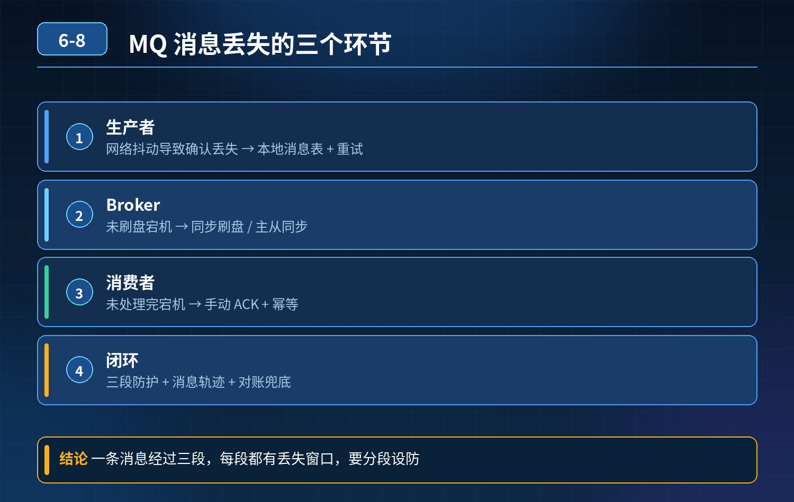

    消息队列消息丢失与可靠性保障

## 第 06-8 题　消息队列消息丢失与可靠性保障

**候选人浅层回答：** 生产者开启 confirm 确认模式，Broker 收到消息返回成功；消费者开启手动 ack，业务处理完成之后再提交确认，两端都做保障就不会丢消息。

## 核心拆解一句话结论

本题考察对底层原理和线上实战能力的综合理解，不能只停留在背结论。

## 连环追问

1. 生产者开启 confirm，网络抖动：消息可能已经投递到 Broker，但是生产者收不到 confirm 回执，生产者无法判断消息到底有没有送达，该怎么处理？
2. Broker 收到消息，还没有刷入磁盘就宕机，内存中的消息是否丢失？集群模式下主节点宕机，从节点还未同步完消息就发生主从切换，消息丢失如何处理？
3. 消费者获取消息，业务还没有处理完成，服务直接宕机，ack 还没提交，消息会不会丢失？
4. 事务消息适用场景和局限性是什么？
5. 消息反复消费失败进入死信队列，如何保证业务数据不会缺失？除 MQ 本身机制之外有没有业务层兜底方案？

## 一、整条链路四大丢消息环节

1. 生产者发送阶段 网络闪断，消息可能发送失败；或者消息已经到达 Broker，但网络问题导致 confirm 回执丢失，生产者状态未知，造成消息状态二义性。

单纯开启 confirm 不能完全解决，需要生产者本地消息表，消息唯一 ID，超时重试。重试会带来重复消息，消费端必须做幂等。

2\. Broker 服务端阶段

- 消息停留在 PageCache，还未刷盘，Broker 宕机，内存消息丢失；需要开启同步刷盘（性能损耗大，生产谨慎评估）。
- 主从集群，主节点收到消息，还没同步到从节点就宕机、发生主从切换，新主节点没有这条消息。需要配置同步复制，等待从节点同步完成再返回成功，同样会牺牲部分吞吐性能。

3\. 消费端阶段 拿到消息之后还未执行业务、还未提交 ack，消费者进程宕机。MQ会重新投递这条消息，消息不会丢，但是会产生重复消费，所以消费逻辑必须做幂等处理。

4\. 死信队列环节 消息多次重试消费全部失败，进入死信队列。如果死信没人监控、无人处理，等同于业务层面消息丢失。

## 二、完整可靠性设计

1. 生产者侧

- 开启 confirm 回调；
- 本地消息表，业务和消息落库在同一个事务；
- 定时任务扫描未确认消息，进行重试发送；
- 消息携带唯一业务 ID，为消费幂等做准备。

注意：重试会带来重复消息，无法做到绝对只投递一次，只能做到至少一次。

2\. Broker 侧

- 根据业务权衡刷盘策略：核心业务可开启同步刷盘；普通业务使用异步刷盘；
- 集群开启主从同步复制，等待从节点同步完成再应答；
- 监控死信队列，死信消息触发告警，人工或者补偿程序介入处理。

3\. 消费者侧

- 使用手动 Ack，业务逻辑执行成功之后再提交 ack；
- 业务必须实现幂等，应对重复投递；
- 消费失败不要无限重试，配置重试次数，超过次数转入死信队列。

4\. 业务兜底（不依赖 MQ 原生能力）

- 本地消息表做对账，定时任务比对业务数据和消息数据，发现消息缺失主动补偿；
- 事务消息：适合本地事务和发消息绑定的场景；局限性：中间件绑定强、有性能开销，不能解决消费端业务异常，不能替代消费幂等和对账兜底。

## 三、重要结论

MQ 做不到绝对 100% 不丢消息，只能通过多套机制把丢消息概率降到极低。

只开启 confirm + 手动 ack 是不够的，要考虑网络抖动、宕机、主从切换、死信堆积等各类故障场景，同时配套业务层兜底对账。

<strong>追问：</strong>这道题考察核心是什么？

<strong>参考答案：</strong> 区分普通后端和高级后端。普通后端只会使用 confirm、手动 ack这些 MQ 原生配置。高级工程师能够完整梳理全链路故障点，理解各个配置带来的性能代价，懂得中间件机制的局限性，会设计业务层兜底方案，考虑幂等、对账、死信告警，保证各类故障下业务数据不出错。

## 场景复盘

拉新活动瞬间涌入几十万消息，MQ 大量堆积； 紧急把消费者扩容 3 倍，消费速度反而越来越慢、报错增多、堆积不降反升； 代码无改动、无慢 SQL、机器 CPU / 内存没打满，下游限流正常。

## 连环追问要点整理

1. 底层核心原理是什么？为什么这么设计？
2. 线上出现相关故障如何快速止损、定位根因？
3. 高并发场景下有哪些坑点，性能、一致性、可用性如何权衡？

## 面试回答完整话术

  - **一句话结论**：本题考察对底层原理和线上实战能力的综合理解，不能只停留在背结论。
  - **连环追问**：生产者开启 confirm，网络抖动：消息可能已经投递到 Broker，但是生产者收不到 confirm 回执，生产者无法判断消息到底有没有送达，该怎么处理？
  - **一、整条链路四大丢消息环节**：生产者发送阶段 网络闪断，消息可能发送失败；或者消息已经到达 Broker，但网络问题导致 confirm 回执丢失，生产者状态未知，造成消息状态二义性。
  - **二、完整可靠性设计**：本地消息表，业务和消息落库在同一个事务；
  - **三、重要结论**：MQ 做不到绝对 100% 不丢消息，只能通过多套机制把丢消息概率降到极低。
  - **场景复盘**：拉新活动瞬间涌入几十万消息，MQ 大量堆积； 紧急把消费者扩容 3 倍，消费速度反而越来越慢、报错增多、堆积不降反升； 代码无改动、无慢 SQL、机器 CPU / 内存没打满，下游限流正常。
  - **收尾**：线上问题按「先止损保可用性 → 再定位根因 → 最后从架构规范层面根治」三段论闭环。

## 追问：本题考察核心是什么？

###  高级工程师要分清：

1. **不能只停留在背结论**：要能回答「为什么这样设计、不这样会怎样、线上踩坑怎么排查」；
2. **具备止损→定位→根治三段论**：先止血保业务，再定位根因，最后从架构与规范层面根治；
3. **给出工程取舍**：性能、一致性、可用性三者权衡，说清代价与适用场景。

  核心思想：这道题考察原理理解 + 线上实战 + 架构思维，真正的工程答案是「现象 → 根因 → 止损 → 定位 → 根治」五段式闭环。

