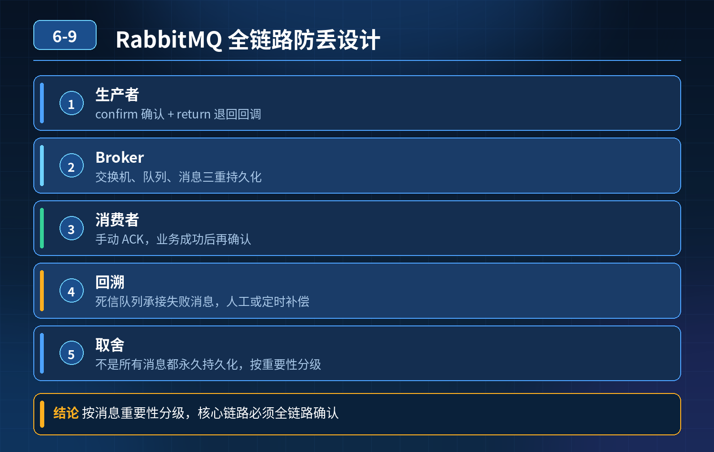

    RabbitMQ 防止消息丢失，全链路可靠性设计

## 第 06-9 题　RabbitMQ 防止消息丢失，全链路可靠性设计

**候选人浅层回答：** 队列和消息开启持久化；消费端改为手动 ACK 确认，就可以避免消息丢失。

## 核心拆解一句话结论

本题考察对底层原理和线上实战能力的综合理解，不能只停留在背结论。

## 连环追问

电商下单发送库存扣减消息，平时正常；服务器断电、网络闪断，消息凭空消失，订单生成库存没扣；还会出现消息重复投递，同一订单多次扣库存导致超卖。本地测试没问题，线上重启 / 网络抖动就丢消息、重复消费。

1. 问题根源在哪？从生产者、Broker、消费者做全链路闭环优化怎么做？
2. 是否为了保证不丢消息，所有消息全部永久持久化，并且无限重试消费？

## 一、消息丢失的三大环节（三段式防御）

消息丢失发生在 3 个地方：生产者发消息阶段、Broker 服务端、消费者消费阶段；只开持久化 + 手动 ACK，只覆盖 Broker 和消费端，生产者侧丢消息的漏洞没有补上，这就是线上故障根源。

1）生产者端：消息没到达 Broker 就丢失场景：生产者发送消息，网络闪断，消息还没投递到 RabbitMQ，业务代码已经认为发送成功。 解决方案：

- 开启生产者确认机制 Publisher Confirms。Broker 收到消息落盘成功后回调ack；如果返回 nack 或者超时，生产者重试投递。
- 业务层：先保存本地消息表（订单 + 消息状态），再发送 MQ；定时任务扫描本地消息表，补偿重试未确认的消息。

注意：单纯 confirm 也有边界 case，推荐本地消息表 +confirm，不推荐无限重试，要做重试次数限制。

2）Broker 服务端：消息收到，但还未落盘磁盘，机器断电丢失只开启队列持久化、消息持久化还不够。

- 开启持久化：durable=true 队列持久，消息标记 persistent；
- 集群模式使用镜像队列 / Quorum 队列，消息复制到多个节点；
- 缺陷：RabbitMQ 默认刷盘策略不是每次消息都 fsync 落盘，写入页缓存就返回成功，断电会丢。高性能场景不能每次强制刷盘（性能暴跌），需要权衡可靠性与吞吐。

3）消费者端：消息拿到，还没执行业务，服务宕机自动 ACK：消息推送给消费者，MQ 立刻删除消息；如果消费过程服务宕机，消息丢失。 方案：手动 ACK。业务逻辑执行成功（库存扣减落库完成）之后，再调用 ack 通知 MQ；业务异常不 ack，消息重回队列。

坑点：ACK 时机非常关键，必须业务数据库事务提交成功之后再ACK；如果先 ACK 再执行业务，消息丢失；如果业务执行完数据库失败才 ACK，会重复投递。

## 二、重复消费问题（幂等，解决超卖）

网络延迟：业务执行成功，ACK 报文丢了。Broker 没收到 ack，消息重新投递，出现重复消费，库存多次扣减。 MQ 本身不保证只投递一次，只能保证至少一次（at-least-once）。 解决手段：业务层实现幂等

1. 订单号作为唯一业务 key；消费前查询，判断该订单是否已经处理，已处理直接返回 ack，不重复扣库存。
2. 幂等表记录已消费业务 ID；
3. 数据库唯一索引 / 乐观锁防止重复扣减库存。

## 三、第二个追问：不能全部永久持久化 + 无限重试

1. 永久持久化：持久化会带来磁盘 IO 开销，降低吞吐。不是所有业务都需要持久化，日志类、允许丢失的消息可以不用持久化，提升性能。
2. 无限重试绝对不行：

- 业务异常（参数错误、订单不存在），无限重试会死循环，持续占用队列资源；
- 方案：设置最大重试次数，超过阈值转入死信队列 DLQ，人工排查，避免阻塞正常业务。

## 四、完整闭环流程（电商库存扣减）

1. 下单事务：生成订单，本地消息表插入一条消息状态 = 待发送，事务提交；
2. 发送消息到 MQ，开启 publisher confirm；
3. 收到 Broker 确认，更新本地消息状态为已发送；长时间未收到 confirm，定时任务重试；
4. MQ：队列持久，使用仲裁队列，消息持久；
5. 消费者收到消息，先查询幂等记录；
6. 执行业务：扣减库存数据库事务；事务成功提交；
7. 手动 ACK；
8. 消费失败，有限次数重试；超过次数进入死信队列，人工处理。

<strong>追问：</strong>本题考察核心是什么？

<strong>参考答案：</strong> 初级开发只会记住持久化 + 手动 ACK 两个配置。高级工程师要理解全链路风险：

1. 消息丢失是三段式风险，生产者投递阶段最容易被忽略；
2. 理解 MQ 的 at-least-once 模型，重复消费是必然要处理的，不是 bug，是分布式 MQ 的固有特性，必须业务幂等兜底；
3. 取舍思维：可靠性不是无限堆持久化、无限重试，要区分业务，死信队列隔离异常消息，防止队列雪崩；
4. 能把理论落地到电商库存场景，理解事务时序、ACK 顺序带来的线上故障。

<strong>核心思想：</strong>MQ 只是中间件，消息可靠性不能完全依赖 MQ，业务侧本地消息表 + 幂等是兜底关键。

## 连环追问要点整理

1. 底层核心原理是什么？为什么这么设计？
2. 线上出现相关故障如何快速止损、定位根因？
3. 高并发场景下有哪些坑点，性能、一致性、可用性如何权衡？

## 面试回答完整话术

  - **一句话结论**：本题考察对底层原理和线上实战能力的综合理解，不能只停留在背结论。
  - **连环追问**：电商下单发送库存扣减消息，平时正常；服务器断电、网络闪断，消息凭空消失，订单生成库存没扣；还会出现消息重复投递，同一订单多次扣库存导致超卖。本地测试没问题，线上重启 / 网络抖动就丢消息、重复消费。
  - **一、消息丢失的三大环节（三段式防御）**：消息丢失发生在 3 个地方：生产者发消息阶段、Broker 服务端、消费者消费阶段；只开持久化 + 手动 ACK，只覆盖 Broker 和消费端，生产者侧丢消息的漏洞没有补上，这就是线上故障根源。
  - **二、重复消费问题（幂等，解决超卖）**：网络延迟：业务执行成功，ACK 报文丢了。Broker 没收到 ack，消息重新投递，出现重复消费，库存多次扣减。 MQ 本身不保证只投递一次，只能保证至少一次（at-least-once）。 解决手
  - **三、第二个追问：不能全部永久持久化 + 无限重试**：永久持久化：持久化会带来磁盘 IO 开销，降低吞吐。不是所有业务都需要持久化，日志类、允许丢失的消息可以不用持久化，提升性能。
  - **四、完整闭环流程（电商库存扣减）**：下单事务：生成订单，本地消息表插入一条消息状态 = 待发送，事务提交；
  - **收尾**：线上问题按「先止损保可用性 → 再定位根因 → 最后从架构规范层面根治」三段论闭环。

## 追问：本题考察核心是什么？

###  高级工程师要分清：

1. **不能只停留在背结论**：要能回答「为什么这样设计、不这样会怎样、线上踩坑怎么排查」；
2. **具备止损→定位→根治三段论**：先止血保业务，再定位根因，最后从架构与规范层面根治；
3. **给出工程取舍**：性能、一致性、可用性三者权衡，说清代价与适用场景。

  核心思想：这道题考察原理理解 + 线上实战 + 架构思维，真正的工程答案是「现象 → 根因 → 止损 → 定位 → 根治」五段式闭环。

