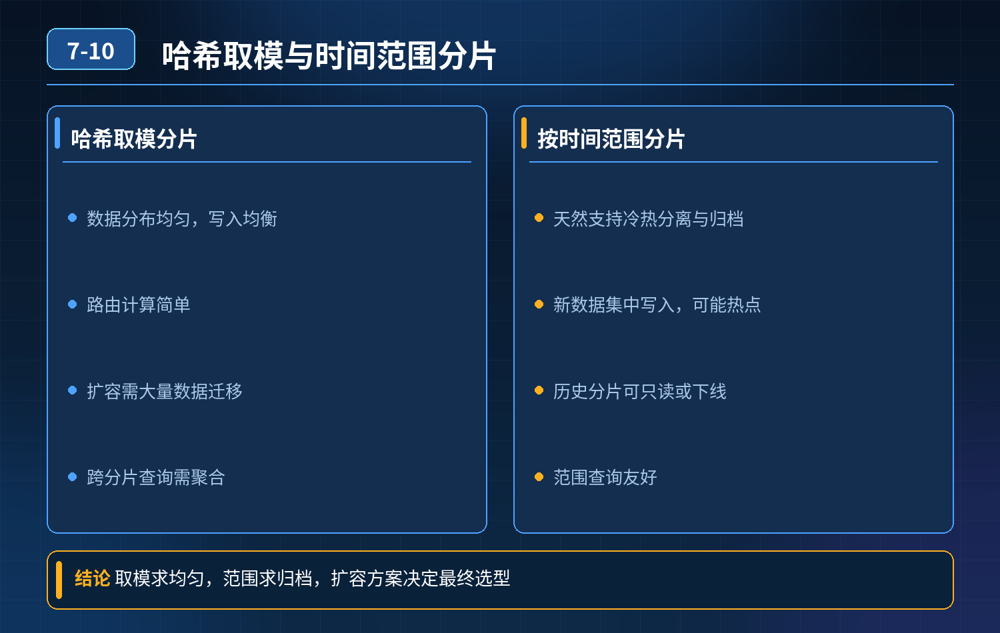

    分库分表方案设计，哈希取模 vs 按时间范围拆分、平滑扩容、跨库关联、衍生问题、“能不分就不分” 的理解

## 第 07-10 题　分库分表方案设计，哈希取模 vs 按时间范围拆分、平滑扩容、跨库关联、衍生问题、“能不分就不分” 的理解

**候选人浅层回答：** 背诵表面结论，没有深入到原理和线上场景。

## 核心拆解一句话结论

本题考察对底层原理和线上实战能力的综合理解，不能只停留在背结论。

## 面试官连环追问：

1. 哈希取模从 8 库扩到 16 库，大量数据要迁移，停服迁移能接受吗？不停服平滑扩容怎么做？
2. 按时间范围拆分行不行？两种分片方式各自适用场景？
3. 拆分后跨库关联怎么处理？分页排序、分布式主键怎么解决？
4. 为什么说分库分表不是银弹，业界共识：能不分库分表，就尽量不分？

## 一、两种分片策略对比

1）哈希取模（hash (user_id) % N）

- 优点：数据均匀打散，热点分散；按分片键等值查询路由到单分片，查询很
- ❌快。

缺点：扩容极痛苦，N 一变，取模结果大面积失效，绝大部分数据路由位置改变；直接扩容需要大规模数据迁移。 适用场景：用户数据、账户、订单（以用户 ID 作为查询入口），查询大多带分片键，流量要打散，没有明显时间热点。

2）范围分片（按时间：按月 / 按天分表，create_time）

- 优点：扩容简单，新增时间片直接新建表，几乎不用迁移老数据；时间范围
- ❌查询天然友好。

缺点：容易出现热点分片—— 最近月份的数据读写量巨大，新表压力极高；老冷表压力很小，负载不均衡。 适用场景：流水、日志、交易账单、监控记录，查询大多带时间条件，历史数据冷、新数据热。

补充：还有复合分片、基因法、一致性哈希。一致性哈希可以降低扩容迁移比例，但它也不是完美的，存在虚拟节点、热点漂移问题，ShardingSphere 也支持。

## 二、哈希分片不停服平滑扩容方案（核心考点）

直接改模、停服迁移是老旧方案，线上大业务不接受。主流平滑扩容：双写 +数据同步校验 + 灰度切流量，步骤：

1. 新集群（16 库）和老集群（8 库）并行部署；
2. 应用开启双写：写请求同时写入老分片、新分片；
3. 用同步工具（Canal/binlog）兜底同步存量数据，并且做数据比对、修复不一致数据；
4. 灰度切换读流量：逐步把一部分用户的读请求切到新分片，观察报错、延迟；
5. 全量切流完成，验证一段时间稳定后，停止双写，下线老集群。

另外一种方案：中间层固定分片数量，业务层路由二次映射（固定模数，路由表映射逻辑），模数不变，只是修改映射关系，迁移量可控。

一致性哈希只是减少迁移数据量，并不能做到零迁移，只是迁移比例从 7/8 降到少量节点。

## 三、分表之后衍生问题的落地解法

1. 跨库关联 join 优先规避：

- 冗余字段（宽表），把需要关联的字段冗余到同一张分片内，避免跨库 join；
- 大表按相同分片键对齐（订单、订单明细都用 user_id 分片，父子数据落在同一个库，可本地 join，叫同路由）； 必须跨库的：先查 A 分片拿到 ID 集合，
- ❌再批量查 B 分片，内存做组装；复杂关联走 ES 检索。

禁止直接跨库join，MySQL 不支持跨库事务，性能极差。

2\. 分页排序 前面一题讲过：普通 limit offset 分页会错乱。优先游标（keyset）分页；浅分页可以框架拉取全分片数据内存合并；深分页、多条件检索直接上 ES。

3\. 分布式主键 不能依赖数据库自增（分库会重复）。可选方案：雪花算法Snowflake、号段模式（Leaf）、Redis 自增；雪花最常用，要注意机器 ID 分配、时钟回拨问题。

4\. 分布式事务 分库后，跨库就是分布式事务。优先业务最终一致性：状态机 +本地消息表、可靠消息队列；尽量避免强一致性 XA，XA 性能差、阻塞风险高。

## 四、为什么说【能不分，就不分库分表】，它不是性能银弹

6\. 分库分表是很重的架构方案，是补救手段，不是优化手段，代价非常大：

1\. 业务复杂度暴涨：要处理路由、主键、跨库查询、分页、扩容、数据迁移、数据校验；开发、测试、排查问题成本大幅上升；

2\. 很多数据库原生能力丢失：跨库 join、数据库约束、全局唯一约束、复杂聚合、数据库事务；

3\. 运维成本翻倍：多库多表、数据同步、扩容、故障排查、数据一致性校验都更麻烦；

4\. 很多时候瓶颈根本不在单表行数：索引不合理、SQL 烂、没有缓存、硬件弱、没有读写分离，这些问题先优化，收益远高于分表；

- 正确顺序：先优化索引 → 加缓存 → 读写分离（主从）→ 历史数据归档冷热分离 → 最后才考虑分库分表。 只有当单表已经到性能天花板、读写分离 + 缓存扛不住、业务数据持续高速增长的时候，才上分库分表。

面试高分连贯话术我会先评估业务查询模式再选分片策略，而不是默认直接 user_id 哈希。 哈希取模适合用户、账户这类以用户 ID 查询为主、需要打散热点的场景，优点是数据分布均匀；缺点是模数一变，大部分数据路由失效，直接扩容需要大量迁移，停服迁移线上高可用业务一般不可接受。不停服平滑扩容主流是双写 + binlog 同步 + 灰度切流，存量数据同步并做数据校验，逐步把读流量切到新分片，稳定后下线老集群；一致性哈希可以减少迁移数据量，但不能零迁移。 按时间范围分片适合流水、账单这类强时间查询的场景，扩容简单，新增时间片建表即可；缺点是新时间分片容易成为热点，负载不均衡。

拆分后有一堆衍生问题：跨库 join 优先通过同分片键对齐、冗余字段规避；实在规避不了就多次查询内存组装，复杂检索交给 ES；分页排序尽量用游标分页，避开 limit offset 的缺陷；主键放弃自增，使用雪花或者 Leaf 号段；跨库事务优先用可靠消息、本地消息表做最终一致性，少用 XA。

同时我认同 “能不分就不分”，分库分表不是性能银弹，它是成本很高的兜底方案。它会丢掉很多数据库能力，大幅提升开发、测试、运维复杂度。优化顺序应该是：优化 SQL 索引 → 引入缓存 → 读写分离 → 冷热归档，这些手段用完还扛不住，再考虑分库分表。

## 连环追问要点整理

1. 底层核心原理是什么？为什么这么设计？
2. 线上出现相关故障如何快速止损、定位根因？
3. 高并发场景下有哪些坑点，性能、一致性、可用性如何权衡？

## 面试回答完整话术

  - **一句话结论**：本题考察对底层原理和线上实战能力的综合理解，不能只停留在背结论。
  - **面试官连环追问：**：哈希取模从 8 库扩到 16 库，大量数据要迁移，停服迁移能接受吗？不停服平滑扩容怎么做？
  - **一、两种分片策略对比**：1）哈希取模（hash (user_id) % N）
  - **二、哈希分片不停服平滑扩容方案（核心考点）**：直接改模、停服迁移是老旧方案，线上大业务不接受。主流平滑扩容：双写 +数据同步校验 + 灰度切流量，步骤：
  - **三、分表之后衍生问题的落地解法**：冗余字段（宽表），把需要关联的字段冗余到同一张分片内，避免跨库 join；
  - **四、为什么说【能不分，就不分库分表】，它不是性能银弹**：6\. 分库分表是很重的架构方案，是补救手段，不是优化手段，代价非常大：
  - **收尾**：线上问题按「先止损保可用性 → 再定位根因 → 最后从架构规范层面根治」三段论闭环。

## 追问：本题考察核心是什么？

###  高级工程师要分清：

1. **不能只停留在背结论**：要能回答「为什么这样设计、不这样会怎样、线上踩坑怎么排查」；
2. **具备止损→定位→根治三段论**：先止血保业务，再定位根因，最后从架构与规范层面根治；
3. **给出工程取舍**：性能、一致性、可用性三者权衡，说清代价与适用场景。

  核心思想：这道题考察原理理解 + 线上实战 + 架构思维，真正的工程答案是「现象 → 根因 → 止损 → 定位 → 根治」五段式闭环。

