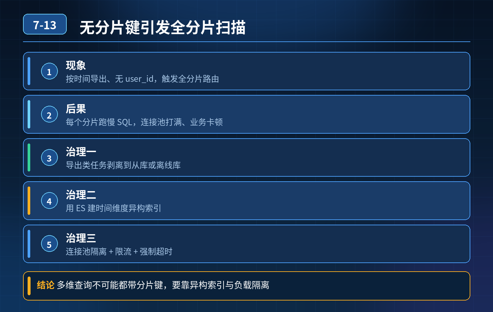

    分片键是 user_id，按用户 ID 哈希分订单表；不带分片键、仅按时间范围导出订单，全分片扫描，连接池打满、线上业务卡顿，如何治理多维查询

## 第 07-13 题　分片键是 user_id，按用户 ID 哈希分订单表；不带分片键、仅按时间范围导出订单，全分片扫描，连接池打满、线上业务卡顿，如何治理多维查询

**候选人浅层回答：** 背诵表面结论，没有深入到原理和线上场景。

## 核心拆解一句话结论

本题考察对底层原理和线上实战能力的综合理解，不能只停留在背结论。

## 一、事故根因

分片键是user_id，路由逻辑依赖分片键；SQL 不带分片键，分片框架不知道走哪个分片，只能广播查询：向全部分片下发 SQL。

1. 导出是大数据量、长时间扫描 SQL；
2. 每一个分片都执行这条慢 SQL，占用数据库连接；
3. 短时间内所有分片连接池被占满；
4. 正常用户下单（带 user_id，单点路由）拿不到连接，业务卡顿。

本质矛盾：分库分表是为分片键的等值查询优化的；非分片键的过滤条件，天然就是全分片广播，风险极高。 业务上不可能强制所有查询都带上分片键，报表、后台统计、多维检索本来就没有 user_id。

## 二、三层防御体系（面试核心）

第一层：访问层拦截 + 流量隔离（事前防护，优先做）

1\. 路由规则校验 在 ShardingSphere 或者自研网关层做 SQL 检查：核心交易链路（下单、查自己订单）强制必须携带分片键；后台统计、导出类的查询打上标签，不允许直接走主业务分片库。 不是一刀切禁止不带分片键的 SQL，而是区分流量身份：业务 C 端流量禁止广播查询；后台报表流量不允许直接打业务分片集群。

2\. 资源隔离

1\. 读写分离：C 端读走从库；但就算从库，全分片扫描依然会打爆从库连接。

2\. 单独给报表、导出、离线统计搭建独立从库 / 只读集群，和在线业务库资源隔离；在线主从集群禁止跑大批量导出 SQL。

3\. 限流、超时、连接配额 给广播查询单独配额：广播查询最大并发数、最长执行时间，超过直接拒绝；和单点路由查询分开限流，防止统计流量挤占在线流量连接。

第二层：数据异构，把多维查询下沉到专用引擎（主流生产方案）这是根治方案，也是大厂最常用方案，在线分片 MySQL 只承载在线交易读写，不承担多维检索、报表导出。 方案选型：

1. ES 同步异构（最常用） 通过 Canal 监听订单 binlog，同步订单全量字段到ES；ES 建立时间、订单号、状态等多维索引。 运营导出、按时间筛选、多条件组合统计，全部查 ES，不碰 MySQL 分片集群。 优点：多维检索、分页、聚合友好；缺点：有同步延迟，对强一致报表不适合。
2. 数仓 / OLAP（ClickHouse、Doris） T+1 或者准实时同步订单数据到 OLAP 引擎，用于大数据量报表、运营导出、数据分析；适合大时间段、大规模聚合统计。 适合这次场景：近一周成交订单导出，本身就是分析类需求，根本不该跑在交易库。

<strong>核心思想：</strong>在线交易库只负责交易；查询模式和交易不一样的，单独存储。

第三层：兜底策略，如果必须临时在分片 MySQL 上执行广播查询（应急，不常态化）实在不能走 ES/OLAP，必须在分片集群查不带分片键的条件，做降级保护：

1. 禁止一次性全量导出；改成分批、游标分页，降低单次扫描压力；
2. 走低峰期执行（凌晨），业务高峰直接拦截这类 SQL；
3. 分片框架层面：对广播查询做资源熔断，一旦广播查询占用连接超过阈值，直接拒绝新的广播 SQL，保护单点路由的在线业务；
4. 增加联合分片、复合分片设计（备选，有限场景）：比如 user_id+create_time复合分片键，但改动成本高，索引、路由变复杂，不能解决任意维度查询。

## 三、补充：什么时候可以接受广播查询？

只有小流量、轻量统计、返回结果很小的场景；大批量、长时间、大结果集的统计查询，绝对不能走广播。

## 四、面试高分话术

这个事故根源是分片键设计带来的访问模型约束：分片键是user_id，没有分片键的查询会触发全分片广播，每一个分片都执行 SQL。导出又是大扫描 SQL，瞬间耗尽所有分片连接池，挤压正常下单的连接资源。 但我们不能简单要求所有查询都带上分片键，后台报表、数据分析本身就没有 user_id 这个条件。我会搭建三层防御： 第一层是流量隔离和访问管控：区分 C 端在线流量和后台统计流量，在线交易链路强制带分片键；报表导出流量不允许直接访问在线分片集群，同时给广播查询单独设置并发、超时配额，避免抢占在线资源。 第二层是数据异构，这是根治方案：用 Canal 同步 binlog，把订单数据同步到 ES 或者 ClickHouse/Doris。在线 MySQL 分片只处理用户下单、按用户 ID 查订单这类分片键查询；按时间、状态多维筛选、导出报表全部交给 ES/OLAP，和交易库解耦。 第三层是应急兜底，如果特殊场景必须在 MySQL 分片执行广播查询，只能放到业务低峰期、分批游标查询，并且加上熔断保护，高峰直接拦截，防止拖垮在线业务。 总结一句话：分库分表的 MySQL，是为分片键查询设计的，多维统计查询本身就不是它的职责，要做存储分层。

## 连环追问要点整理

1. 底层核心原理是什么？为什么这么设计？
2. 线上出现相关故障如何快速止损、定位根因？
3. 高并发场景下有哪些坑点，性能、一致性、可用性如何权衡？

## 面试回答完整话术

  - **一句话结论**：本题考察对底层原理和线上实战能力的综合理解，不能只停留在背结论。
  - **一、事故根因**：分片键是user_id，路由逻辑依赖分片键；SQL 不带分片键，分片框架不知道走哪个分片，只能广播查询：向全部分片下发 SQL。
  - **二、三层防御体系（面试核心）**：第一层：访问层拦截 + 流量隔离（事前防护，优先做）
  - **三、补充：什么时候可以接受广播查询？**：只有小流量、轻量统计、返回结果很小的场景；大批量、长时间、大结果集的统计查询，绝对不能走广播。
  - **四、面试高分话术**：这个事故根源是分片键设计带来的访问模型约束：分片键是user_id，没有分片键的查询会触发全分片广播，每一个分片都执行 SQL。导出又是大扫描 SQL，瞬间耗尽所有分片连接池，挤压正常下单的连接资源。
  - **收尾**：线上问题按「先止损保可用性 → 再定位根因 → 最后从架构规范层面根治」三段论闭环。

## 追问：本题考察核心是什么？

###  高级工程师要分清：

1. **不能只停留在背结论**：要能回答「为什么这样设计、不这样会怎样、线上踩坑怎么排查」；
2. **具备止损→定位→根治三段论**：先止血保业务，再定位根因，最后从架构与规范层面根治；
3. **给出工程取舍**：性能、一致性、可用性三者权衡，说清代价与适用场景。

  核心思想：这道题考察原理理解 + 线上实战 + 架构思维，真正的工程答案是「现象 → 根因 → 止损 → 定位 → 根治」五段式闭环。

