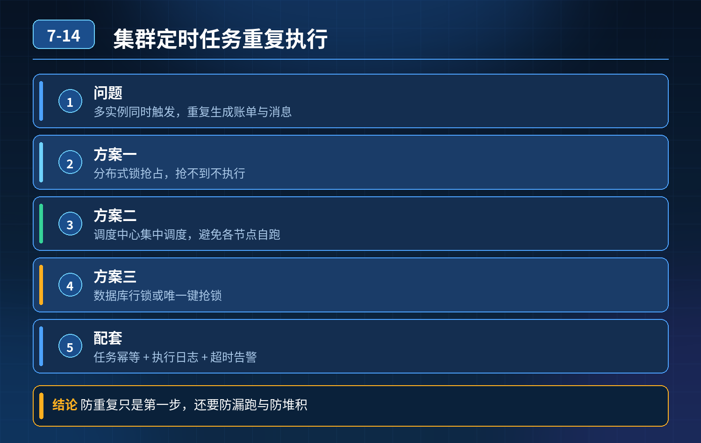

    集群定时任务多实例同时触发，重复执行、重复生成账单推送消息，如何保证集群下任务同一时间只执行一次

## 第 07-14 题　集群定时任务多实例同时触发，重复执行、重复生成账单推送消息，如何保证集群下任务同一时间只执行一次

**候选人浅层回答：** 背诵表面结论，没有深入到原理和线上场景。

## 核心拆解一句话结论

核心根源：普通 Spring @Scheduled 这类本地定时，每个实例是独立调度器，多节点互不感知，到 cron 时间点所有节点同时触发，天然重复执行。

## 候选人浅层回答

知道需要集群控制，但说不出落地方案，想靠只留一台机器跑任务。

## 连环追问

1. 问题根源是什么？
2. 不能只保留单台实例（单点故障），有哪些主流方案？
3. 定时任务还要考虑哪些风险：任务超时卡死、任务重叠执行、失败重试、幂等、分片场景？

## 参考答案

方案一：分布式锁（轻量改造，原有 @Scheduled 改造）适合简单小任务、不想引入中间件。 原理：到调度时间，每个节点先去抢一把分布式锁（Redis Redisson、Zookeeper），抢到锁的节点执行业务，其余节点直接放弃退出。锁要设置合理的过期时间，防止任务卡死、锁永远不释放，任务永久卡死。 要点：

- 锁 key：任务唯一标识（比如 task:daily_stat）
- 锁超时时间 \> 预估任务最大执行时长，防止任务还没跑完锁过期，其他节点又抢到锁，并发重复跑
- 任务执行完成主动释放锁；异常场景依靠自动过期兜底缺陷：调度还是每个节点都在计时抢锁，只是只有一个能成功；适合简单任务，没有统一后台管理、日志、告警、分片能力。

方案二：分布式定时调度框架（生产主流：XXL-Job / Elastic-Job）XXL-Job（最常用）架构：独立调度中心（Admin），执行器（业务服务）。 调度中心统一触发，同一任务同一时间只下发一次调度指令，由调度中心选定一个执行器节点去执行；天然解决重复执行。 额外能力：

- 可视化后台：管理 cron、启停任务、看执行日志、告警
- 超时控制、失败重试、路由策略（轮询、随机、分片广播）
- 支持任务阻塞策略：比如任务还没跑完，下一轮调度又来了，可选：丢弃本次、串行等待、覆盖执行Elastic-Job适合分片类定时任务（海量数据分片统计），支持分片广播，多节点分工处理，同一个分片只会分配给一个节点。

方案三：数据库乐观锁（无中间件）任务表记录任务执行日期、执行状态。 执行前 update task set status=running where task_id=xxx and execute_date=今天 and status=init； 更新成功的节点拿到执行权；更新行数为 0 说明已经被别的节点抢占，直接跳过。 适合 Redis 都不能用的极简环境；注意数据库事务、行锁，并发高时性能一般。

定时任务三层防御体系（专家说的三层）第一层：调度层防重复（选主 / 分布式锁 / 中心化调度）解决 “多个节点同时触发” 这个原始问题，保证同一时刻只有一个节点拿到执行权。

注意：这一层不是万能的，存在边界风险：网络抖动、执行器接收指令后执行一半宕机，调度中心不知道有没有处理成功。

第二层：业务层幂等兜底（最重要兜底）哪怕调度层出问题，也不能产生脏数据。 以每日统计账单为例：以业务日期作为唯一键，插入账单前先判断当天账单是否已经存在；存在直接返回，不再重复生成、推送。 任何定时任务都必须加幂等，是最后一道防线。

第三层：任务运行期防护（防任务雪崩、卡死、重叠）

1. 任务超时控制：设置最大执行时间，超时自动终止、告警，防止任务卡死占住资源、锁永远不放
2. 阻塞策略：禁止任务重叠执行。比如一个 5 分钟任务，下一轮 cron 又来了，要做策略控制，不能并发跑两份
3. 失败重试 + 告警：失败后有限次数重试，重试耗尽告警人工介入
4. 隔离：定时任务线程池和业务接口线程池隔离，定时任务跑崩不会拖垮在线接口避坑点

- ❌ 不要简单停掉其他实例：单点故障，调度节点宕机任务直接停摆；

5\. ❌ 分布式锁过期时间不能太短：任务没跑完锁过期，会出现并发重复执行；

6\. ❌ 只靠锁、不加幂等：极端网络异常依然有重复风险；

7\. ❌ 长耗时任务慎用高频 cron，容易任务堆积重叠。

## 连环追问要点整理

1. 底层核心原理是什么？为什么这么设计？
2. 线上出现相关故障如何快速止损、定位根因？
3. 高并发场景下有哪些坑点，性能、一致性、可用性如何权衡？

## 面试回答完整话术

  - **一句话结论**：核心根源：普通 Spring @Scheduled 这类本地定时，每个实例是独立调度器，多节点互不感知，到 cron 时间点所有节点同时触发，天然重复执行。
  - **候选人浅层回答**：知道需要集群控制，但说不出落地方案，想靠只留一台机器跑任务。
  - **连环追问**：不能只保留单台实例（单点故障），有哪些主流方案？
  - **参考答案**：核心根源：普通 Spring @Scheduled 这类本地定时，每个实例是独立调度器，多节点互不感知，到 cron 时间点所有节点同时触发，天然重复执行。单点运行是治标，会引入单点故障，高可用场景不
  - **收尾**：线上问题按「先止损保可用性 → 再定位根因 → 最后从架构规范层面根治」三段论闭环。

## 追问：本题考察核心是什么？

###  高级工程师要分清：

1. **不能只停留在背结论**：要能回答「为什么这样设计、不这样会怎样、线上踩坑怎么排查」；
2. **具备止损→定位→根治三段论**：先止血保业务，再定位根因，最后从架构与规范层面根治；
3. **给出工程取舍**：性能、一致性、可用性三者权衡，说清代价与适用场景。

  核心思想：这道题考察原理理解 + 线上实战 + 架构思维，真正的工程答案是「现象 → 根因 → 止损 → 定位 → 根治」五段式闭环。

