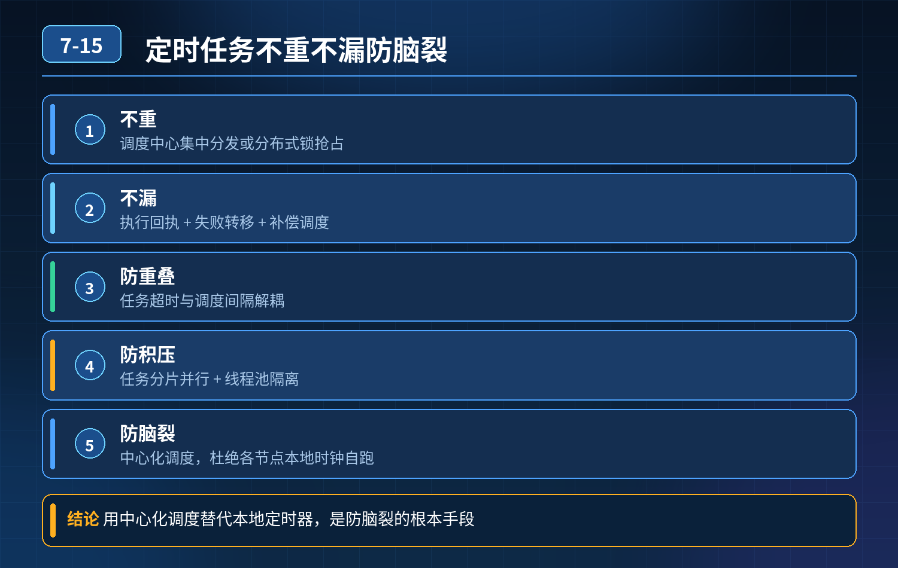

    分布式定时任务（订单对账任务）如何做到不重、不漏、防重叠、防积压、防脑裂

## 第 07-15 题　分布式定时任务（订单对账任务）如何做到不重、不漏、防重叠、防积压、防脑裂

**候选人浅层回答：** 用 XXL-Job，调度中心集群、执行器集群，接口加幂等就可以。

## 核心拆解一句话结论

核心问题总结只靠幂等只能兜底重复执行带来的数据错误，无法阻止重复调度、任务重叠、任务积压、任务丢失；

## 连环追问

1. XXL-Job 是怎么解决调度中心脑裂问题的，靠什么选主？
2. 分布式锁防重叠有什么坑，锁过期但是业务还在跑怎么办？
3. 任务状态机需要包含哪些状态，重试、转移的流转逻辑？
4. 任务重试策略怎么设计，对账任务适合无限重试吗？
5. 纯数据库自研方案，任务表需要哪些核心字段，抢任务逻辑怎么写？

## 参考答案

核心问题总结只靠幂等只能兜底重复执行带来的数据错误，无法阻止重复调度、任务重叠、任务积压、任务丢失；幂等是最后防线，不是调度层的防护手段。 脑裂的本质：调度集群网络分区，多节点同时认为自己是 master，同时下发调度指令； 漏执行本质：任务执行无持久状态、无回执、无认领机制，宕机后没人接管； 任务重叠：调度间隔短、任务耗时长，上一轮没结束新一轮调度又触发； 任务雪崩：所有任务共用一个线程池，慢任务卡死，核心高优任务排队饿死。

三层防御体系（调度层脑裂与选主防护 → 执行层防重、防重叠、故障转移 →资源隔离、监控兜底）第一层：调度层：选主机制，从源头避免脑裂双调度成熟框架（XXL-Job）：调度中心集群基于 DB 锁抢占主节点，同一时刻只有一个 master 调度节点，follower 只待命不发调度指令，从源头避免脑裂双下发。

自研方案：

1. 调度主节点抢占 DB 锁（调度 leader 表，通过 update 原子抢占），抢到锁的节点才负责扫描、下发任务；锁有过期时间，leader 宕机锁自动释放，其他节点自动接管。
2. 调度动作本身持久化，每一次调度生成一条调度记录，携带唯一调度流水号。

重点：选主解决 “多个调度节点同时下发”；但就算选主没问题，同一个调度下发给集群多个执行器，依然会重复执行，需要执行层控制。

第二层：执行层：任务认领、状态机、防重叠、故障转移（核心）任务表核心状态：待认领 → 执行中 → 执行成功 / 执行失败

1. 原子认领（防止同一个调度被多个执行器抢到） update task setstatus=RUNNING,executor_ip=?,start_time=? where id=? and status=WAIT and version=? 乐观锁原子抢占，抢到的执行器负责跑，其他执行器抢不到直接跳过。
2. 防任务重叠执行 两种方案配合：

- 方案 A：任务执行前抢占任务维度分布式锁，锁过期时间 \> 任务最大预估执行时长；获取锁失败直接放弃本次调度，避免并发跑同一个对账任务。

坑：锁提前过期，业务还在跑，依然会重入；要设置看门狗续期（Redisson）。

- 方案 B：调度配置【禁止并发执行】，框架层面（XXL-Job 的任务路由策略：串行），调度记录判断上一条任务状态不是终态（成功 / 失败），直接跳过本次调度。

3\. 故障转移、防止漏执行

- 执行中状态的任务，持续上报心跳；
- 调度服务定时扫描：status=RUNNING && 心跳长时间未更新 / 超时，判定节点宕机；
- 自动把任务重置为【待认领】，其他健康节点重新抢任务，自动续跑，不需要人工介入。

4\. 幂等 + 调度流水号 对账逻辑使用调度流水号作为幂等 key，而不是单纯依赖时间区间；哪怕因为故障转移多次认领，同一个调度流水只允许生成一次对账结果，增量对账不会重复写入。

区分：调度层防重复下发、执行层防重复认领，幂等是兜底。

第三层：资源分级隔离、限流、监控告警，防止任务积压雪崩

1. 线程池隔离：核心对账类高优任务独立线程池；报表、统计类低优任务单独线程池，互不抢占线程。慢任务、卡死任务设置执行超时，超时自动中断，释放线程。
2. 任务积压管控：监控排队任务数量，积压超过阈值触发告警；限流、暂停低优先级任务，保障对账等高优任务调度。
3. 重试策略控制：对账这类资金任务不能无限重试；失败后有限次数重试、退避策略，多次失败进入人工复核队列，避免疯狂重试冲击数据库。
4. 全链路监控：监控调度成功率、任务执行耗时、心跳失联、积压数量、主节点切换事件；任务变更灰度验证。

补充：无框架，纯数据库自研极简流程

1. 一张任务配置表（cron、任务 key、优先级、最大执行时长）
2. 一张调度实例表（做 leader 选主锁）
3. 一张调度执行记录表（核心，调度流水、状态、执行器、心跳、版本号） 流程： ① leader 节点定时扫描 cron，到时间生成一条【待认领】调度记录； ② 所有执行器定时捞取待认领记录，乐观锁 update 原子认领； ③ 认领成功后执行业务，持续上报心跳； ④ 执行完成更新为成功 / 失败终态； ⑤ 调度服务定时扫描超时 RUNNING 任务，重置为待认领，触发故障转移。

## 面试高分话术

只靠幂等是不够的，幂等只能兜底数据错误，无法解决脑裂双调度、任务重叠、任务积压饿死核心任务这些问题。整套方案分三层。

第一层调度层靠选主机制防脑裂，XXL-Job 通过数据库锁抢占唯一 master 节点，只有 leader 下发调度指令，从节点不调度，从源头避免网络分区后多个节点同时下发同一个任务。自研方案同样依靠 DB 锁抢占 leader。

第二层执行层是核心，依靠任务状态机 + 乐观锁原子认领，保证同一条调度只会被一个执行器拿到；通过串行调度配置或者带看门狗续期的分布式锁，防止任务执行时长超过调度间隔，出现任务重叠并发。执行中的任务持续上报心跳，调度扫描超时无心跳的任务，自动重置状态让其他节点接管，实现故障转移，避免对账任务丢失。同时使用调度流水号做幂等 key，兜底增量同步场景重复写入问题。

第三层做资源隔离和稳定性兜底：核心对账任务和普通报表任务使用独立线程池，防止慢任务卡死挤占资源；限制重试次数，避免无限重试压垮数据库；监控任务积压、心跳、调度成功率，积压超限告警，必要时降级低优先级任务，防止雪崩。

如果不能使用框架，就基于三张表（任务配置、leader 锁表、调度执行记录），用乐观锁实现任务原子认领、心跳检测、超时自动转移，也能实现一套不重不漏的分布式调度。

## 连环追问要点整理

1. 
    - 调度中心网络分区脑裂，两个主节点同时下发调度，只靠业务幂等足够吗？增量同步场景重复写入怎么办？

## 面试回答完整话术

  - **一句话结论**：核心问题总结只靠幂等只能兜底重复执行带来的数据错误，无法阻止重复调度、任务重叠、任务积压、任务丢失；
  - **连环追问**：XXL-Job 是怎么解决调度中心脑裂问题的，靠什么选主？
  - **参考答案**：核心问题总结只靠幂等只能兜底重复执行带来的数据错误，无法阻止重复调度、任务重叠、任务积压、任务丢失；幂等是最后防线，不是调度层的防护手段。 脑裂的本质：调度集群网络分区，多节点同时认为自己是 mast
  - **面试高分话术**：只靠幂等是不够的，幂等只能兜底数据错误，无法解决脑裂双调度、任务重叠、任务积压饿死核心任务这些问题。整套方案分三层。
  - **收尾**：线上问题按「先止损保可用性 → 再定位根因 → 最后从架构规范层面根治」三段论闭环。

## 追问：本题考察核心是什么？

###  高级工程师要分清：

1. **不能只停留在背结论**：要能回答「为什么这样设计、不这样会怎样、线上踩坑怎么排查」；
2. **具备止损→定位→根治三段论**：先止血保业务，再定位根因，最后从架构与规范层面根治；
3. **给出工程取舍**：性能、一致性、可用性三者权衡，说清代价与适用场景。

  核心思想：这道题考察原理理解 + 线上实战 + 架构思维，真正的工程答案是「现象 → 根因 → 止损 → 定位 → 根治」五段式闭环。

