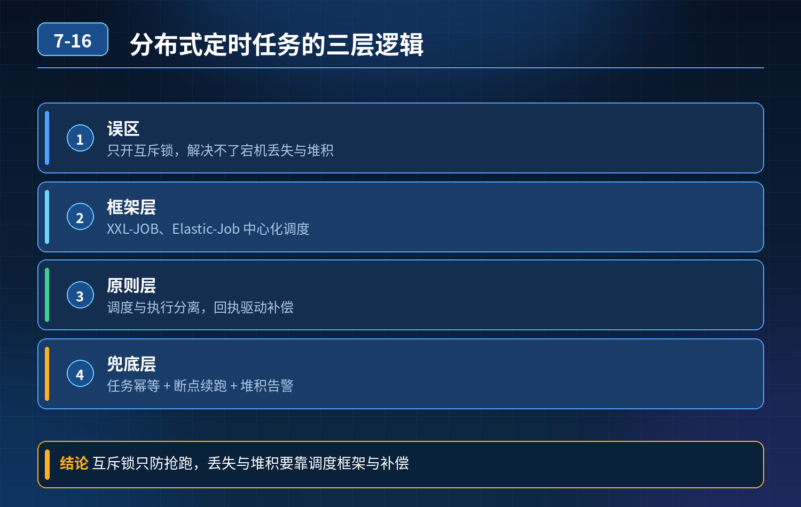

    分布式定时任务（重复执行/丢失/堆积）

## 第 07-16 题　分布式定时任务（重复执行/丢失/堆积）

**候选人浅层回答：** 背诵表面结论，没有深入到原理和线上场景。

## 核心拆解一句话结论

本题考察对底层原理和线上实战能力的综合理解，不能只停留在背结论。

## 场景回顾

集群多实例部署定时任务，候选人只知道 XXL-JOB 开启互斥锁防重复，但是回答不了几个硬核问题：任务中途宕机丢失、长任务超过调度间隔造成堆积、服务器时钟偏差、原生 Quartz 集群的问题。

核心误区：单纯互斥锁只能解决同一时间多实例抢跑重复执行，解决不了宕机断点丢失、任务堆积阻塞、时钟漂移这类问题。

## 三层高分逻辑

第一层：调度层，保证同一任务只触发一次（防重复、时钟漂移）

1. 成熟框架（XXL-JOB、Elastic-Job）：中心化调度，由调度中心统一发执行指令，不是各节点本地时钟自己跑，天然规避机器时间不一致带来的重复触发；框架自带执行锁、路由策略（轮询、分片、广播）。
2. 如果老旧项目不能接入框架、只用 Quartz 集群：依赖数据库行锁抢占，缺陷很明显：依赖数据库、锁竞争大、时钟差依然会有风险、没有失败重试、缺少运维看板，不适合大集群。
3. 自研简易方案：Redis 分布式锁 / DB 任务抢占表，抢到锁的实例才执行；注意锁自动续期，防止长任务没跑完锁过期，其他节点抢锁重复跑。

第二层：执行层，断点续跑 + 失败补偿（防止任务丢失，保证业务完整）

1. 任务要做状态流水表：任务分片 / 业务单据标记状态：待执行 → 执行中 →成功 / 失败；执行前更新状态，执行成功标记完成。
2. 任务宕机恢复：调度中心有执行日志，识别「执行中但是超时未完成」的脏任务，自动重试；
3. 幂等：任务基于业务唯一 ID 执行，重试不会重复扣钱、重复统计；
4. 长任务禁止同步阻塞，尽量拆成分片，分片记录进度，支持断点续跑，不用从头重跑。

第三层：保护与治理层，解决任务堆积、线程池打满（熔断隔离）

1. 线程池隔离：不同类型定时任务分开线程池，慢任务不挤占核心任务线程；设置线程上限、拒绝策略；
2. 过载保护、堆积熔断：检测任务堆积数量、延迟时间，如果堆积超过阈值，跳过本次调度或者告警，不再继续生成新任务，而不是单纯拉大间隔；
3. 限速 + 分片：大数据量任务分片分发到多实例并行处理，单实例不要一次性加载全量数据；
4. 监控告警：监控调度延迟、执行失败率、堆积数量、执行时长。

方案选型一句话对比

- XXL-JOB：中心化调度，简单易用，适合绝大多数业务任务；
- Elastic-Job：分片调度，适合海量数据分片跑（数据同步、对账）；
- Quartz 集群：尽量少用，依赖 DB 锁、性能差、运维弱；
- 自研分布式锁：仅适合少量简单任务，没有重试、看板、堆积治理，不推荐大规模使用。
- 30

## 秒口述标准答案

分布式定时任务不能只依靠互斥锁。三层设计：第一层中心化调度，用 XXL-JOB 这类框架统一下发任务，避免多节点本地时钟不一致导致重复触发；第二层任务执行带状态流水，记录执行进度，失败自动重试，同时做业务幂等，服务宕机后支持断点续跑，防止数据丢失；第三层线程池隔离、堆积熔断，监控调度延迟，长任务分片处理，避免任务越积越多把服务线程耗尽。Quartz 原生集群锁竞争重、能力弱，一般不推荐在大集群使用。

## 连环追问要点整理

1. 底层核心原理是什么？为什么这么设计？
2. 线上出现相关故障如何快速止损、定位根因？
3. 高并发场景下有哪些坑点，性能、一致性、可用性如何权衡？

## 面试回答完整话术

  - **一句话结论**：本题考察对底层原理和线上实战能力的综合理解，不能只停留在背结论。
  - **场景回顾**：核心误区：单纯互斥锁只能解决同一时间多实例抢跑重复执行，解决不了宕机断点丢失、任务堆积阻塞、时钟漂移这类问题。
  - **三层高分逻辑**：第一层：调度层，保证同一任务只触发一次（防重复、时钟漂移）
  - **秒口述标准答案**：分布式定时任务不能只依靠互斥锁。三层设计：第一层中心化调度，用 XXL-JOB 这类框架统一下发任务，避免多节点本地时钟不一致导致重复触发；第二层任务执行带状态流水，记录执行进度，失败自动重试，同时做
  - **收尾**：线上问题按「先止损保可用性 → 再定位根因 → 最后从架构规范层面根治」三段论闭环。

## 追问：本题考察核心是什么？

###  高级工程师要分清：

1. **不能只停留在背结论**：要能回答「为什么这样设计、不这样会怎样、线上踩坑怎么排查」；
2. **具备止损→定位→根治三段论**：先止血保业务，再定位根因，最后从架构与规范层面根治；
3. **给出工程取舍**：性能、一致性、可用性三者权衡，说清代价与适用场景。

  核心思想：这道题考察原理理解 + 线上实战 + 架构思维，真正的工程答案是「现象 → 根因 → 止损 → 定位 → 根治」五段式闭环。

