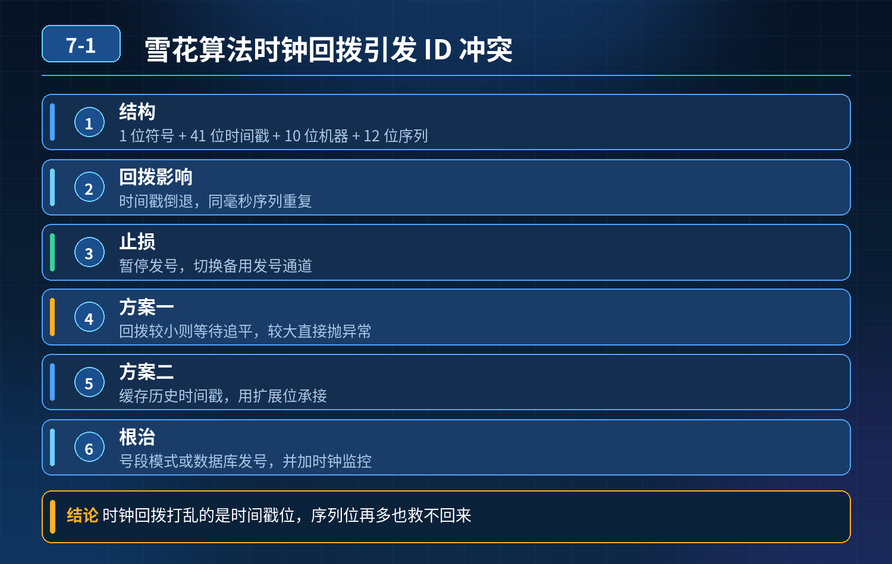

    雪花算法时钟回拨导致订单 ID 重复，如何止损、根治分布式 ID 冲突问题

## 第 07-1 题　雪花算法时钟回拨导致订单 ID 重复，如何止损、根治分布式 ID 冲突问题

**举例说明：**22:00:00.500 已生成一批 ID，NTP 校时把时钟回拨到 22:00:00.100，之后 400 毫秒内的请求时间戳重复、序列号又从 0 开始，于是生成了与之前完全相同的 ID，插入时直接报主键冲突。

**候选人浅层回答：** 用雪花算法，全局唯一、有序、性能高，直接引入工具类就能用。

## 核心拆解一句话结论

本题考察对底层原理和线上实战能力的综合理解，不能只停留在背结论。

## 连环追问

1. 雪花算法的结构是什么？为什么时钟回拨会造成 ID 重复？
2. 雪花算法内部常见的时钟回拨处理方案有哪些，各自优缺点？
3. 如果回拨时间很长（几十分钟），单纯等待时间追上还合适吗？
4. 除了雪花，还有哪些分布式 ID 方案？它们会不会受时钟回拨影响？
5. 订单这种资金业务，只靠 ID 生成器保证唯一够不够？还需要什么兜底？
6. 集群多实例场景，如何统一管控时间，降低时钟回拨风险？

## 事故根源

标准雪花 ID 结构：1bit 符号位 + 41bit 时间戳 + 10bit 机器ID + 12bit 序列号 ID 的唯一性依赖时间戳单调递增。 时钟回拨 = 系统时间往回调；同一台机器，回拨后的时间戳，和之前已经生成过 ID 的时间戳重合，机器 ID 不变、序列号又从 0 重新开始自增 → 生成完全一样的雪花 ID，发生冲突。

重点：机器 ID 不重复、代码没错，也挡不住时间回拨，这是原生雪花算法天生缺陷。很多开源雪花工具类默认没有时钟回拨防护，只会直接生成 ID，不抛异常，所以没有报错，悄无声息产生脏数据。

三层防御体系（ID 生成器内置防护 → 多方案降级兜底 → 业务层最终兜底）第一层：雪花算法内部，时钟回拨检测与应急策略（生成器层第一道防线）每次生成 ID 前，记录上一次成功生成 ID 的最后时间戳 lastTime：

1\. 拿到当前时间 nowTime，和 lastTime 对比：

1\. nowTime \> lastTime：正常，序列号自增；序列号耗尽，等待下一毫秒。

2\. nowTime == lastTime：同毫秒，序列号 + 1。

3\. nowTime \< lastTime：判定时钟回拨！

2\. 三种内置处理策略：

1\. 策略 1（短回拨，几秒内）：循环等待，直到系统时间追上 lastTime。适合NTP 小幅回拨；缺点：回拨很久会阻塞线程，接口超时。

2\. 策略 2（回拨较大）：抛出异常，上层捕获，不生成 ID。风险：直接报错影响下单。

3\. 策略 3：启用回拨补偿位 / 回拨纪元（进阶改造）：预留比特位，回拨后使用补偿序号，不再复用旧时间戳；或者使用相对时间（基于启动基准时间，不再依赖系统 wall 时间），这个改造复杂度高。

业界常用开源方案：百度 UidGenerator、滴滴 TinyId 都针对时钟回拨做了处理。

第二层：架构层面，多 ID 方案兜底，规避时钟依赖（治本方案）核心思路：把强依赖系统时间的雪花，换成不依赖机器系统时间的分布式 ID 方案，资金核心业务不要单一依赖雪花。

1. 数据库号段模式（号段 ID） 单独一张 ID 号段表，预分配一段 ID（如\[10000,20000\]）给应用实例，用完再去数据库拿新号段。ID 来源是数据库自增，完全不依赖服务器系统时间，不存在时钟回拨问题；性能靠本地缓存号段保证。

滴滴 TinyId 就是这个思路。 缺点：需要单独 DB、抢号段有一点 DB 压力。

2\. Redis INCR 生成 ID redis incr/incrby 原子自增，不依赖系统时间；适合中小流量。要做持久化，防止 Redis 丢数据 ID 重复。

3\. UUID / 数据库原生自增 ID UUID 无序，不适合做数据库索引；单库自增简单，分库分表场景不方便。

推荐组合：主方案用号段 ID（无时钟风险）；雪花作为备选 /非核心业务使用。

第三层：业务层兜底，就算 ID 生成器故障，也杜绝脏数据（资金订单必须有）ID 生成器只是生成手段，不能作为唯一性的最终保障：

1\. 订单表给订单号建立唯一索引。哪怕 ID 生成器 bug、时钟异常产出重复 ID，数据库唯一索引直接拦截，拒绝插入，不会生成两条订单脏数据。这是最后一道闸门！本次事故里，如果订单号有唯一索引，重复 ID 插入直接报错，不会悄无声息产生两条订单。

2\. 监控告警：

1\. 监控服务器时间偏移、NTP 同步事件；

2\. ID 生成器捕获到时钟回拨时立刻上报告警；

3\. 运维规范： 尽量在业务低峰执行 NTP 时间校准；优先使用 PTP 精密时间协议，减少大幅度回拨；禁止业务高峰期强制回拨时间。

线上故障紧急止损步骤（已经发生时钟回拨）

1. 立即切换 ID 生成策略：从雪花切到号段 / Redis 自增，停止继续产出重复ID；
2. 开启限流，保护下单接口，防止大量脏数据持续写入；
3. 通过订单号唯一索引校验，扫描数据库，清理已经产生的重复订单脏数据；
4. 修复雪花算法，增加时钟回拨检测逻辑，上线后再评估是否切回雪花。

## 面试高分话术

根源是原生雪花算法强依赖单调递增的系统时间戳，时钟回拨后，同一机器的时间戳回到过去，和历史已使用时间重叠，机器 ID、序列号再次组合出相同 ID；很多实现没有检测逻辑，不会抛出异常，静默产生重复 ID。

整套防御分为三层。第一层是雪花生成器内部增加时钟回拨检测，记录上一次的时间戳，发现时间回拨后，小幅回拨可以等待时间追上；回拨幅度大直接抛出异常，阻止继续生成 ID。但这只是补丁，不能彻底消除风险。

第二层是架构兜底，核心订单业务不单一依赖雪花。优先选用号段模式分布式 ID，它基于数据库预分配号段，完全不依赖服务器系统时间，天然不怕时钟回拨；Redis 自增 ID 也是同类思路。

雪花适合非核心、允许一定降级的业务。

第三层是业务数据库兜底，订单号建立唯一索引，这是资金场景的底线。就算 ID 生成器出现 BUG，数据库唯一索引会拦截重复写入，避免脏数据入库。同时运维规范控制 NTP 同步时机，加上时间偏移、时钟回拨事件的监控告警。

一句话总结：雪花好用，但时钟回拨是原生短板；核心业务不能只靠 ID 生成器保证唯一，数据库唯一索引是最后防线。

## 连环追问要点整理

1. 底层核心原理是什么？为什么这么设计？
2. 线上出现相关故障如何快速止损、定位根因？
3. 高并发场景下有哪些坑点，性能、一致性、可用性如何权衡？

## 面试回答完整话术

  - **场景举例**：22:00:00.500 已生成一批 ID，NTP 校时把时钟回拨到 22:00:00.100，之后 400 毫秒内的请求时间戳重复、序列号又从 0 开始，于是生成了与之前完全相同
  - **一句话结论**：本题考察对底层原理和线上实战能力的综合理解，不能只停留在背结论。
  - **连环追问**：雪花算法的结构是什么？为什么时钟回拨会造成 ID 重复？
  - **事故根源**：标准雪花 ID 结构：1bit 符号位 + 41bit 时间戳 + 10bit 机器ID + 12bit 序列号 ID 的唯一性依赖时间戳单调递增。 时钟回拨 = 系统时间往回调；同一台机器，回拨后的
  - **面试高分话术**：根源是原生雪花算法强依赖单调递增的系统时间戳，时钟回拨后，同一机器的时间戳回到过去，和历史已使用时间重叠，机器 ID、序列号再次组合出相同 ID；很多实现没有检测逻辑，不会抛出异常，静默产生重复 ID
  - **收尾**：线上问题按「先止损保可用性 → 再定位根因 → 最后从架构规范层面根治」三段论闭环。

## 追问：本题考察核心是什么？

###  高级工程师要分清：

1. **不能只停留在背结论**：要能回答「为什么这样设计、不这样会怎样、线上踩坑怎么排查」；
2. **具备止损→定位→根治三段论**：先止血保业务，再定位根因，最后从架构与规范层面根治；
3. **给出工程取舍**：性能、一致性、可用性三者权衡，说清代价与适用场景。

  核心思想：这道题考察原理理解 + 线上实战 + 架构思维，真正的工程答案是「现象 → 根因 → 止损 → 定位 → 根治」五段式闭环。

