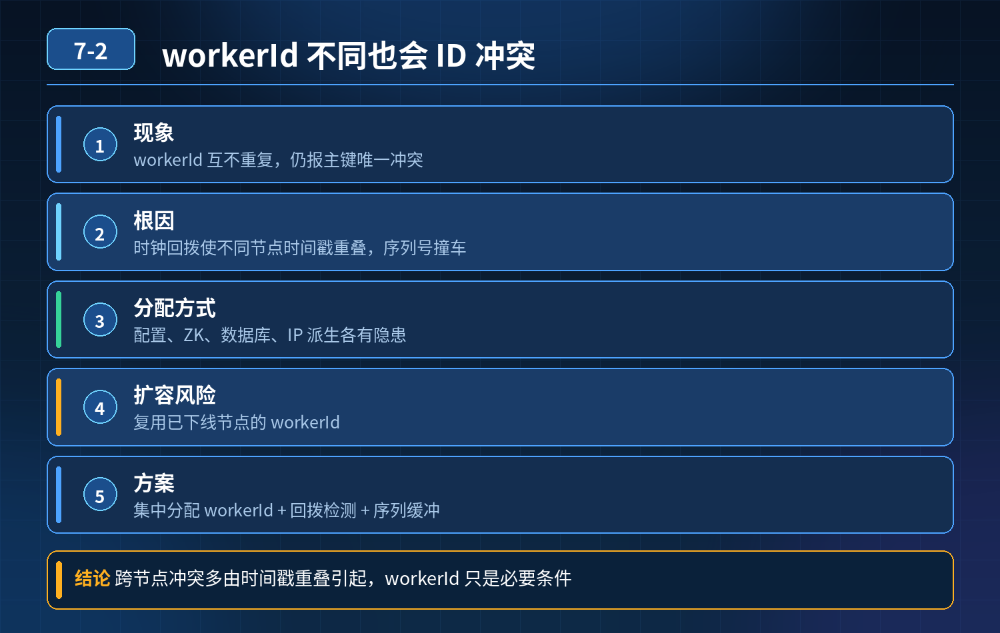

    雪花算法时钟回拨，不同 workerId 节点也出现 ID 冲突，如何保证时钟异常、机器扩容场景下 ID 绝对唯一

## 第 07-2 题　雪花算法时钟回拨，不同 workerId 节点也出现 ID 冲突，如何保证时钟异常、机器扩容场景下 ID 绝对唯一

**候选人浅层回答：** 雪花算法，分配 workerId，时间戳 + 序列号，高性能全局唯一。

## 核心拆解一句话结论

本题考察对底层原理和线上实战能力的综合理解，不能只停留在背结论。

## 连环追问

1. 为什么 workerId 不一样，时钟回拨还能跨节点出现 ID 重复？
2. workerId 常见分配方式有哪些，各自隐患是什么？扩容时怎么避免 workerId冲突？
3. 雪花内部几种时钟回拨方案：等待、抛异常、纪元补偿，分别适合什么场景？
4. 号段模式（TinyId/UidGenerator）对比雪花，在时钟问题上优势在哪？
5. 如果业务必须有序 ID、又不能接受时钟依赖，你选什么方案？
6. 数据库唯一索引在这里扮演什么角色？能不能替代 ID 生成器本身的可靠性？

## 事故根源

很多人误以为：只要 workerId 不同，就一定不会撞 ID。 雪花 ID 结构：1bit 符号位 + 41bit 时间戳 + 5bit datacenterId（数据中心 ID）+ 5bit workerId（工作节点 ID，合计 10bit 机器位）+ 12bit 序列号；跨节点 ID 冲突的关键：不同机器，回拨后落到了同一个历史时间戳，刚好各自在这个时间戳下，序列号生成了一样的值。 举例：A 节点 2026-10-20 10:00:05 生成过 (t1, w1, seq=100)；B 节点时钟回拨，也走到 t1，B 的 workerId=w2，seq 也走到 100。

- 这里并不会和 A 那条重复。

那本次跨节点冲突怎么来的？两个高频真实原因： ① workerId 看似人工配置不重复，实际扩容 / 容器重启自动分配逻辑有漏洞（比如用 ip hash、hostname hash，不同实例算出相同 workerId）； ② 时钟大幅度回拨 + 自研雪花没有做时间原点隔离：不同节点使用同一个基准时间体系，回拨后时间戳复用；部分简化实现没有严格的时间校验，多节点撞组合。 补充：容器 / 云服务器动态扩缩容场景是重灾区，很多新手用容器 IP 后两段当 workerId，IP 回收复用就会 workerId 碰撞。

一句话总结： workerId 只是降低冲突概率，时钟回拨是时间戳维度的风险；workerId 不重复 ≠ 天然免疫时钟回拨带来的所有 ID 风险；原生雪花强依赖单机单调递增的墙上时间。

三层防御体系（workerId 可靠分配 + 生成器时钟容错改造 + 架构备选 + 业务兜底）第一层：workerId 规范化管理，先堵扩容带来的 workerId 冲突workerId 是雪花的前置基础，先保证它不会重复：

1. 静态人工分配：适合物理机、长期固定节点；缺点扩容麻烦，容易登记错。
2. 中心化分配（推荐）：独立 workerId 注册中心，启动时申请、用完释放，如UidGenerator 的 DB 分配 workerId；启动抢占，保证同一个时刻拿到的 workerId 唯一。容器弹性扩缩容首选。
3. 避坑：禁止直接 IP 哈希、hostname 哈希、容器 ID 取模作为 workerId，云环境 IP 回收复用极易撞 ID。

但就算 workerId 分配 100% 没问题，时钟回拨依旧会造成本节点 ID 重复，只是不会跨节点撞；业务依然会报错。

第二层：ID 生成器层，时钟回拨容错 + 备选无时钟依赖方案

1. 原生雪花改造（补丁方案，适合无法换组件） 每次生成 ID 记录lastTimestamp：

- now \> last：正常生成
- now == last：序列号自增，序列号耗尽 sleep 到下一毫秒
- now \< last（回拨）：
- 小幅回拨（几百 ms 以内）：等待时间追上 lastTime 再生成
- 大幅回拨：直接抛出异常，拒绝生成 ID，不静默产出重复 ID（本次事故的核心痛点：很多工具类不校验，直接生成）
- 进阶：时间纪元补偿，预留 bit 位当做 epoch 纪元号；一旦检测到回拨，纪元号 + 1，相当于换一套独立时间域，旧时间戳不再复用（百度 UidGenerator 就是这个思路）局限：只是缓解，没有根除时钟依赖，运维 NTP 大幅度调时依然危险。

2\. 治本方案：核心业务（订单、支付流水）脱离墙上系统时间

- 数据库号段模式（TinyId）：数据库预分配号段，应用本地缓存一段 ID；ID 来源是 DB 自增，完全不依赖服务器系统时间，天然不怕时钟回拨；支持有序、高吞吐。
- Redis INCR：原子自增，无时间依赖，适合中小流量。

取舍：号段方案不再依赖机器时间，从根源消灭时钟回拨这个故障诱因，适合对账、支付这类强可靠场景；雪花适合日志、消息 ID 等非资金、容忍降级场景。

第三层：业务兜底防线 + 运维监控规范（最后保险）

3\. 数据库层面：订单号、支付流水号字段必须加唯一索引。 哪怕 ID 生成器bug、workerId 碰撞、时钟异常，数据库直接拦截重复写入，不会脏数据入库，只是抛出唯一冲突异常。这是资金链路不可缺少的底线。

重点：索引只能拦截，不能避免报错、下单失败；所以不能只靠它当主方案。

1. 运维规范：

- 业务高峰期禁止强制 NTP 回拨；优先快进、低峰校准；优先 PTP 精密时钟
- 监控服务器时间偏移量、时钟回拨事件、ID 生成器异常告警

2\. 降级预案：雪花异常时，快速切到号段模式生成 ID，保障下单链路可用。

## 面试高分话术

很多人误以为 workerId 不重复就万事大吉，其实雪花 ID 唯一性是【时间戳 + workerId + 序列号】三者组合唯一。本次跨节点冲突，常见是 workerId 分配逻辑不可靠，比如 IP 哈希、容器动态 IP 复用导致 workerId 撞了；就算 workerId 完全不重复，时钟回拨依然会造成单机内部 ID 重复，只是不会跨节点碰撞。

整套防御分为三层。第一层先做好 workerId 中心化分配，容器弹性扩容场景不能靠简单哈希，通过数据库注册中心启动抢占 workerId，先解决扩容带来 workerId 冲突。

第二层是 ID 生成器本身的容错和选型。原生雪花要增加时钟回拨检测，小幅回拨等待，大幅回拨拒绝生成或者启用纪元补偿；但这属于补丁，没法彻底消除时钟依赖。订单、支付这类核心资金业务，推荐采用号段模式，ID 由数据库预分配自增号段，完全不依赖服务器墙上时间，天然规避时钟回拨风险，不用被 NTP 校准绑架。雪花适合非核心业务。

第三层是兜底和运维：订单号加数据库唯一索引，防止脏数据入库；同时监控时间偏移、时钟回拨事件，规范 NTP 校准操作，准备好 ID 方案切换的降级预案。

也不是所有场景都要直接上数据库自增，号段模式在保证可靠的同时，也能支撑高并发，比单机自增性能更好。

## 连环追问要点整理

1. 底层核心原理是什么？为什么这么设计？
2. 线上出现相关故障如何快速止损、定位根因？
3. 高并发场景下有哪些坑点，性能、一致性、可用性如何权衡？

## 面试回答完整话术

  - **一句话结论**：本题考察对底层原理和线上实战能力的综合理解，不能只停留在背结论。
  - **连环追问**：为什么 workerId 不一样，时钟回拨还能跨节点出现 ID 重复？
  - **事故根源**：很多人误以为：只要 workerId 不同，就一定不会撞 ID。 雪花 ID 结构：1bit 符号位 + 41bit 时间戳 + 5bit datacenterId（数据中心 ID）+ 5bit wo
  - **面试高分话术**：很多人误以为 workerId 不重复就万事大吉，其实雪花 ID 唯一性是【时间戳 + workerId + 序列号】三者组合唯一。本次跨节点冲突，常见是 workerId 分配逻辑不可靠，比如 IP
  - **收尾**：线上问题按「先止损保可用性 → 再定位根因 → 最后从架构规范层面根治」三段论闭环。

## 追问：本题考察核心是什么？

###  高级工程师要分清：

1. **不能只停留在背结论**：要能回答「为什么这样设计、不这样会怎样、线上踩坑怎么排查」；
2. **具备止损→定位→根治三段论**：先止血保业务，再定位根因，最后从架构与规范层面根治；
3. **给出工程取舍**：性能、一致性、可用性三者权衡，说清代价与适用场景。

  核心思想：这道题考察原理理解 + 线上实战 + 架构思维，真正的工程答案是「现象 → 根因 → 止损 → 定位 → 根治」五段式闭环。

