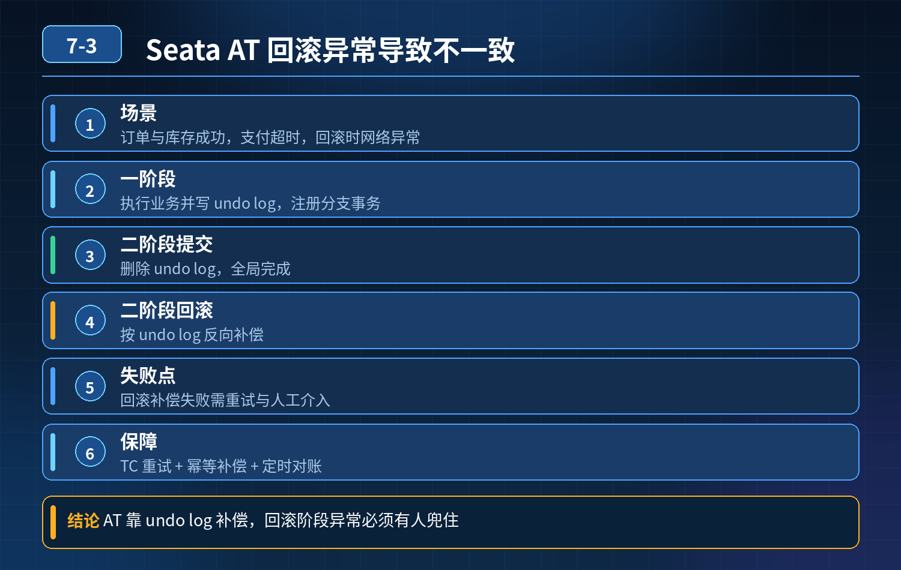

    Seata AT 模式下单场景，订单、库存成功，支付超时，回滚时网络异常引发数据不一致、超卖问题

## 第 07-3 题　Seata AT 模式下单场景，订单、库存成功，支付超时，回滚时网络异常引发数据不一致、超卖问题

**候选人浅层回答：** 用 Seata AT 自动代理，就能保证跨服务事务一致性。

## 核心拆解一句话结论

本题考察对底层原理和线上实战能力的综合理解，不能只停留在背结论。

## 连环追问

1. Seata AT 模式的二阶段提交流程是什么？一阶段、二阶段失败分别是什么行为？
2. AT 模式回滚失败（TC 和 RM 网络断了）会发生什么？Seata 默认怎么处理？
3. 为什么下单场景很多公司不首选 AT，而是选 TCC 或者状态机 + 本地消息表？

AT 有哪些隐藏风险？

4\. 支付这个节点适合做 TCC 吗？Try/Confirm/Cancel 怎么设计？

5\. 最终一致性方案里，补偿任务怎么保证幂等、不重复补偿？

6\. 什么场景才适合强一致性（XA），电商下单为什么基本不用 XA？

## 事故根源

核心误区：误以为 Seata AT 可以 100% 自动兜底、一定能回滚成功。 SeataAT 原理：

- 一阶段：执行业务 SQL，生成 undo_log，本地事务提交，释放本地锁；向 TC注册分支事务。
- 二阶段：TC 决定全局提交 / 回滚。回滚时 RM 读取 undo_log 反向补偿。

本次故障链路拆解：

1. 一阶段：订单插入、库存扣减，两个分支本地事务提交，undo_log 落库；支付分支调用超时，全局事务标记 rollback。
2. TC 下发回滚指令给订单、库存 RM。
3. 库存 RM 执行补偿回滚的时候，发生网络中断：TC 收不到库存分支的回滚成功回执。

AT 本身没有无限阻塞重试的强保障：TC 会重试分支回滚，但如果长时间网络不通、RM 宕机，这个分支就卡在【回滚中】，库存 undo 补偿没有落地；订单可能回滚成功、库存回滚失败，最终数据撕裂。 额外风险：AT 依赖数据库快照 undo_log；undo_log 被清理、SQL 结构变更、DDL、大事务长时间占用，都会导致补偿失败。 而且 AT 是侵入数据库、基于快照补偿，属于自动补偿，但补偿动作本身也是一次远程调用，同样受网络抖动影响，不是 “魔法回滚”。

一句话总结： Seata AT 能降低分布式事务开发成本，但二阶段补偿操作本身依然是分布式调用，存在补偿失败的可能性；AT 不解决补偿时网络异常这个底层问题，它只是简化补偿代码，不是绝对可靠。下单 + 支付链路，支付是外部第三方（支付宝 / 微信），天然不支持 AT，强行纳入 AT 链路本身就不合理。

三层防御体系（事务模式选型与链路拆分 → 可靠补偿 + 状态机驱动 → 对账兜底）第一层：业务链路拆分 + 事务模式合理选型（源头规避风险）电商下单，支付是外部系统，不能放进 AT 全局事务里，这是很多人踩的第一大坑。 推荐标准拆分：

1. 订单 + 库存：可以用 AT/TCC 做前置锁定；只锁定库存，不要直接扣减库存（这是防超卖关键）

- Try：锁定库存（冻结）、创建待支付订单；
- Confirm：用户支付成功后，正式扣减冻结库存；
- Cancel：超时未支付，解冻库存、关闭订单。

不要下单直接扣真实库存！本次事故就是直接扣减，回滚失败直接超卖。

方案对比：

- AT：开发简单，适合内部服务、短事务、更新简单 SQL；短板：补偿依赖undo_log，二阶段补偿失败风险，不适合外部三方服务。
- TCC：Try/Confirm/Cancel 由业务自己写补偿逻辑，可控性最强，适合库存、资金这类核心链路；缺点：开发量大。
- SAGA（状态机）：长事务、含外部调用（支付、物流）首选；每个步骤有正向+ 逆向补偿，状态持久化，一步一步流转，失败停在当前状态，由调度持续重试补偿。支付回调、超时关单非常适合 SAGA。
- XA：强一致，锁持有时间长，性能差，电商下单几乎不用。

推荐电商下单标准方案：SAGA 状态机 + 库存 TCC 锁定，支付作为 SAGA 其中一个独立步骤，依靠支付回调 / 定时任务驱动状态流转，而不是把第三方支付塞进 Seata AT 全局事务。

第二层：补偿层：持久状态、幂等、定时重试，解决网络抖动导致补偿失败不管是 AT、TCC、SAGA，补偿动作都要满足：

2\. 全链路状态持久化：一张主事务状态表，记录全局流水、当前步骤、状态、版本；每一步执行完才流转状态，宕机重启后从状态断点继续。

3\. 补偿接口必须强幂等：用全局事务流水号作为幂等 key，重复调用解冻 / 回滚接口不会重复操作。

4\. 调度重试机制： TC / 定时任务扫描【补偿中、补偿失败】的事务，按退避策略重试补偿；设置最大重试次数，超过上限进入人工待审队列，避免无限重试压垮下游。

5\. 隔离补偿逻辑：正向业务和补偿任务分开线程池，补偿失败不阻塞下单主链路。

针对 Seata AT 使用的补充规范：

- 控制一阶段事务尽量短小，不要长事务；
- 不要在 AT 事务内调用第三方 HTTP 接口（支付、短信）；
- 监控 TC 分支状态，识别长时间处于回滚中的分支，及时告警。

第三层：最终兜底：定时对账 + 人工复核（资金、库存链路必不可少）任何分布式一致性方案，都不能替代对账兜底。

6\. 定时对账任务：订单表、库存冻结表、支付流水三方对账，找出不一致的脏数据（订单关闭但库存冻结未释放、支付成功库存没扣减）。

7\. 自动修复：满足安全规则的自动补偿；风险高的（资金差异）进入工单人工复核。

8\. 监控告警：全局事务成功率、补偿失败数、对账差异条数告警，不要等到用户投诉才发现。

针对本次场景修正后的正确流程

1. 发起下单 SAGA 流程，TCC Try：创建待支付订单、冻结库存（不是扣减），状态 = 待支付。
2. 调用第三方支付，等待支付回调或者轮询查询支付结果。
3. 收到支付成功回调 → SAGA 推进 Confirm：冻结库存转为真实扣减，订单改为已支付。
4. 超时未支付 / 支付失败 → SAGA 推进 Cancel：解冻冻结库存，关闭订单。
5. 如果解冻库存时网络异常：状态停留在【待取消】，定时调度持续重试解冻；重试超限进入对账工单。

就算补偿暂时失败，库存只是冻结，不会真实扣减，不会直接超卖。

## 面试高分话术

事故根源是两个误区：第一，误以为 Seata AT 能保证二阶段补偿一定成功，实际上补偿本身也是远程调用，网络中断、RM 宕机就会补偿卡住；第二，把第三方支付服务纳入 AT 全局事务，并且下单直接扣减真实库存，而不是先冻结库存，一旦回滚失败直接超卖。AT 的 undo_log 自动补偿只是简化开发，不是万能保险箱。

整套可靠方案分为三层。第一层是链路拆分和事务选型，支付属于外部三方调用，不适合 AT；下单库存优先采用 TCC 冻结库存，整体链路用 SAGA 状态机编排，每个节点定义正向操作和逆向补偿，状态持久化，每一步流转都落地状态，宕机之后可以从断点恢复。库存只冻结不直接扣减，从源头降低超卖风险。

第二层是补偿层保障，所有补偿接口基于全局事务流水号做幂等；对于补偿失败的事务，由定时任务配合退避策略持续重试，设置最大重试次数，避免风暴。如果继续使用 Seata AT，要严格限制 AT 只用于内部短事务，禁止内嵌第三方调用，监控长时间处于回滚中的分支事务及时告警。

第三层兜底是定时对账，订单、库存、支付流水三方定时核对，发现不一致数据，低风险自动修复，资金相关差异进入人工复核工单。分布式一致性追求的是最终一致，任何框架都无法消除网络不可达这个物理问题，对账是资金库存链路最后的防线。

## 连环追问要点整理

1. 底层核心原理是什么？为什么这么设计？
2. 线上出现相关故障如何快速止损、定位根因？
3. 高并发场景下有哪些坑点，性能、一致性、可用性如何权衡？

## 面试回答完整话术

  - **一句话结论**：本题考察对底层原理和线上实战能力的综合理解，不能只停留在背结论。
  - **连环追问**：Seata AT 模式的二阶段提交流程是什么？一阶段、二阶段失败分别是什么行为？
  - **事故根源**：核心误区：误以为 Seata AT 可以 100% 自动兜底、一定能回滚成功。 SeataAT 原理：
  - **面试高分话术**：事故根源是两个误区：第一，误以为 Seata AT 能保证二阶段补偿一定成功，实际上补偿本身也是远程调用，网络中断、RM 宕机就会补偿卡住；第二，把第三方支付服务纳入 AT 全局事务，并且下单直接扣减
  - **收尾**：线上问题按「先止损保可用性 → 再定位根因 → 最后从架构规范层面根治」三段论闭环。

## 追问：本题考察核心是什么？

###  高级工程师要分清：

1. **不能只停留在背结论**：要能回答「为什么这样设计、不这样会怎样、线上踩坑怎么排查」；
2. **具备止损→定位→根治三段论**：先止血保业务，再定位根因，最后从架构与规范层面根治；
3. **给出工程取舍**：性能、一致性、可用性三者权衡，说清代价与适用场景。

  核心思想：这道题考察原理理解 + 线上实战 + 架构思维，真正的工程答案是「现象 → 根因 → 止损 → 定位 → 根治」五段式闭环。

