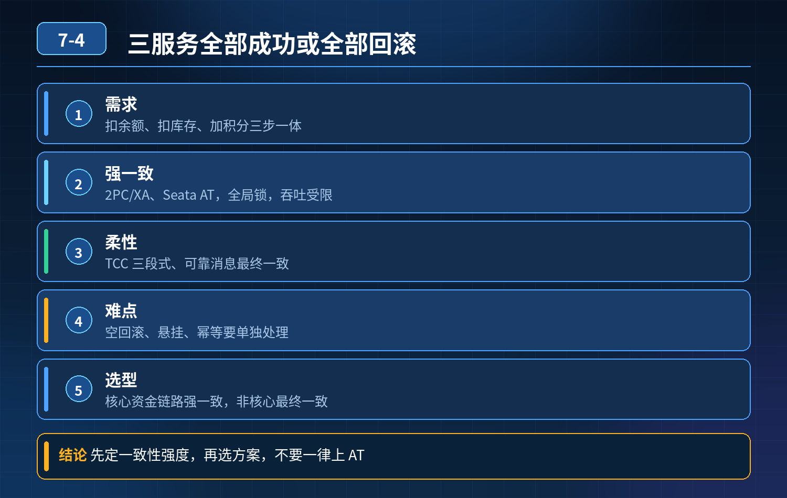

    订单扣余额、扣库存、增加积分三服务操作，如何保证全部成功或全部回滚

## 第 07-4 题　订单扣余额、扣库存、增加积分三服务操作，如何保证全部成功或全部回滚

**候选人浅层回答：** 背诵表面结论，没有深入到原理和线上场景。

## 核心拆解一句话结论

本题考察对底层原理和线上实战能力的综合理解，不能只停留在背结论。

## 面试官连环追问：

1. AT 会锁住业务行，高并发会不会锁冲突、死锁？
2. 一阶段完成，二阶段的时候某个服务宕机怎么处理？
3. 空回滚、悬挂怎么解决？
4. 如果改用 TCC，Try/Confirm/Cancel 如何做幂等，防止重复扣钱扣库存？
5. 业务可以接受最终一致的前提下，可靠消息方案如何做到消息不丢、必消费？
6. 下游消费持续失败、重试一直报错，兜底策略是什么？

## 连环追问

1. AT 模式的锁是读锁还是写锁？锁什么时候释放？
2. TCC 里，为什么 Cancel 接口必须幂等，Confirm 也必须幂等？
3. 本地消息表方案，怎么保证【业务入库】和【写入消息记录】原子性？
4. 消息消费失败，无限重试会带来什么风险？死信队列怎么用？
5. 对比：AT、TCC、可靠消息（SAGA）各自适合这个余额 - 库存 - 积分场景的取舍？
6. 这个场景，积分属于附属福利，能不能做业务降级，不参与核心事务？

## 核心误区总结

候选人的问题：把 AT 注解当成万能方案，只知道自动生成 undo_log，不清楚AT 行锁带来的并发问题；不知道空回滚、悬挂是 TCC（不是 AT）的问题；遇到消费持续失败只会拉长超时或者单纯人工对账，缺少分层兜底。 先明确场景特点：余额、库存属于资金强敏感，积分属于次要福利；三个都是内部微服务、自有数据库，没有外部第三方。

AT 本质：一阶段执行业务 SQL，生成 undo_log，提交本地事务、释放本地锁；TC 统一调度二阶段提交 / 回滚。 AT 的锁风险：一阶段会加数据库行写锁；如果并发订单争抢同一条库存行、同一张用户余额行，极易锁等待、死锁；事务越长，锁持有窗口越大，并发越差。 AT 的短板：二阶段依然是远程调用；如果二阶段 RM 宕机、网络断连，TC 会重试，但重试有上限，极端情况卡住，形成中间状态脏数据；AT 本身不存在空回滚、悬挂，空回滚、悬挂是 TCC 独有的问题。

三层防御体系（模式选型与业务裁剪 → 模式落地（AT / TCC / 可靠消息）+异常防控 → 重试、死信、对账兜底）第一层：业务优先裁剪 + 方案选型（优先从业务降低一致性压力）首选思路：区分核心和非核心，不要一股脑全部捆进同一个事务

- 核心链路：扣余额、扣库存，这两个必须强一致；
- 积分：属于奖励，可降级、可异步，不参与强事务。下单成功之后，通过 MQ异步发积分增加通知，积分失败单独补偿，不卡住下单主流程。

剩下两种主流技术路线二选一：

1. 追求开发简单、并发不高：Seata AT（适合流量平稳，热点争抢不严重）
2. 高并发、资金链路，可控性优先：TCC（余额、库存做 TCC，积分异步 MQ）
3. 业务接受最终一致、不想处理锁竞争：SAGA + 本地消息表（可靠消息）选型对比

- AT：开发简单，自动 undo 补偿；代价：行锁、并发瓶颈、二阶段补偿依赖网络；适合普通订单，不适合秒杀热点库存。
- TCC：完全由业务写 Try/Confirm/Cancel，没有自动快照锁；Try阶段冻结余额、冻结库存，不是直接扣减；Confirm 才真实扣减；Cancel 解冻；适合资金库存等高可靠场景，需要处理幂等、空回滚、悬挂。
- 可靠消息：无锁，异步推进，最终一致；适合能接受短暂不一致的场景，一致性时效弱于 TCC/AT。

第二层：方案落地 + 边界异常处理方案 A：AT 模式落地规范（规避锁冲突、二阶段宕机）

4\. 缩短事务时长，不要在全局事务内写复杂逻辑、远程调用；

5\. 避免热点行争抢：库存做分库分表、库存预分片，打散行锁；调整业务 SQL 顺序，统一更新顺序，避免循环等待死锁；

6\. 二阶段 RM 宕机：TC 自带重试机制；同时监控长时间处于【二阶段中】的分支事务，告警；重试耗尽未成功，落异常流水，进入对账修复队列。

重点：AT 没有空回滚、悬挂，这个坑只在 TCC。

方案 B：TCC 模式落地（余额 + 库存，回答空回滚、悬挂、幂等）TCC 三阶段定义：

- Try：冻结余额、冻结库存（不直接扣减），记录 TCC 事务流水；
- Confirm：确认扣减冻结额度，增加冻结扣减标记；
- Cancel：解冻余额、解冻库存，取消冻结。

三个接口全部强制幂等，以全局事务 XID 作为幂等 Key，同一个 XID 重复调用直接返回上一次结果，防止重复扣减 / 解冻。

- 空回滚：Try 还没执行，Cancel 先到达（网络乱序）。解决：建一张 TCC 控制表，Cancel 到来先插入这条事务记录，标记 Cancel 已执行；后续 Try 请求到达时，查询控制表，如果 Cancel 已存在，Try 直接返回成功，不执行业务冻结逻辑。
- 悬挂：Cancel 已经执行完毕，延迟的 Try 请求才到达；和空回滚共用同一张控制表拦截，不让 Try 再冻结资源，避免资源冻结之后没有机会解冻。

方案 C：可靠消息（本地消息表，最终一致方案）流程：

7\. 订单服务本地事务：创建订单 + 插入本地消息记录（状态待发送），同一个本地事务提交，保证原子性；

8\. 独立定时任务扫描本地消息表，投递 MQ；投递成功更新消息状态为已发送；投递失败持续重试；

9\. 余额、库存服务消费消息，执行业务，消费成功 ACK；消费失败不 ACK，MQ重新投递。

消息不丢的保障：本地消息表保证上游消息一定落地；ACK 机制保证只有业务处理成功才移除消息；MQ 持久化。 缺点：只能最终一致，下单成功之后余额 / 库存可能延迟几秒才扣完。

第三层：重试管控、死信、兜底对账（消费反复失败场景）下游消费持续失败（比如余额账户冻结、库存超卖校验失败、数据库故障）：

1. 不能无限重试：设置指数退避，限制最大重试次数；
2. 超过重试上限，消息转入死信队列，不再继续疯狂重试压垮下游；
3. 死信消息单独消费，记录异常流水，触发告警；区分两类：

- 可自动修复：短暂故障恢复后，运维人工触发重放；
- 业务规则冲突（用户余额本身不足）：直接落差异常工单，人工介入；

4\. 兜底：定时对账任务，订单、余额流水、库存流水三方对账，找出不一致数据，低风险自动补偿，资金差异人工复核。

## 面试高分话术

这个场景，首先我会做业务解耦：积分属于附属权益，不参与余额、库存的核心事务，下单成功后异步发 MQ 加积分，积分失败不影响下单结果，减少事务负担。

如果业务流量平稳，热点争抢不严重，可以选用 Seata AT。但AT 会在一阶段加数据库行写锁，高并发下同用户余额、同商品库存热点行会出现锁等待甚至死锁；需要通过分库存分片、统一 SQL 更新顺序、缩短事务时长来规避锁问题。一阶段提交后二阶段服务宕机，TC 会自动重试，同时监控长期卡在二阶段的分支事务告警，重试失败进入对账修复。要注意：AT 本身不存在空回滚和悬挂，这是 TCC 才有的问题。

如果是资金敏感、高并发场景，优先 TCC。Try 只冻结余额和库存，不直接扣减；Confirm 真实扣减，Cancel 解冻。Try、Confirm、Cancel 全部基于全局 XID 做幂等，防止重复扣减。空回滚和悬挂靠一张事务控制表拦截：Cancel 先到就打标，延迟到达的 Try 直接放行不执行业务冻结，避免资源挂死。

如果业务接受最终一致性，就用本地消息表的可靠消息方案。订单创建和消息记录在同一个本地事务落地，保证消息不会丢；下游消费成功才 ACK。当下游反复消费失败，不能无限重试，达到上限转入死信队列告警；最后定时三方对账作为兜底，处理所有框架和重试覆盖不到的异常。

## 连环追问要点整理

1. 底层核心原理是什么？为什么这么设计？
2. 线上出现相关故障如何快速止损、定位根因？
3. 高并发场景下有哪些坑点，性能、一致性、可用性如何权衡？

## 面试回答完整话术

  - **一句话结论**：本题考察对底层原理和线上实战能力的综合理解，不能只停留在背结论。
  - **面试官连环追问：**：AT 会锁住业务行，高并发会不会锁冲突、死锁？
  - **连环追问**：AT 模式的锁是读锁还是写锁？锁什么时候释放？
  - **核心误区总结**：AT 本质：一阶段执行业务 SQL，生成 undo_log，提交本地事务、释放本地锁；TC 统一调度二阶段提交 / 回滚。 AT 的锁风险：一阶段会加数据库行写锁；如果并发订单争抢同一条库存行、同一张
  - **面试高分话术**：这个场景，首先我会做业务解耦：积分属于附属权益，不参与余额、库存的核心事务，下单成功后异步发 MQ 加积分，积分失败不影响下单结果，减少事务负担。
  - **收尾**：线上问题按「先止损保可用性 → 再定位根因 → 最后从架构规范层面根治」三段论闭环。

## 追问：本题考察核心是什么？

###  高级工程师要分清：

1. **不能只停留在背结论**：要能回答「为什么这样设计、不这样会怎样、线上踩坑怎么排查」；
2. **具备止损→定位→根治三段论**：先止血保业务，再定位根因，最后从架构与规范层面根治；
3. **给出工程取舍**：性能、一致性、可用性三者权衡，说清代价与适用场景。

  核心思想：这道题考察原理理解 + 线上实战 + 架构思维，真正的工程答案是「现象 → 根因 → 止损 → 定位 → 根治」五段式闭环。

