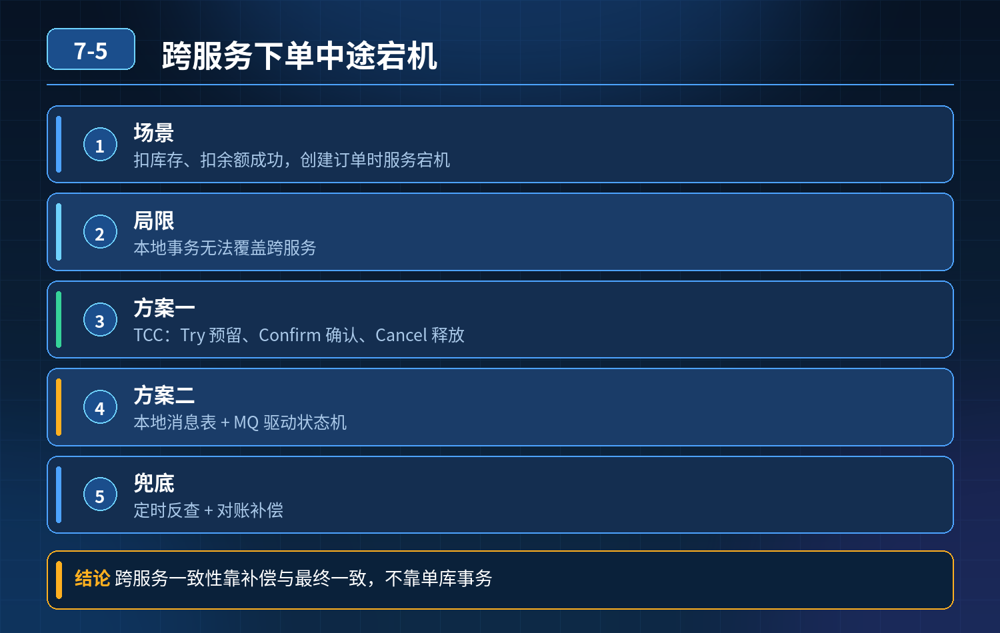

    下单同时扣库存、扣余额、生成订单；跨服务场景，扣库存、扣余额成功，创建订单时宕机，怎么解决

## 第 07-5 题　下单同时扣库存、扣余额、生成订单；跨服务场景，扣库存、扣余额成功，创建订单时宕机，怎么解决

**候选人浅层回答：** 背诵表面结论，没有深入到原理和线上场景。

## 核心拆解一句话结论

本题考察对底层原理和线上实战能力的综合理解，不能只停留在背结论。

## 面试官追问：

1. 库存、余额已经扣减成功，创建订单瞬间服务宕机，订单没生成，数据不一致怎么办？
2. 如果重试生成订单依然失败，库存余额已经扣了没法回滚，同时用户重复下单，怎么防止重复扣减、兜底？

## 连环追问

1. @Transactional 为什么在这里完全失效？它的生效边界是什么？
2. 如果用 TCC，Try 阶段做冻结，能怎么规避这个 “先扣资源、主单据缺失”的故障？
3. 如果用可靠消息 / 本地消息表，流程顺序应该是【先建订单】还是【先扣库存余额】？为什么？
4. 幂等号（全局业务流水号）在防止重复下单、重复扣减里怎么用？
5. 对账系统要核对哪几项，怎么识别 “有库存余额扣减记录、无订单” 这种脏数据？

## 核心误区总结

@Transactional 只是本地数据库事务注解，只能保证同一个库内多条 SQL 原子性；三个操作分属不同服务、不同数据库，属于分布式场景，这个注解完全管不到。 候选人第二个错误：直接真实扣库存、扣余额，再创建订单。顺序本身就埋了致命风险：资源先扣，主单据后创建。一旦建订单环节宕机，资源已经消耗，缺少订单凭证，变成很难修复的脏数据；单纯重试建订单解决不了根本问题，重试还会带来重复扣减风险。

故障链路复盘： 扣库存成功 → 扣余额成功 → 建订单时宕机。 结果：资源扣了、订单不存在；用户钱扣了、看不到订单；直接重试建订单，如果没有幂等控制，用户再次发起下单，会二次扣余额、扣库存。

三层防御体系（调整执行顺序 + 资源预冻结；方案落地 + 幂等防重；异常识别 + 对账兜底）第一层：源头优化，调整业务顺序 + 资源冻结思想（最关键）核心原则：不要先真实扣减资源，再创建订单 两种安全思路二选一：

1. 优先创建订单（订单状态：待确认 / 待支付），再去扣减库存、余额（可靠消息 / SAGA）
2. TCC 模式：Try 阶段只冻结库存、冻结余额，不真实扣减；订单创建成功之后，再 Confirm 完成真实扣减；订单创建失败 / 宕机，走 Cancel 解冻资源。

TCC 三阶段适配这个场景：

- Try：创建待支付订单、冻结库存、冻结余额
- Confirm：订单校验正常，把冻结转为实际扣减
- Cancel：订单创建失败、超时、宕机，解冻库存、余额 好处：资源不会直接被扣死，订单单据和资源锁定是同一个事务域，不会出现 “资源没了、订单消失”。

第二层：主流方案落地，解决宕机重试、防重复扣减方案 1：TCC（强一致可控，资金库存首选）全局唯一流水号（bizNo）作为整条链路的幂等 KEY，前端下单时生成，全程携带。

- Try 接口幂等：同一个 bizNo 重复调用冻结，直接返回冻结成功，不重复冻结；
- 如果 Try 里订单创建成功，冻结成功，Confirm 阶段宕机：TC 会重试Confirm；Confirm 也是幂等，不会多次扣减；
- 如果订单创建失败，直接 Cancel 解冻。 从根源杜绝：真实扣减发生在订单存在之后。

方案 2：本地消息表 / 可靠消息（最终一致，开发成本更低）调整顺序：先创建订单（本地事务落库），再发消息去扣库存、扣余额 流程：

3\. 订单服务本地事务：insert 订单（状态：待扣资源） + 写入本地消息记录，一起提交；

4\. 后台任务扫描本地消息，投递 MQ 给库存、余额服务；

5\. 库存、余额消费消息，执行业务，消费成功 ACK；消费失败，MQ 重试；优势：订单单据一定先存在，不会出现 “扣了资源、没有订单”；就算扣库存 / 余额一直失败，订单还在，对账很好识别，后续可以自动退款、回补库存。 风险控制：消费接口以 bizNo 做幂等，重复投递消息不会重复扣减。

方案 3：Seata AT同样要调整顺序，优先创建订单，再扣库存余额； AT 的风险：一阶段提交之后二阶段宕机，会卡住；适合流量平稳场景，不适合热点高并发。

- ❌ 禁止顺序：先扣库存余额、后建订单。

回答重试失败、用户重复下单问题：所有接口都依赖前端传入的全局唯一流水号（幂等 ID），这个 ID 由前端生成或者网关生成，一次下单固定一个。后端收到相同 bizNo，先查执行状态，已经处理过直接返回结果，不再走扣减逻辑，杜绝重复扣减。

第三层：兜底层：异常识别、补偿修复、定时对账就算前面两层做好，依然要兜底：

6\. 状态机持久化：记录 bizNo、当前步骤、执行状态；运维可以直观看到卡在哪个环节；

7\. 死信隔离：库存 / 余额服务持续消费失败（账户冻结、库存不足），超过重试上限，进入死信队列，告警，不无限重试；

8\. 定时对账任务： 核对逻辑：库存扣减流水、余额扣减流水 → 关联订单表；找出【存在扣减流水、找不到对应订单】的脏数据； 修复策略：

- 资金类：原路退回余额、回补库存，生成修复工单留痕；
- 修复动作同样幂等，防止多次回补。

## 面试高分话术

@Transactional 只是本地事务，跨服务、跨库场景完全无效。这个故障的根源是执行顺序写反了：先扣真实库存和余额，再创建订单，一旦建订单环节宕机，资源消耗了但是主单据丢失，很难修复，单纯重试订单解决不了问题，还会带来重复扣减风险。

第一层我会优先调整业务顺序，有两种主流思路：资金库存敏感场景优先 TCC，Try 阶段只冻结库存、冻结余额，同时创建订单，订单确认没问题之后再 Confirm 真实扣减；订单创建失败就 Cancel 解冻资源，从源头避免资源裸扣。如果业务接受最终一致，就用本地消息可靠消息方案，先落订单单据，再发消息扣库存余额，保证订单一定存在。

第二层，整条链路使用前端或者网关生成的全局唯一业务流水号作为幂等 KEY，所有冻结、扣减、订单创建接口都做幂等校验，同一个流水号不会多次扣减，解决用户重复下单、消息重复投递的问题。

第三层兜底，所有事务状态持久化；消费持续失败进入死信队列告警；定时对账，扫描库存、余额扣减流水，匹配订单，识别这种 “有扣减无订单” 的脏数据，自动回补库存、退回余额，修复操作留痕。分布式环境没有绝对可靠的调用，核心不是依赖框架自动回滚，而是控制资源释放顺序、幂等防重、状态可追溯、对账兜底。

## 连环追问要点整理

1. 底层核心原理是什么？为什么这么设计？
2. 线上出现相关故障如何快速止损、定位根因？
3. 高并发场景下有哪些坑点，性能、一致性、可用性如何权衡？

## 面试回答完整话术

  - **一句话结论**：本题考察对底层原理和线上实战能力的综合理解，不能只停留在背结论。
  - **面试官追问：**：库存、余额已经扣减成功，创建订单瞬间服务宕机，订单没生成，数据不一致怎么办？
  - **连环追问**：@Transactional 为什么在这里完全失效？它的生效边界是什么？
  - **核心误区总结**：故障链路复盘： 扣库存成功 → 扣余额成功 → 建订单时宕机。 结果：资源扣了、订单不存在；用户钱扣了、看不到订单；直接重试建订单，如果没有幂等控制，用户再次发起下单，会二次扣余额、扣库存。
  - **面试高分话术**：@Transactional 只是本地事务，跨服务、跨库场景完全无效。这个故障的根源是执行顺序写反了：先扣真实库存和余额，再创建订单，一旦建订单环节宕机，资源消耗了但是主单据丢失，很难修复，单纯重试订
  - **收尾**：线上问题按「先止损保可用性 → 再定位根因 → 最后从架构规范层面根治」三段论闭环。

## 追问：本题考察核心是什么？

###  高级工程师要分清：

1. **不能只停留在背结论**：要能回答「为什么这样设计、不这样会怎样、线上踩坑怎么排查」；
2. **具备止损→定位→根治三段论**：先止血保业务，再定位根因，最后从架构与规范层面根治；
3. **给出工程取舍**：性能、一致性、可用性三者权衡，说清代价与适用场景。

  核心思想：这道题考察原理理解 + 线上实战 + 架构思维，真正的工程答案是「现象 → 根因 → 止损 → 定位 → 根治」五段式闭环。

