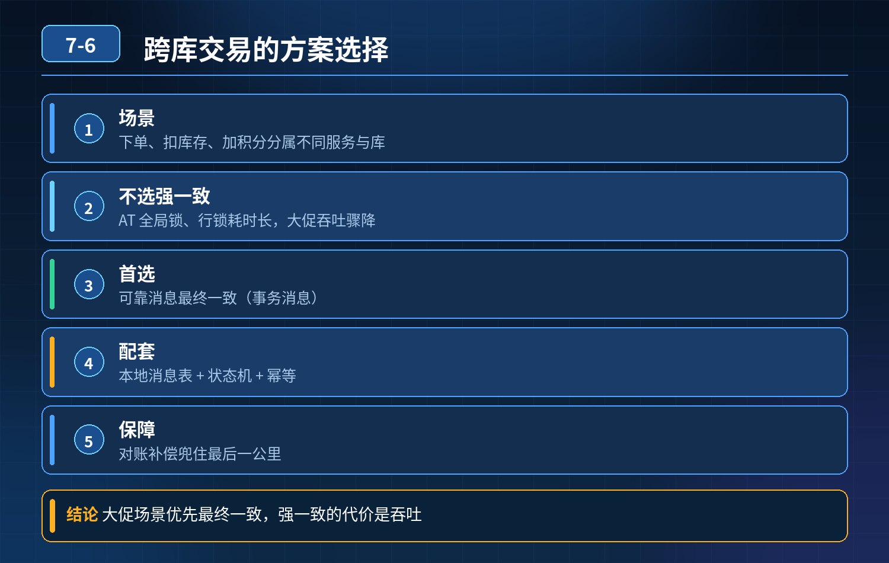

    跨库交易（下单扣库存+加积分）

## 第 07-6 题　跨库交易（下单扣库存+加积分）

**候选人浅层回答：** 背诵表面结论，没有深入到原理和线上场景。

## 核心拆解一句话结论

本题考察对底层原理和线上实战能力的综合理解，不能只停留在背结论。

## 场景说明

下单、扣库存、增加会员积分，分属不同服务、不同数据库，属于跨服务分布式业务；大促并发高，很容易出现一部分成功、一部分失败，数据不一致。 很多人上来直接说用 Seata AT 或者分布式锁做强一致，但忽略了性能、宕机、超时补偿这些工程痛点。

方案选型思路互联网电商大促，一般不优先选强一致方案（2PC / Seata AT）：

- Seata AT（无锁 TCC）：全局锁、行锁持有时间长，大促高并发场景容易锁等待、吞吐量下降；服务宕机、超时会触发回滚，有脏写风险；
- 分布式锁强一致：串行执行，直接压垮吞吐，大促场景基本不适合；业务更适合 可靠消息最终一致性（RocketMQ 事务消息） + 状态机 + 定时对账兜底，三层设计：第一层：主链路实时保障（事务消息 + 状态机）

1. 创建订单本地事务成功后，发送半消息；
2. 库存服务消费消息扣减库存，积分服务消费消息增加积分；
3. 每个消费节点自带幂等，用业务订单号防重复；
4. 订单主表使用状态机流转：待支付 → 库存扣减成功 → 积分发放成功 → 完成；只要中间某一步失败，消息进入重试队列反复重试；超过重试上限进死信。

第二层：补偿机制（异常兜底）

- 消息回查：Broker 长时间没有收到本地事务结果，主动回查订单状态；
- 补偿接口：库存、积分都要提供正向执行接口 + 补偿回滚接口；死信消息人工触发补偿。

第三层：日终对账（最后一道保险）每日定时对账任务：订单表、库存流水、积分流水三方核对； 找出订单已完成、但是库存没扣 / 积分没加上的异常数据，自动修复或者告警人工处理； 用来应对中间件宕机、消息丢失等极端链路故障。

一句话核心：实时链路用事务消息保障流转，幂等防止重复，日终对账兜底修复极端异常。 选型原则：不是选最强的一致性，而是选匹配业务容忍度、兼顾性能和成本的一致性。

各个方案对比（应对面试官连环追问）

5\. Seata AT：适合并发不高、对一致性要求高的内部系统；大促高并发不推荐；

6\. TCC：强控制、性能好，但是业务侵入极大，每个模块都要写Try/Confirm/Cancel，资金核心场景才用；

7\. 可靠消息（事务消息）：低侵入、高吞吐，电商订单、积分、库存这类绝大多数互联网业务首选；

8\. SAGA：长流程编排，适合订单履约多步骤长事务。

- 30

## 秒口述标准答案

跨库下单扣库存加积分这种场景，大促高并发不建议直接上 Seata AT 或者分布式锁强一致，锁和全局事务会拖垮吞吐量。我们采用可靠消息事务消息方案：下单成功发送事务消息，库存、积分服务各自消费，每个消费节点基于订单号做幂等，配合状态机控制流转；失败消息自动重试，多次失败进死信人工补偿；最后加上日终定时对账，三方流水核对，兜底处理消息丢失、服务宕机等极端异常，用最终一致性换取更高的并发能力。

面试官连环追问准备Q1：如果库存扣成功，积分一直加失败怎么办？ A：消息持续重试；达到重试阈值进死信；对账程序扫描出来，调用积分补偿接口补发积分，同时幂等保证不会重复加。

Q2：为什么不用 Seata？ A：Seata AT 会持有全局行锁，大促并发高的时候锁竞争激烈，吞吐上不去；而且协调者、TC 宕机、网络超时都会带来回滚复杂度；这个业务可以接受短暂不一致，优先选高吞吐的最终一致方案。

Q3：对账会不会延迟太久，用户投诉？ A：对账是兜底；主链路依靠消息重试优先实时完成；对账只捕获极低概率的极端故障，不是主流程。

## 连环追问要点整理

1. 底层核心原理是什么？为什么这么设计？
2. 线上出现相关故障如何快速止损、定位根因？
3. 高并发场景下有哪些坑点，性能、一致性、可用性如何权衡？

## 面试回答完整话术

  - **一句话结论**：本题考察对底层原理和线上实战能力的综合理解，不能只停留在背结论。
  - **场景说明**：下单、扣库存、增加会员积分，分属不同服务、不同数据库，属于跨服务分布式业务；大促并发高，很容易出现一部分成功、一部分失败，数据不一致。 很多人上来直接说用 Seata AT 或者分布式锁做强一致，但忽
  - **秒口述标准答案**：跨库下单扣库存加积分这种场景，大促高并发不建议直接上 Seata AT 或者分布式锁强一致，锁和全局事务会拖垮吞吐量。我们采用可靠消息事务消息方案：下单成功发送事务消息，库存、积分服务各自消费，每个消
  - **收尾**：线上问题按「先止损保可用性 → 再定位根因 → 最后从架构规范层面根治」三段论闭环。

## 追问：本题考察核心是什么？

###  高级工程师要分清：

1. **不能只停留在背结论**：要能回答「为什么这样设计、不这样会怎样、线上踩坑怎么排查」；
2. **具备止损→定位→根治三段论**：先止血保业务，再定位根因，最后从架构与规范层面根治；
3. **给出工程取舍**：性能、一致性、可用性三者权衡，说清代价与适用场景。

  核心思想：这道题考察原理理解 + 线上实战 + 架构思维，真正的工程答案是「现象 → 根因 → 止损 → 定位 → 根治」五段式闭环。

