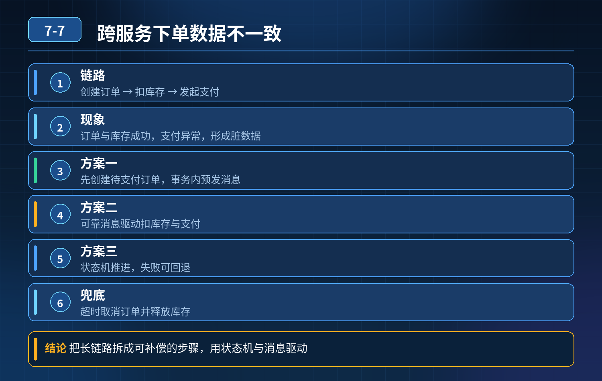

    跨服务下单、库存扣减、支付异常导致数据不一致

## 第 07-7 题　跨服务下单、库存扣减、支付异常导致数据不一致

**候选人浅层回答：** 背诵表面结论，没有深入到原理和线上场景。

## 核心拆解一句话结论

本题考察对底层原理和线上实战能力的综合理解，不能只停留在背结论。

## 场景复盘

下单链路：订单服务创建订单 → 库存服务扣减库存 → 支付服务发起支付。

<strong>现象：</strong>订单创建、库存扣减都成功，支付服务异常失败；库存扣了、订单待支付，形成脏数据、账务不平。 候选人只想到本地事务、整体回滚，不理解微服务下本地事务无法跨服务生效。

核心本质：本地事务只能在单一数据库生效；跨服务、跨库是独立资源，没有天然原子性，网络抖动、服务宕机、超时都会导致部分成功部分失败。强一致方案代价极高，业务主流是最终一致性。

## 三层防御体系

第一层：业务方案优先（首选，低侵入、高性能）—— TCC / 状态机 + 可靠消息（SAGA）主流落地是可靠消息 + 状态机 SAGA（订单库存支付场景最常用）：

1\. 订单服务先创建【待支付订单】，事务内预发可靠消息；

2\. 收到消息后执行扣库存；库存扣成功，再发起支付；

3\. 每个服务都要提供正向执行接口 + 补偿回滚接口：

1\. 支付失败 → 触发补偿：恢复库存、更新订单状态为支付失败；

2\. 每个步骤都记录业务状态，依靠状态流转驱动，不依赖锁阻塞；

3\. TCC 适合资金、强管控场景：Try（预留资源）→ Confirm（确认）→ Cancel（取消）；下单时 Try 冻结库存，支付成功 Confirm 扣减，支付失败 Cancel 解冻库存。

重点：冻结库存而不是直接扣减库存，就是为了方便补偿，避免题目里 “库存扣了回不来” 的问题。

- 不推荐一上来就用 2PC（XA）：同步阻塞、性能差、协调者单点，微服务大流量场景很少用。

第二层：兜底保障层（定时补偿 + 幂等），解决消息丢失、消息重复、补偿失败

4\. 所有操作必须幂等：防止消息重试重复扣库存、重复创建订单；

5\. 定时补偿任务（对账 Job）：扫描长时间卡在中间态的数据（订单待支付，但库存已扣），主动执行回滚补偿；

6\. 消息表 / 事务消息（RocketMQ 事务消息）保证消息一定发出，解决 “本地事务成功、消息没发出去” 的消息丢失问题。

第三层：监控与人工兜底（资金链路底线）

1. 监控中间态脏数据数量、补偿执行失败告警；
2. 日终对账：订单流水、库存流水、支付渠道三方对账；自动冲正失败的，人工复核处理；
3. 限流隔离：防止大量异常请求瞬间产生一堆脏数据。

- 30

## 秒口述标准答案

这个问题根源是本地事务无法跨服务保证原子性，不能直接像单库一样统一提交回滚。我们分三层防御：第一层优先采用 SAGA 状态机或者 TCC 模式，下单时优先冻结库存而不是直接扣减，支付成功才确认扣减，支付失败调用补偿接口释放库存；第二层依托事务消息保证消息可靠投递，加上接口幂等和定时补偿任务，自动扫描卡在中间状态的数据进行回滚；第三层做三方流水对账和告警，作为资金场景最后的兜底，避免资损。业务上优先最终一致，尽量不用 XA 这种强一致方案，牺牲性能换取一致性。

## 高频追问

Q：SAGA 和 TCC 怎么选？ A：简单补偿场景、补偿逻辑轻用 SAGA；资金、库存这类资源需要预先锁定、补偿逻辑严谨的用 TCC。 Q：补偿接口调用也失败怎么办？ A：补偿要支持重试幂等，同时记录补偿日志，多次失败后告警人工介入。 Q：为什么不能直接用 XA 分布式事务？ A：XA 两阶段提交是同步阻塞，协调者故障会锁住资源，吞吐量低，不适合电商下单这种高并发链路。

## 连环追问要点整理

1. 底层核心原理是什么？为什么这么设计？
2. 线上出现相关故障如何快速止损、定位根因？
3. 高并发场景下有哪些坑点，性能、一致性、可用性如何权衡？

## 面试回答完整话术

  - **一句话结论**：本题考察对底层原理和线上实战能力的综合理解，不能只停留在背结论。
  - **场景复盘**：下单链路：订单服务创建订单 → 库存服务扣减库存 → 支付服务发起支付。
  - **三层防御体系**：第一层：业务方案优先（首选，低侵入、高性能）—— TCC / 状态机 + 可靠消息（SAGA）主流落地是可靠消息 + 状态机 SAGA（订单库存支付场景最常用）：
  - **秒口述标准答案**：这个问题根源是本地事务无法跨服务保证原子性，不能直接像单库一样统一提交回滚。我们分三层防御：第一层优先采用 SAGA 状态机或者 TCC 模式，下单时优先冻结库存而不是直接扣减，支付成功才确认扣减，支
  - **高频追问**：Q：SAGA 和 TCC 怎么选？ A：简单补偿场景、补偿逻辑轻用 SAGA；资金、库存这类资源需要预先锁定、补偿逻辑严谨的用 TCC。 Q：补偿接口调用也失败怎么办？ A：补偿要支持重试幂等，同时记
  - **收尾**：线上问题按「先止损保可用性 → 再定位根因 → 最后从架构规范层面根治」三段论闭环。

## 追问：本题考察核心是什么？

###  高级工程师要分清：

1. **不能只停留在背结论**：要能回答「为什么这样设计、不这样会怎样、线上踩坑怎么排查」；
2. **具备止损→定位→根治三段论**：先止血保业务，再定位根因，最后从架构与规范层面根治；
3. **给出工程取舍**：性能、一致性、可用性三者权衡，说清代价与适用场景。

  核心思想：这道题考察原理理解 + 线上实战 + 架构思维，真正的工程答案是「现象 → 根因 → 止损 → 定位 → 根治」五段式闭环。

