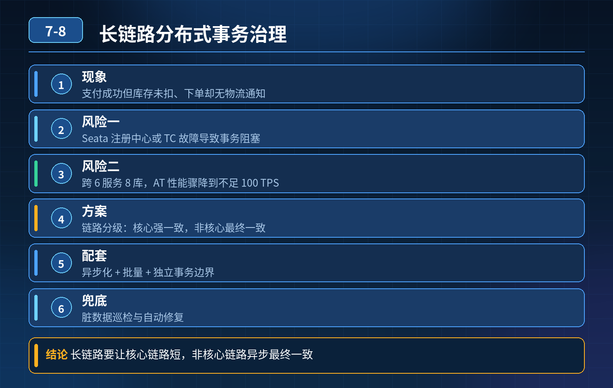

    支付成功库存未扣减、下单成功收不到物流通知；长链路、外部第三方、Seata 依赖故障、高并发锁瓶颈、脏数据排查修复整套方案

## 第 07-8 题　支付成功库存未扣减、下单成功收不到物流通知；长链路、外部第三方、Seata 依赖故障、高并发锁瓶颈、脏数据排查修复整套方案

**候选人浅层回答：** 加@GlobalTransactional 用 Seata AT 搞定分布式事务。

## 核心拆解一句话结论

本题考察对底层原理和线上实战能力的综合理解，不能只停留在背结论。

## 连续追问：

1. Seata 注册中心宕机，会不会造成事务阻塞、数据不一致？
2. 跨 6 服务 8 库的长订单链路，AT 性能掉到 TPS 不到 100 怎么办？
3. 微信支付、顺丰物流这类外部系统无法接入全局事务，如何保证最终一致？
4. 已经出现 “半成功” 脏数据，怎么快速定位、修复？
5. 秒杀高并发场景，AT 全局锁带来死锁、性能瓶颈怎么处理？
6. TCC 空回滚、悬挂是什么，怎么解决？

## 连环追问

1. Seata TC、注册中心分别挂掉，对一阶段已经提交的事务影响有什么区别？
2. AT 模式为什么长链路性能差？快照 undo_log、行锁、TC 轮询分别消耗在哪？
3. SAGA 和 TCC 的适用边界，什么时候不能混用？
4. 什么是空回滚、悬挂、幂等防防悬挂表设计思路？
5. 对账补偿任务怎么区分 “还没执行完” 和 “真的异常脏数据”，避免误修复？
6. 秒杀场景，为什么优先业务预扣 + 异步补偿，而不是全局分布式事务？

## 面试高分话术

只靠 @GlobalTransactional 的 AT 模式解决不了这些问题，AT本身有明确的边界。 首先，Seata 注册中心宕机，新事务无法注册开启；但已经完成一阶段提交的分支，本地事务已经提交，不会自动回滚，TC 恢复之后才会继续二阶段协调，这个间隙就会产生半成功脏数据。而且 AT 基于数据库行锁和 undo 快照，跨 6 服务 8 库的长链路，锁持有时间叠加、TC 协调开销变大，性能快速下跌，不适合长链路。

所以第一层要做链路拆分和选型：内部短链路简单更新可以用AT；库存资金核心链路用 TCC，同时处理空回滚、悬挂问题，通过一张事务控制表，拦截先到的 Cancel，防止后续 Try 执行；包含微信支付、顺丰这类外部系统的流程，不能接入 AT，要用 SAGA 状态机 + 可靠事务消息，异步编排，每一步状态落地，失败支持断点重试。秒杀等高并发场景直接放弃实时分布式事务，改成 Redis 预扣 + 异步落库 + 对账补偿，避开分布式锁的性能瓶颈。

第二层保证通信可靠，用本地消息表或者 RocketMQ 事务消息解决消息丢失，也就是本次支付成功库存没扣、物流通知收不到这类消息丢失故障；所有 Confirm、Cancel、消费接口基于全局流水号做幂等，避免重试带来重复操作。

第三层是故障排查和兜底。出现半成功脏数据，先拿全局 xid 串联全链路日志、TC 事务表、MQ 消费记录，定位是调用丢失、补偿卡住还是回调超时；区分还在重试窗口和终态异常数据，低风险自动补偿，资金高风险走人工工单。最后定时四方对账，作为所有一致性方案的兜底。

一句话：分布式一致性不是靠注解，而是靠链路拆分、模式匹配、可靠消息、状态持久、幂等补偿、对账兜底整套体系。

## 连环追问要点整理

1. 底层核心原理是什么？为什么这么设计？
2. 线上出现相关故障如何快速止损、定位根因？
3. 高并发场景下有哪些坑点，性能、一致性、可用性如何权衡？

## 面试回答完整话术

  - **一句话结论**：本题考察对底层原理和线上实战能力的综合理解，不能只停留在背结论。
  - **连续追问：**：Seata 注册中心宕机，会不会造成事务阻塞、数据不一致？
  - **连环追问**：Seata TC、注册中心分别挂掉，对一阶段已经提交的事务影响有什么区别？
  - **面试高分话术**：只靠 @GlobalTransactional 的 AT 模式解决不了这些问题，AT本身有明确的边界。 首先，Seata 注册中心宕机，新事务无法注册开启；但已经完成一阶段提交的分支，本地事务已经提交
  - **收尾**：线上问题按「先止损保可用性 → 再定位根因 → 最后从架构规范层面根治」三段论闭环。

## 追问：本题考察核心是什么？

###  高级工程师要分清：

1. **不能只停留在背结论**：要能回答「为什么这样设计、不这样会怎样、线上踩坑怎么排查」；
2. **具备止损→定位→根治三段论**：先止血保业务，再定位根因，最后从架构与规范层面根治；
3. **给出工程取舍**：性能、一致性、可用性三者权衡，说清代价与适用场景。

  核心思想：这道题考察原理理解 + 线上实战 + 架构思维，真正的工程答案是「现象 → 根因 → 止损 → 定位 → 根治」五段式闭环。

