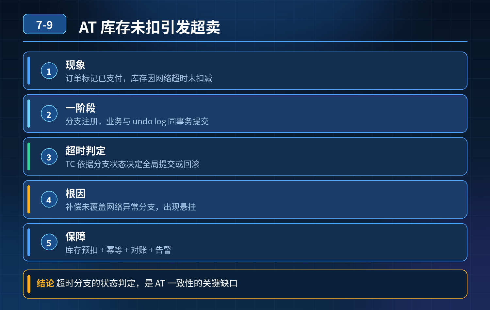

    Seata AT 下单链路，订单标记已支付成功，库存服务网络超时未扣减，引发超卖，问题根源与完整保障方案

## 第 07-9 题　Seata AT 下单链路，订单标记已支付成功，库存服务网络超时未扣减，引发超卖，问题根源与完整保障方案

**候选人浅层回答：** Seata 框架回滚异常。

## 核心拆解一句话结论

本题考察对底层原理和线上实战能力的综合理解，不能只停留在背结论。

## 连环追问

1. Seata AT 一阶段、二阶段的时序，库存分支调用超时，TC 是怎么判定全局事务结果的？
2. 为什么会出现【订单分支提交成功，库存分支超时，最终订单状态停在已支付】，AT 不是自动回滚吗？
3. AT 模式里，RPC 调用超时和业务异常，TC 处理逻辑有什么区别？
4. 库存这个热点资源，用 AT 会带来什么额外并发风险？
5. 如果改成 TCC，怎么从源头避免超卖？Try/Cancel 如何设计？
6. 对账系统怎么识别 “订单已支付、库存未扣减” 这类超卖脏数据？

## 面试高分话术

这个事故不是 Seata 框架坏了，而是混淆了业务异常和网络超时的区别。库存服务内部抛出库存不足这类业务异常，RM 会主动上报失败，TC 发起全局回滚；但单纯网络超时，TC 无法判断库存扣减到底执行成功还是失败，属于状态未知，AT 不会直接回滚，事务就悬停住。再加业务漏洞：支付回调提前把订单改成已支付，不等全局事务二阶段结果，最后出现订单已支付、库存没扣，引发超卖。合并回单体库只是回避微服务拆分，不是可靠方案。

第一层，我们要根据业务特点选型：普通流量可以用 AT，但严格管控订单状态流转，订单不能提前标记已支付，要等全局事务二阶段确认；库存热点、防超卖优先 TCC，Try 阶段只冻结库存，Confirm 才真实扣减，从源头保证没确认扣减前库存不会被释放售卖，规避超卖。如果业务能接受短暂不一致，使用 SAGA + 可靠消息异步推进。

第二层，所有库存操作接口基于 XID 做幂等，避免 TC 重试带来重复扣减；监控 TC 里面状态长时间未知的分支及时告警；支付回调只落支付流水，订单已支付状态，必须等库存处理完成再变更，堵住状态撕裂漏洞。

第三层兜底，定时对账，匹配已支付订单和库存扣减流水，扫描这类脏数据；库存充足自动补扣，库存不足走人工售后工单。分布式一致性的核心不是框架自动回滚，而是识别网络超时这种模糊状态、做好资源冻结、状态串行流转，最后对账兜底。

## 连环追问要点整理

1. 底层核心原理是什么？为什么这么设计？
2. 线上出现相关故障如何快速止损、定位根因？
3. 高并发场景下有哪些坑点，性能、一致性、可用性如何权衡？

## 面试回答完整话术

  - **一句话结论**：本题考察对底层原理和线上实战能力的综合理解，不能只停留在背结论。
  - **连环追问**：Seata AT 一阶段、二阶段的时序，库存分支调用超时，TC 是怎么判定全局事务结果的？
  - **面试高分话术**：这个事故不是 Seata 框架坏了，而是混淆了业务异常和网络超时的区别。库存服务内部抛出库存不足这类业务异常，RM 会主动上报失败，TC 发起全局回滚；但单纯网络超时，TC 无法判断库存扣减到底执行成
  - **收尾**：线上问题按「先止损保可用性 → 再定位根因 → 最后从架构规范层面根治」三段论闭环。

## 追问：本题考察核心是什么？

###  高级工程师要分清：

1. **不能只停留在背结论**：要能回答「为什么这样设计、不这样会怎样、线上踩坑怎么排查」；
2. **具备止损→定位→根治三段论**：先止血保业务，再定位根因，最后从架构与规范层面根治；
3. **给出工程取舍**：性能、一致性、可用性三者权衡，说清代价与适用场景。

  核心思想：这道题考察原理理解 + 线上实战 + 架构思维，真正的工程答案是「现象 → 根因 → 止损 → 定位 → 根治」五段式闭环。

