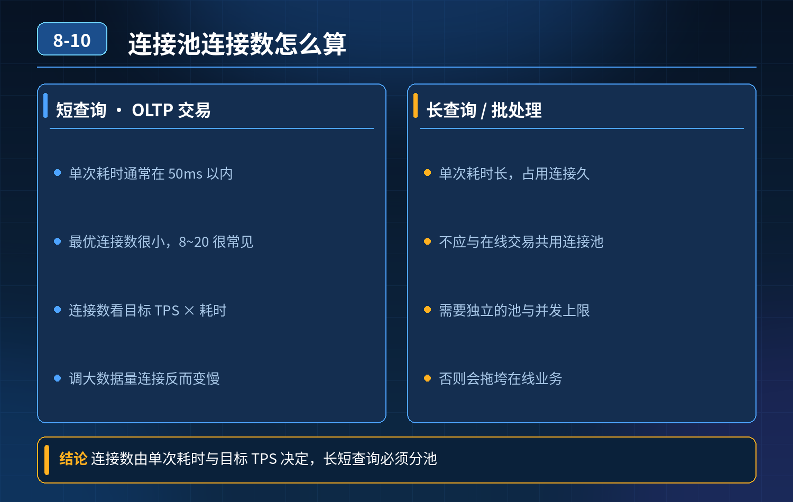

    数据库连接池核心连接数怎么计算

## 第 08-10 题　数据库连接池核心连接数怎么计算

**候选人浅层回答：** 背诵表面结论，没有深入到原理和线上场景。

## 核心拆解一句话结论

本题考察对底层原理和线上实战能力的综合理解，不能只停留在背结论。

## 场景复盘

面试官提问：连接池核心 10、最大 20 是怎么来的？依据是什么？SQL 长短查询怎么判断？调到 50 吞吐量会不会翻倍？连接数太大有什么副作用？ 候选人只会背经验值，没有推导逻辑。

核心认知：连接池不是越大越好，MySQL 的连接是昂贵资源；最优连接数和单 SQL 执行时长、目标 TPS、数据库 CPU 能力强相关，不是固定 10/20。

## 三层体系

第一层：理论计算公式（IO 密集型数据库场景）经典公式： 最优连接数 ≈ TPS × SQL 平均执行时长(秒) 举例： 目标 TPS=200，单条 SQL 平均耗时 20ms（0.02s） 200 × 0.02 = 4，理论 4 个连接就可以扛住。 如果是慢查询，单 SQL 耗时 200ms，同样 TPS200：200 ×

0\. 2 = 40。

理解：一条连接同一时刻只能跑一条 SQL；SQL 等待时间越长，需要更多连接来并发 “填住等待空隙”。 短查询（ms 级）：不需要很多连接；长查询（几百 ms+）才需要更大连接池。

区分业务：

- 短查询（OLTP 交易）：平均耗时 \< 50ms，最优连接数一般很小，8~20 区间很常见；
- 长查询（报表、统计、大 join）：耗时几百 ms~ 秒级，需要更多连接，但长查询本身应该隔离到从库，不能和核心交易共用连接池。

第二层：上限约束（为什么不能无脑加大，拉到 50 吞吐量不会翻倍）MySQL 单实例有天然瓶颈：

1. 每个连接都有内存开销（线程栈、会话缓存、事务上下文），连接越多内存占用越高；
2. 连接过多，CPU 会大量消耗在线程上下文切换、锁竞争、事务调度，超过临界点后，连接越多，吞吐量反而下降，响应时间暴涨；
3. MySQL 全局参数 max_connections 是数据库侧总上限，要预留连接给 DBA运维、备份、监控，不能全部给业务。

所以：连接池最大连接数，要同时满足两个约束：业务公式算出的值、数据库能承载的安全上限。 一个经验结论：MySQL 单库，稳定 OLTP 场景，通常并发连接超过 30~60 之后收益快速衰减，很多时候加到 50 不仅不翻倍，还会雪崩。

第三层：工程落地配置策略（HikariCP 为主，SpringBoot 默认）HikariCP 的核心两个参数：

- minimumIdle（空闲保活，核心连接）：不建议盲目设置很大，Hikari 推荐直接设和 maximumPoolSize 一致；很多人设置 10 只是保活，不是并发上限。
- maximumPoolSize（最大连接）：按压测标定，而不是公式直接写死；公式只是初始参考值，最终以压测拐点为准。

配套观测指标（判断是长查询还是短查询、连接池是否合理）：

1\. 连接池排队等待时长（最关键！如果大量线程排队拿连接，说明池子偏小）

2\. 数据库端：Threads_running（正在运行的活跃连接，不是 sleep 连接）

3\. 慢查询日志、平均 SQL 耗时、99 分位耗时

4\. CPU、iowait落地流程：

1\. 先统计线上 SQL 平均耗时、目标 TPS，用公式算出初始值；

2\. 压测爬坡，找到吞吐量拐点；拐点就是最优最大连接；

3\. 核心交易和报表查询隔离连接池、隔离库，长查询绝对不能挤占交易连接；

4\. 监控排队告警，动态调整，不要写死。

- 30

## 秒口述标准答案

连接数不能直接抄 10、20。理论上可以用 TPS 乘以单 SQL 平均执行时长估算初始值；短查询耗时低，需要的连接很少，长查询才需要更多连接。但连接数有天花板，超过最优值之后，线程上下文切换、锁竞争加剧，吞吐量不会跟着翻倍，甚至下降，还会消耗大量数据库内存。最终不能只靠公式，要压测找到吞吐量拐点；同时要区分长短查询，报表长查询单独隔离，不和核心交易共用连接池；日常看连接池排队时间、数据库活跃运行线程来判断配置是否合理。

## 高频追问

Q：HikariCP 为什么不建议把 minimumIdle 设置很大？ A：Hikari 设计思想是尽量少空闲连接，minimumIdle 大了会维持一堆闲置连接占用数据库资源，推荐 minimumIdle = maximumPoolSize。 Q：Threads_connected 和 Threads_running 的区别？ A：Threads_connected 是所有已经建立的连接（大量 sleep 空闲）；Threads_running 是正在执行 SQL 的活跃连接，这个才是压力指标。 Q：如果看到连接池排队很久，加大 max 就一定解决吗？ A：不一定。排队根源如果是慢 SQL 锁等待、数据库 IO 瓶颈，加大连接只会雪上加霜

## 连环追问要点整理

1. 底层核心原理是什么？为什么这么设计？
2. 线上出现相关故障如何快速止损、定位根因？
3. 高并发场景下有哪些坑点，性能、一致性、可用性如何权衡？

## 面试回答完整话术

  - **一句话结论**：本题考察对底层原理和线上实战能力的综合理解，不能只停留在背结论。
  - **场景复盘**：核心认知：连接池不是越大越好，MySQL 的连接是昂贵资源；最优连接数和单 SQL 执行时长、目标 TPS、数据库 CPU 能力强相关，不是固定 10/20。
  - **三层体系**：第一层：理论计算公式（IO 密集型数据库场景）经典公式： 最优连接数 ≈ TPS × SQL 平均执行时长(秒) 举例： 目标 TPS=200，单条 SQL 平均耗时 20ms（0.02s） 200 
  - **秒口述标准答案**：连接数不能直接抄 10、20。理论上可以用 TPS 乘以单 SQL 平均执行时长估算初始值；短查询耗时低，需要的连接很少，长查询才需要更多连接。但连接数有天花板，超过最优值之后，线程上下文切换、锁竞争
  - **高频追问**：Q：HikariCP 为什么不建议把 minimumIdle 设置很大？ A：Hikari 设计思想是尽量少空闲连接，minimumIdle 大了会维持一堆闲置连接占用数据库资源，推荐 minimum
  - **收尾**：线上问题按「先止损保可用性 → 再定位根因 → 最后从架构规范层面根治」三段论闭环。

## 追问：本题考察核心是什么？

###  高级工程师要分清：

1. **不能只停留在背结论**：要能回答「为什么这样设计、不这样会怎样、线上踩坑怎么排查」；
2. **具备止损→定位→根治三段论**：先止血保业务，再定位根因，最后从架构与规范层面根治；
3. **给出工程取舍**：性能、一致性、可用性三者权衡，说清代价与适用场景。

  核心思想：这道题考察原理理解 + 线上实战 + 架构思维，真正的工程答案是「现象 → 根因 → 止损 → 定位 → 根治」五段式闭环。

