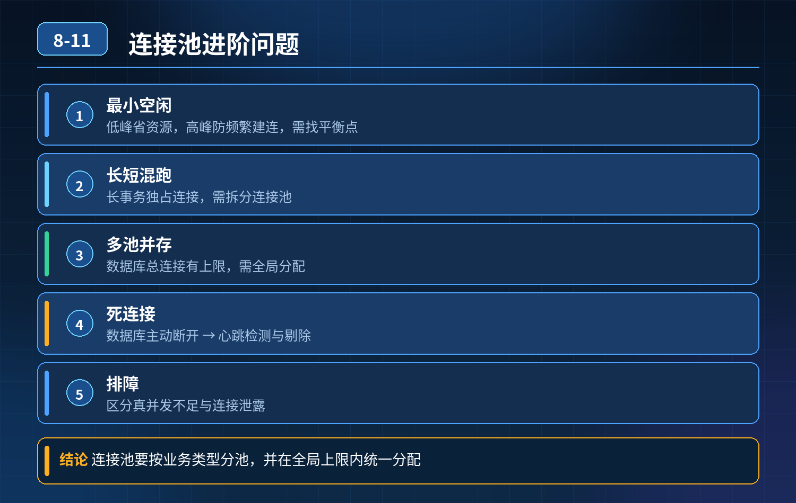

    连接池进阶面试题

## 第 08-11 题　连接池进阶面试题

**候选人浅层回答：** 背诵表面结论，没有深入到原理和线上场景。

## 核心拆解一句话结论

本题考察对底层原理和线上实战能力的综合理解，不能只停留在背结论。

## 一、空闲连接平衡点（minimumIdle 的取舍）

HikariCP 的 minimumIdle 不是固定一个值，没有万能数字，是根据流量形态选择模式 两种模式：

1. 固定池模式（大促、核心链路、流量持续稳定） minimumIdle =

- maximumPoolSize，idleTimeout = 0，关闭空闲回收。

优点：不会频繁创

- ❌建销毁连接，RT 稳定，没有建连尖刺； 缺点：低峰期连接一直占用 DB 连接资源； 适合：下单、支付核心写链路，流量持续高，业务稳定性优先，愿意付出连接资源成本。

2\. 弹性伸缩模式（昼夜波动大、非核心查询服务） 设置合理 minimumIdle（偏小，

- 比如 5~10），开启 idleTimeout，低峰回收空闲连接。

优点：低峰释放

- ❌DB 连接，给别的服务； 缺点：流量突然抬升时，会临时新建连接，短暂抖动； 配套优化：搭配预热、限流削峰，避免突发流量瞬间打爆。

平衡点思路： 优先压测，拿到业务常态 QPS、99 分位连接持有时长，算出常态并发水位；minimumIdle \>= 常态并发水位，预留少量缓冲； 突发尖刺靠 maxPoolSize 兜底，而不是靠 minimumIdle 撑尖刺；尖刺同时配合限流，不依赖连接池扩容扛洪峰。

## 二、长短事务混合，长事务霸占连接，短事务饥饿（高频高分点）

4\. 不要单纯调大 maxPoolSize，治标不治本，还会把 DB 总连接上限吃掉，加剧锁竞争。 方案分层：

1\. 【最优方案：资源隔离，按事务类型拆分连接池】 长事务、短事务分开两套连接池。短事务池子 max 可以小一点、获取连接超时短，优先保障短事务；长事务单独一个独立池，并且给这个池子设置严格的限流、事务超时，防止它无限抢占资源。

但是面试官追问来了：池子多了，DB 总连接会上涨，这里就要引出全局配额管控。

1. 【其次：业务治理，消灭不必要的长事务】 根源优先：把 RPC、外部调用移出事务；大事务拆小；长事务加单独告警、拦截，上线评审卡点。
2. 【补充：池内排队隔离，信号量隔离（备选方案，不想拆多个池的时候）】 同一个连接池之上，在业务层加业务维度信号量：长事务请求单独一个信号量配额，限制同时运行的长事务数量，避免长事务把全部连接吃光。短事务不被长事务排队挤压。

一句话：连接池是底层资源，它本身不区分请求优先级；要在业务层做配额隔离、优先级控制。Hikari/Druid 本身没有内置排队优先级。

## 三、多个连接池，数据库全局连接上限怎么平衡？

4\. MySQL 的 max_connections 是全局硬上限，所有应用、所有实例、所有连接池加起来不能超限。 治理思路：全局配额分配 + 动态水位管控

1\. 给 MySQL 实例做连接配额预算： 总可用连接 = max_connections - 预留运维连接（DBA、监控、后台，一般预留 20~50）； 然后按服务优先级分配配额：核心订单、支付分配高配额，报表、后台导出、统计任务给很低配额；

2\. 每个服务、每个连接池设置自己 maxPoolSize，所有池 max 之和 ≤ 分配给它的配额；

3\. 不同环境隔离：在线业务库和离线统计库分开，离线报表不要蹭主库连接；

4\. 动态调整：配置中心支持热改 maxPoolSize，大促前把配额向核心链路倾斜，低峰期回收给离线任务；

5\. 红线：禁止各个业务团队自己随便调大连接池，需要 DBA 侧全局审批。

## 四、数据库主动断开，连接池残留死连接（无效连接、僵死连接）

MySQL wait_timeout 超时之后，服务端单方面断开连接，但应用连接池不知道，池子里的连接变成死连接，拿出来执行 SQL 才抛异常。 Hikari 的方案（重点）：

1\. maxLifetime：连接最大存活时间，必须小于 MySQL wait_timeout；MySQL默认 wait_timeout=8 小时，maxLifetime 一般设 30~60 分钟；Hikari 自带

2\. 5% 随机偏移，防止批量同时过期；到期主动销毁重建，从源头避免僵死连接。

2\. 测试连接：connectionTestQuery / validationTimeout Hikari 默认不需要配置 connectionTestQuery，它会用 JDBC4 的 isValid () 校验；

- validationTimeout：校验超时时间；
- 校验时机：拿连接出来使用前校验（很多人误以为是空闲时轮询心跳）；

<strong>注意：</strong>不要配 idleTest，空闲轮询心跳会增加 DB 压力，Hikari 设计理念是取出时校验。 Druid 才支持空闲心跳检测，二者设计思路不一样。

1. 兜底：捕获 SQL 异常，识别通讯异常，触发连接丢弃。

## 五、报错拿不到连接：快速区分【真并发不足】vs【连接泄露】

先看 Hikari 埋点指标：

- pending（等待队列长度）持续上涨；
- active 活跃连接： 真并发不足：
- QPS 上涨 → active 慢慢打满；QPS 回
- 落之后，active 跟着回落；流量降下来池子可以自动释放； 连接泄露：哪怕 QPS 降到 0，active 连接只涨不跌，不会回落； 配套手段：

1. 开启 leakDetectionThreshold，比如 2000ms，泄露会打印线程栈，直接定位代码；
2. 线程 dump：大量线程卡在 getConnection() 是排队；拿到连接之后卡住才是 SQL / 锁；
3. DB 侧 show processlist 辅助核对，看会话是不是还在活跃执行。

## 连环追问要点整理

1. 底层核心原理是什么？为什么这么设计？
2. 线上出现相关故障如何快速止损、定位根因？
3. 高并发场景下有哪些坑点，性能、一致性、可用性如何权衡？

## 面试回答完整话术

  - **一句话结论**：本题考察对底层原理和线上实战能力的综合理解，不能只停留在背结论。
  - **一、空闲连接平衡点（minimumIdle 的取舍）**：HikariCP 的 minimumIdle 不是固定一个值，没有万能数字，是根据流量形态选择模式 两种模式：
  - **二、长短事务混合，长事务霸占连接，短事务饥饿（高频高分点）**：4\. 不要单纯调大 maxPoolSize，治标不治本，还会把 DB 总连接上限吃掉，加剧锁竞争。 方案分层：
  - **三、多个连接池，数据库全局连接上限怎么平衡？**：4\. MySQL 的 max_connections 是全局硬上限，所有应用、所有实例、所有连接池加起来不能超限。 治理思路：全局配额分配 + 动态水位管控
  - **四、数据库主动断开，连接池残留死连接（无效连接、僵死连接）**：MySQL wait_timeout 超时之后，服务端单方面断开连接，但应用连接池不知道，池子里的连接变成死连接，拿出来执行 SQL 才抛异常。 Hikari 的方案（重点）：
  - **五、报错拿不到连接：快速区分【真并发不足】vs【连接泄露】**：pending（等待队列长度）持续上涨；
  - **收尾**：线上问题按「先止损保可用性 → 再定位根因 → 最后从架构规范层面根治」三段论闭环。

## 追问：本题考察核心是什么？

###  高级工程师要分清：

1. **不能只停留在背结论**：要能回答「为什么这样设计、不这样会怎样、线上踩坑怎么排查」；
2. **具备止损→定位→根治三段论**：先止血保业务，再定位根因，最后从架构与规范层面根治；
3. **给出工程取舍**：性能、一致性、可用性三者权衡，说清代价与适用场景。

  核心思想：这道题考察原理理解 + 线上实战 + 架构思维，真正的工程答案是「现象 → 根因 → 止损 → 定位 → 根治」五段式闭环。

