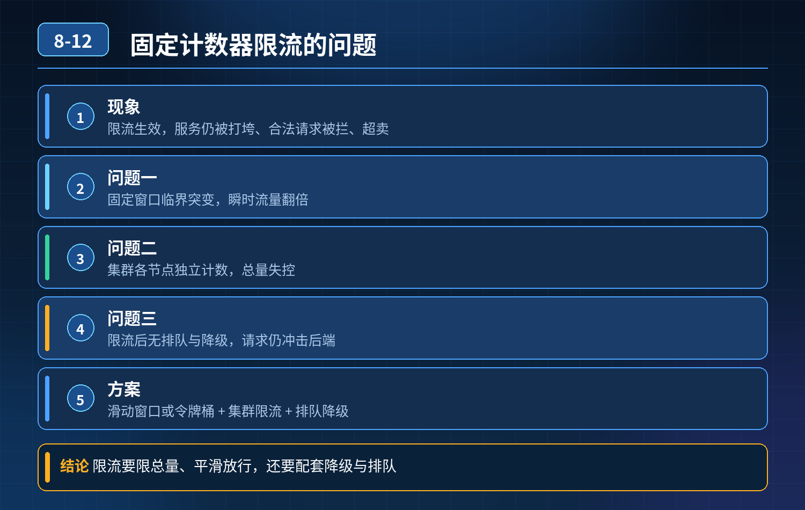

    秒杀 Redis 固定计数器限流，限流生效但服务打垮、合法请求被拦截、出现超卖

## 第 08-12 题　秒杀 Redis 固定计数器限流，限流生效但服务打垮、合法请求被拦截、出现超卖

**举例说明：**计数器限流窗口为每秒 1000 次。第 0.99 秒放进 1000 次请求，第 1.01 秒又放进 1000 次，0.02 秒内实际涌入 2000 次请求，后端瞬间被打垮；换成令牌桶按固定速率放行，就不会出现这种临界突变。

**候选人浅层回答：** Redis 做计数器 + 令牌桶，设置每秒请求数限制就可以限流。

## 核心拆解一句话结论

<strong>核心思想：</strong>限流不是一个 Redis 计数器就能搞定的功能，是流量识别、配额隔离、削峰缓冲、柔性返回、动态调控组成的流量治理体系。

## 连环追问

秒杀场景，Redis 计数器限制每秒 1000 请求；限流规则生效，但瞬间涌入流量后服务超时雪崩，大量正常用户被拦截，还出现超卖。

1. 问题根源在哪？
2. 怎么设计限流策略，既能挡恶意流量保护服务，又兼顾合法用户体验，避免限流引发故障？
3. 只靠计数器、固定阈值够用吗？

## 参考答案

事故根因拆解这个案例踩了限流非常典型的一堆坑：
1. 简单全局固定计数器，没有分布式集群分摊 多实例部署时，如果只做全局固定QPS，或者没做单机配额，很容易出现流量倾斜；如果是单机阈值，多机叠加后总流量远超预期容量。
2. 限流只做了 “拦截”，没有排队、削峰，流量还是瞬间冲击后端 计数器 / 令牌桶只是拒绝请求，不做缓冲；秒杀瞬间脉冲流量，Redis 判断放行的 1000 个请求同时打到业务服务、数据库，并发压垮下游。限流≠削峰。
3. 没有流量分级、用户分层，一刀切拦截 老用户、会员、普通用户、爬虫恶意请求同等对待，峰值来了合法优质用户和刷量请求一起被拦，体验极差。
4. 限流和库存扣减逻辑解耦，限流不代表不会超卖 限流只是控制进入接口的请求量；限流通过之后，库存扣减本身没有原子控制、没有预扣锁，依然会超卖。
限流是流量防护，不是库存防超卖方案，很多人混淆二者。
5\. 限流触发后缺少柔性兜底 直接返回报错，大量请求失败，重试风暴又来了，二次冲击服务。
6\. 阈值拍脑袋设置，没有基于单机压测容量计算 阈值不是看业务想放多少人，而是看服务、DB、Redis 链路最大稳定承载上限。
三层限流防御体系第一层：分层限流 + 多维度配额，拒绝一刀切限流要按位置、维度、优先级拆分，不是只在服务内做一层 Redis 限流
1. 分层位置（由外到内） 网关层粗粒度限流（第一道闸门）→ 应用层细粒度接口限流 → 资源层（Redis/DB）保护
2. 限流维度 全局总配额、单机配额、用户 ID、IP、渠道、用户等级；
3. 流量分级 高优先级（会员、老用户）预留配额；低优先级（匿名、高频刷请求）严格限制；恶意 IP 直接拉黑。
算法选型：
- 令牌桶：允许一定突发，适合秒杀这种允许短暂脉冲的场景；
- 漏桶：匀速流出，适合消息、对外接口，不适合秒杀；
- 固定窗口计数器：容易窗口临界点突刺（临界毛刺问题），秒杀不推荐；滑动窗口计数器更稳妥。
第二层：削峰排队，把脉冲流量摊平（秒杀重点）限流只是 “挡”，削峰才是保护后端的关键。 放行的请求依然是瞬时并发，数据库扛不住：
- 引入消息队列做削峰：请求先入 MQ，异步排队消费，后端按自身处理能力匀速拉取；前端返回排队中，而不是同步等待下单结果；
- 本地排队 + Redis 分布式排队结合，控制同时进入扣库存逻辑的并发；
- 注意：排队也要设置超时，防止队列无限堆积。
第三层：限流联动降级兜底 + 和库存机制配合
4\. 柔性降级兜底 被限流不要直接返回 500，返回友好提示：“活动火爆，请稍后重试”，引导用户不要疯狂刷新重试，避免重试风暴；
5\. 限流 ≠ 库存控制 限流负责控制进入接口的流量；防超卖靠Redis 预扣库存 +分布式锁 / 库存版本号，两者必须分开设计，不能混淆；
6\. 动态阈值，而不是固定值 根据服务 CPU、线程池、Redis 耗时动态调整配额，系统负载高的时候自动收紧阈值，负载回落自动放开，比写死 1000 / 秒更健壮。
补充避坑点
1. 分布式限流要注意 Redis 的性能瓶颈，大量请求去 Redis 判断限流本身也会把Redis 打满；可以本地 Sentinel 令牌桶做本地初限，Redis 做全局总控，减少 Redis 压力；
2. 时钟问题：分布式节点时间不一致会影响滑动窗口；
3. 限流规则要支持热更新，大促期间可以动态调配额，不用重启服务。
<strong>追问：</strong>本题考察核心是什么？
<strong>参考答案：</strong>初级开发只会实现一个限流算法，把限流等同于 “设置 QPS 拦截请求”。高阶工程师明白：
1. 限流的目标不是拦住多少人，是保护下游资源稳定，同时尽量保障核心用户体验；
2. 分清限流、削峰、库存防超卖是三件独立事情，不能混为一谈；
3. 理解固定窗口计数器的临界毛刺缺陷，知道不同限流算法的适用场景；
4. 懂得多层防护：网关、本地、分布式全局、排队削峰、柔性兜底一套组合；
5. 阈值不是业务目标，是容量上限，必须基于压测得出。

## 连环追问要点整理

1. 底层核心原理是什么？为什么这么设计？
2. 线上出现相关故障如何快速止损、定位根因？
3. 高并发场景下有哪些坑点，性能、一致性、可用性如何权衡？

## 面试回答完整话术

  - **场景举例**：计数器限流窗口为每秒 1000 次。第 0.99 秒放进 1000 次请求，第 1.01 秒又放进 1000 次，0.02 秒内实际涌入 2000 次请求，后端瞬间被打垮；换成令牌
  - **一句话结论**：<strong>核心思想：</strong>限流不是一个 Redis 计数器就能搞定的功能，是流量识别、配额隔离、削峰缓冲、柔性返回、动态调控组成的流量治理体系。
  - **连环追问**：秒杀场景，Redis 计数器限制每秒 1000 请求；限流规则生效，但瞬间涌入流量后服务超时雪崩，大量正常用户被拦截，还出现超卖。
  - **参考答案**：事故根因拆解这个案例踩了限流非常典型的一堆坑：
  - **收尾**：线上问题按「先止损保可用性 → 再定位根因 → 最后从架构规范层面根治」三段论闭环。

## 追问：本题考察核心是什么？

###  高级工程师要分清：

1. **不能只停留在背结论**：要能回答「为什么这样设计、不这样会怎样、线上踩坑怎么排查」；
2. **具备止损→定位→根治三段论**：先止血保业务，再定位根因，最后从架构与规范层面根治；
3. **给出工程取舍**：性能、一致性、可用性三者权衡，说清代价与适用场景。

  核心思想：这道题考察原理理解 + 线上实战 + 架构思维，真正的工程答案是「现象 → 根因 → 止损 → 定位 → 根治」五段式闭环。

