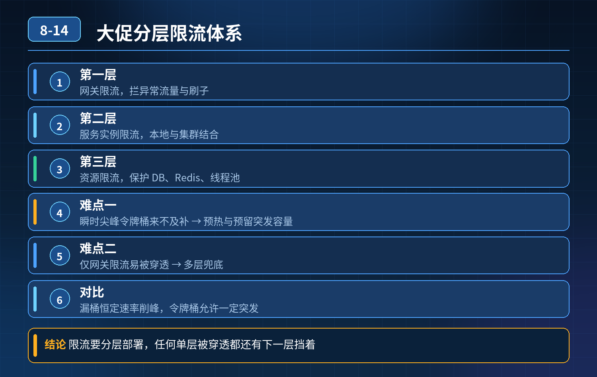

    大促分层限流体系设计，网关+多实例集群、流量尖峰、Redis 故障、差异化限流、漏桶/令牌桶对比、多层防护防雪崩

## 第 08-14 题　大促分层限流体系设计，网关+多实例集群、流量尖峰、Redis 故障、差异化限流、漏桶/令牌桶对比、多层防护防雪崩

**候选人浅层回答：** 背诵表面结论，没有深入到原理和线上场景。

## 核心拆解一句话结论

本题考察对底层原理和线上实战能力的综合理解，不能只停留在背结论。

## 面试官连环追问：

1. 多网关集群只用本地限流，阈值不准、总量失控怎么解决？
2. 瞬时流量尖峰，令牌桶来不及生成令牌，正常请求被误杀怎么办？
3. 只做网关限流，网关规则 bug，流量穿透打挂业务服务，如何多层防护？
4. 普通用户、VIP 付费用户差异化限流怎么实现？
5. 漏桶算法优缺点，和令牌桶对比？
6. Redis 故障，分布式限流失效，兜底方案？

## 一、先梳理主流限流算法对比

- 令牌桶 Token Bucket：按固定速率放令牌，桶有最大容量。可以允许一定的流量突刺，适合大促秒杀这种突发流量场景；Gateway、Sentinel 分布式限流最常用。
- 漏桶 Leaky Bucket：请求先入桶排队，以固定速率流出。流量强制平滑，不允许突刺；适合对外第三方接口、消息消费，不适合秒杀活动，瞬间洪峰直接拒绝大量正常流量。

一句话区分：令牌桶是 “能扛一波尖峰”；漏桶是 “强制匀速，削峰不允许爆发”。

## 二、集群限流不准（多网关实例本地限流）问题

- 单机本地限流：每个实例独立计数，总 QPS = 实例数 \* 单机阈值，流量负载不均时总量失控。
- 方案分两类：

1. 分布式限流（Redis + 令牌桶 / 滑动窗口）：全网关共享 Redis 计数，统计全集群总 QPS；适合按接口、按 IP、按用户维度做全局配额。 缺点：有 Redis 网络开销、Redis 故障风险、存在少量时间窗口内的超量（竞争）。
2. 本地限流 + 配额分摊（Sentinel 集群模式）：集群总阈值，由控制台动态分摊到每一台网关实例，实例本地计数，不需要频繁访问 Redis；兼顾性能和集群总量控制，生产用得很多。

注意：纯 Redis 分布式限流也不是绝对精准，存在时钟、网络延迟带来的误差，一般预留安全水位。

## 三、瞬时流量尖峰，令牌桶误杀正常请求

令牌桶的桶容量就是用来吸收突刺的，优化手段：

1. 合理设置桶容量（burst）：根据历史大促峰值，桶容量承载预期瞬时尖峰；生成速率是平稳持续流量上限。
2. 预热令牌桶：大促开始前，提前预填充令牌，避免活动刚开始桶是空的，第一波流量直接被打死。
3. 区分预热期、正式期两套阈值；活动开启瞬间临时放大 burst，后续回落。
4. 结合排队：短时间流量超过桶容量时，加入短时排队，而不是直接拒绝；排队设置最大等待超时，防止堆积。

漏桶在这里就不适合：没有 burst 能力，尖峰直接拒绝，用户体验差。

## 四、多层限流防护体系（从外到内，层层兜底，避免单点限流失效）

从外层到内层，逐级拦截，形成防护链，防止一层失效全量穿透：

1. 第一层：接入层（Nginx/CDN） 防护：IP 黑名单、CC 攻击防护、单 IP 单机限流、连接数限流；拦截爬虫、恶意刷量；这一层是第一道屏障，不做复杂业务维度。
2. 第二层：API 网关层（Spring Cloud Gateway / Kong / APISIX）【核心限流层】分布式 / 集群分摊限流：接口维度、用户 ID、IP、设备号；做差异化限流；大促主要在这里挡流量。
3. 第三层：业务应用层（Sentinel 本地限流）【兜底防线，重中之重】 哪怕网关限流 bug、规则配置错误、网关全部绕过，每个微服务实例自带本地限流 + 熔断降级；每个服务自己保护自己。 规则：按服务、接口设置最大承载水位，超过直接快速失败、返回降级页，不继续调用下游 DB / 其他 RPC。
4. 第四层：资源层（数据库、MQ） DB 连接池上限、MQ 消费者并发数限制，最底层资源锁死保护。

<strong>核心思想：</strong>每一层都有独立限流，上层挡大部分流量，下层是保命兜底，不把希望只放在网关。

## 连环追问要点整理

1. 底层核心原理是什么？为什么这么设计？
2. 线上出现相关故障如何快速止损、定位根因？
3. 高并发场景下有哪些坑点，性能、一致性、可用性如何权衡？

## 面试回答完整话术

  - **一句话结论**：本题考察对底层原理和线上实战能力的综合理解，不能只停留在背结论。
  - **面试官连环追问：**：多网关集群只用本地限流，阈值不准、总量失控怎么解决？
  - **一、先梳理主流限流算法对比**：令牌桶 Token Bucket：按固定速率放令牌，桶有最大容量。可以允许一定的流量突刺，适合大促秒杀这种突发流量场景；Gateway、Sentinel 分布式限流最常用。
  - **二、集群限流不准（多网关实例本地限流）问题**：单机本地限流：每个实例独立计数，总 QPS = 实例数 \* 单机阈值，流量负载不均时总量失控。
  - **三、瞬时流量尖峰，令牌桶误杀正常请求**：令牌桶的桶容量就是用来吸收突刺的，优化手段：
  - **四、多层限流防护体系（从外到内，层层兜底，避免单点限流失效）**：从外层到内层，逐级拦截，形成防护链，防止一层失效全量穿透：
  - **收尾**：线上问题按「先止损保可用性 → 再定位根因 → 最后从架构规范层面根治」三段论闭环。

## 追问：本题考察核心是什么？

###  高级工程师要分清：

1. **不能只停留在背结论**：要能回答「为什么这样设计、不这样会怎样、线上踩坑怎么排查」；
2. **具备止损→定位→根治三段论**：先止血保业务，再定位根因，最后从架构与规范层面根治；
3. **给出工程取舍**：性能、一致性、可用性三者权衡，说清代价与适用场景。

  核心思想：这道题考察原理理解 + 线上实战 + 架构思维，真正的工程答案是「现象 → 根因 → 止损 → 定位 → 根治」五段式闭环。

